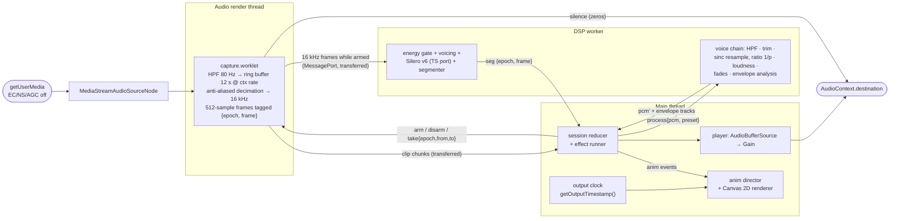
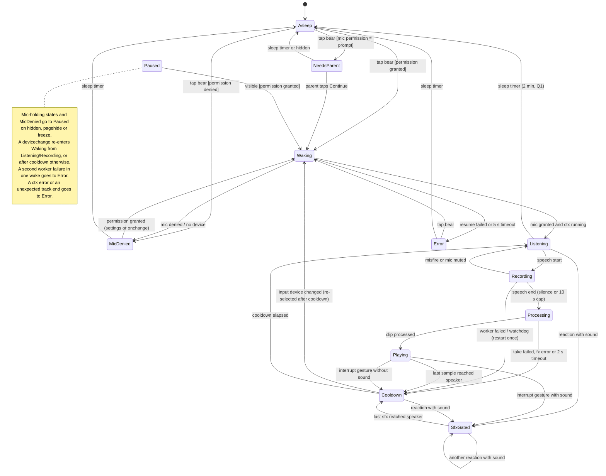
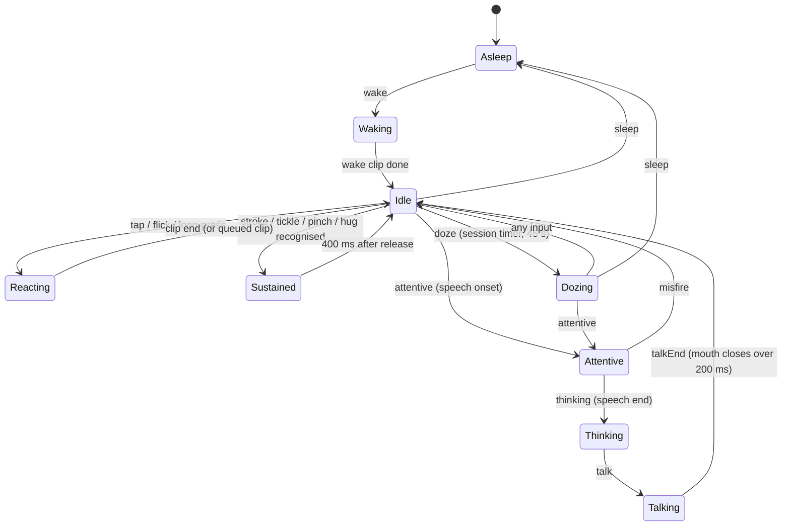

# Talking Bear: implementation plan

**Status:** plan only. No application code exists yet.
**Date:** 2026-09-26. **Amended 2026-10-25:** the duck plan (Q9–Q17): a second character, Fenn the duckling, and the Duckling voice (M9–M11).
**Scope:** a client-side-only, installable, offline PWA. You talk to one of two original characters (Juni the bear, Fenn the duckling), and it repeats what you said in a high voice. You can also poke, pet and tickle it.
**Targets:** Android Chrome first, desktop Chrome second. iOS/Safari is out of scope, but blockers found along the way are listed in [§4.11](#411-ios-blockers-noted-not-designed-around).

---

## 0. How to read this document

### Evidence tags

Every non-obvious factual claim carries one of these tags.

| Tag | Meaning |
|---|---|
| **[V]** | Read in the primary source during this planning session: spec source, Chromium/AOSP source, MDN content or browser-compat-data, library source/README, or the npm registry. |
| **[E]** | Measured or reproduced **in this sandbox**: headless Chromium 141 via Playwright 1.56, or Node 22 on a 2.1 GHz Xeon VM. These are *not* phone measurements. |
| **[E N1]** | Measured in the duck research on an **aarch64 Neoverse-N1 VM (4 vCPU), Node 24.21.0, 2026-10-24**, with the throwaway spike `docs/research/spikes/09-duck-voice/`. This is a second [E] sandbox: not the Xeon above, and not D1. |
| **[S]** | Seen only in a search-result snippet. Treat as a lead, not a fact. |
| **[M]** | From memory, reasoning or estimation. Unverified. Every [M] that matters has an experiment in [§5](#5-risks-unknowns-and-the-experiments-that-settle-them). |

### Source-access caveat

The research sandbox could **not** reach developer.mozilla.org, developer.chrome.com, web.dev, w3.org/w3c.github.io, whatwg.org or the Chromium bug tracker. Those sources were read through their GitHub mirrors instead:

- `mdn/content` and `mdn/browser-compat-data`
- `w3c/*` and `WebAudio/*` spec sources
- `whatwg/html` source
- the `chromium/chromium` GitHub mirror (`main`, fetched 2026-09-26)
- `aosp-mirror/*`
- the `GoogleChrome/developer.chrome.com` repo

Chromium `main` is roughly 1–2 milestones ahead of Stable. Where behaviour changed recently, this is called out.

Chromium bug-tracker entries are cited only from search snippets and are tagged [S].

### What was verified by hand

I re-checked the following against source or by running them myself.

- The Android input-preset logic: `aaudio_stream_wrapper.cc:517-534`.
- The constraint-default logic: `media_stream_constraints_util_audio.cc:631-641`.
- The installed-web-app autoplay exemption: `autoplay_policy.cc:71`.
- The Web Audio `playbackRate` interpolation: `audio_buffer_source_handler.cc:334-355, 870-881`.
- The Silero TypeScript-port parity result: re-ran it [E].
- The fake-microphone Playwright loop, including the `%noloop` behaviour at end of file [E].
- The CSP behaviour of AudioWorklet and WASM [E].

The research scripts behind the `[E]` results are committed as throwaway spikes under [`docs/research/spikes/`](research/spikes/): the fake-mic loop, the Silero port and parity test, resampling and aliasing benchmarks, the Go server prototype, the Vite/PWA/CSP experiments and the plan consistency checks.

---

## 1. Decisions at a glance

| Area | Decision | Main alternatives rejected | Details |
|---|---|---|---|
| Capture API | `AudioWorklet` in the same `AudioContext` that plays back, posting **transferred** `Float32Array`s. No `SharedArrayBuffer`, so no COOP/COEP needed. | `MediaRecorder` + `decodeAudioData` (no pre-roll, lossy, decode latency); `MediaStreamTrackProcessor` (main-thread only in Chrome, drops frames); SAB ring (needs cross-origin isolation for no gain) | [§4.1](#41-audio-capture) |
| Capture constraints | `echoCancellation:false, noiseSuppression:false, autoGainControl:false`; own high-pass + loudness normalisation with a hard ceiling | Browser defaults: on Android they put the device in call mode with call-volume routing; noise-suppression artefacts get amplified by pitch-up; AGC pumping on desktop | [§4.1](#41-audio-capture) |
| Sample rate | Native context rate (usually 48 kHz), `latencyHint:'interactive'`; never force a rate | Forced 16/44.1 kHz context (extra resampling and latency) | [§4.1](#41-audio-capture) |
| VAD | **Silero VAD v6 (16 kHz) via a hand-written TypeScript port** in a Worker. Weights are extracted from the pinned upstream ONNX file, and ONNX Runtime is kept only as a CI parity oracle. An **energy VAD** in the same worker is the level meter, the fallback and an optional CPU pre-gate. | WebRTC VAD (collapses at SNR ≤ 10 dB); `@ricky0123/vad-web` as-is (main-thread inference, 16 kHz-only audio, anti-aliasing-free resampler); onnxruntime-web at runtime (14.2 MB wasm); TEN VAD (licence) | [§4.2](#42-speech-detection-vad) |
| Voice effect | **Offline windowed-sinc resampling in TypeScript** (pitch and tempo move together: the authentic "Talking Tom" sound). Presets: Bear cub ×1.6, Chipmunk ×2.0, Big bear ×0.75, Duckling ×1.45 + duck stage (AM, nasal EQ, cubic). | Raw `playbackRate` (Chromium uses linear interpolation with **no anti-aliasing**); SoundTouchJS (slow, aliasing, licence provenance); phase vocoder (slow, phasey); Rubber Band (GPL) | [§4.3](#43-voice-transformation), [§4.3.5](#435-duck-voice) |
| Feedback loop | **Half-duplex.** The mic stays open, but capture is disarmed from end-of-speech until the playback's last sample has left the speaker plus a cooldown. Barge-in is by touch only. | Relying on AEC: on Android, Chrome does not cancel Web Audio playback unless the OEM platform echo canceller happens to | [§4.4](#44-feedback-loop) |
| Rendering | **Procedural Canvas 2D.** Art is authored as SVG path data, a 2D rig with springs, and geometric hit regions. One engine, one `CharacterSpec` per character (art, drives, regions, reactions). | Rive (proprietary editor/CLI, 360–900 KB gzip wasm, paid export); Lottie (timeline-first, stale player); sprites / three.js (non-code art pipelines) | [§4.6](#46-character-and-animation) |
| Mouth | RMS envelope plus a 2-band spectral ratio, precomputed from the **processed** buffer and synced via `getOutputTimestamp()` | Visemes (wLipSync needs Unity-calibrated profiles and breaks on pitch-shifted formants; Rhubarb is a 42 MB wasm port) | [§4.6](#46-character-and-animation) |
| Gestures | Hand-rolled Pointer Events recogniser, with thresholds from Android `ViewConfiguration` | Hammer.js (last release 2016), `@use-gesture` (no region/tickle semantics) | [§4.6](#46-character-and-animation) |
| PWA | `vite-plugin-pwa` 1.3.0 in `generateSW` mode, `registerType:'prompt'`, everything precached (with `clientsClaim`), updates applied only when the page is hidden in `Asleep`/`Paused` | `autoUpdate` (reloads mid-recording); `injectManifest` / hand-written service worker (no custom fetch logic needed) | [§4.7](#47-pwa) |
| Serving | **Tiny Go server** (~200 lines, stdlib only, `embed.FS`) on `distroless/static-debian13:nonroot`, pinned by digest. Headers live in code, served precompressed with content-hash ETags; zero writes. | static-web-server (fine, but Last-Modified only, and its scratch image runs as root); nginx-unprivileged (no brotli, needs tmpfs); Caddy (root by default, writable dirs) | [§4.8](#48-image-serving-and-headers) |
| Toolchain | Vite 8.3 (Rolldown), TypeScript 7.0 (native `tsc`), oxlint + tsgolint, Prettier, Vitest 5, Playwright 1.63, pnpm 12, Node 24 LTS | ESLint + typescript-eslint (not compatible with TypeScript 7 yet); Rsbuild / esbuild / Parcel (no better worklet + PWA story) | [§8](#8-dependencies) |

---

## 2. Goals, non-goals, constraints

### Goals

- **The loop:** speak, then the bear listens, then replays you pitched up, with its mouth in sync.
- **Touch:** reactions to poke, pet, tickle, long-press and multi-touch.
- **Idle life:** blinking, breathing and gaze.
- **Character choice:** two characters, Juni the bear and Fenn the duckling. A swap button, shown only while the character sleeps, switches between them (Q12). Each has its own look, reactions and remembered voice.
- **Privacy:** fully client-side. Audio never leaves the device: no network I/O apart from fetching the app itself.
- **Install:** installable PWA that works fully offline after the first load.

### Non-goals

- Accounts, analytics, telemetry, cloud speech, and recording or sharing to files (MVP).
- iOS support.

### Deployment constraints (the output of this repo)

- **Image:** `ghcr.io/chethan123/talking-bear:<version>`. It must be small, pinned, non-root, and serve static files.
- **Runtime:** the container runs with `read_only: true`, all capabilities dropped, no egress, and tight memory/pid limits.
- **Topology:** per-app Caddy sidecar → app over plain HTTP. TLS terminates at a front Caddy; the site is served at `bear.<domain>`.
- **Out of scope:** the hosting package itself.
- **Repo:** this one is **private** and MIT-licensed. That matters for licences ([§8](#8-dependencies)), fixtures (no real voices, per [Q2](#12-open-questions-asked-one-at-a-time)) and GitHub artifact attestations ([§9](#9-ci-outline)).

### Privacy posture

What the design guarantees:

- The app **collects nothing**: no accounts, analytics or telemetry.
- The only network I/O is fetching the app itself, and CSP `connect-src 'self'` plus `default-src 'none'` enforce that in the browser.
- Captured audio exists only in memory and is discarded after each replay. Settings live in `localStorage` on the device.

As designed, the app therefore does not itself collect a child's voice online in the sense COPPA regulates, and it runs no consent-based processing that would engage GDPR Art. 8 [M, not legal advice].

The one place personal data exists is the **hosting layer**: the front Caddy's access logs contain IP addresses. Those are the host's responsibility and outside this repo.

A short parent-readable version of this lives in the settings sheet (M8).

---

## 3. Architecture

### 3.1 Threads and ownership

| Thread | Code | Owns |
|---|---|---|
| Main | `app/*`, `anim/*`, `input/*`, `reactions/*`, `platform/*`, `pwa/*`, `ui/*`, `audio/engine.ts`, `audio/player.ts`, `audio/sfx.ts`, `audio/output-clock.ts` | Session state machine (a pure reducer plus an effect runner), animation loop (rAF), gesture recognition, AudioContext lifecycle, playback and sfx scheduling, wake lock, visibility and permissions |
| Audio render thread | `audio/capture.worklet.ts` | Capture only: high-pass, ring buffer, decimation, framing and `take`. It is deliberately minimal to stay within the render-thread budget ([§4.10](#410-performance-and-battery-budget-reference-device-d1-the-mid-range-pixel-q7)). |
| DSP Worker (module) | `workers/dsp.worker.ts` | **All VAD work** while listening: gate-path filters, energy floor, voicing, Silero, pre-gate, segmenter. Then the voice-effect chain and envelope analysis while processing. These never overlap, because the loop is half-duplex. |

**Capture worklet, per 128-frame quantum:**

- **Clip path:** 80 Hz high-pass → **ring buffer of 12 s at the context rate**. The ring is written **continuously, even while disarmed**, so a `take` whose end is a few ms in the future can still be served.
- **VAD feed (only while armed):** anti-aliased decimation to 16 kHz with the same sinc kernel as the voice effect. The decimator runs continuously, and frames are *posted* only while armed. That avoids a filter start-up transient at every arm, for ≈ 4 µs per quantum. Each 512-sample frame is posted to the worker, tagged with the current `epoch` and the **context-rate frame index of its first sample**, with the decimator's group delay already subtracted.
- **Commands:**
  - `arm{epoch}` starts the VAD feed and answers `armed{epoch, armFrame}`.
  - `disarm{epoch}` stops it.
  - `take{epoch, id, fromFrame, toFrame}` is **deferred until `currentFrame ≥ toFrame`**. It is then streamed to the main thread in transferred chunks of ≤ 48 000 samples, one chunk per quantum, so no quantum copies megabytes. If `fromFrame` has already been evicted, the worklet answers `takeFailed`.

**Epochs.** Every `arm` starts a new `epoch`. Every VAD event, clip chunk and processing result carries its epoch or request id. The session reducer **explicitly ignores** anything stale, which prevents late events from a previous listen (after a pause, an interruption or a race between `seg.end` and `disarm`) from driving the current one.

**Timeline.** One clock is canonical: **the capture frame index** in the AudioWorklet's `currentFrame` domain, which is the context-rate frame counter.

- Every VAD event carries a context-rate frame index. The worker converts from 16 kHz frames using the tag on each frame.
- Clip extraction is by frame range.
- Playback and sfx timing use `AudioContext` time, which is the same clock divided by the sample rate.

Wall-clock time is used only for UI timers (doze, sleep, processing timeout). It is injected as a `Clock` so tests are deterministic.

**Capture gaps.** Chrome's `currentFrame` can jump. The capture worklet's ring zero-fills every jump. Up to 0.5 s (`Math.round(sampleRate / 2)` ctx frames), the decimator is fed the same zeros, so the frame tags stay on the ring's frames and contiguous. A longer jump, an audio-thread stall over 0.5 s, **re-anchors** the VAD feed instead: the decimator is reset, the partial VAD frame is dropped, and the next frame starts at the jump frame. In the worker, a frame whose `firstFrame` differs by more than one render quantum (`CAPTURE_GAP_SLACK`, 128 ctx frames) from the previous frame's (same epoch) `firstFrame` plus one VAD frame starts after a gap. Before consuming it, VadCore (#244, decisions D3–D5 of its approved plan):

- drops the partial 10 ms hop and restarts the voicing window from zeros, as at `reset`;
- ends a segment in progress at its last step before the gap (the last Silero frame, or the last energy hop): `end{reason: 'silence'}` with its `lastSpeechFrame` if it passes the checks a silence end faces there (the minimum speech, then the energy voicing rule or the Silero proximity gate), otherwise `misfire`. The segmenter then starts over;
- with the trace on, ends the trace batch at the gap: the partial batch is posted, except that on Silero a partial batch without a Silero value is dropped.

So no hop, segment or trace batch spans a re-anchor. A jump of up to 0.5 s is not a gap in this sense: its zeros are ordinary input, and a hop, segment or trace batch can run across it. The take of a segment ended at the gap (row 20) lies before it, apart from at most its 150 ms tail, which can reach into the ring's zero fill; the 300 ms pre-roll of a segment that starts after the gap can likewise reach back into the zeros. The epoch and its backend, the energy gate and its floor, the gate filter, the Silero LSTM state, the pre-gate, the hop count (the `level` cadence), the proximity gate's hop history and the onset block carry over. No new event or end reason is involved.

### 3.2 Audio pipeline (data flow)



**Why the worklet may connect to `destination` even though it outputs silence.** Chromium wraps the Web Audio sink in a `SilentSinkSuspender`:

- After 30 s of exact-zero output, it releases the hardware output and drives rendering from a fake sink [V R9].
- The silence detection is **disabled** when the graph contains "automatic pull" nodes, and an `AudioWorkletNode` whose outputs are unconnected is one of those [V R8 `realtime_audio_destination_handler.cc:295-327`, `audio_worklet_handler.cc:243-261`].

Connecting the worklet lets Chrome power the output path down while we are only listening.

**This has a capture-continuity risk.** While suspended, the whole graph, mic capture included, is driven by a thread-pool task instead of the audio device thread [V R9 `renderer_webaudiodevice_impl.cc:354-361, 501-508`]. The `MediaStreamAudioSourceNode` FIFO holds only about 6 device buffers and **drops incoming audio on overrun** [V R76 `webaudio_media_stream_audio_sink.cc:94-106, 140-162`]. A scheduling hiccup could therefore delete the start of a child's first word after a quiet spell.

The wiring is therefore a **runtime flag** that defaults to *unconnected*. It is switched on only if **X-R4** shows no capture gaps under load.

**Message budget.** 16 kHz frames of 512 samples mean **31.25 messages/s** from the worklet to the worker, and only while armed. The main thread gets only events and a ~30 Hz level value from the worker. The only audio that reaches the main thread is the one chunked clip transfer per utterance.

### 3.3 Module map and interfaces

These are illustrative TypeScript signatures. Everything under `src/dsp/` is DOM-free and runs unchanged in Node, the worklet and the worker.

```ts
// ---- src/dsp (pure; Float32Array in/out; no globals) -------------------------------
export interface Biquad { process(x: Float32Array, out?: Float32Array): Float32Array; reset(): void }
export function butterworthHighpass(fs: number, fc: number): Biquad;

export class RingBuffer {                       // single-producer/single-consumer, frame-indexed
  constructor(capacityFrames: number);
  write(block: Float32Array, startFrame: number): void;
  read(fromFrame: number, toFrame: number): Float32Array; // throws RangeError if evicted
}

// ONE convention everywhere: ratio = outRate / inRate (output samples per input sample).
//   48k→16k decimation: ratio = 1/3.   Voice pitch-up by p: ratio = 1/p (fewer samples → higher pitch, shorter).
//   Anti-alias cutoff, as a fraction of the INPUT Nyquist: 0.9 · min(1, ratio).
//   (Chromium's SincResampler uses the inverse, in/out, hence its 1/io_ratio [V R11 sinc_resampler.cc:109-126].)
export interface Resampler {                    // Kaiser-windowed sinc, polyphase, arbitrary ratio
  readonly ratio: number;                       // outRate / inRate
  process(input: Float32Array): Float32Array;   // streaming (keeps history); used in worklet
  flush(): Float32Array;
  readonly groupDelayInputFrames: number;       // for frame-index tagging
}
export function createResampler(inRate: number, outRate: number, opts?: { zeroCrossings?: number; cutoff?: number }): Resampler;
export function resampleOffline(x: Float32Array, ratio: number): Float32Array; // same kernel, one shot; voice uses ratio = 1/p

export interface FrameFeatures { frame: number; db: number; floorDb: number; voiced?: boolean }
export interface EnergyGateParams { onsetMarginDb: number; offsetMarginDb: number; absMinDb: number;
  floorDownTauMs: number; floorUpTauMs: number; floorInSpeechTauMs: number; ignoreBelowDb: number }
export function energyGateStep(s: EnergyGateState, f: FrameFeatures, p: EnergyGateParams): EnergyGateState;

// One segmenter for both backends: consumes per-frame speech probability (Silero) or 0/1 (energy).
export type SegEvent =
  | { kind: 'start'; frame: number }
  | { kind: 'end'; frame: number; lastSpeechFrame: number; reason: 'silence' | 'maxLength' }
  | { kind: 'misfire'; frame: number };
export interface SegParams { posThreshold: number; negThreshold: number; hangoverMs: number;
  minSpeechMs: number; maxUtteranceMs: number; frameMs: number }
export function segmenterStep(s: SegState, p: SegParams, frame: number, prob: number): [SegState, SegEvent | null];

export interface SileroModel { reset(): void; process(frame16k: Float32Array /* 512 */): number /* p(speech) */ }
export function createSilero(weights: SileroWeights): SileroModel;   // TS port, fp16/fp32→fp32 weights at load

export interface VoicePreset { id: 'cub' | 'chipmunk' | 'bigbear' | 'duck' | 'custom'; pitchRatio: number }  // 'duck': sinc + duck stage (§4.3.5)
export interface Envelope { hopMs: 10; jaw: Float32Array; width: Float32Array; round: Float32Array; teeth: Float32Array }
export function processVoice(pcm: Float32Array, fs: number, preset: VoicePreset):
  { pcm: Float32Array; envelope: Envelope; durationSec: number };

// ---- src/audio/messages.ts (structured-clone protocol; all audio buffers transferred) --
// Every message that belongs to a listen carries its epoch; the reducer ignores stale epochs/ids.
export type MainToWorklet =
  | { t: 'arm'; epoch: number }                                  // start the 16 kHz VAD feed
  | { t: 'disarm'; epoch: number }                               // stop it; the ring keeps recording
  | { t: 'take'; epoch: number; id: number; fromFrame: number; toFrame: number }; // deferred until currentFrame ≥ toFrame
export type WorkletToWorker =                                    // MessagePort handed to both at startup
  | { t: 'frame'; epoch: number; firstFrame: number; pcm16k: Float32Array /* 512 */ }; // firstFrame: ctx-rate index, group delay removed
export type WorkletToMain =
  | { t: 'armed'; epoch: number; armFrame: number }
  | { t: 'clipChunk'; epoch: number; id: number; seq: number; last: boolean; pcm: Float32Array; sampleRate: number }
  | { t: 'takeFailed'; epoch: number; id: number; reason: 'evicted' };
export type MainToWorker =
  | { t: 'reset'; epoch: number; vad: 'silero' | 'energy'; restoreFloorDb?: number } // new listen: reset segmenter, LSTM, history
  | { t: 'process'; id: number; pcm: Float32Array; sampleRate: number; preset: VoicePreset };
export type WorkerToMain =
  | { t: 'seg'; epoch: number; ev: SegEvent }                    // frames in ctx-rate indices
  | { t: 'level'; epoch: number; frame: number; db: number; floorDb: number } // ~30 Hz, UI/debug
  | { t: 'floorSnapshot'; epoch: number; floorDb: number }       // taken at onset, restored at re-arm
  | { t: 'vadStats'; p95Ms: number }
  | { t: 'processed'; id: number; pcm: Float32Array; envelope: Envelope; durationSec: number }
  | { t: 'error'; where: 'vad' | 'fx'; message: string };

// ---- src/app/machine.ts (pure) -----------------------------------------------------
export function reduce(s: SessionState, e: SessionEvent): { state: SessionState; effects: Effect[] };
export type Effect =
  | { k: 'openMic'; req: number } | { k: 'closeMic' }        // closeMic invalidates every pending openMic request
  | { k: 'resumeCtx' } | { k: 'suspendCtx' } | { k: 'restartWorker' }
  | { k: 'arm'; epoch: number; restoreFloorDb?: number } | { k: 'disarm'; epoch: number }
  | { k: 'take'; epoch: number; id: number; fromFrame: number; toFrame: number }
  | { k: 'process'; id: number; preset: VoicePreset } | { k: 'play'; id: number } | { k: 'stopPlayback' }
  | { k: 'timer'; name: 'cooldown' | 'sleep' | 'doze' | 'processing' | 'waking' | 'recording'; ms: number }
  | { k: 'cancelTimer'; name: 'cooldown' | 'sleep' | 'doze' | 'processing' | 'waking' | 'recording' | '*' }
  | { k: 'wakeLock'; on: boolean } | { k: 'anim'; ev: AnimEvent } | { k: 'sfx'; id: SfxId } // sfx end is tracked at the speaker
  | { k: 'reselectInput' }
  | { k: 'ui'; show: 'tapToWake' | 'parentPermission' | 'micHelp' | 'micMuted' | 'tooNoisy' | 'error' | null };

// ---- src/audio/output-clock.ts -----------------------------------------------------
/** Seconds of the scheduled clip that have actually reached the output device "now". */
export function clipTimeNow(ctx: AudioContext, scheduledStartCtxTime: number): number;
// = ts.contextTime + (performance.now() - ts.performanceTime)/1000 - scheduledStartCtxTime
// where ts = ctx.getOutputTimestamp(); contextTime already accounts for output latency [V spec].

// ---- src/input/recognizer.ts (pure) ------------------------------------------------
export interface PointerSample { id: number; t: number; x: number; y: number; type: 'down' | 'move' | 'up' | 'cancel' }
export type Gesture =
  | { g: 'tap'; region: RegionId; x: number; y: number } | { g: 'longPress'; region: RegionId; phase: 'start' | 'end' }
  | { g: 'stroke'; region: RegionId; phase: 'start' | 'update' | 'end'; pathPx: number; dir: number }
  | { g: 'tickle'; region: RegionId } | { g: 'flick'; region: RegionId; vx: number; vy: number }
  | { g: 'pinch'; regions: [RegionId, RegionId]; spanRatio: number } | { g: 'hug' };
export function recognize(s: RecState, sample: PointerSample, hit: (x: number, y: number) => RegionId): [RecState, Gesture[]];

// ---- src/anim ------------------------------------------------------------------------
export const enum Ch { HeadRot, HeadTilt, Jaw, MouthW, MouthRound, LidL, LidR, IrisX, IrisY, EarRotL, EarRotR,
  EarFoldL, EarFoldR, BrowY, BodySquash, BellyJiggle, TuftRot, Blush, ArmRotL, ArmRotR, /* … ~40 */ Count }
export type Pose = Float32Array; // length Ch.Count, preallocated
export interface Layer { update(dt: number, pose: Pose, ctx: AnimContext): void }
export function directorReduce(s: DirectorState, e: AnimEvent): DirectorState;   // pure, testable
export function render(g: CanvasRenderingContext2D, rig: Rig, pose: Pose): void; // no allocation
```

**Additions for the second character and the duck voice (M9–M11).** These amend the signatures above: `duckStage` and the peaking biquad, `VoiceId` and the settings fields, `CharacterSpec`, `createRig(spec)`, `hitTest(…, table)`, `DirectorCast` and the director signatures.

```ts
// ---- src/dsp/types.ts (changed) -----------------------------------------------------------------
export type VoiceId = 'cub' | 'chipmunk' | 'bigbear' | 'duck' | 'custom';
export interface VoicePreset { id: VoiceId; pitchRatio: number }
export const DUCK_PITCH_RATIO = 1.45; // added in T115 (no stage code in types.ts, so the main thread doesn't import duck.ts); T119 changes it
export const PRESETS: Record<Exclude<VoiceId, 'custom'>, VoicePreset>; // + duck: { id: 'duck', pitchRatio: DUCK_PITCH_RATIO } (T116)

// ---- src/dsp/biquad.ts (changed: new) -----------------------------------------------------------
export function peakingCoefficients(fs: number, f0: number, gainDb: number, q: number): BiquadCoefficients; // RBJ; highShelf's order
export function peaking(fs: number, f0: number, gainDb: number, q: number): Biquad;
export function butterworthHighpassCoefficients(fs: number, fc: number): BiquadCoefficients; // the existing sections' coefficients,
export function butterworthLowpassCoefficients(fs: number, fc: number): BiquadCoefficients;  // exposed for the EQ-response test

// ---- src/dsp/duck.ts (new; pure, erasable syntax, .ts imports) ----------------------------------
export interface DuckParams {
  amHz: number; amMix: number;
  hpHz: number;
  dipHz: number; dipQ: number; dipDb: number;
  peak1Hz: number; peak1Q: number; peak1Db: number;
  peak2Hz: number; peak2Q: number; peak2Db: number;
  lpHz: number;           // four cascaded butterworthLowpass sections (LP_SECTIONS = 4, a constant)
  shapeMix: number;       // 0 = no cubic, 1 = full
}
export const DUCK: Readonly<DuckParams>;        // { 70, 0.35, 320, 700, 1.4, −9, 1600, 3, 10, 3100, 2.5, 6, 5000, 1 }
export const LP_SECTIONS = 4;
/** X-F4 fallback 1: amMix = max(0.05, d.amMix − 0.15), peak1Db = max(2, d.peak1Db − 4), the rest of d. New frozen object. */
export function softenDuck(d: Readonly<DuckParams>): Readonly<DuckParams>;
/** Pre-tune bounds (T117 sliders; T115 tests cover the corners): p 1.30–1.60, amHz 60–80, amMix 0.20–0.40, peak1Db 6–12. */
export const DUCK_TUNE_BOUNDS: Readonly<Record<'p' | 'amHz' | 'amMix' | 'peak1Db', readonly [number, number]>>;
/** New buffer, same length as y. Throws RangeError unless fs is finite and ≥ 16000. Never modifies y. */
export function duckStage(y: Float32Array, fs: number, d?: Readonly<DuckParams>): Float32Array;

// ---- src/dsp/voice.ts (changed) -----------------------------------------------------------------
// processVoice: … y = resample(x, p); voiced = isVoiced(y, fs);
//   z = preset.id === 'duck' ? duckStage(y, fs, DUCK) : y; applyGain(z, fs, voiced); fades(z, fs); envelope(z, fs, p)
export const voiceStages: { clipDetect; hpfTrim; resample; isVoiced; duck: typeof duckStage; applyGain; fades; envelope };

// ---- src/app/settings.ts (changed; key stays 'bear.settings.v1', fields are additive) -----------
export type CharacterId = 'juni' | 'fenn';
export interface Settings {
  voice: VoiceId;        // Juni's voice (default 'cub'; meaning unchanged for stored v1 data)
  fennVoice: VoiceId;    // Fenn's voice (default 'duck')
  character: CharacterId; // default 'juni'
  customPitch: number; quietMode: boolean; gentleMode: boolean; haptics: boolean; noisyRoomNs: boolean; sleepTimeoutSec: number;
}
export function presetFor(s: Settings): VoicePreset; // voice of s.character; 'custom' → { id: 'custom', pitchRatio: customPitch }

// ---- src/characters/types.ts (new) --------------------------------------------------------------
import type { Bone, Part } from '../art/bear-parts.gen.ts';
export interface CharacterArt {
  readonly BONES: readonly Bone[]; readonly PARTS: readonly Part[];
  readonly BONE: Readonly<Record<string, number>>; readonly PART: Readonly<Record<string, number>>;
}
export type Term = readonly [ch: number, k: number];
export interface Drive { readonly rot?: Term; readonly tx?: Term; readonly ty?: Term; readonly sx?: Term; readonly sy?: Term }
export type MouthSpec =
  | { readonly kind: 'lips'; readonly bone: string /* Juni: 'jaw' */; readonly afterSubtree: string /* Juni: 'muzzle' */;
      readonly x: number; readonly y: number; // Juni: MOUTH.x/y (500, 525), renderer.ts
      readonly minWidth: number; readonly widthRange: number; readonly openRange: number; readonly tongueJaw: number;
      readonly teethMin: number; readonly interior: string; readonly tongue: string; readonly teeth: string }
  | { readonly kind: 'parts' }; // the beak is ordinary parts on bones driven by Jaw/MouthW; nothing parametric
export interface StarsSpec { readonly bone: string; readonly cx: number; readonly cy: number; readonly radius: number;
  readonly count: number; readonly outer: number; readonly inner: number; readonly fill: string }
export interface CharacterNames {
  readonly name: string;      // 'Juni' | 'Fenn'
  readonly stage: string;     // 'Juni the bear' | 'Fenn the duckling'
  readonly switchTo: string;  // the swap button's label when this is the *other* character: 'Switch to Fenn the duckling'
}
export interface CharacterSpec {
  readonly id: CharacterId;
  readonly art: CharacterArt;
  readonly drives: Readonly<Record<string, Drive>>;
  readonly gazeParts: readonly string[];          // iris, pupil, highlight of the left eye, then the right
  readonly lidParts: { readonly L: string; readonly R: string };
  readonly blushParts: readonly string[];
  readonly mouth: MouthSpec;
  readonly stars: StarsSpec;
  readonly background: { readonly top: string; readonly bottom: string };
  readonly eyesCenter: { readonly x: number; readonly y: number };
  readonly regions: readonly RegionDef[];        // priority order
  readonly names: CharacterNames;
  readonly cast: DirectorCast;                    // added in T122
  readonly reactionFor: (g: Gesture) => Reaction | null; // added in T122
}
export const CHARACTERS: Readonly<Record<CharacterId, CharacterSpec>>; // src/characters/index.ts
export const JUNI: CharacterSpec;   // src/characters/juni.ts
export const FENN: CharacterSpec;   // src/characters/fenn.ts
export const FENN_CLIPS: Readonly<Record<string, Clip>>;        // src/anim/clips/fenn.ts
export const FENN_REACTIONS: Readonly<Record<string, Reaction>>; // src/reactions/fenn-table.ts

// ---- src/anim/rig.ts (changed) ------------------------------------------------------------------
export interface Rig {
  readonly spec: CharacterSpec; readonly boneCount: number;
  readonly paths: readonly Path2D[]; readonly kind: Uint8Array;
  readonly mouthSlot: number;   // −1 for mouth kind 'parts' (the renderer's slot test is then never true)
  readonly jaw: number; readonly head: number; // bone indices (jaw −1 for 'parts'); head = stars.bone
  readonly parent: Int32Array; readonly pivotX: Float64Array; readonly pivotY: Float64Array;
  readonly driveCh: Int8Array; readonly driveK: Float64Array; readonly irisSide: Int8Array;
  readonly stack: Float64Array; readonly boneBuf: Float32Array; // boneBuf: the renderer's per-frame scratch
}
/** Allocates; setup only. `paths: false` leaves `paths` empty (no Path2D, for Node: scripts/gesture-eval.ts); every other field is built. */
export function createRig(spec: CharacterSpec, opts?: { paths?: boolean }): Rig;
export function boneMatrices(rig: Rig, pose: Pose, out: Float32Array): Float32Array; // unchanged signature
export function partMatrix(rig: Rig, pose: Pose, bones: Float32Array, part: number, out: Float32Array | Float64Array, o?: number): void;
export function boneIndex(rig: Rig, id: string): number; export function partIndex(rig: Rig, id: string): number;
// removed exports: BONE_COUNT (use rig.boneCount)

// ---- src/input/regions.ts (changed) -------------------------------------------------------------
export interface RegionTable { readonly defs: readonly RegionDef[]; readonly offset: Int32Array;
  readonly cx: Float64Array; readonly cy: Float64Array; readonly rx: Float64Array; readonly ry: Float64Array; readonly id: readonly RegionId[] }
export function compileRegions(rig: Rig): RegionTable; // from rig.spec.regions
export function hitTest(x: number, y: number, boneMatrices: Float32Array, view: View, table: RegionTable, padCssPx?: number): RegionId;

// ---- src/input/region-ids.ts (changed) ----------------------------------------------------------
// REGION_IDS += 'beak', 'wingL', 'wingR', 'tail' (appended before 'background')

// ---- src/anim/layers/gaze.ts (changed) ----------------------------------------------------------
// createGaze(…, eyesCenter) and createEarTwitch(…, eyesCenter), eyesCenter: { x: number; y: number }: EYES_CENTER becomes
// Juni's spec value, passed by bear-view from rig.spec.eyesCenter

// ---- src/anim/director.ts (changed) -------------------------------------------------------------
export interface DirectorCast {
  readonly clips: ReadonlyMap<string, Clip>;          // session + reaction + mime + character clips + flinch + mirrored
  readonly mirrored: ReadonlyMap<string, string>;     // clip name → mirrored clip name (today: pet → petMirrored)
  readonly reactions: Readonly<Record<string, Reaction>>; // escalation targets by name
}
export function createDirectorCast(clipSets: readonly Readonly<Record<string, Clip>>[],
  reactions: Readonly<Record<string, Reaction>>): DirectorCast; // adds FLINCH and the mirrored pet
// every listed function gains a trailing, non-optional `cast: DirectorCast`; `mouth` loses its default (`= false`
// today, director.ts:1142 and :1157) and every caller passes it:
// directorStep(s, i, cast), directorReduce(s, i, cast), evaluate(s, now, out, mouth, cast),
// evaluateFrom(…, cast), clipByName(name, cast). initialDirector(now) and mouthCloseScale are unchanged.

// ---- src/anim/bear-view.ts (changed) ------------------------------------------------------------
export interface BearViewDeps { /* … existing … */ character: CharacterSpec }

// ---- src/ui/character-switch.ts (new) -----------------------------------------------------------
export interface CharacterSwitchDeps {
  state(): StateName;                       // shown only while 'Asleep'
  current(): CharacterId;
  choose(id: CharacterId): void;            // main.ts: settings.set({ character: id })
  thumbnail(id: CharacterId, size: number): HTMLCanvasElement; // the other character's head, drawn once
}
export interface CharacterSwitch { refresh(): void; dispose(): void } // refresh on every session state change
export function mountCharacterSwitch(root: HTMLElement, deps: CharacterSwitchDeps): CharacterSwitch;
```

**Refinements settled while writing the M1 tasks** (the sketch above stays illustrative):

- **`init` messages:** `init{port}` to the worklet and `init{ctxRate, port}` to the worker hand over the worklet↔worker `MessagePort`. A new `init` is also how the worker is restarted.
- **In-place state:** `segmenterStep` and `energyGateStep` mutate their state in place, so the per-frame path doesn't allocate.
- **Effects:**
  - `sfx` effects carry a sequence number, and `sfxAtSpeakerEnded{seq}` means that every sfx scheduled so far has left the speaker.
  - An `applyUpdate` effect implements the §4.7 update policy.

Design rules:

1. **DSP and state are pure.** Side effects happen only in effect runners and the DOM, worklet and worker adapters.
2. **The worklet contains glue only.** `process()` calls into `src/dsp/*`, and it is tested in Node with a stubbed `AudioWorkletGlobalScope` ([§4.9](#49-testing)).
3. **No allocation in hot loops** (the `process()` quantum and the rAF frame). Buffers are preallocated and reused, except for the transferred messages.
4. **VAD backend behind an interface.** `reset{vad:'silero'|'energy'}` switches the backend per listen, and the segmenter is shared. That makes the fallback a one-line switch. Both backends run in the worker. If the worker dies, the main thread restarts it once; a second failure goes to `Error`.
5. **Every (state, event) pair is handled explicitly.** "Ignore" is a legal, listed outcome. A reducer test enumerates the full cross product.

### 3.4 Session (conversation) state machine



**Clarifications** (settled while writing the M1 `machine` task, which has the full list C1–C12):

- **Derived effects:** `wakeLock` and overlay `ui` effects are derived from group and state changes, not emitted per row.
- **Disarm:** `disarm` happens on leaving {Listening, Recording} for any other state.
- **Sfx still audible:** if an sfx started in `MicDenied` (row 11) is still audible when Waking would enter Listening, the machine goes to `SfxGated` instead, so `arm` never overlaps sound.
- **Worker failure in Waking:** a first worker failure in `Waking` stays in `Waking` (restart only), because Cooldown would arm before the mic is granted.
- **Tapping an awake bear:** `tapBear` is handled only in Asleep and Error. Taps on an awake bear arrive as reactions.

**State groups.**

- **Awake** = `Waking`, `Listening`, `Recording`, `Processing`, `Playing`, `SfxGated`, `Cooldown`, `MicDenied`.
- **Mic stream open** = every awake state except `MicDenied`. Reopening the stream re-triggers Android audio-mode and routing changes [V R4], costs stream-open latency [M] and flickers the privacy indicator, so we avoid it.
- **Mic gated** (VAD feed stopped) = `Processing`, `Playing`, `SfxGated`, `Cooldown`.
- **Wake lock held** = mic-open states plus `NeedsParent`. It is released in `MicDenied`, where touch still resets the OS screen timeout.

**Entry and exit actions.** These apply on top of the row effects, and are what make the timers correct on every path.

| When | Actions |
|---|---|
| Enter `Listening` | `epoch += 1`; worker `reset{epoch, restoreFloorDb}`; worklet `arm{epoch}`; `timer sleep = T_sleep` (120 s, Q1); `timer doze = 45 s`; `anim idle` |
| Exit `Listening` | `cancelTimer sleep`, `cancelTimer doze` |
| Enter a gated state from an armed one | worklet `disarm{epoch}` |
| Enter `Asleep` / `Paused` / `Error` | `cancelTimer *`; abort take, playback and sfx; `closeMic`; `suspendCtx`; `wakeLock off` |
| Enter `MicDenied` or `Error` | `timer sleep` (so neither holds anything forever) |
| Enter `Recording` / exit `Recording` | `timer recording = maxUtterance + 2 s` (a watchdog in case the worker stops producing events) / `cancelTimer recording` |

**Pending mic opens.** Every `openMic` carries a request id `req`, and `micGranted{req}` / `micDenied{req}` echo it.

- `closeMic`, which runs on entry to `Asleep`, `Paused` and `Error`, **invalidates every pending request**.
- The effect runner **immediately stops every track** of a `getUserMedia` result whose `req` is no longer current. So hiding the page while the prompt or stream-open is still pending can never leave a live mic behind.
- The reducer ignores stale `micGranted`/`micDenied` (row 44).
| Any reaction in `Listening` or `MicDenied` | restart `timer sleep` and `timer doze` |

**Transitions.** Epoch and id guards are implicit in every row that consumes a `seg`, clip or `processed` event.

| # | From | Event | Guard | To | Row effects |
|---|---|---|---|---|---|
| 1 | Asleep | `tapBear` | permission `granted` | Waking | `resumeCtx`, `openMic`, `wakeLock on`, `timer waking 5 s`, `anim wake` |
| 2 | Asleep | `tapBear` | permission `prompt` (first run, or a one-time grant expired) | NeedsParent | `resumeCtx`, `wakeLock on`, `ui parentPermission`, `timer sleep`. This is the one screen with text, for a parent ([§4.5](#45-android-chrome-specifics)). |
| 3 | Asleep | `tapBear` | permission `denied` | MicDenied | `resumeCtx`, `ui micHelp`, `anim wake` (the bear is awake for reactions, row 11) |
| 3b | Asleep | `settingsRetry` | — | as rows 1 / 2 / 3 by permission | (#266) |
| 3c | Asleep | `tapBear` \| `settingsRetry` | `updateActivated`: another tab activated the update (`updateReady{activated}`) | Asleep | `applyUpdate` only: the page reloads at once instead of waking ([§4.7](#47-pwa)); checked before rows 1–3 and 3b (#277) |
| 4 | NeedsParent | `parentContinue` | — | Waking | `openMic`: Chrome's prompt appears now, in front of the parent |
| 5 | NeedsParent | `timer sleep` \| `hidden` | — | Asleep | — |
| 6 | Waking | `micGranted` \| `ctxRunning` | the *other* flag is already set | Listening | `cancelTimer waking` (entry actions arm) |
| 7 | Waking | `micGranted` \| `ctxRunning` | other flag not yet set | Waking | record the flag |
| 8 | Waking | `micDenied` \| `noDevice` | — | MicDenied | `cancelTimer waking`, `closeMic`, `ui micHelp`, `anim shrug` |
| 9 | Waking | `ctxResumeFailed` \| `timer waking` | — | Error | — |
| 10 | MicDenied | `permissionChanged(granted)` \| `settingsRetry` | — | Waking | as row 1 |
| 11 | MicDenied | `reaction` | — | MicDenied | reaction **including sfx** (the mic is closed, so no gating). **Bear taps never re-prompt**, so a child can't trigger Chrome's prompt-dismissal embargo. |
| 12 | MicDenied | `timer sleep` | — | Asleep | — |
| 13 | Listening | `seg.start{frame}` | — | Recording | store `onsetFrame`; `anim attentive` |
| 14 | Listening | `reaction{sfx}` | — | SfxGated | `sfx` scheduled at a known ctx time; `anim reaction` |
| 15 | Listening | `reaction{no sfx}` | — | Listening | `anim reaction` |
| 16 | Listening | `timer doze` | — | Listening | `anim doze` |
| 17 | Listening | `timer sleep` | — | Asleep | `anim sleep` |
| 18 | Listening | track `mute` | — | Listening | `ui micMuted`; timers keep running |
| 19 | Listening | track `unmute` | — | Listening | re-enter (new epoch, floor reset); `ui null` |
| 20 | Recording | `seg.end{lastSpeechFrame, reason}` | — | Processing | `take(from = max(onsetFrame − 300 ms, armFrame), to = lastSpeechFrame + 150 ms)`, deferred by the worklet until available; `timer processing 2 s`; `anim thinking`; if `reason = maxLength` and `voicedRatio < 0.3`, bump the noisy counter ([§4.4](#44-feedback-loop)); any other end resets it |
| 21 | Recording | `seg.misfire` | — | Listening | `anim earTwitch` ("huh?"); if `reason = maxLength` and `voicedRatio < 0.3` (the energy backend's voicing-rule misfire), bump the noisy counter, the same as a capped end ([§4.4](#44-feedback-loop)); any other misfire leaves it unchanged |
| 22 | Recording | track `mute` | — | Listening | abort; `anim earTwitch`; `ui micMuted` |
| 23 | Recording | `reaction` | — | Recording | animation only; no sfx, so the take is not polluted |
| 24 | Processing | all clip chunks received | — | Processing | `process{id, preset}` to the worker |
| 25 | Processing | `processed{id}` | — | Playing | `cancelTimer processing`; `play` at `currentTime + 50 ms`; `anim talk(envelope, startCtxTime)` |
| 26 | Processing | `takeFailed` \| `error(fx)` \| `timer processing` | — | Cooldown | `anim confused`; `timer cooldown` (a worker crash here goes to row 45) |
| 27 | Processing | `reaction` | — | Processing | animation only |
| 28 | Playing | `playbackAtSpeakerEnded` | — | Cooldown | `timer cooldown = 250 ms` (tuned by X-E5) |
| 29 | Playing | `reaction{priority ≥ 3, sfx}` | — | SfxGated | `stopPlayback`, `sfx`, `anim reaction` |
| 30 | Playing | `reaction{priority ≥ 3, no sfx}` | — | Cooldown | `stopPlayback`, `anim reaction`, `timer cooldown` |
| 31 | Playing | `reaction{priority < 3}` | — | Playing | additive flinch only, no sfx |
| 32 | SfxGated | `reaction{sfx}` | — | SfxGated | `sfx`; gate end = max(current end, new end) |
| 33 | SfxGated | `reaction{no sfx}` | — | SfxGated | `anim reaction` |
| 34 | SfxGated | `sfxAtSpeakerEnded` | the latest sfx has left the speaker (`clipTimeNow` ≥ its duration) | Cooldown | `timer cooldown = 250 ms` |
| 35 | Cooldown | `timer cooldown` | no `reselectPending` | Listening | (entry actions: new epoch, floor restore) |
| 35b | Cooldown | `timer cooldown` | `reselectPending` | Waking | clear the flag; `closeMic`, `reselectInput`, `openMic` |
| 36 | Cooldown | `reaction{sfx}` | — | SfxGated | `cancelTimer cooldown`, `sfx` |
| 37 | Cooldown | `reaction{no sfx}` | — | Cooldown | `anim reaction` |
| 38 | any awake | `hidden` \| `pagehide` \| `freeze` | — | Paused | then, if `updateReady`, apply the update synchronously ([§4.7](#47-pwa)) |
| 39 | Paused | `visible` | permission `granted` / `prompt` / `denied` | Waking / NeedsParent / MicDenied | as rows 1 / 2 / 3 |
| 40 | Listening \| Recording | `devicechange` that changes the input set | — | Waking | abort any take; `closeMic`, `reselectInput` (§4.5 policy), `openMic` |
| 40b | Processing \| Playing \| SfxGated \| Cooldown | `devicechange` that changes the input set | — | unchanged | set `reselectPending`. The input is re-selected only after the bear's audio has left the speaker and the cooldown has elapsed (row 35b), so re-arming can never overlap audible output. Chrome may re-route the current output meanwhile; that's fine. |
| 41 | any awake | `ctxError` \| track `ended` not initiated by us | — | Error | `ui error` (icon: tap to retry) |
| 42 | Error | `tapBear` | — | Waking | as row 1 |
| 43 | Error | `timer sleep` \| `hidden` | — | Asleep | — |
| 44 | any | `seg` / clip / `takeFailed` / `processed` with a stale epoch or id; `micGranted`/`micDenied` with a stale `req` | — | unchanged | none (explicit ignore); the runner has already stopped any stale tracks |
| 45 | any mic-open state | `workerFailed` (error event or crash) \| `timer recording` | first failure in this wake | Cooldown | abort take and processing; `restartWorker`; `anim confused`; `timer cooldown`. The re-arm after cooldown uses a new epoch on the new worker. |
| 46 | any mic-open state | `workerFailed` \| `timer recording` | a restart already happened in this wake | Error | abort; `ui error` |

**How the rows combine at the edges:**

- **No self-capture:**
  - The worker blocks onsets for 100 ms after `armFrame`.
  - Row 20 clamps pre-roll so it never reaches before `armFrame`.
  - Sfx gating is judged **at the speaker** (row 34), with the same `getOutputTimestamp()` predicate as playback, so output latency and a silent-sink resume can't open the mic early.
- **When "playback ended" fires:** `playbackAtSpeakerEnded` is **not** `AudioBufferSourceNode.onended`, which fires when rendering stops. The player waits for `onended`, then polls `getOutputTimestamp()` until `contextTime ≥ startTime + duration`, and waits at least `max(outputLatency, 50 ms)` in case the timestamp reports zero delay ([§4.4](#44-feedback-loop)).
- **Taking the clip at the cap:** with `reason: 'maxLength'`, `toFrame` is ~150 ms in the future. The worklet keeps writing the ring and serves the take when `currentFrame ≥ toFrame`.

**Character swap (M10–M11): no new state, event, row, timer or effect.**

- The swap button exists only in `Asleep`, where the mic is closed and the context is suspended (entry actions), so no gating question arises. A tap swaps the sleeping character and never wakes it or opens the mic.
- `main.ts` applies a character change by disposing the view and mounting the new one, outside the reducer, **only while the session is `Asleep`**. A change seen in any other state (only possible through the test hooks) is applied on the next entry into `Asleep`.
- The voice follows through the existing `settings.subscribe → settingsChanged{preset}` path in every state. `settingsChanged{preset}` already carries any preset in every state.
- The [§4.9.1](#491-unit-tests-vitest-5-environment-node) property "no `arm` while any gated state is active or any sfx or playback is audible" is untouched.

### 3.5 Animation director (separate from, and driven by, the session)

This machine only consumes events from the session:

- `wake`, `sleep`, `doze`, `attentive`, `thinking`, `talk{envelope,start}`, `talkEnd`, `reaction{…}`, `confused`, `earTwitch`, `shrug`

It emits `requestStopPlayback` and `sfx` back to the session. The two machines share **no state**, only a typed event bus, so each is unit-testable alone.



**Structure.**

- **Base layer:** exactly one of the states above, crossfaded over 150 ms.
- **Additive layers, always running and weighted by state:** blink, breathing, gaze/look-at, ear twitch, spring physics (tuft, ears, belly, neckerchief tails) and mood (`joy`/`annoy` scalars decaying with τ = 8 s).
- **Reaction priorities:**
  - P1: ambient fidget
  - P2: tap reaction
  - P3: sustained reaction
  - P4: "big" reaction (laugh fit, dizzy, hug)
- **Interruption rule:** a new reaction interrupts only if its priority ≥ the current one. Otherwise it is queued (queue length 1, dropped after 500 ms).
- **Cooldown:** 800 ms per (region, gesture).
- **Escalation:** by default, the same reaction ×3 within 4 s escalates to its P4 variant. The specific windows in [§4.6.4](#464-gesture--region--reaction) take precedence: a head flick ×3 in 3 s → dizzy, and a belly tickle continuous for > 3 s → laugh fit. The nose's big sneeze comes from the recogniser's multi-poke count. A higher-priority reaction is never blocked by the 800 ms cooldown.
- **While `Talking`:** P2 is additive flinch only; P3 and above emit `requestStopPlayback` (session rows 29–30).
- **Cast (M10):** the director takes an explicit `DirectorCast` (clip book, mirrored-clip map, escalation targets) instead of module-level tables, so each character brings its own. Fenn's cast holds every Juni clip, so the session clips (`wake`, `sleep`, `confused`, `earTwitch`, `shrug`), the mimes (`cuppedEar`, `tooLoud`, `tooLoudGentle`) and `FLINCH` play on Fenn by name. On Fenn, `EarRot` moves the fluff tufts and `ArmRot` the wings. Fenn adds the clips `quack`, `bigQuack`, `bigQuackGentle`, `beakNibble`, `fluffRuffle`, `wingFlapL`, `wingFlapR` and `tailWiggle` ([§4.6.7](#467-concrete-duckling-design-fenn)). States, transitions, priorities, cooldowns, escalation, queue and release rules are unchanged. A remount starts the director in `Asleep`, matching the session.

---

## 4. Research findings and decisions

References `[R#]` resolve in [§13](#13-references).

### 4.1 Audio capture

#### 4.1.1 Constraints: what `echoCancellation` / `noiseSuppression` / `autoGainControl` really do in Chrome

- **Defaults follow `echoCancellation`.** In `UpdateDefaultValues`, `auto_gain_control &= default` and `noise_suppression &= default`, and that default comes from the echo-cancellation (EC) constraint [V R2, hand-checked]. So `{echoCancellation:false}` alone turns noise suppression (NS) and auto gain control (AGC) off too, unless they are explicitly `true`.
- **Software processing is WebRTC's audio processing module (APM)** [V R5]:
  - NS runs at `kHigh`.
  - On Android, AGC is AGC2 with a **fixed +6 dB** digital gain.
  - On desktop, AGC is AGC2 adaptive, plus an input-volume controller.
  - The echo canceller is AEC3, used only when Chrome itself provides the echo cancellation.
  - The APM runs at 48 kHz on every platform. Android moved from 16 kHz to 48 kHz in June 2024 [V R6 `9720e66`].
- **Android: which preset and which audio mode.** These are the effects that matter most.
  - Chrome advertises the platform `ECHO_CANCELLER` effect iff `AcousticEchoCanceler.isAvailable()` [V R3]. It never advertises platform NS/AGC.
  - When echo cancellation is requested and available, AAudio input uses `AAUDIO_INPUT_PRESET_VOICE_COMMUNICATION`. Otherwise it uses **`GENERIC`** [V R1, hand-checked lines 517–534].
  - The GENERIC preset landed on 2026-08-13 (commit `054d2dc`); previously it was `CAMCORDER`. A rollback flag `kForceAAudioCamcorderInputPreset` exists with a "remove once M153 hits stable" TODO. **Expect CAMCORDER on current Stable devices and GENERIC on newer ones** [V R1, R6].
  - Chrome deliberately never uses `UNPROCESSED` because "lack of automatic gain control results in quiet, sometimes silent, streams" [V R1].
  - The commit message says GENERIC "still enables AGC". So **"all off" is not raw audio on Android**: some OEM MIC-path processing remains [V R6].
  - If the first input stream's effects are non-empty, Chrome calls `setMode(MODE_IN_COMMUNICATION)`. Output streams created afterwards then get `AAUDIO_USAGE_VOICE_COMMUNICATION`, which means call-volume routing [V R3, R4].
- **What the processing does to a record-then-replay clip** [M, well-known WebRTC behaviour]:
  - NS at kHigh leaves "musical noise" and smears consonant onsets. Pitch-shifting up makes both more audible.
  - Adaptive AGC ramps gain over hundreds of ms, which pumps at the start of an utterance.
  - AEC3 only matters if you record during playback, which we never do.
- **Newer constraint values:**
  - `echoCancellation: "all" | "remote-only"` is in the spec [V R19]. It is stable in Chrome [V R76 `runtime_enabled_features.json5`] and shipped around M141 [S]. On Android "remote-only" is not offered, and "all" is offered only when a platform echo canceller exists [V R2].
  - `voiceIsolation` is in Media Capture Extensions [V R20]. It is experimental in Chrome and ChromeOS-only [V R76].
- **`sampleRate` / `channelCount` / `latency` constraints** [V R2]:
  - Each processing path accepts exactly one sample rate: 48 kHz with APM, the device rate without. An exact mismatch gives `OverconstrainedError`; an `ideal` value is ignored.
  - Android input is mono.
  - `latency` is honoured only on the unprocessed path.

**Decision.** Request exactly this:

```js
{ audio: { echoCancellation:false, noiseSuppression:false, autoGainControl:false } }
```

Then do our own 80 Hz high-pass, trim and loudness normalisation with a hard output ceiling ([§4.3.4](#434-decision-and-the-voice-knob)). On Android this avoids `MODE_IN_COMMUNICATION` and call-volume routing, and the bear plays on the loudspeaker at media volume (see [§4.5](#45-android-chrome-specifics)).

- **Optional "noisy room" toggle, off by default:** `noiseSuppression:true` alone. That is software NS only, still the GENERIC preset, and no communication mode [V R1–R3].
- **Rejected: the defaults (all `true`).** They bring communication mode and call volume on Android, NS artefacts, and AGC pumping on desktop. Echo cancellation is unnecessary with half-duplex.

#### 4.1.2 Getting samples: AudioWorklet vs MediaRecorder vs others

| Option | Findings | Verdict |
|---|---|---|
| **AudioWorklet**, transferring `Float32Array`s via `port.postMessage(buf,[buf.buffer])` | Runs on the audio render thread in 128-frame quanta. Transfer is zero-copy and needs no special headers. An `AudioWorkletNode` with no connected output is pulled automatically; that's verified in source [V R8] and was used in the sandbox loop [E]. Whether we connect it to `destination` instead is a power/continuity trade-off, flagged in [§3.2](#32-audio-pipeline-data-flow). At 48 kHz mono the data rate is 192 KB/s, trivial for `postMessage`. | **Chosen** |
| AudioWorklet + `SharedArrayBuffer` ring | Needs cross-origin isolation (COOP+COEP) [V R31]. No throughput benefit at this data rate. | Rejected; revisit only if message jitter shows up in X-R4 |
| `MediaRecorder` + `decodeAudioData` | Chrome encodes Opus in webm/mp4 using **60 ms Opus frames**, so `timeslice` granularity is ≥ 60 ms [V R16]. There is **no pre-roll**: recording must already be running before the onset, and later chunks are not independently decodable [M]. It is lossy. Decoding adds latency and resamples to the context rate [V R21]. | Rejected |
| `MediaStreamTrackProcessor` (audio) | Chrome exposes it on **Window only**, whereas the spec says DedicatedWorker [V R30]. The main thread would receive `AudioData` and drop frames under jank; `discardedFrames` stats exist since Chrome 150 [V R30]. | Rejected |

**Worklet design.** One `capture` processor handles the following:

- **Per quantum:**
  - Down-mix to mono.
  - Run the 80 Hz high-pass.
  - Write the ring buffer, which holds 12 s at the context rate (2.3 MB at 48 kHz). The ring is written continuously, even while disarmed.
  - While armed: stream into the 16 kHz decimator, accumulate 512-sample frames, and post each one to the worker, tagged `{epoch, firstFrame}`.
- **Output:** zeros. Whether the output is connected to `destination` is a runtime flag; see [§3.2](#32-audio-pipeline-data-flow).
- **Commands:**
  - `arm` and `disarm`.
  - `take{epoch,id,from,to}`: deferred until `currentFrame ≥ to`, then streamed in ≤ 48 000-sample transferred chunks, one per quantum. No quantum ever allocates or copies megabytes.
- **Not in the worklet:** gate-path band-limiting, the energy floor, voicing and the segmenter all live in the DSP worker ([§4.2.3](#423-decision)). That keeps the render thread's per-quantum cost small and fixed.

The processor has no timers and no `performance` object [V R73], so it is purely frame-driven.

**Measured cost** of this kind of loop on a 2.1 GHz Xeon VM [E]:

- about 0.64 µs per 128-frame quantum for a ring write plus energy, which is more than the worklet now does;
- about 4 µs per quantum (1.5 ms per second of audio) for the decimator;
- ≈ 5 µs per quantum in total, i.e. 0.2 % of a core.

Assume 5–10× slower on a Cortex-A55 [M]. That is still negligible next to Chrome's own capture and output pipeline.

#### 4.1.3 Sample-rate handling

- **Android context rate.** The default `AudioContext` rate on Android is `AudioManager.PROPERTY_OUTPUT_SAMPLE_RATE`, falling back to 44100 if that is null [V R4]. That is usually 48 kHz; some devices report 44.1 kHz [M].
- **Mic track rate.** The track delivers 48 kHz on the APM path, or the device rate on the raw path [V R2].
- **Resampling to the context.** `MediaStreamAudioSourceNode` resamples to the context rate with a SincResampler and a FIFO; FIFO overruns drop audio [V R21, R76 `webaudio_media_stream_audio_sink.cc`].
- **Forcing a rate.** `new AudioContext({sampleRate})` works (Chrome 74+) but forces output resampling, which the spec warns may add latency "by a large amount" [V R21, R30].
- **`latencyHint`.** `'interactive'` maps to AAudio `PERFORMANCE_MODE_LOW_LATENCY`; `'playback'` maps to `POWER_SAVING` [V R1]. A snippet reports AudioWorklet glitches with `'playback'` on Android [S crbug 40133762].
- **Headless test context.** In this sandbox, headless Chromium ran the context at **44.1 kHz** and the fake track at 44.1 kHz stereo, and it resampled both 48 kHz and 16 kHz WAV fixtures without trouble [E].

**Decision.**

- Never pass `sampleRate`. Use `ctx.sampleRate` everywhere.
- The 16 kHz VAD path uses the generic polyphase sinc resampler. It handles both 48k→16k (`ratio = 1/3`) and 44.1k→16k (`ratio = 160/441`), with the same code as the voice effect. The ratio convention is defined once in [§3.3](#33-module-map-and-interfaces).
- Keep `latencyHint:'interactive'`.
- **Rejected:** a forced 16 kHz or 48 kHz context.

### 4.2 Speech detection (VAD)

All numbers in this section come from a synthetic evaluation in this sandbox [E]:

- **Speech:** 10 utterances from one speaker, taken from `silero-vad/tests/data/test.wav`, separated by 3 s gaps.
- **Noise:** pink noise ("fan"), amplitude-modulated pink, low-passed second speaker ("TV"), and 40 ms knocks.
- **Ground truth:** a clean-signal energy oracle.

The results are **directional only**: synthetic noise, one speaker, n = 10. [§7 M2](#m2--vad-tuning) replaces them with on-device fixtures.

#### 4.2.1 The three candidates

**Energy/RMS with an adaptive floor**

Grounding: G.729 Annex B; Sohn 1999; Martin 2001 minimum statistics [M R44]. Common JS libraries such as `hark` and Jam3 use fixed thresholds and never adapt [V R43].

Proposed algorithm (10 ms frames):

1. **Band-limit** (gate path only, in the worker, on the 16 kHz stream): 2× high-pass at 200 Hz, then a low-pass at 3.4 kHz (biquads). This is separate from the 80 Hz high-pass on the clip path.
2. **Level:** `E` in dBFS.
3. **Noise floor `N`:** asymmetric EMA in dB.
   - Falls fast (τ ≈ 45 ms).
   - Rises slowly (τ ≈ 2.5 s).
   - During speech it only drifts up (τ ≈ 20 s).
   - **Ignores frames below −100 dBFS** (digital silence).
4. **Hysteresis:** onset when `E > max(N+10 dB, −65 dBFS)`; offset when `E < N+5 dB`.
5. **Voicing gate:** normalised autocorrelation peak > 0.5, for F0 in 70–600 Hz. It's computed **in the worker on the 16 kHz stream**, over a **32 ms (512-sample) window at a 10 ms hop**; a 10 ms frame can't hold even one 70 Hz period, which is 229 samples at 16 kHz. An utterance needs ≥ 60 ms of voiced frames.
6. **Segmenter:** min speech 150 ms, hangover **800 ms**, pre-roll 300 ms, max 10 s.

Why step 3 ignores digital silence: my first toy VAD in the headless loop false-triggered at t = 20 ms. The floor had collapsed to −81 dB on the fake device's leading digital silence, and then −65 dB background noise looked like speech [E]. The guard fixed it.

Cost: 10 µs per frame at 16 kHz, plus 86 µs for voicing [E].

**WebRTC VAD (libfvad → WASM)**

- A GMM over 6 sub-band energies, computed internally at 8 kHz, with modes 0–3 [V R41].
- Maintained ports: `@echogarden/fvad-wasm` 0.2.0 (BSD-3, 7 KB brotli wasm) and `auditok-webrtcvad` 0.1.0 [V R41].
- It is extremely cheap (2–6 µs per frame) but inaccurate in noise:
  - Silero's own benchmark: ROC-AUC 0.73 vs 0.97 for Silero v6, and 0.00 whole-clip accuracy on ESC-50 noise [V R38; vendor benchmark, so possibly biased].
  - Here: 19–24 false triggers/min on fan noise at SNR 10, and it latched on until the 10 s cap at SNR ≤ 5 [E].

**Silero VAD** [V R38]

- **Model:** v6 (2025-08; v6.2 2025-12) takes 512-sample frames at 16 kHz plus 64 samples of context. Its state is `[2,1,128]`. MIT licensed.
- **Upstream files:** `silero_vad.onnx` is 2.33 MB (8k+16k); **`silero_vad_16k_op15.onnx` is 1.29 MB and 16k-only**, a drop-in replacement.
- **`@ricky0123/vad-web` 0.0.31** [V R39] is not usable as-is:
  - It runs inference **on the main thread**.
  - Its worklet resamples by **boxcar averaging** (no anti-alias filter).
  - `onSpeechEnd` returns 16 kHz audio only, with no timestamps.
  - Its CJS bundle pulls in two onnxruntime builds (430 KB JS).
  - Its default model is still `legacy`.
- **`onnxruntime-web` 1.30.0** [V R40, E]:
  - The only CPU wasm is **14.24 MB raw / 2.30 MB brotli**. No single-threaded build has existed since 1.19; it runs one thread when not cross-origin isolated.
  - Measured 0.41 ms per frame (1 thread, x86) [E].
  - It needs `'wasm-unsafe-eval'`.
  - The files exceed Workbox's 2 MiB default per-file precache limit and are **silently dropped** from the precache (with only a build warning) [V R57].
- **Hand-written TypeScript port.** The upstream `tinygrad_model.py` documents the graph [V R38]:
  - reflect-pad 64
  - STFT as a 258×256 stride-128 convolution, then magnitude
  - 4 × conv (k = 3) with ReLU
  - LSTMCell(128)
  - ReLU → 1×1 conv → sigmoid

  Ported to about 60 lines, with weights extracted from `silero_vad_16k_op15.onnx`, its maximum probability error against onnxruntime is **2.4 × 10⁻⁶**, with **0 of 1875 frames flipping** their decision at 0.5. I re-ran this [E]. A deliberately wrong LSTM gate order produces garbage, which is a useful negative control [E].

  Performance and size:
  - About 0.9–1.0 ms per frame in plain scalar JS (x86) [E].
  - fp16 weights, excluding the STFT basis (which is generated in code), are **487 KB raw / 435 KB brotli**, still with 0 flips [E]. The shipped file keeps the conv biases, conv2W, conv3W, conv4W and lstmWhh in fp32: **742 KB raw / 678 KB brotli**, because with only the conv biases in fp32, fp16 rounding moved p by up to 1.44e-2 on the M2 espeak-ng corpus (#182; see [§4.2.3](#423-decision)).
  - No WASM, so no `'wasm-unsafe-eval'` for this path.

#### 4.2.2 Comparison

| | Energy + floor + voicing | WebRTC VAD (WASM) | Silero v6 via ORT-web | **Silero v6 TS port** |
|---|---|---|---|---|
| Download (brotli) | ~4 KB | 7–18 KB | **~3.3 MB** (15.6 MB raw) | **~0.68 MB** |
| x86 CPU per frame [E] | 10 µs / 10 ms (+86 µs voicing) | 2–6 µs / 10 ms | 0.41 ms / 32 ms | 0.9–1.0 ms / 32 ms |
| Mid-range Android CPU (est. ×1.5–3 big core, ×4–8 little core) [M] | < 1 % | ~0 | 2–5 % big / ~10 % little | 5–10 % big / 12–25 % little **while running** |
| False triggers/min, steady fan [E] | 0 | 19–24 at SNR 10; latches at ≤ 5 | 0 | = ORT |
| Modulated fan [E] | 10–11 (0 with voicing gate) | 16–17 | 0 | = ORT |
| **TV speech** [E] | 8–10 | 7–9 | **8** | = ORT |
| Speech in fan at SNR 5 [E] | 3/10 split, tails cut | latched to cap | 0 splits | = ORT |
| Hangover needed for 0 splits [E] | ≥ 800 ms | n/a | **600 ms** | 600 ms |
| CSP needs | none | `'wasm-unsafe-eval'` | `'wasm-unsafe-eval'` | none |
| Precache (2 MiB default) | fits | fits | breaks without config | fits |

**No VAD rejects TV speech.** Every method false-triggered 7–10 times/min on it [E]. This is a product problem, handled by:

- **A proximity gate:** the utterance's active level must be ≥ background + X dB. Concretely, the power-mean band-limited level over the segment minus the noise floor at onset must be ≥ X, or the segment becomes a misfire. X is tuned in the M2 grid, and raised by the too-noisy logic in §4.4.
- the "too noisy" hint;
- an optional hold-to-talk fallback ([§4.4](#44-feedback-loop), [§7 M8](#m8--polish)).

#### 4.2.3 Decision

- **Primary: Silero v6 16k, TS port, in the DSP worker**, fed 512-sample 16 kHz frames from the worklet over a transferred `MessagePort`.
  - The weights are extracted at dev time by `scripts/extract-silero-weights.ts` from a **pinned** upstream file (commit plus SHA-256), stored as fp16, except the conv biases, conv2W, conv3W, conv4W and lstmWhh, which stay fp32 (#182), and committed with a provenance JSON. That keeps builds hermetic. The pin is `snakers4/silero-vad` commit `5cd7945676eb32225748052e2e6a0580e4686a08` (tag v6.2.3), file `src/silero_vad/data/silero_vad_16k_op15.onnx`, 1,289,603 bytes, SHA-256 `7ed98ddbad84ccac4cd0aeb3099049280713df825c610a8ed34543318f1b2c49`.
  - `onnxruntime-web` is a **devDependency only**: it is the parity oracle in CI. Parity has two tiers:
    - the TS port with **fp32** weights: `max|Δp| < 1e-4`;
    - the shipped **fp16/fp32** weights: `max|Δp| < 5e-3`. The spike measured 1.9e-3 (all fp16); the shipped layout measures 1.07e-3 over the fixtures and the espeak-ng corpus (#182).

    Both tiers require 0 decision flips at 0.5 and 0.35, excluding frames within ±5e-3 of the threshold.
- **Level meter, fallback and optional pre-gate: the energy VAD, also in the DSP worker.**
  - **Fallback:** while the model loads, or if Silero throws, `reset{vad:'energy'}` switches the shared segmenter's input to the energy gate, with an 800 ms hangover.
  - **Optional pre-gate (CPU optimisation, off in the MVP):**
    - The worker skips Silero inference only while *both* hold: the energy gate is closed (below floor + **3 dB**), and the segmenter is idle.
    - It keeps the last 10 frames (320 ms) of the current epoch. On gate-open it runs them through Silero first, so the result matches continuous operation. Those frames are always post-arm user audio, never the bear.
    - It keeps inferring until the gate has been closed for ≥ 700 ms.
    - Because the worker owns both the segmenter and the gate, a quiet consonant mid-utterance can never starve the end-of-speech logic.
    - Why +3 dB and not +6: at SNR 5 dB, speech plus noise averages only ≈ 6.2 dB above the floor, so a +6 dB gate would chop exactly the utterances Silero was chosen for [arithmetic].
    - The pre-gate is **enabled only if M2 measures continuous Silero above the quiet-room idle budget** ([§4.10](#410-performance-and-battery-budget-reference-device-d1-the-mid-range-pixel-q7)).
- **Default parameters (Silero):**

  | Parameter | Value |
  |---|---|
  | Positive / negative threshold | 0.5 / 0.35 |
  | Hangover | 600 ms |
  | Minimum speech | 150 ms, else misfire |
  | Pre-roll | 300 ms, taken from the context-rate ring |
  | Maximum utterance | 10 s |
  | Clip trim | ends at `lastSpeechFrame` + 150 ms, so the bear never replays 600 ms of hangover silence |
  | LSTM state | reset at every re-arm |

- **Gate to keep the TS port (M2).** On-device p95 must be **≤ 8 ms per 32 ms frame** on the mid-range reference phone.
  - If it misses: first optimise (real FFT for the STFT, loop tuning).
  - Then fall back to the ORT backend: +3.3 MB; `'wasm-unsafe-eval'`; precache limit raised to 16 MiB; **`wasm` and `onnx` added to `globPatterns`**; `.onnx` served as `application/octet-stream`.
  - Or accept energy-only.
- **Rejected:**
  - WebRTC VAD (noise false positives).
  - `vad-web` as-is (reasons above).
  - TEN VAD: Apache-2.0 **plus Agora non-compete conditions** [V R42].
  - FluidVad 0.2.0: 1.9 MB brotli, slower than ORT, 2 months old [V/E].
  - A custom minimal ORT build: undocumented size, Emscripten build burden [V R40].

End-to-end latency from the true end of speech to the start of the bear's voice, for a **5 s clip**:

| Component | Time |
|---|---|
| Hangover | 600 ms |
| Clip take | < 5 ms, plus up to 150 ms of deferral if the clip hit the 10 s cap |
| Voice processing | ≈ 25–35 ms on a big core, up to ≈ 150 ms if the worker lands on a little core. Estimated from 12–15 ms per 5 s on x86 [E] × 1.5–10 [M]. |
| Scheduling margin | 50 ms |
| Output latency | 20–50 ms on the speaker [M] |
| **Total** | **≈ 0.7–0.85 s** |

This is comparable to the original app [M].

**Definition used by every budget and gate:** *end-of-speech latency* = `seg.end` frame − true speech offset. It **includes the hangover**. The true offset comes from the clean label in the TTS corpus, or from the hold-to-talk release or energy oracle in traces ([§7 M2](#m2--vad-tuning)).

### 4.3 Voice transformation

#### 4.3.1 `playbackRate` in Chromium is linear interpolation, with no anti-aliasing

- **The spec leaves interpolation to the UA** [V R21].
- **Chromium's implementation.** `AudioBufferSourceHandler::ProcessInterpolatedPath` computes `(1−f)·s[i] + f·s[i+1]` and has no pre-filter anywhere. Its own comment says high rates exist "to minimize linear interpolation aliasing". An `AudioBuffer` tagged with a different `sampleRate` goes through **the same path**, because `sample_rate_factor` just multiplies the rate [V R8, hand-checked lines 334–355, 870–881].
- **Measured with a Chromium-clone interpolator on synthetic voice [E]:**
  - At r = 2.0, 14/18/20 kHz tones alias to 20/12/8 kHz at **full level** (−6 dBFS in → −6 dBFS out).
  - At r = 1.7, aliases reach −9 dBFS.
  - An 8-zero-crossing Kaiser sinc brings aliasing to ≤ −100 dB relative.
- **The `decodeAudioData` trick.** Wrap the PCM in a WAV header claiming rate `48000·r` and decode it on a 48 kHz context. Chromium then resamples with its `SincResampler`, whose kernel is 32 or 64 taps (cutoff 0.90 or 0.92 × the output Nyquist when downsampling; Chromium's ratio is in/out). It *does* anti-alias [V R11 `sinc_resampler.cc:109-126`]. It is clever but obscure and untested in a browser, so it is kept only as a fallback experiment.

Audibility is subjective. Aliasing lands on sibilants ("grainy s"), is probably masked on a phone speaker, and is audible on headphones [M]. Eliminating it costs ~0.8 KB of code, so we do.

#### 4.3.2 Candidates

CPU is per 5 s clip at 48 kHz on the VM [E]. The phone column is an estimate [M]. Quality judgements are subjective.

| Approach | Duration | Formants | CPU / 5 s clip, VM [E] | Phone est. [M] | Size min / gzip [E] | Licence | Notes |
|---|---|---|---|---|---|---|---|
| ABSN `playbackRate` | ÷r | ×r | native | native | 0 | — | aliasing (above) |
| **Offline sinc resample (own TS)** | ÷r | ×r | **12–15 ms** | 36–90 ms | 0.8 / 0.5 KB | own | clean; authentic |
| SoundTouchJS `@soundtouchjs/core` 2.1.1 | = | ×r | 88–116 ms (Lanczos), 22–26 ms (linear) | 66–700 ms | 24.8 / 6.3 KB | MPL-2.0 *(relicensed from LGPL-2.1 in 2.0.1; provenance unclear)* | WSOLA flutter; **no anti-alias filter** [V/E] |
| Phase vocoder (SoundTouch PV / `@audio/shift`) | = | ×r | 87–335 ms | 260–2000 ms | 8 KB gzip | MPL / MIT | phasiness |
| Own TD-PSOLA + YIN | = | preserved or tunable | 47–62 ms | 140–370 ms | 1.6 KB gzip | own | pitch-mark errors; octave errors |
| `@audio/shift` `formant` (cepstral) | = | mostly preserved | ~118 ms | 350–710 ms | 6.1 KB gzip | MIT | |
| **Signalsmith Stretch** 1.3.2 | = | ×r, compensated, or shifted | 37–72 ms; 85–102 with formants | real-time in a worklet | 44.4 KB gzip (wasm inlined) | MIT | best overall [M]; default blob: worklet → set `moduleUrl` same-origin; needs `'wasm-unsafe-eval'` |
| Rubber Band wasm | = | options | — | — | 116 KB gzip | **GPL** | rejected |

Sources: [V R45–R48], measurements [E].

- `pitchfinder` (a common JS pitch-detection library) is **GPL-3** [V R47]. Write your own YIN (~40 lines) if one is ever needed.
- **SoundTouchJS licence risk.** The move from LGPL-2.1 to MPL-2.0 needs every copyright holder's consent, and `Stretch.js` still carries Olli Parviainen's copyright [V R45]. If the relicensing is invalid, the LGPL-2.1 relink obligations would apply. A service-worker-cached minified bundle makes those awkward [M, not legal advice].

#### 4.3.3 Formants and "cute"

Resampling scales F0 **and** the spectral envelope by r. The formants rise as if the vocal tract were r× shorter, which is the chipmunk/helium sound. The measured centroid ratio was 1.37× at r = 1.5 [E].

Formant-preserving methods (PSOLA, LPC, cepstral) sound like the *same person* in falsetto, which is less cartoonish [M].

Perceived size is driven jointly by glottal pulse rate and vocal-tract length [S R49]. A "cub" preset with pitch ×1.7 but formants only ×1.3 would likely be cuter and more intelligible for children's already-high voices. Only PSOLA-with-grain-resampling or Signalsmith can express that.

#### 4.3.4 Decision and the "voice knob"

**MVP: offline windowed-sinc resampling in TS, in the DSP worker.**

- 8 zero-crossings, Kaiser window with **β = 6.0**. With β = 7, a 9 kHz tone leaks through the 48k→16k decimator at −56 dBFS and fails the −60 dBFS alias test in §4.9.1; β = 6 gives −77 dBFS [E, numerical prototype while writing the tasks]. Voice calls `resampleOffline(pcm, 1/p)`: `ratio = 1/p` in the §3.3 convention, cutoff `0.9 · min(1, ratio)` of the input Nyquist.
- Polyphase table cached per ratio.
- **The same kernel** as the streaming VAD decimator.

Chain: `clip → HPF 80 Hz (2nd-order Butterworth) → resample (ratio 1/p) → [duck stage, Duckling only] → loudness normalise → true-peak ceiling → 8 ms raised-cosine fades → envelope analysis`.

- **Duckling:** `isVoiced` runs on the pitch-shifted clip **before** the duck stage, so the AM can't change the make-up-gain decision. Loudness and the ceiling then run on the duck output, so the stage can never raise the level ([§4.3.5](#435-duck-voice)).
- **`DUCK` parameters:** AM 70 Hz at mix 0.35; HPF 320 Hz; −9 dB at 700 Hz (Q 1.4); +10 dB at 1.6 kHz (Q 3); +6 dB at 3.1 kHz (Q 2.5); four low-pass sections at 5 kHz; cubic shaper mix 1. X-F4 may retune them, and the ADR then records the values.

**Loudness safety for small ears (Q3).** Peak normalisation would make a whisper as loud as a shout, so it's rejected. Instead:

- **Target:** integrated loudness **−20 LUFS**, per ITU-R BS.1770: K-weighting, 400 ms blocks, absolute and relative gating. That's about 80 lines of TS [M].
- **Make-up gain capped at +12 dB,** so quiet speech stays quieter. Loud input is only ever attenuated. Normalisation is skipped when there are no voiced frames.
- **Clips shorter than one 400 ms BS.1770 block.** The minimum take (300 ms pre-roll + 150 ms speech + 150 ms tail) becomes 375 ms at ×1.6, and shorter at higher ratios. For these, loudness is the **ungated K-weighted mean square over the whole clip**, with no zero-padding, which would bias the measurement. The same make-up cap and true-peak ceiling apply. A unit test with a 150 ms "hi" fixture at ×2.0 asserts a finite gain within the caps.
- **True-peak ceiling −3 dBTP,** estimated with 4× oversampling. The applied gain is `min(loudness gain, ceiling gain)`.
- **Output bus:** voice and sfx share a master `GainNode` at 0.7 before `destination`.
  - A **Quiet mode** setting, **on by default**, takes another −6 dB for every route.
  - **No route-dependent attenuation.** Android exposes only a `default` output and synthetic *input* labels ([§4.5](#45-android-chrome-specifics)), so headphones without a mic, or a connected device that isn't the active output, can't be detected reliably. The protection is route-independent instead: the 0.7 master gain plus Quiet mode, which is on by default. The parent sheet and settings say to keep Quiet mode on with headphones.
- **Limits of this:** no web API reports absolute SPL or the device's volume setting, so every cap is relative to the phone's media volume [M]. X-E1 includes an optional SPL check.

The result plays through an `AudioBufferSourceNode` at rate 1. Fades and envelope come from the **exact** buffer that plays.

**Knob: yes.** In the MVP, presets are nearly free: one parameter on one code path.

| Preset | Pitch ratio p | Tempo | Algorithm | When |
|---|---|---|---|---|
| **Bear cub** (default, [M] ≈ Talking Tom) | 1.6 (+8.1 st) | ×1.6 | sinc | MVP |
| Chipmunk | 2.0 (+12 st) | ×2.0 | sinc | MVP |
| Big bear | 0.75 (−5 st) | ×0.75 | sinc (upsampling, so no aliasing) | MVP |
| **Duckling** (Fenn's default, Q10–Q11) | 1.45 (+6.4 st) | ×1.45 | sinc + duck stage (AM, nasal EQ, cubic; [§4.3.5](#435-duck-voice)) | MVP+1 (`v1.1.0`) |
| Custom slider | 0.7–2.2 | coupled | sinc | MVP (settings) |
| Tiny & clear | 1.8 | ×1.25 | WSOLA stretch + sinc | later |
| Cartoon cub | 1.7, formants ×1.3 | = | Signalsmith (`formantSemitones` + compensation) or own PSOLA | later |
| Adaptive | `clamp(targetF0/medianF0, 1.3, 2.1)` | coupled | YIN + sinc (~8 ms/s of audio [E]) | later |

The default ratio is settled by the M3 listening test ([§7](#7-milestones-build-order)).

**Rejected:**

- Raw `playbackRate`: avoidable aliasing.
- SoundTouchJS: speed, aliasing, licence provenance.
- Phase vocoder: speed, phasiness.
- Rubber Band and `pitchfinder`: GPL.
- WORLD vocoder: CPU and complexity.
- Tone.js `PitchShift`: delay-line artefacts [M].

#### 4.3.5 Duck voice

The **Duckling** preset (Q10) is the plain sinc pitch-up (p = 1.45) followed by a **duck stage**: a 70 Hz amplitude modulation (the rasp), a nasal EQ and a cubic shaper. It is Fenn's default voice and is selectable for Juni too (Q11). It adds no dependency (Q14) and needs no pitch tracker. It ships in M9–M11 as `v1.1.0` (Q13). Numbers here are [E N1] ([§0](#evidence-tags)) unless tagged.

IP rule: no Disney name or asset appears in the UI, code, manifest, screenshots or sfx.

**Target sound** [M]: the voice is raspy (rough amplitude fluctuation, 30–150 Hz), nasal and pinched (energy pushed into 1–3 kHz, little below 400 Hz), bright and high. It must stay intelligible: a child must recognise their own words.

**Method** [E N1]. The input is the committed espeak-ng TTS corpus (`test/corpus/speech`, 40 sentence renders, 10 of them at the "child-like" pitch 99; synthetic, Q2), upsampled to 48 kHz with the production sinc kernel. Each candidate D(x) is compared with a timing-matched clean reference R(x):

- for pitch-up chains, R(x) is the plain sinc pitch-up at the same p (the Juni-style replay, assumed intelligible);
- for tempo-preserving PSOLA, R(x) is the input.

The intelligibility proxy is STOI (Taal et al. 2011), simplified: silent frames are dropped in the STFT domain instead of by time-domain overlap-add. STOI measures only the extra damage a duck stage does on top of the pitch-up. It is a proxy, not a child listening test, which is X-F4.

In this table, CPU is the median of 11 runs after 3 warm-ups on one 5 s clip at 48 kHz (`bench.mjs`, `bench2.mjs`). The recommended stage's final numbers (§4.3.5, Chosen chain) are medians and p95s of 30 runs (`bench4.mjs`).

**Comparison (all [E N1] unless tagged):**

| # | Family (configuration) | CPU / 5 s clip, stage only | Code size (gzip) [M] | STOI mean / min (n = 40) | Aliasing | Fit with resampler / YIN | Verdict |
|---|---|---|---|---|---|---|---|
| 1 | Pitch-up + formant shift: TD-PSOLA pitch 1.8, formant 1.35 (`lab/algos/psola.ts`) | 94.5 ms, including its pitch track | 1.6 KB (§4.3.2 [E]) | 0.773 / 0.581, vs the unshifted input | grain resampling has no anti-alias filter [M] | needs pitch marks (a per-frame YIN track, which `src/dsp` lacks); preserves tempo, so it breaks the coupled-tempo style; X-F1 already tests PSOLA | rejected |
| 2 | Ring / amplitude modulation: `y·(1 − m + m·sin 2π·fc·t)`, fc 90 Hz, m 1.0 / 0.5 | 3.6 ms | 0.1 KB | 0.870 / 0.767 (m 1.0); 0.937 / 0.889 (m 0.5) | none: a linear time-varying gain moves content by ±fc, and nothing reaches Nyquist after the resample's 0.9 cutoff [arithmetic] | trivial | **kept, at fc 70 Hz, m 0.35** |
| 3 | Band-pass / nasal resonance EQ: HPF 320, −9 dB at 700, +10 dB at 1.6 k, +6 dB at 3.1 k, LPF 5.6 k (5 biquads; the final stage uses 4 LPF sections at 5 kHz, §4.3.5, Chosen chain) | 3.8 ms | 0.3 KB | 0.993 / 0.989 | none (linear) | reuses `biquad.ts`; needs a peaking section | **kept** |
| 4 | Waveshaping: tanh, drive 3, at 1× / 2× / 4× (production sinc for over-sampling) | 4.1 / 54.7 / 108.9 ms | 0.2 KB | 0.963 / 0.920 at every rate (STOI's 10 kHz band hides the aliases) | 7 kHz tone: −21.5 / −39.9 / −40.6 dB re total; ADAA-1 at 1× is 6.8 ms and −18.8 dB at 9 kHz; a 31-tap half-band 2× is 41.8 ms and −29 dB | 2× with the production kernel blows the budget | replaced by a cubic shaper after the LPF (§4.3.5, Chosen chain) |
| 5 | Subharmonic: pitch-synchronous AM at f0/2, depth 0.5 (period doubling); pulse buzz at f0, depth 0.6 | 7.7 ms, plus a pitch track: 47.7 ms (lab YIN-lite) or 22.9 ms (YIN at 8 kHz, 10 ms hop) | 0.2 KB + 0.6 KB tracker | 0.976 / 0.878 (sub); 0.951 / 0.860 (pulse) | none: the gain is smooth | needs a new per-frame YIN track (`src/dsp/yin.ts` has only a single-f0 estimate, used by tests [V]) | **fallback** (§4.3.5, Fallback) |
| 6 | Source-filter: LPC order 18 at 16 kHz, 70 % of the voiced residual replaced by a pulse train at the tracked f0 | 35.4 ms, plus the track | 1.2 KB | 0.925 / 0.832 | the output is band-limited to 7.2 kHz by the 16 kHz path; the impulse train is quantised to 16 kHz samples (≤ 1 % period jitter at 300 Hz) | decimates and interpolates with the production resampler; Levinson-Durbin is ≈ 60 lines | rejected: worst STOI per ms |
| A | 5 + 3 + tanh 2× | 113.4 ms | — | 0.957 / 0.866 | as 4 | as 5 | rejected (CPU) |
| B | 6 + 3 | 35.4 ms + track | — | 0.920 / 0.841 | as 6 | as 6 | rejected |
| C | 2 + 3 + tanh 2× | 61.5 ms | — | 0.948 / 0.850 | as 4 | none needed | became the recommendation, once its 2× tanh was replaced by a cubic shaper |

##### Chosen chain, with exact parameters

Pitch-up (unchanged code): `resampleOffline(x, 1/p)`, with **p = 1.45** (+6.4 st, tempo ×1.45). Then `duckStage(y, fs, DUCK)`, in this order:

1. **AM:** `z[i] = y[i] · (1 − 0.35 + 0.35 · sin(2π · 70 · i / fs))`, with i counting from 0 at the first output sample.
2. **Nasal EQ**, in place, in this order:
   1. `butterworthHighpass(fs, 320)`;
   2. `peaking(fs, 700, −9, 1.4)`;
   3. `peaking(fs, 1600, +10, 3)`;
   4. `peaking(fs, 3100, +6, 2.5)`;
   5. `butterworthLowpass(fs, 5000)` **four times**: four cascaded RBJ 2nd-order sections, each Q √½, so −12 dB at 5 kHz and 48 dB/octave above it. This is not a Butterworth of order 8. Everywhere this section says "the LPF", it means these four sections.

   `peaking(fs, f0, gainDb, q)` is the RBJ cookbook peaking EQ, new in `biquad.ts`, with `highShelf`'s argument order [V `biquad.ts:136` `highShelfCoefficients`, `:168` `highShelf`].
3. **Cubic shaper:** with `peak = max|z|` (if peak = 0, return z unchanged), `u = z[i] / peak`, `c = 1.5 · peak · (u − u³/3)`, set `z[i] = clamp((1 − shapeMix) · z[i] + shapeMix · c, −peak, peak)`. `DUCK.shapeMix` = 1. The clamp only removes float rounding at the peak sample (u can differ from ±1 by an ulp).
   - It is a pure cubic, so it adds only third-order products: 3f and the AM-sideband combinations k·f ± j·amHz, with k ≤ 3 and j ≤ 3.
   - Peak normalisation makes the third harmonic of a lone tone 19 dB below it whatever its level. A product folds back only from content above fs/6, so the alias level is set by how far the LPF has already cut that content. With two sections at 5.5 kHz (an earlier design), 8 kHz tones aliased at −44.6 dBFS. With four sections at 5 kHz, the worst case is −67.5 dBFS (table below).
   - |output| ≤ peak.

**Measured** (all [E N1]; `bench4.mjs`, `alias-onset.mjs`, `corners2.mjs`, `golden.mjs`; earlier runs in `bench*.mjs`):

| Property | Result |
|---|---|
| Stage CPU, 5 s clip at 48 kHz, median / p95 of 30 | 10.4 / 13.5 ms (2.1 / 2.7 ms per second of audio) |
| Whole chain, 5 s clip, median / p95 of 30 (ms; ms/s) | duck p 1.45: **67.2 / 97.0 (13.4 / 19.4)**; plain sinc p 1.45: 56.7 / 62.4 (11.3 / 12.5); Bear cub 1.6: 53.6 / 55.2 (10.7 / 11.0); Chipmunk 2.0: 45.6 / 52.2 (9.1 / 10.4); Big bear 0.75: 98.6 / 110.9 (**19.7 / 22.2**). The §4.10 budget is a p95: the duck and Big bear are over it on this machine. The p95 of a 30-run series moves by ±25 % between runs on this VM (an earlier run measured the duck at 82.3 ms) |
| Aliasing: tone at −6 dBFS with a 2048-sample raised-cosine onset; 65 536-point 4-term Blackman-Harris window from sample 8192; energy outside ±8 bins of k·f ± j·amHz (j = 0…3) | worst **−67.5 dBFS** over 13 tones (1130, 2310, 3710, 4930, 6130, 7310, 8000, 8500, 9000, 10000, 11330, 13700, 17990 Hz) × fs {44 100, 48 000} × amHz {60, 70, 80} × amMix {0.2, 0.35, 0.4} × peak1Db {6, 10, 12}; at 44.1 kHz, 8 kHz, amHz 80, amMix 0.2, peak1Db 10 |
| STOI vs plain sinc at the same p (40 sentences; the pitch-99 subset of 10) | p 1.30: 0.958 (min 0.894), pitch-99 0.947. **p 1.45: 0.960 (min 0.919), pitch-99 0.948 (min 0.919)**. p 1.60: 0.959 (min 0.930), pitch-99 0.946 |
| STOI on T115's 10 sentences | `DUCK`: mean 0.960, min 0.945. Worst over the 36 corners p {1.30, 1.45, 1.60} × amHz {60, 70, 80} × amMix {0.20, 0.40} × peak1Db {6, 12}: lowest mean 0.939 (p 1.30, amHz 60, amMix 0.40, peak1Db 12), lowest min 0.885 (p 1.30, amHz 80, amMix 0.40, peak1Db 12) |
| STOI port golden (`sentence-00-r0` at 48 kHz, plain = sinc p 1.45) | `stoi(plain, plain)` = 1.000000; `stoi(plain, y·(0.5 + 0.5·sin(2π·90·i/fs)))` = 0.939072 |
| Spectral centroid shift vs plain sinc (40 sentences) | +156 Hz at p 1.45 (+280 at p 1.30, +24 at p 1.60) |
| Added inharmonic energy on a steady harmonic complex (the AM sidebands are the rasp) | −9.8 dB re total at f0 200 Hz, −10.2 dB at 420 Hz; with the AM off, −92.4 dB (the cubic adds only harmonics) |
| Loudness after the unchanged §4.3.4 gain rule (5 s clip) | normal −20.00 LUFS, −5.61 dBTP; shouted (×4, clipped) −20.00 LUFS, −5.90 dBTP; whisper (×0.03) −39.61 LUFS vs plain −38.79 (the make-up cap holds) |
| Determinism | bit-identical on two runs (no RNG; the AM phase starts at sample 0) |
| Mouth envelope (`sentence-00-r0`, `sentence-03-r1`; plain → duck) | jaw max 1.00 → 1.00 and 0.96 → 0.97; mean width 0.13 → 0.30 and 0.17 → 0.28; mean round 0.49 → 0.41 and 0.54 → 0.48; teeth max 0.00 → 0.00 and 1.00 → 0.00 (the LPF empties the > 5 kHz × p band). **Decision:** accepted. Fenn has no teeth. Juni with the Duckling voice shows a wider mouth and never teeth; X-A8 checks it by eye |
| YIN f0 of the output (`yinF0`) | **unusable**: measured f0 ratio 0.650×, NaN and 0.533× on the 140 Hz vowel at p 1.30/1.45/1.60, and 2.606×, 1.935× and 1.600× on the 300 Hz vowel (`f0check.mjs`, final stage). AM plus the 320 Hz HPF break the periodicity YIN looks for, so the duck e2e cannot use plan §4.9.3's "f0 × p ± 3 %" assertion |
| e2e marker: 70 Hz line in the 1 kHz envelope spectrum, vs the median of 40–100 Hz excluding ±3 Hz | duck 33.2–46.4 dB; plain sinc −0.9 to 3.9 dB, on 3 vowel fixtures at 44.1 and 48 kHz |

**Where it sits in §4.3.4's chain** (the only change is step 4b):

`clip → clipping flag → HPF 80 Hz → trim → sinc resample (ratio 1/p) → `**`[duck stage, preset duck only]`**` → loudness normalise to −20 LUFS (make-up ≤ +12 dB, skipped if unvoiced) → true-peak ceiling −3 dBTP → 8 ms fades → envelope analysis`

- The voiced decision `isVoiced` runs on the pitch-shifted clip **before** the duck stage. The AM must not change the make-up-gain decision.
- The loudness and ceiling then run on the duck output, so the rasp and the EQ gain can never raise the level.
- The fades and the envelope come from exactly the buffer that plays.
- Quiet mode (−6 dB), the 0.7 master gain and the route-independent protection are unchanged (they sit on the bus, not in the chain).
- Sound effects stay ≥ 6 dB below the −3 dBTP ceiling.

**Fit with the resampler and YIN plans:**

- The recommended chain reuses `resampleOffline` unchanged and needs **no pitch tracker**.
- `PRESETS.cub` and ADR 0002 (#71) are independent of it: the duck preset always uses sinc plus the duck stage, whatever ADR 0002 decides for Juni's presets.
- The fallback (§4.3.5, Fallback) would add a per-frame `yinTrack` to `src/dsp/yin.ts`.

##### Fallback

If X-F4 rejects the frozen parameters, T119 applies the first variant that passes, in this order:

1. **"duckSoft" = `softenDuck(DUCK)`:** `amMix = max(0.05, DUCK.amMix − 0.15)`, `peak1Db = max(2, DUCK.peak1Db − 4)`, everything else unchanged. With the T115 defaults that is AM mix 0.2 and +6 dB at 1.6 kHz. It is tested in the same X-F4 session, always relative to the frozen pre-tune values.
2. **Pitch-synchronous rasp:** the AM replaced by a pitch-synchronous gain `1 − 0.45·(½ + ½·cos(φ/2))`, with φ the integrated phase of a YIN track (8 kHz, 32 ms windows, 10 ms hop, 100–1000 Hz). STOI 0.974 (min 0.887); stage CPU 33.2 ms per 5 s [E N1]. This needs a new task, filed by T119.
3. Neither passes: T119 stops and comments for an owner decision.

### 4.4 Feedback loop

**Can AEC do the job? Not on Android.**

- **Desktop (Win/Mac/Linux):** yes in principle. With echo cancellation on, Chrome-wide AEC3 uses Chrome's own output mix as its reference, including Web Audio [V R5, `media_switches.cc`].
- **Android: no.**
  - If the device has a platform echo canceller, Chrome defers to it. Whether the HAL's echo reference includes Chrome's Web Audio stream is OEM-specific [M].
  - If it has none, Chrome's software AEC3 references **only RTCPeerConnection playout**, which is the definition of "remote-only". So Web Audio echo is not cancelled at all [V R2, R19].
  - Even a good AEC leaves residual echo from a phone speaker a few cm from the mic at full volume [M].
  - Echo cancellation on Android also forces call mode ([§4.1](#41-audio-capture)).

**Decision: half-duplex** (state machine in [§3.4](#34-session-conversation-state-machine)).

1. **Mic open, capture gated.** One `getUserMedia` stream stays open for the whole awake period. From `speechEnd` until the end of `Cooldown` the VAD feed is stopped, and the worker's floor is frozen. The ring keeps recording, but it's only read by `take`, which is clamped to the current epoch.
2. **"Playback ended" means at the speaker.** After `onended`, wait until `ctx.getOutputTimestamp().contextTime ≥ start + duration`. Chrome derives that timestamp from AAudio `getTimestamp`, and reports **0 delay if that call fails** [V R10]. So also wait a minimum of `outputLatency` or 50 ms, whichever is larger.
3. **Cooldown ≥ 250 ms** for room tail and speaker ring-down. Tune with X-E5.
4. **Re-arm hygiene.** Every re-arm starts a new epoch. The worker resets its segmenter, Silero LSTM state and warm-up history, restores the floor saved at onset, and ignores onsets for the first 100 ms after `armFrame`. The take's pre-roll is clamped to `max(onset − 300 ms, armFrame)`, so the bear's own tail can never be pre-rolled into the next take.
5. **Reaction sounds are gated the same way, at the speaker** (`SfxGated`, §3.4 rows 14 and 32–36). Sfx are scheduled at a known context time, and the gate opens only when the latest one has left the speaker plus a 250 ms cooldown. During `Recording` and `Processing`, reactions are silent.
6. **Barge-in is touch-only.** Tap the bear to stop it (P ≥ 3 gestures). Acoustic barge-in during a loud replay cannot be told apart from the echo without AEC [M].

**Edge cases**

| Case | Handling |
|---|---|
| User speaks during playback | Ignored by design. The bear's "talking" pose is the affordance; tapping interrupts. |
| Background noise never falls silent | Steady noise is absorbed by the adaptive floor. A separate too-noisy estimate, at most one per second over a window of at least 1 s, counts Listening levels, and Recording levels from 1000 ms after the epoch's first Recording level; earlier Recording levels close the window. So noise that holds the energy gate open still counts, while the child's own speech rarely does. If the estimate > −35 dBFS, show "too noisy" in Listening or Recording: the hold-to-talk button takes priority in both, and the mic-muted indicator in Listening. It is never announced. If 3 consecutive takes (or capped energy misfires, §3.4 row 21) hit the cap with a low voiced ratio: raise the margins by 3 dB each time, then offer hold-to-talk. This breaks noise→replay→noise loops. |
| Too short (< 150 ms speech; knocks, clicks) | `misfire` → ear-twitch "huh?", no replay |
| Too long | Hard cap at 10 s (ring buffer 12 s), then replay what was captured |
| Clipping (shouting) | Detect ≥ 0.1 % samples at \|x\| > 0.99. Normalisation cannot fix it; optionally show a playful "too loud!" reaction (M8). |
| Mic muted by the OS (phone call, privacy toggle) | Track `mute` → mic-muted indicator. A take in progress is aborted (§3.4 rows 18, 19 and 22). Chrome started reporting Android mic-mute state on 2026-09-04 [V R6 `c187abd` title]. |

### 4.5 Android Chrome specifics

**Autoplay and user gesture**

- Top-level documents need **sticky** user activation for Web Audio [V R7, R32].
- A document that is **capturing the mic may start audio** [V R7].
- **Inside an installed web app's scope, the policy is `kNoUserGestureRequired`** [V R7 `autoplay_policy.cc:71`, hand-checked]. On Android the scope comes from the WebAPK's manifest scope [V R76 `CustomTabDelegateFactory.java`].
- Decision: we still **require one tap** ("tap the bear to wake him"), because:
  - the mic prompt should follow a user action;
  - behaviour stays identical in a tab and in the installed app;
  - it doubles as the "Asleep" affordance.

**AudioContext states**

- The states are `suspended | running | closed | interrupted` [V R8]. `interrupted` exists since Chrome 136 [V R30].
- Chromium enters `interrupted` only when the `media-playback-while-not-visible` Permissions-Policy blocks playback in a hidden frame [V R8].
- Phone calls and audio-focus loss appear to **duck** rather than interrupt [V R8; effect M → X-E8].
- Render errors fire `onerror` (Chrome 128) and suspend the context [V R8, R30].

**Earpiece or loudspeaker?**

- Every input stream re-selects the "communication device". For the default device the priority is **wired headset > USB > Bluetooth > speakerphone**, and the earpiece is never the default [V R4].
- With echo cancellation off (our choice), there is no `MODE_IN_COMMUNICATION` and output keeps `USAGE_MEDIA`. **Result: loudspeaker (or headset / A2DP) at media volume** [V R3, R4; X-E1 confirms on device].
- With echo cancellation on, the loudspeaker is still used, but on the **voice-call stream**. That stream is quieter, and its volume slider cannot go below ~20 % [V R4].
- **Trap:** on phones `enumerateDevices()` returns *synthetic* input labels such as "Speakerphone", "Headset earpiece" and "Bluetooth headset" [V R4]. Picking "Headset earpiece" routes communication audio to the earpiece. Never pick inputs by list position.
- `HTMLMediaElement.setSinkId` is not on Android. `AudioContext.setSinkId` exists (Chrome 110), but the only Android output is "default". `selectAudioOutput` is not shipped [V R30].

**Bluetooth**

- With a Bluetooth headset connected, Chrome selects it as the communication device [V R4].
- When SCO is on, AOSP suspends A2DP/LE Audio [V R36]. The mic and communication output then run over HFP: 8 kHz CVSD, 16 kHz mSBC, or 32 kHz LC3-SWB on newer devices [M].
- Chrome briefly forced communication mode for Bluetooth mics "to prevent no sound issues", then reverted it (Nov 2024 → Jul 2025) [V R6].
- **Plan:** after permission is granted, if a "Bluetooth headset" input exists, request `deviceId:{exact:<"Speakerphone" id>}`. That keeps the phone mic, SCO off and playback on A2DP. Offer "use headset mic" as an opt-in. **Implement only after X-E4 confirms the behaviour on devices.**

**Mic permission persistence**

- Grants are per-origin in Chrome's site settings; the WebAPK shares Chrome's permission store [M].
- Android shows "Allow while visiting the site", "Allow this time" and "Don't allow" [V R18].
- One-time grants expire on page close, after 16 h, or after more than 5 min in the background. That is documented for desktop [V R33]; assume the same on Android [M → X-E7].
- Unused-site auto-revocation covers the mic on Android [S]. The feature flag is off by default in code and presumably rolled out via server config [V R18; M].
- **Handling:** `navigator.permissions.query({name:'microphone'})` (Chrome 64+) plus `onchange`, re-checked on every `visibilitychange` [V R30].
- **Designed for a child who can't read (Q3):**
  - Chrome's prompt is text-only, so the mic is **never requested straight from a child's tap**. When permission is `prompt` (first run, or an expired one-time grant), tapping the bear opens a **parent sheet** (§3.4 `NeedsParent`). It is the only text screen in the app. It explains that the bear only listens on the device and nothing is sent anywhere, and has a Continue button that triggers Chrome's prompt.
  - In `MicDenied`, **bear taps never re-prompt**. Repeated dismissals can put the site under Chrome's prompt embargo [M], after which only site settings can fix it. Retrying lives behind the settings long-press, which also tells a parent how to re-enable the mic in site settings; the settings retry from Asleep wakes as a tap does (§3.4 row 3b).
  - X-E7 also records whether the WebAPK shows an additional Android runtime dialog, and what three "Don't allow" dismissals in a row do.
- **Accidental install:** listen for `beforeinstallprompt` and call `preventDefault()`, so no install UI appears in front of a child. Offer "Install" only inside settings. `beforeinstallprompt` is Chromium-only and non-standard [V R30].

**Background and screen lock**

- The AudioContext keeps rendering when the page is hidden [V R8].
- Android 9+ blocks background mic access [V R37]. Chrome's microphone foreground service is behind `kAndroidEnableBackgroundMediaCapturing`, **disabled by default** [V R17].
- Freezing is enabled on mobile [V R17]; tabs are frozen after about 5 min in the background [S].
- **Decision** ([§3.4](#34-session-conversation-state-machine) rows 38–39):
  - On `visibilitychange→hidden`, `pagehide` or `freeze`: abort the take, `track.stop()`, `ctx.suspend()`, release the wake lock.
  - On `visible`: re-open the mic, `resume()`, re-acquire the wake lock.

**Screen Wake Lock**

- Available on Chrome and Chrome Android since 84 [V R30].
- The request is rejected if the document is hidden. The lock is auto-released on hide. The UA may deny it for battery reasons. It is governed by the `screen-wake-lock` Permissions-Policy (default `'self'`) [V R22].
- **Decision:** hold it while awake; release it in `Asleep`/`Paused`; re-request on `visible` if awake.

**Output latency and lip-sync**

- `baseLatency` (Chrome 58), `outputLatency` (Chrome 102) and `getOutputTimestamp` (Chrome 57) are all available [V R30].
- `outputLatency` is quantised to 8 ms, or 1 ms after mic permission is granted [V R10].
- Android defaults to AAudio from Q (Android 10) onwards [V R10].
- The AAudio buffer is 2× burst [V R10].
- The CDD target is ≤ 45 ms for low-latency devices [S]. Bluetooth A2DP adds 150–300 ms [M].
- **Decision:** drive the mouth from `getOutputTimestamp()`, which includes output latency by definition [V R21], with a +40 ms visual lead ([§4.6](#46-character-and-animation)).
- **Rejected:** a live `AnalyserNode`. It reflects the signal before the output latency, so the mouth would be visibly early on Bluetooth.

### 4.6 Character and animation

#### 4.6.1 Rendering technology

The key constraint is that **an AI agent writes most of the code**, so art must be authorable as text.

| | SVG DOM | **Canvas 2D (chosen)** | Rive | Lottie / dotLottie | Sprite sheets | three.js + glTF |
|---|---|---|---|---|---|---|
| Authoring as code | full | full (SVG path data + TS) | partial: RML text → proprietary CLI (new in 2026) | JSON is possible but verbose, and you lose runtime control | no | no (Blender) |
| Human editor work | none (optional art review) | none (optional art review) | editor for polish; **runtime export requires a paid plan** | After Effects / Creator | every frame | model, rig, shape keys |
| Runtime size (gzip) | own code only | own code only (est. 20–30 KB [M]) | 360 KB (lite) – 907 KB wasm + JS [E] | 510 KB (dotLottie) / 46–54 KB (lottie-web light) [E] | MBs of art | 159 KB + .glb [E] |
| Per-frame cost | main-thread style/layout/paint for ~60 nodes [M] | ~1–3 ms to record a ~60-path frame [M] | efficient wasm [M] | fine for playback | cheap draw, heavy memory | GPU and battery |
| Hit-testing | per element, but touch has implicit capture, so strokes still need geometric tests [V R29] | geometric regions attached to bones | built-in listeners | state-machine events | manual | raycast |
| Procedural / secondary motion | JS springs | JS springs | constraints, scripting | baked only | baked only | bones |
| Risk | low | low | vendor + brand-new CLI | lottie-web barely maintained | art pipeline | high |

Sources: [V R50–R52], sizes measured with esbuild + gzip [E].

Notes on the alternatives:

- **Rive.** `.riv` is a binary format [V R50]. RML is an XML serialisation compiled by the proprietary `rive` CLI offline. Unsigned files work on the web unless they contain scripts, but `--publish` watermarks the output on the free plan [V R50]. The runtime defaults to fetching wasm **from unpkg with a jsdelivr fallback**, so you must call `RuntimeLoader.setWasmUrl()` and `setWasmFallbackUrl(null)` [V R50]. It is the right tool if a human animator ever joins. It is not right for code-first art today.
- **Lottie.** `lottie-web` 5.13.0 has had no commits since Nov 2024. Its full build contains `eval` for After Effects expressions; the light builds do not [V R51]. `dotlottie-web`'s wasm-bindgen glue contains `Function(...)` [V], so it would need CSP testing.

**Decision: procedural Canvas 2D.**

- **Source of truth:** one SVG per character: `art/bear.svg` for Juni and `art/duck.svg` for Fenn. Each has an `id` per part, `data-pivot` and `data-parent` attributes. Agents and humans can both edit it and preview it in any browser.
- **Generated module:** `scripts/gen-bear-parts.ts` compiles each SVG through a per-character table (`art/<file>.svg` → `src/art/<file>-parts.gen.ts`: `bear-parts.gen.ts` and `duck-parts.gen.ts`), containing path strings, fills, pivots and a parent tree.
- **One engine, one spec per character:** the rig, renderer, hit regions, gaze, director, reaction table and view take a `CharacterSpec` ([§3.3](#33-module-map-and-interfaces)) instead of importing a character's modules.
- **Rendering:**
  - Build `Path2D` objects once from the SVG path strings [V R31].
  - Each frame, walk the rig with `setTransform`.
  - Draw the mouth parametrically with `bezierCurveTo`, so no strings are built per frame.
  - Canvas backing store = CSS size × `min(devicePixelRatio, 2)`.
  - `getContext('2d', { alpha: false })`.
- **Keep SVG DOM as a debug view** of the same data (dev only).
- **OffscreenCanvas-in-worker is a later option.** Rendering is a pure function of a `Float32Array` pose, so moving it is cheap.

#### 4.6.2 Mouth movement

**Decision: an RMS envelope plus a 2-band spectral ratio**, computed in the DSP worker from the **processed** buffer (after pitch-shifting, so the tempo is already baked in).

1. **Framing and level:** 10 ms hop, 25 ms Hann window (1200 samples at 48 kHz), RMS in dB.
2. **Normalisation:** floor = 20th percentile + 6 dB, ceiling = 95th percentile, `n = clamp((dB−floor)/(ceil−floor))`.
3. **Smoothing:** asymmetric one-pole, attack 15 ms and release 70 ms. `jaw = n^0.7`. The mouth closes after 120 ms of silence.
4. **Shape tracks:** a **2048-point FFT** of the zero-padded 25 ms window per hop gives `E_lo` (150–900 Hz × p) and `E_hi` (1.5–4.5 kHz × p), where p is the pitch ratio.
   - `width = E_hi/(E_lo+E_hi)`.
   - Low `width` at high energy means `round`.
   - Energy above 5 kHz × p (capped below Nyquist) dominating at low RMS means a "teeth" pose.
5. **Sync:** each rAF samples the envelope at `clipTimeNow(ctx, start) + L`.
   - `L` is a **display-latency compensation constant**, starting at 40 ms and **fitted by X-A2**. Most of it is consumed by rAF→display latency, 1–2 vsyncs plus Android composition [M]. The rest can be a slight visual lead, which viewers tolerate better than a lag. ITU-R BT.1359 gives roughly +45/−125 ms detectability [M R74].
   - `getOutputTimestamp().contextTime` already includes output latency [V R21].

**Rejected: visemes.**

- wLipSync (MIT) needs profiles calibrated in Unity/uLipSync. Its `-single` build loads its worklet and wasm from `data:` URLs, which a strict CSP blocks. Its vowel classification degrades on pitch-shifted formants [V R53; M].
- Rhubarb (MIT) is a PocketSphinx-based offline CLI whose wasm port is 42 MB [V R53].

#### 4.6.3 Gestures

**Decision: a hand-rolled Pointer Events recogniser.** It is pure (`recognize(state, sample, hitTest)`), fed by a thin DOM adapter using `getCoalescedEvents()`.

Thresholds come from AOSP `ViewConfiguration`, which Chrome Android's gesture config also reads [V R35, R15]:

| Constant | Value |
|---|---|
| Touch slop | 8 dp |
| Long-press timeout | 400 ms |
| Double-tap timeout | 300 ms |
| Double-tap slop | 100 dp |
| Minimum fling velocity | 50 dp/s |

A CSS px is ≈ 1 dp on Chrome Android [M].

| Gesture | Rule (CSS px, ms) |
|---|---|
| Tap / poke | up within < 400 ms, moved < 10 px. React on *down*, confirm on up. |
| Multi-poke | next down ≤ 300 ms after up, within 100 px. Escalates the reaction instead of delaying single taps. |
| Long-press | held ≥ 500 ms, moved < 10 px. Deliberately above the platform's 400 ms so the start of a pet isn't misread. |
| Stroke / pet | moved > 10 px, speed 40–1200 px/s, ≤ 1 reversal per 300 ms. Path length ≥ 120 px inside the region; the pet level integrates path length. |
| Tickle | ≥ 4 reversals within 600 ms, each 4–40 px; **or** ≥ 3 taps within 900 ms on the belly or feet |
| Flick | release velocity ≥ 800 px/s over the last 80 ms, duration < 250 ms |
| Pinch cheeks | 2 pointers starting on the left and right cheeks; span shrinks > 16 px (= 2 × slop [V R15]) |
| Hug | 2 pointers on opposite flanks, converging |
| ≥ 3 pointers | "all-over tickle". Expect `pointercancel` [V R29]. |

**DOM hygiene:**

- `touch-action: none` and `user-select: none` on the canvas.
- `preventDefault()` on `contextmenu`, which Chrome Android fires on long-press [M → X-A5].
- `setPointerCapture` for the mouse. Touch has implicit capture [V R29].
- `pointercancel` aborts the gesture with no reaction.

**Haptics:**

- `navigator.vibrate` needs **sticky** activation. For touch, only `pointerup`/`touchend` activates [V R31]. So the very first poke vibrates on up, not down.
- Patterns: poke 12 ms; tickle `[8,40,8,40,8]`; purr `[15,35]…`.
- Haptics are a user setting.

**Rejected libraries:**

- Hammer.js: last release 2016-04-22 [V R54].
- `@use-gesture/vanilla` 10.3.1 (9 KB gzip): no region or tickle semantics [V R54].

#### 4.6.4 Gesture × region → reaction

All sound effects are **synthesised with Web Audio** (oscillators, filtered noise, envelopes), so there are no audio assets. Every reaction with sound goes through the `SfxGated` path.

**Content rules for the family-friendly, 4+ audience (decided in Q3):**

- The bear reacts with surprise, ticklishness, delight or mild grumpiness. **Never pain, fear or crying.** No sound or pose frames a touch as hitting or hurting.
- "Slapstick" is limited to wobbles, boings and a gentle dizzy spell with circling stars and a happy recovery.
- Sound effects peak **≥ 6 dB below** the voice's true-peak ceiling and share the same master bus (Quiet mode, headset attenuation). There are no sudden loud transients; a 5 ms attack minimum avoids startling clicks.
- No text is needed to play; everything is communicated through the bear's body language and icons ([§7 M8](#m8--polish)).
- A parent **Gentle mode** setting uses the reduced-motion variants (gentle sneeze, no dizzy or laugh fit) even when the OS `prefers-reduced-motion` is off.

| Region | Tap | Long-press | Stroke | Tickle | Other |
|---|---|---|---|---|---|
| Nose | Sneeze: anticipation 300 ms, then snap (head −15°, squash 0.9), noise burst + "choo". ×3 → big sneeze. | Nose wrinkle, cross-eyed at finger | — | — | — |
| Head top / tuft | Tuft boing (spring impulse), "boing" | Head presses up into finger | **Pet:** eyes close, leans into stroke, purr-hum (110 Hz saw, 25 Hz AM, low-passed), blush. Against the fur: brows down, head shake. | — | Flick: head **wobbles** (spring impulse, amplitude capped), "whoa!". ×3 in 3 s → gentle dizzy (stars circle, sways, then a happy shake-off) (P4). |
| Ear L/R | Ear flick, "hm?" | **Ear droops** (fold→1), half-lids, low hum; springs back on release | Ear flattens along the stroke | — | — |
| Eyes | Hard blink, paw rubs eye, grumpy-cute "hmph!" (no pain sound) | — | — | — | — |
| Cheeks | Cheek puff | — | Blush | — | **Pinch: squish** (head scaleX↓ scaleY↑), puckered lips, "pop" on release |
| Belly | **"Boing-hehe"** (sine 300→520 Hz bounce + short chirp), jiggle, squash | Belly rub: content sigh | Pet (belly) | **Giggle** (5–7 chirps at 700–1100 Hz with vibrato). > 3 s → laugh fit, falls back (P4). | Hug: arms wrap, squeal |
| Paw | Waves back | High-five: paw rises to finger, "hi!" on release | — | — | — |
| Feet | Pulls foot back, "hey!" | — | — | Giggle + leg kicks | — |
| Neckerchief | Paw adjusts the knot; tails swing | — | — | — | — |
| Background | Gaze to the point; ears orient | — | Eyes track the finger | — | — |

**Fenn's table.** The content rules above apply to Fenn unchanged. The recogniser ([§4.6.3](#463-gestures)) is character-agnostic: Fenn reuses the region ids it gives meaning to (`cheekL/R`, `flankL/R`, `belly`, `footL/R`, `headTop`) and adds `beak`, `wingL/R` and `tail`. Fenn's hit regions are in [§4.6.7](#467-concrete-duckling-design-fenn).

- "Juni's" means the existing frozen `REACTIONS` entry, reused as is.
- New entries are built by a local `defClip(name, clip, priority, sfx, sustained, extras)`, where the clip may differ from the name.
- Haptics and mood use table.ts's constants (`HAPTIC_TAP`, `HAPTIC_PURR`, `HAPTIC_TICKLE`, `JOY`, `ANNOY`), module-private today (`table.ts:55-64` [V]) and exported unchanged in T122.
- Content stays within Q3: surprise, ticklishness, delight and mild grumpiness only.

| Region | Tap | Long-press | Stroke | Tickle | Other |
|---|---|---|---|---|---|
| `beak` | `quack`: P2, sfx `quack`, clip `quack`, haptic tap. Multi-poke `count ≥ 3` → `bigQuack`: P4, sfx `bigQuack`, clip `bigQuack`, `gentleClip` `bigQuackGentle`, haptic tap | `beakNibble`: P3, sustained, sfx `nibble`, `sfxLoopMs` 600, clip `beakNibble` | — | — | — |
| `headTop` | Juni's `tuftBoing` | Juni's `headPress` | update with `pathPx ≥ STROKE_MIN_PATH`: `petTrill` (P3, sustained, sfx `trill`, clip `pet`, haptic purr, mood joy, `sfxLoopMs` 1200); against: `fluffRuffle` (P3, sustained, sfx `hmph`, clip `fluffRuffle`, mood annoy) | — | flick: Juni's `wobble` (×3 in 3 s → `dizzy`) |
| `eyeL` / `eyeR` | `blinkPeepL/R`: P2, sfx `peep`, clip `hardBlinkL/R`, haptic tap, mood annoy | — | — | — | — |
| `cheekL` / `cheekR` | Juni's `cheekPuffL/R` | — | Juni's `blush` | — | pinch: Juni's `squish` |
| `wingL` / `wingR` | `wingFlapL/R`: P2, sfx `flap`, clip `wingFlapL/R`, haptic tap | `wingHighFiveL/R`: P3, sustained, sfx none, `sfxOnRelease` `peep`, clip `highFiveL/R` | — | — | — |
| `belly` | Juni's `bellyBoing` | `bellyRubTrill`: P3, sustained, sfx `trill`, clip `bellyRub` | `petTrill` (update, `pathPx ≥ STROKE_MIN_PATH`) | Juni's `giggle` (> 3 s → `laughFit`) | hug (flanks): Juni's `hug` |
| `footL` / `footR` | `footPatL/R`: P2, sfx `pat`, clip `footPullL/R`, haptic tap | — | — | Juni's `kickGiggle` | — |
| `tail` | `tailWiggle`: P2, sfx `rustle`, clip `tailWiggle`, haptic tap | — | — | — | — |
| `background` | gaze (as Juni) | — | eyes track | — | — |
| any 3 pointers | — | — | — | — | Juni's `giggle` |

- Every other (region, gesture) pair maps to `null`.
- Fenn's `cast.reactions` = `{ ...REACTIONS, ...FENN_REACTIONS }`, and the new names don't collide.
- Fenn's `cast.clips` = Juni's session, reaction and mime clips plus `FENN_CLIPS`, via `createDirectorCast`.

#### 4.6.5 Concrete bear design: Juni

**Status: approved as the working design (Q4, 2026-09-26).** You review the first render in M4; the name stays a working name until M8.

**Silhouette.** A seated chibi. The head is wider than the body, head:body ≈ 1:1.3, with a pear-shaped, bottom-heavy seated torso and forward-facing soles.

**Signature traits:**

- a three-spike cowlick **tuft**, which gives constant secondary motion;
- a **notch in the right ear**;
- a cream **blaze** stripe running from the forehead to the nose;
- a **mustard neckerchief** knotted at the side, with two swinging tails;
- a plain oval belly patch with **no emblem**.

**Palette:**

| Role | Colour |
|---|---|
| Fur | `#2F7A6D` juniper teal (shade `#225A51`, highlight `#3F9282`) |
| Muzzle, belly, inner ear | `#EBD9B4` oat |
| Blaze | `#F6EEDC` |
| Nose | `#2B1D2A` |
| Mouth | `#5A1E2E` |
| Tongue | `#E07A7A` |
| Pads | `#7B4B5A` |
| Iris | `#E3A43A` amber |
| Pupil | `#1A1216` |
| Neckerchief | `#E2B33C` (stitch `#B9861E`) |
| Blush | `#F2A07B`, α ≤ 0.35, reactions only (never permanent round red cheeks) |
| Background | `#FFF4E0` → `#F3D6B3` |

**Why it's distinct:**

- Teal fur and amber eyes are unlike Talking Tom's grey fur and green eyes.
- The colours are unlike the brown, golden, white, black, pink or lavender of famous bears. Gummibär is lime.
- There is no hat, bow tie, coat, shirt, crescent or belly emblem. That rules out Paddington, Pooh, the Care Bears, Rilakkuma, Freddy Fazbear and Fozzie.
- No panda or polar colouring.
- For personal use (Q8), a reverse-image search of the first render is optional (X-L1).

**Rig and geometry** (design box 1000 × 1400, y down; `~` marks a spring):

```
root(feet contact) └ body(~squash, pivot at base)
  ├ legL/R → footL/R(pad, 3 toe beans)      ├ belly(~jiggle)
  ├ neckerchief → knot, tailA~, tailB~      ├ armL/R(shoulder) → pawL/R
  └ neck → head(~rot, tilt, squishX/Y)
      ├ earL~/earR~(notch; fold param) → innerEar   ├ tuft~   ├ blaze   ├ browL/R
      ├ eyeL/R: sclera(clip) → iris+pupil(gaze offset) → highlight; lidUpper, lidLower
      ├ cheekBlushL/R
      └ muzzle → nose(~sniff), upperLip, jaw(rot/translate) → mouthInterior(param path) → tongue, teeth
```

| Part | Shape and position |
|---|---|
| Head | squircle-ellipse rx 290, ry 235 at (500, 400) |
| Ears | r 85 at (285/715, 195), turned outward 20° |
| Eyes | sclera rx 38, ry 46 at (405/595, 385); iris r 30; pupil r 16 |
| Muzzle | rx 125, ry 90 at (500, 500) |
| Nose | rounded triangle 70 × 48 |
| Mouth | anchor (500, 525), width 60–150, open 0–110 |
| Body | pear from y 600 to y 1250 |
| Belly | rx 190, ry 220 |
| Arms | capsules 90 × 260, pivots at (300/700, 700) |
| Feet | rx 110, ry 85 at (350/650, 1270) |

That comes to about **60 filled paths**, i.e. about 60 draw calls, from about 30 unique `Path2D` objects (mirrored parts reuse paths with `scale(-1,1)`).

**Animations mapped to channels:**

| Animation | Channels |
|---|---|
| Breathing | body scaleY 1 ± 0.012 at 0.25 Hz; belly phase +0.2 |
| Blink | Poisson, mean 3.5 s; 15 % doubles; 60/40/80 ms close/hold/open |
| Look-around | iris offset ≤ 10 units; head follows at 30 % (spring f = 2 Hz, ζ = 0.8); saccade every 1.5–4 s |
| Listening | tilt 8°, ears −10°, brows +6, lean 3° |
| Talking | jaw, width and roundness from the envelope; head bob from d(envelope)/dt; brow lift on peaks |
| Sneeze, squish, laugh, dizzy | keyframed curves on the same channels, plus spring impulses |

#### 4.6.6 Frame loop

- **One rAF loop.** `dt` is clamped to ≤ 50 ms.
- **Physics:** fixed-step at 120 Hz with an accumulator, using semi-implicit Euler springs with `k=(2πf)²` and `c=2ζ·2πf`. This is stable for f ≤ 10 Hz [M].
- **Allocation:** the pose `Float32Array`, spring state, matrix stack and gesture ring buffers are all preallocated. Nothing allocates per frame.
- **Idle throttling:** when nothing moves apart from the breathing and blink layers, render at 30 fps (still dt-based). Rendering stops entirely in `Asleep` apart from a slow breathing loop at 15 fps, and while the page is hidden (rAF pauses anyway [V R31]).
- **`prefers-reduced-motion`:**
  - squash, sway and wobble scaled × 0.3;
  - dizzy and laugh fits replaced by gentle variants;
  - spring damping ζ ≥ 0.9;
  - blinks, mouth and gaze kept.

#### 4.6.7 Concrete duckling design: Fenn

**Status: working design (Q9, decided 2026-10-25).** The name stays a working name until the first render is reviewed (T124), like Juni's under Q4. The reaction table is in [§4.6.4](#464-gesture--region--reaction).

**Silhouette.** A seated chibi duckling in the same 1000 × 1400 design box as Juni:

- a round head wider than the body (head:body ≈ 1:1.2);
- an egg-shaped body;
- two big webbed feet forward;
- stubby wings;
- two tail feathers peeking out behind the right hip.

**Signature traits:**

- a single curled down feather on the crown (the `tuft` bone, so tuft boing and the spring work unchanged);
- a brown cap and a dark eye stripe over a butter face;
- a flat two-tone bill with a darker nail at the tip;
- a Juni-teal stripe (speculum) on each wing;
- fluffy down tufts at the sides of the head (the `fluffL/R` bones, driven by the ear channels).

No clothing, no hat, no bow, no emblem.

**Palette** (the only fills allowed in `art/duck.svg`):

| Role | Colour |
|---|---|
| Down: cap, back, wings, fluff | `#7A5A3A` (shade `#5E4329`, highlight `#94714C`) |
| Face, belly, cheeks | `#F4D27A` (shade `#DDB65A`) |
| Bill | `#F09A4A` (shade `#D67C30`), nail and nostrils `#8A4A20` |
| Feet | `#E8893A` (shade `#C46F26`) |
| Wing stripe | `#2F7A6D` |
| Sclera / iris / pupil / eye highlight | `#FFFFFF` / `#3A2A1E` / `#1A1216` / `#FFFFFF` |
| Bill interior / tongue | `#5A1E2E` / `#E07A7A` |
| Blush | `#F2A07B`, `fill-opacity="0"`, reactions only (α ≤ 0.35) |
| Background (renderer) | `#E9F5F0` → `#C9E6DC` |

**Why it's distinct** [M]:

- It is not white (Donald, Daisy), not black (Daffy), and not all-yellow with a three-hair tuft (Psyduck).
- It is not bath-toy shaped (rubber ducks), has no eggshell (Calimero), and wears no sailor shirt, hat or bow.
- Its colouring is a real mallard duckling's.
- The name and the art never reference any Disney character; X-L2 is an optional reverse-image search.

**Rig** (document order; pivots in design units; `~` marks a spring):

```
root(500,1340) └ body(500,1250; ~squash)
  ├ tailA(770,1060)~, tailB(782,1050)~        drawn first: behind the body
  ├ legL(400,1160) → footL(370,1275)          ├ legR(600,1160) → footR(630,1275)
  ├ belly(500,960; ~jiggle)                    ├ wingL(290,720), wingR(710,720)
  └ neck(500,640) → head(500,600; ~rot, tilt, squish)
      ├ fluffL(230,330)~, fluffR(770,330)~     ├ tuft(500,160)~
      ├ browL(400,312), browR(600,312)         ├ eyeL(400,380), eyeR(600,380): sclera(clip) → iris+pupil → highlight; lidUpper, lidLower
      ├ cheekBlushL(330,470), cheekBlushR(670,470)
      └ bill(500,505; ~bob) → jaw(500,540)
```

**Drives** (Fenn's `drives`; same `Term` semantics as Juni's table, §3.3):

| Bone | Drives |
|---|---|
| `head` | rot `HeadRot`; tx `HeadX`; ty `HeadY`; sx `HeadSquishX`; sy `HeadSquishY` (all ×1) |
| `neck` | rot `HeadTilt` |
| `fluffL` / `fluffR` | rot `EarRotL` / `EarRotR`; sy `EarFoldL` / `EarFoldR` × −0.5 |
| `tuft` | rot `TuftRot` |
| `body` | rot `BodyLean`; sx `BodySquash` × −0.5; sy `BodySquash` × 1 |
| `belly` | sx, sy `BellyJiggle` |
| `wingL` / `wingR` | rot `ArmRotL` / `ArmRotR` |
| `footL` / `footR` | tx `FootL` × −30 / `FootR` × 30 |
| `tailA` / `tailB` | rot `KerchiefA` / `KerchiefB` |
| `bill` | ty `NoseY` × 1; sy `NoseWrinkle` × −0.1 |
| `jaw` | ty `Jaw` × 60; sx `MouthW` × 0.12 |
| `cheekBlushL/R` | sx, sy `CheekPuff` |
| `browL` / `browR` | ty `BrowL` / `BrowR` × −1 |

`MouthRound` and `Teeth` drive nothing on Fenn.

**Geometry:**

| Part | Shape and position |
|---|---|
| Head | ellipse rx 290, ry 250 at (500, 400): brown cap over the top half; butter face patch rx 230, ry 170 at (500, 470); eye stripe from each eye to the head edge |
| Fluff tufts | 3-lobed tufts ≈ 120 × 100 at (230/770, 330), behind the head outline |
| Crown curl | single curled feather in bbox [450, 60, 590, 170] |
| Eyes | sclera rx 44, ry 50 at (400/600, 380); iris r 32; pupil r 18; highlight r 9 offset (−11, −13); lids as Juni's (upper drawn closed, lower static) |
| Brows | feather strokes 60 × 14 at (400/600, 312) |
| Cheeks | blush rx 55, ry 35 at (330/670, 470) |
| Bill | upper bill bbox [385, 470, 615, 548] with nail and 2 nostrils (on `bill`); interior ellipse rx 85, ry 34 at (500, 548) on `bill`, drawn before the lower bill; tongue ellipse rx 40, ry 14 at (500, 566) and lower bill bbox [405, 536, 595, 590] on `jaw`. Draw order: interior, tongue, lower bill, upper bill, nostrils |
| Body | egg from y 640 to y 1250, half-width 280 at y 1000; belly patch rx 200, ry 220 at (500, 960) |
| Wings | teardrops ≈ 120 × 270 from the shoulder pivots down-outward to tips near (230/770, 980), teal stripe near the tip; left drawn, right mirrored |
| Feet | webbed paddles rx 120, ry 55 at (370/630, 1275), 3 toe scallops; mirrored |
| Tail | two feathers in bbox [745, 950, 875, 1080], behind the body, peeking out past the right hip |

Target: 40–80 drawn parts (Juni: 54 [V]).

Other spec constants:

- `eyesCenter` = (500, 380);
- `stars` = head bone, centre (500, 400), radius 330, 3 stars, outer 26, inner 11, `#E2B33C`;
- `mouth` = `{ kind: 'parts' }`;
- `names` = `{ name: 'Fenn', stage: 'Fenn the duckling', switchTo: 'Switch to Fenn the duckling' }`. Juni's `switchTo` is `'Switch to Juni the bear'`.

**Hit regions** (priority order; ellipses in the bone's rest-pose design space; 12 px padding as today)

| # | id | bone | cx | cy | rx | ry |
|---|---|---|---|---|---|---|
| 1 | `eyeL` | head | 400 | 380 | 50 | 56 |
| 2 | `eyeR` | head | 600 | 380 | 50 | 56 |
| 3 | `beak` | bill | 500 | 528 | 120 | 65 |
| 4 | `cheekL` | head | 330 | 470 | 65 | 50 |
| 5 | `cheekR` | head | 670 | 470 | 65 | 50 |
| 6 | `wingL` | wingL | 255 | 860 | 70 | 140 |
| 7 | `wingR` | wingR | 745 | 860 | 70 | 140 |
| 8 | `footL` | footL | 370 | 1275 | 120 | 70 |
| 9 | `footR` | footR | 630 | 1275 | 120 | 70 |
| 10 | `tail` | tailA | 815 | 1015 | 55 | 55 |
| 11 | `belly` | belly | 500 | 960 | 200 | 220 |
| 12 | `headTop` | head | 500 | 400 | 290 | 250 |
| 13 | `headTop` | tuft | 520 | 115 | 70 | 60 |
| 14 | `flankL` | body | 275 | 1115 | 80 | 135 |
| 15 | `flankR` | body | 725 | 1115 | 80 | 135 |

- `headTop` (290 × 250) and `belly` (200 × 220) are at least Juni's size (290 × 235 and 190 × 220 [V]). So a pet stroke covers at least Juni's path lengths (#95/#96 note), and T85's tuned `STROKE_MIN_PATH` transfers.
- Pinch (cheeks), hug (flanks), the belly and feet tap-tickle groups, and "against" on `headTop` work through the unchanged recogniser.
- Checked [E N1, arithmetic on this table]: at the neutral pose, with padding 0, 24 or 31.6 design units (12 CSS px at view scale 0.5 or 0.38), every region's centre hits that region first. Juni's flanks (300/700, 1050, 90 × 150) would lose their centres to Fenn's larger belly, hence the lower flank position.

**New clips** (`src/anim/clips/fenn.ts`; every track starts at 0, and a non-sustained clip also ends at 0; signs follow the rig convention):

| Clip | Duration | Tracks and kicks |
|---|---|---|
| `quack` | 0.45 s | `Jaw` 0 → 0.8 @0.06 → 0.1 @0.16 → 0.6 @0.24 → 0 @0.40; `HeadY` 0 → −6 @0.06 → 0 @0.40; kick `SPRING.nose` peak 3 at t 0 |
| `bigQuack` | 1.2 s | three `quack` jaw shapes at 0, 0.35, 0.70 s (last peak 1.0); `BodySquash` 0 → −0.06 @0.1 → 0.04 @0.5 → 0 @1.1; `HeadRot` 0 → −0.05 @0.35 → 0.05 @0.7 → 0 @1.1; kicks `SPRING.tuft` and `SPRING.nose` at 0, 0.35, 0.70 |
| `bigQuackGentle` | `gentle(bigQuack)` (amplitudes × 0.3, as for Juni's gentle variants) | |
| `beakNibble` | 0.2 s, sustained | `Jaw` 0 → 0.25; `IrisConverge` 0 → 4; `LidL`/`LidR` 0 → 0.2 |
| `fluffRuffle` | 0.95 s | `BodySquash` 0, −0.03, 0.03, −0.02, 0 at 0, 0.1, 0.2, 0.3, 0.45; `EarRotL` 0 → −0.3 @0.15 → 0 @0.6; `EarRotR` 0 → +0.3 @0.15 → 0 @0.6; `BrowL`/`BrowR` 0 → −4 @0.2 → 0 @0.9; kick `SPRING.tuft` peak 0.3 at 0 |
| `wingFlapL` | 0.6 s | `ArmRotL` 0 → 0.6 @0.1 → 0 @0.2 → 0.6 @0.3 → 0 @0.4 → 0.4 @0.5 → 0 @0.6 |
| `wingFlapR` | 0.6 s | as `wingFlapL` on `ArmRotR` with negated values |
| `tailWiggle` | 0.8 s | `BodyLean` 0, +2°, −2°, +1°, 0 at 0, 0.15, 0.3, 0.45, 0.6; kicks `SPRING.kerchiefA` peak 0.35 and `SPRING.kerchiefB` peak −0.3 at 0 |

**New sound effects** (`SfxId` += `quack`, `bigQuack`, `nibble`, `trill`, `peep`, `flap`, `pat`).

Every recipe obeys the `sfx-synths.ts` rules and its browser test [V `sfx-synths.browser.test.ts:23-27` thresholds, `:121` the `tight` rule]: sample peak ≤ −9 dBFS and ≥ −30 dBFS, no rise faster than 5 ms, an exact duration (the sound is still above −60 dBFS within 30 ms before it), its last node into `out`, nothing that suggests pain, fear or crying. **Level:** each recipe has one named gain constant, set so that its sample peak, rendered alone at 48 kHz, is −10 ± 1 dBFS (like `BEEP_PEAK`, `sfx-synths.ts:255`). In the envelopes below, 1 means that peak. Every noise burst or click has a 5 ms linear attack and a linear decay to 0 over the rest of its length.

| Id | Duration | Recipe |
|---|---|---|
| `quack` | 0.22 s | sawtooth, exponential glide 620 → 440 Hz; band-pass 1.6 kHz Q 3; AM 70 Hz depth 0.35; envelope 0 → 1 @6 ms → 0.8 @160 ms → 0 @220 ms |
| `bigQuack` | 0.85 s | three `quack`s at 0, 0.28 and 0.56 s; the third glides 560 → 380 Hz, its envelope stretched to 0.29 s (0 → 1 @6 ms → 0.8 @0.23 s → 0 @0.29 s) |
| `nibble` | 0.29 s | four 12 ms band-passed noise clicks (2.5 kHz, Q 2) at 0, 0.09, 0.18 and 0.27 s |
| `trill` | 0.5 s | sine 1.4 kHz, frequency-modulated at 18 Hz by ±80 Hz, low-pass 3 kHz; envelope 0 → 1 @20 ms → 0.7 @400 ms → 0 @500 ms |
| `peep` | 0.12 s | sine glide 1.8 → 2.3 kHz; envelope 0 → 1 @8 ms → 0 @120 ms |
| `flap` | 0.28 s | three 40 ms noise bursts low-passed at 1.2 kHz at 0, 0.11, 0.22 s |
| `pat` | 0.12 s | sine 180 → 90 Hz plus noise low-passed at 400 Hz; envelope 0 → 1 @6 ms → 0 @120 ms |

### 4.7 PWA

**Installability (current Chromium `main`)** [V R13]

- **Required:** a parseable manifest with a specified `start_url`, a non-empty `name` or `short_name`, and a `display` mode in {`standalone`, `fullscreen`, `minimal-ui`, `window-controls-overlay`, `unframed`, `tabbed`}. If `display_override` is set, its first recognised value is validated instead.
- **Icon:** at least one **purpose `any` icon ≥ 144 px** in PNG, SVG or WebP, with `sizes` set. Maskable-only sets fail.
- **Origin:** a secure origin (localhost counts; a self-signed cert does not). Not incognito.
- **No service-worker or fetch-handler requirement.** Dropped in Chrome 108 (Android) and 112 (desktop) [S R34; code V R13]. We use a service worker for offline, not for installability.
- **Richer install UI on Android:** needs ≥ 1 `narrow` screenshot. Desktop uses only `wide`. Limits: ≤ 8 screenshots, 320–3840 px, aspect ≤ 2.3, all with the same aspect ratio [V R13].
- **WebAPK updates** [V R14]:
  - A check runs on launch if ≥ 1 day has passed since the last one.
  - It is **dropped if `id` changes**.
  - It compares name, icons, colours, scope, `start_url`, display, orientation and shortcuts.
  - That is why **the manifest is never long-cached** and `id` never changes.

**Manifest** (via `VitePWA({ manifest })`):

```json
{
  "id": "/", "start_url": "/", "scope": "/",
  "name": "Talking Bear", "short_name": "Talking Bear", "lang": "en",
  "description": "Talk to Juni the bear or Fenn the duckling and hear yourself back in a funny voice. Works offline; audio never leaves your device.",
  "display": "standalone", "orientation": "portrait",
  "theme_color": "#2F7A6D", "background_color": "#FFF4E0",
  "launch_handler": { "client_mode": "focus-existing" },
  "icons": [
    { "src": "/icons/icon-192.png", "sizes": "192x192", "type": "image/png", "purpose": "any" },
    { "src": "/icons/icon-512.png", "sizes": "512x512", "type": "image/png", "purpose": "any" },
    { "src": "/icons/maskable-512.png", "sizes": "512x512", "type": "image/png", "purpose": "maskable" }
  ],
  "screenshots": [
    { "src": "/screenshots/phone-1.webp", "sizes": "1080x1920", "type": "image/webp", "form_factor": "narrow", "label": "The bear listening" },
    { "src": "/screenshots/phone-2.webp", "sizes": "1080x1920", "type": "image/webp", "form_factor": "narrow", "label": "The bear talking back" },
    { "src": "/screenshots/phone-3.webp", "sizes": "1080x1920", "type": "image/webp", "form_factor": "narrow", "label": "The duckling talking back" },
    { "src": "/screenshots/desktop-1.webp", "sizes": "1920x1080", "type": "image/webp", "form_factor": "wide", "label": "Desktop" }
  ]
}
```

Field notes:

- **`name`: "Talking Bear"** (Q8: this is personal-use software). `short_name` is the same; at 12 characters it fits under the launcher icon. The characters inside the app are Juni and Fenn (Q9). The description and the screenshots are not WebAPK update fields (above), so installed apps don't update when they change (Q16); the icons, name and colours stay as they are.
- **`launch_handler: focus-existing`** avoids a second window holding the mic. Support is Chrome 110 on desktop [V R30]; Android support is unverified.
- **Left out:**
  - `shortcuts`: any change forces a WebAPK update.
  - `prefer_related_applications`: routes to the Play Store path.
  - `display_override`: not needed.
- **Icons:** the maskable safe zone is a circle of radius 40 % [V R25]. Icons are generated once with `@vite-pwa/assets-generator` from `art/icon.svg` and committed. That keeps sharp/libvips out of CI.

**Service worker: `vite-plugin-pwa` 1.3.0 (`generateSW`) with Workbox 7.4.1** [V R56, R57]

```ts
build: { assetsInlineLimit: 0 },   // no data: URLs for small ?url assets (e.g. weights, icons); ?worker&url is emitted as a file anyway [E reviewer build]
worker: { format: 'es' },
VitePWA({
  injectRegister: false,           // no inline <script>; we import virtual:pwa-register
  registerType: 'prompt',          // we choose when to activate
  includeManifestIcons: false,
  manifest: { /* above */ },
  workbox: {
    globPatterns: ['**/*.{html,js,css,webmanifest,png,svg,webp,bin,json,txt}'], // default is js,wasm,css,html only [V R57]; txt = licenses.txt
    globIgnores: ['**/*.{br,gz,map}', 'screenshots/**'],                      // screenshots only matter to the installer
    maximumFileSizeToCacheInBytes: 2 * 1024 * 1024, // default; fail the build if anything exceeds it (see check-dist)
    inlineWorkboxRuntime: true,     // single sw.js, no importScripts [V R56]
    clientsClaim: true,             // prompt mode doesn't set it; without it the first page stays uncontrolled, so
                                    // offline-before-first-tap relied on the HTTP cache [E reviewer]. Safe: updates still wait for SKIP_WAITING.
    // navigateFallback 'index.html' and cleanupOutdatedCaches: true are plugin defaults [V R56]
  },
})
```

- **Why precache everything.** Runtime caching stores only what was requested. A user who goes offline before their first tap must still have the worklet, the weights and everything else.
- **Build check.** `scripts/check-dist.mjs` fails the build in any of these cases:
  - an emitted file is missing from the precache manifest. Workbox silently skips oversize files [V R57]. **Exempt:** `sw.js` itself, which Workbox never precaches because its own revision would be self-referential; `screenshots/**`; `*.{br,gz,map}`; and `workbox-*.js` if the runtime is ever un-inlined;
  - any `data:text/javascript` appears in `dist/**/*.js`;
  - any `__bearTest` appears in a production build;
  - the worklet chunk isn't self-contained (contains `import`, `import.meta`, `document` or `self`);
  - `dist/lab/**` exists: lab pages, including their trace and download flows, must never ship.

  It runs inside the Dockerfile's `web` stage **before** precompression ([§9](#9-ci-outline)). `index.html` also links `<link rel="icon" href="/icons/icon-192.png">`, so Chrome doesn't request `/favicon.ico` and log a 404.
- **Rejected:**
  - `injectManifest`: no custom fetch logic is needed.
  - A hand-written service worker: it would re-implement revisioned precache, atomic install and cleanup.

**Update flow**

- **Why `prompt` and not `autoUpdate`:** `autoUpdate` calls `location.reload()` on activate. That could cut a recording, and the new SW's activate deletes old precache entries, so old lazy chunks would 404 [V R56].
- Our policy:
  - `onNeedRefresh` sets `updateReady`.
  - Apply with `updateSW()` **when the page becomes hidden and the session is `Asleep` or `Paused`**. The call is made synchronously in the `visibilitychange→hidden` handler, right after row 38 has aborted any take or playback, so nothing is cut. Freezing (~5 min in the background) would otherwise remove the chance to run JavaScript.
  - A parent can also tap "new version – restart" in settings. That control is **enabled only while `updateReady` is true**. In prompt mode, the reload listener is attached inside workbox-window's `waiting` handler, so calling `updateSW()` earlier silently does nothing [E reviewer, V R56/R57].
  - Frozen tabs run no timers, so the hourly `reg.update()` may only happen on the next `visible` [M]. That's acceptable.
  - All lazy resources (worklet, worker, weights, art) are loaded at wake, so an old page never needs old URLs after activation.
  - **Another tab's update (#230, #277).** Another tab applying an update makes its worker take control of this page too (`clientsClaim`), and that activation deleted the old precache. This page keeps running old code, and nothing is left waiting for it to activate. A page that has woken since it loaded holds its graph, but a never-woken one would fetch old lazy URLs at its first wake (the exception to the bullet above). So the page sets `updateReady{activated}` and reloads in one of three ways:
    - at once, if hidden;
    - at its next hide in Asleep or Paused (C11);
    - in Asleep, at a tap or settings retry instead of waking (§3.4 row 3c).
- **Update checks:** browsers re-check `sw.js` on navigation, or on subresource fetches only after 24 h [V R26]. A never-navigating single-page app therefore calls `reg.update()` on `visibilitychange→visible` and hourly.
- **HTTP caching of `sw.js`:** `updateViaCache` defaults to `'imports'`, so the top-level `sw.js` fetch always bypasses the HTTP cache [V R26]. We still serve it `no-cache`.

**Offline guarantees**

- After the first `offlineReady`, call `navigator.storage.persist()`. Chrome grants it heuristically, favouring installed apps [V R31].
- Log `persisted()` and `estimate()` in the debug overlay.
- Best-effort storage can be evicted (LRU under pressure), which removes the service worker too [V R31]. The expected footprint without ORT is **< 1.5 MB**.

### 4.8 Image, serving and headers

#### 4.8.1 Server choice

| Option | Read-only rootfs | Non-root | Size (compressed) | Header control | Precompressed | Validators | Verdict |
|---|---|---|---|---|---|---|---|
| **Custom Go server + `embed.FS`** on `distroless/static-debian13:nonroot` | zero writes [E prototype] | uid 65532 | ≈ 1 MB base + ~6 MB binary with assets | full; unit-tested | br + gz, honours `q=0` | strong SHA-256 ETag | **chosen** |
| static-web-server 2.44.0 | yes | `-alpine`/`-debian` run as `sws`; **the scratch tag runs as root** | 3.8–35 MB | TOML globs | br/gz/zst | **Last-Modified only** (changes every build) | good alternative |
| caddy:2-alpine | needs tmpfs for `/data` and `/config` | **root** by default | 24 MB | full | yes | yes | viable but heavier |
| nginx-unprivileged slim | needs tmpfs `/tmp` | uid 101 | 5.7 MB | `add_header` inheritance pitfalls | gzip only (brotli needs a module) | yes | rejected |
| busybox / darkhttpd / lighttpd | ok | ok | tiny | limited per-path headers | limited | varies | rejected |

Sources: [V R68–R71, E prototype tested with curl in the research sandbox].

**Why Go:**

- About 200 lines of stdlib code, with the header table in code under table-driven tests.
- The only parser exposed to requests is `net/http`.
- No filesystem at runtime and no config drift.
- **Cost:** you own it, and must rebuild promptly for Go security releases (Dependabot/Renovate on the base images).

**Server behaviour:**

- `//go:embed all:dist`. The `all:` prefix matters: Rolldown emits `_`-prefixed chunks, which a plain embed skips [V R70].
- On startup: walk `dist`, pair each file with its `.br`/`.gz` variants, and precompute content type, Cache-Control and a strong ETag `"<b64url(sha256)[:16]>"`. Variants get the suffix **inside the quotes** (`"…​.br"`); an unquoted suffix makes the header invalid, and `ServeContent` would then ignore `If-None-Match`.
- Only `GET` and `HEAD`; anything else is 405.
- `/` → `/index.html`. `/healthz` → 204. Unknown paths → 404 with `no-store`. There is no SPA fallback server-side; offline, the SW's `navigateFallback` covers in-scope navigations.
- `http.ServeContent` handles `If-None-Match`/304, `Range`/206 and HEAD.
- **Gotcha:** for non-range responses it omits `Content-Length` when `Content-Encoding` is set [V R70], so the server sets it explicitly. For Range requests `ServeContent` sets it itself. The `ReadSeeker` passed in must be **the chosen (compressed) variant**, or 206 offsets are wrong.
- **Gotcha:** `embed.FS` mod-times are zero [V R70], hence the content-hash ETags.
- Timeouts: `ReadHeaderTimeout 5s`, `ReadTimeout 10s`, `WriteTimeout 60s`, `IdleTimeout 120s`, `MaxHeaderBytes 16 KiB`.
- The header test table covers 200 (br, gz, identity), 304, 206, **416 on a bad Range** (`serveError` strips `Cache-Control`/`ETag`, which is fine but asserted), 404, 405 and HEAD.
- A `-probe` flag GETs `127.0.0.1:8080/healthz` and exits 0/1, for compose healthchecks (distroless has no shell or curl).

#### 4.8.2 Dockerfile sketch

Digests were resolved 2026-09-26 [V R72]. Re-resolve at M7, and let Dependabot maintain them.

```dockerfile
# syntax=docker/dockerfile:1
# BUILD_MODE=e2e builds dist with test hooks for the CI e2e image
ARG BUILD_MODE=production

FROM --platform=$BUILDPLATFORM node:24.21.0-alpine3.24@sha256:ebfe2f90462722a7a4de65e91990e97fe0d401c70e0e762c5b53302f905ec1c1 AS web
ARG BUILD_MODE
WORKDIR /src
# include node_modules/dist in the SBOM, not just the final image
ARG BUILDKIT_SBOM_SCAN_STAGE=true
RUN npm install -g pnpm@12.6.0 --ignore-scripts
COPY package.json pnpm-lock.yaml pnpm-workspace.yaml ./
RUN --mount=type=cache,target=/root/.local/share/pnpm/store pnpm install --frozen-lockfile
# .dockerignore excludes node_modules, dist*, .git, test-results
COPY . .
# the shipped bytes are the checked bytes: check-dist and size-limit run before precompression
RUN pnpm build --mode "$BUILD_MODE" && node scripts/check-dist.mjs dist "$BUILD_MODE" \
 && pnpm size-limit && node scripts/precompress.mjs dist

FROM --platform=$BUILDPLATFORM golang:1.27.1-alpine3.24@sha256:8a5910f31396cd4d89662f56c68b3ae31d374308270a1c3bd96672ee5ed43414 AS server
ARG TARGETOS TARGETARCH
WORKDIR /src
COPY server/ ./
COPY --from=web /src/dist ./dist
RUN go vet ./... && go test ./... && \
    CGO_ENABLED=0 GOOS=$TARGETOS GOARCH=$TARGETARCH go build -trimpath -ldflags="-s -w -buildid=" -o /out/bearserve .

FROM gcr.io/distroless/static-debian13:nonroot@sha256:e2e927ec666bae08560abb3c55d0659eceabb657f56b6782ab500a9fc7f555e3
ENV GOMEMLIMIT=48MiB
COPY --from=server /out/bearserve /bearserve
USER 65532:65532
EXPOSE 8080
ENTRYPOINT ["/bearserve"]
```

- **Multi-arch without QEMU.** Both build stages run on `$BUILDPLATFORM`, and Go cross-compiles for `$TARGETARCH`. The build output (`dist`) is architecture-independent.
- **`precompress.mjs`** uses Node's `zlib`, so there are no extra packages:
  - brotli q11 (lgwin 24) and gzip -9;
  - only `html js css json webmanifest svg bin`;
  - skip files under 1 KB or where compression saves less than 5 %.
- **Expected runtime flags** (the monorepo sets these; listed here because CI smoke-tests with them):

  ```
  --read-only --cap-drop=ALL --security-opt=no-new-privileges --user 65532:65532 --pids-limit 64 --memory 64m
  ```

  Embedded assets are rodata. `GOMEMLIMIT=48MiB` is set in the image (see the `ENV` line).
- **Digest kind:** the distroless digest is the multi-arch **image-index** digest, which is correct for a cross-platform `FROM`. The node and golang digests match Docker Hub's tag index [V reviewer check].

#### 4.8.3 Headers

**How the CSP was derived** [V R23, R24, R21, R28]

- **AudioWorklet.** `audioWorklet.addModule()` fetches with destination `audioworklet`, which CSP maps to `script-src-elem`, falling back to `script-src`.
  - Worklets inherit the **document's** policy container.
  - Module fetches require a JavaScript MIME type.
  - **Verified in this sandbox [E]:** with `script-src 'self'`, a same-origin worklet file loads; a `blob:` worklet fails (`AbortError: Unable to load a worklet's module`); with no CSP, the `blob:` worklet loads.
- **Workers and the service worker** are governed by `worker-src`. A worker's policy comes from **its own response**, so the server sends the CSP on JS responses too. The manifest is governed by `manifest-src`, and `fetch()` of weights by `connect-src`.
- **WASM** needs `'wasm-unsafe-eval'` (Chrome 97+).
  - **Verified [E]:** without it, `WebAssembly.compile` throws `CompileError: … 'unsafe-eval' is not an allowed source of script`.
  - The **MVP ships no WASM** (TS Silero port, TS resampler), so the MVP CSP **omits `'wasm-unsafe-eval'`**. Add it only if M2 or M3 adopts ORT or Signalsmith.
- **Vite `data:` inlining.** Vite inlines assets under 4 KiB as `data:` URLs, including a small `?url` worklet [V R55]. Use `build.assetsInlineLimit: 0` and import worklets as `?worker&url` [V R55]. A CI check asserts that `dist/**/*.js` contains no `data:text/javascript`.
- **Trusted Types.**
  - **Script-URL sinks:** Vite and workbox-window hit exactly two, `new Worker(…)` and `serviceWorker.register(…)`. That was observed under Report-Only [E reviewer]. `Worklet.addModule` takes a `USVString` and is **not** a sink [V R24].
  - **Policy:** a `default` policy with `createScriptURL` allowing same-origin URLs only. It ran the full flow **enforced** with zero violations [E reviewer]. It must live in **the first module imported by `main.ts`**, because ES imports are hoisted and it has to exist before any sink call.
  - **HTML sinks** (`innerHTML`, `insertAdjacentHTML`, `DOMParser`, …) are also guarded. UI code builds DOM with `createElement`/`textContent` only; no HTML strings anywhere, the debug overlay included.
  - Put the TT directives **on HTML only**: on worker scripts they would break `importScripts`.
  - Roll out as Report-Only first. There is no report endpoint, by design; Playwright collects the violations.
- **`style-src 'self'` in practice** [E reviewer]:
  - blocked: `setAttribute('style', …)`, `style=""` in HTML strings, injected `<style>`;
  - allowed: CSSOM (`el.style.x`, `cssText`, `setProperty`) and `el.animate()`;
  - Vite 8's production output has no inline script or style.
  - The Vite **dev** server injects `<style>` tags, so CSP compliance can only be tested against `vite preview` with headers or the image, which is what e2e does.

**Header table** (set by the Go server on every response unless noted)

| Header | Value |
|---|---|
| `Content-Security-Policy` | `default-src 'none'; script-src 'self'; worker-src 'self'; connect-src 'self'; img-src 'self'; media-src 'self'; font-src 'self'; style-src 'self'; manifest-src 'self'; base-uri 'none'; form-action 'none'; frame-ancestors 'none'; object-src 'none'` (**+ `'wasm-unsafe-eval'` in `script-src` only if a WASM dependency is adopted**) |
| …HTML only (M7 Report-Only → M8 enforce) | `require-trusted-types-for 'script'; trusted-types default` |
| `Permissions-Policy` | `microphone=(self), screen-wake-lock=(self), autoplay=(self), fullscreen=(self), camera=(), geolocation=(), display-capture=(), usb=(), serial=(), midi=(), payment=(), accelerometer=(), gyroscope=(), magnetometer=(), idle-detection=(), publickey-credentials-get=(), browsing-topics=()` |
| `Cross-Origin-Opener-Policy` | `same-origin` |
| `Cross-Origin-Resource-Policy` | `same-origin` |
| `Cross-Origin-Embedder-Policy` | **omitted**: no `SharedArrayBuffer` needed. If ever needed, add `require-corp` and assert `crossOriginIsolated`; everything is same-origin, so nothing breaks. |
| `X-Content-Type-Options` | `nosniff` |
| `Referrer-Policy` | `no-referrer` |
| `Vary` | `Accept-Encoding` on files with precompressed variants |
| `Strict-Transport-Security` | **front Caddy only**: browsers ignore it over plain HTTP, and `includeSubDomains` is a domain-wide decision |

Header notes:

- **Permissions-Policy syntax** is a structured-field dictionary: `()` is an empty allowlist and `self` a bare token [V R27].
- **`hid` and `bluetooth` are deliberately omitted.** Chromium only recognises a policy name when its runtime feature is enabled on that platform: `bluetooth` depends on WebBluetooth, which is not stable on Linux, and `hid` on WebHID, which is experimental on Android. Listing them logs "Unrecognized feature" on CI or on Android [E reviewer: Linux Chromium 141; V R76 `permissions_policy_features.json5`]. With `frame-ancestors 'none'` and no iframes, `()` added nothing anyway.
- **`microphone=(self)`** is the default for the top-level page anyway. It blocks delegation to frames and documents intent.
- **A future option:** `media-playback-while-not-visible=()` would make Chromium put the context into `interrupted` when hidden [V R8]. Its runtime feature is `stable` on Chromium `main` [V R76]; Stable lags 1–2 milestones.
  - A header policy applies to the top-level document itself, so the app's **own** context would become `interrupted` on hide. `resume()` rejects from `interrupted` until the page is visible again [V R8].
  - Row 39 would then need to wait for the context to leave `interrupted`, not assume `suspended`. That's experiment X-P6; it's off until then.

**Cache-Control**

| Path | Value |
|---|---|
| `/assets/*` (Vite `[name]-[hash]`) | `public, max-age=31536000, immutable` |
| `/`, `/index.html` | `no-cache` |
| `/sw.js` | `no-cache` |
| `/manifest.webmanifest` | `no-cache` |
| `/icons/*`, `/screenshots/*`, other unhashed `public/` files | `no-cache` (content-hash ETag → cheap 304s) |
| 404, `/healthz` | `no-store` |

**MIME types**

| Extension | Content-Type |
|---|---|
| `.html` | `text/html; charset=utf-8` |
| `.js`, `.mjs` (including the worklet and `sw.js`) | `text/javascript; charset=utf-8` (module scripts and worklets **require** a JS MIME type [V R24]) |
| `.css` | `text/css; charset=utf-8` |
| `.webmanifest` | `application/manifest+json` |
| `.wasm` | `application/wasm`, **exactly, with no parameters**. `instantiateStreaming` rejects even `application/wasm;` [V R28]. |
| `.bin` (Silero weights), `.onnx`, `.riv` | `application/octet-stream` |
| `.json` (incl. Lottie) | `application/json` |
| `.glb` | `model/gltf-binary` |
| `.svg` | `image/svg+xml` |
| `.png` | `image/png` |
| `.webp` | `image/webp` |
| `.woff2` | `font/woff2` |
| `.wav` | `audio/wav` (never precompressed) |

**Where headers live** (decided in **Q5**, 2026-09-26: the image owns all app headers. This is a constraint on your monorepo's Caddy configs.)

| Layer | Responsibility |
|---|---|
| Image | Every app-specific header above. Versioned with the app and asserted in CI against the actual image. |
| Sidecar Caddy | Plain `reverse_proxy app:8080`. **No `header` directives and no `encode`.** |
| Front Caddy | TLS, HTTP→HTTPS redirect, HSTS. Any shared baseline header must use `?Header` (set only if absent) or `>Header` (deferred), never a plain set. |

The Caddy constraints have two causes:

- **Duplicates:** `reverse_proxy` copies upstream headers with `Header.Add`. A plain `header Content-Security-Policy …` at either Caddy yields **two CSPs**, and browsers enforce both [V R69].
- **`encode` side effects:** it skips responses that are already encoded, but it compresses identity responses, drops `Accept-Ranges` and rewrites ETags [V R69].

### 4.9 Testing

#### 4.9.1 Unit tests (Vitest 5, `environment: 'node'`)

**Code shape that makes this possible:**

- `src/dsp/*` is pure `Float32Array` functions.
- `app/machine.ts` and `anim/director.ts` are pure reducers `(state, event) → {state, effects}`.
- `input/recognizer.ts` is pure over `PointerSample` streams.
- Time is always passed in: audio frames for audio, an injected `Clock` for UI.

**Fixtures:**

- `scripts/gen-fixtures.ts` generates WAVs from a seeded PRNG: 48 kHz mono s16, each with a sidecar JSON of ground truth (onset/offset samples, f0).
- Signals:
  - digital silence and −60 dBFS noise
  - white and pink noise at a target RMS
  - sines
  - an 80→400 Hz log chirp
  - a "synthetic vowel": a jittered impulse train through F1/F2/F3 resonators (700/1220/2600 Hz) with a 4 Hz syllabic envelope
  - mixes at a set SNR
  - knock bursts, 1.5 s apart: more than the 800 ms energy hangover, so each is its own too-short event
- Every fixture **starts with ≥ 1 s of silence and ends with ≥ 300 ms of digital zeros** (see [§4.9.3](#493-end-to-end-playwright--chromium-fake-media)).
- **No real-voice audio is ever stored (Q2, amended).** Real voices tune the VAD through **feature traces**: per-frame probabilities, energies and voicing scores, not audio. The synthetic/TTS corpus is the CI regression suite ([§7 M2](#m2--vad-tuning)).

**Property-based tests (fast-check 4.10):**

| Module | Properties |
|---|---|
| Resampler (`ratio = outRate/inRate`) | output length `round(n·ratio) ± 1`; RMS of sines up to 0.8 × the cutoff (cutoff = `0.9·min(1, ratio)` × the input Nyquist) preserved within ±0.5 dB; at the cutoff itself the response is ≈ −1.4 dB; a sine at f comes out at f/ratio within 1 %; **alias tests on the real downsampling cases**: an 18 kHz tone at `ratio = 0.5` (pitch ×2) and a 9 kHz tone through the 48k→16k decimator (`ratio = 1/3`) must both land below −60 dBFS |
| Segmenter | events alternate start/end, and end never comes first; every segment ≥ `minSpeech`; all-zero input never triggers; appending silence after `end` never yields `start` |
| Ring buffer | model-based test against an array model across wrap-around |
| Session reducer | on random event sequences with an injected clock: **no `arm` while any gated state is active or any sfx or playback is audible**; no `sfx` effect outside transitions into `SfxGated` or within `MicDenied`; in `Listening` the sleep and doze timers are always armed; with no `seg.start` or `reaction`, every trace reaches `Asleep` within `T_sleep` + maximum utterance + processing timeout + playback + cooldown; stale-epoch events and stale-`req` mic results never change state; a worker failure in any mic-open state leads to `Cooldown` or `Error`, never a stall; no `arm` happens while a `reselectPending` input change is outstanding; the mic stream is open iff the state is mic-open; the full (state × event) cross product is handled explicitly |
| Recogniser | `pointercancel` never yields a reaction; taps are position-invariant within slop |
| Duck stage (`duckStage`) and the peaking biquad | **alias:** the energy outside ±8 bins of k·f ± j·amHz (k ≥ 1, j = 0…3) is ≤ −60 dBFS for 13 tones from 1130 to 17990 Hz at 44.1 and 48 kHz, at `DUCK`, `softenDuck(DUCK)` and the 8 corners of `DUCK_TUNE_BOUNDS` (worst −67.5 dBFS [E N1]); **EQ response** equals the product of the 8 sections' analytic magnitudes ±0.1 dB; **AM** sidebands at 2000 ± amHz equal 20·log10((amMix/2)/(1 − amMix)) ± 0.3 dB; the shaper never exceeds the peak after the EQ; zero in gives zero out; same length; bit-identical on a second run; `RangeError` for fs < 16 000; the peaking section gives its gain ±0.05 dB |
| Duck intelligibility (STOI) | regression floors only; X-F4 is the gate. Over 10 TTS sentences at `DUCK`: mean ≥ 0.93, min ≥ 0.88. At the 8 corners (p 1.30 / 1.60, amHz 60 / 80, peak1Db 6 / 12, amMix 0.40): mean ≥ 0.92, min ≥ 0.87. A port golden: `stoi(plain, plain)` = 1 ± 1e-6, and 0.9391 ± 1e-3 for a 90 Hz AM of depth 0.5 |
| Settings and character specs | defaults `character 'juni'`, `fennVoice 'duck'`; a stored v1 object parses; `presetFor`; per spec, every drive and region bone exists, the neutral pose is the identity, and `hitTest` at each region's centre (padding 12 CSS px, view scales 0.5 and 0.38) returns that region's own id; Fenn's `headTop` and `belly` are at least Juni's size |

**Worklet code in Node.** `class X extends AudioWorkletProcessor` runs at import time, so the scope has to exist *before* the module is evaluated.

- ESM static imports are hoisted above a `vi.stubGlobal` call, so a plain stub-then-import fails [V R61 `docs/api/vi.md`].
- Instead, stub `sampleRate`, `currentFrame`, `AudioWorkletProcessor` (with a `MessageChannel` port) and a capturing `registerProcessor` in a **`setupFiles`** entry, or inside `vi.hoisted()`.
- Then load the module with `await import('../audio/capture.worklet')` inside the test, and drive `process()` quantum by quantum.

**Silero parity.** The TS port is compared against `onnxruntime-web` in Node, with the two tiers from [§4.2.3](#423-decision): fp32 weights `max|Δp| < 1e-4`, and the shipped fp16/fp32 weights `max|Δp| < 5e-3`, with 0 decision flips across all fixtures. That's the same check I reproduced on one file (max error 2.4 × 10⁻⁶ over 1875 frames [E]), applied to a wider corpus.

**Coverage.** v8 provider, with ≥ 90 % line and branch thresholds **scoped by glob to the pure modules**: `src/dsp/**`, `src/app/machine.ts`, `src/app/settings.ts`, `src/input/recognizer.ts`, `src/anim/director.ts`. Vitest supports per-glob thresholds [V R61]. The adapters (`effects.ts`, `pointer-adapter.ts`) are covered by Browser Mode and e2e instead.

#### 4.9.2 Browser-level unit tests (Vitest Browser Mode, Chromium via Playwright)

- Run the **real** worklet module in an `OfflineAudioContext`: `AudioBufferSource(fixture) → capture worklet → destination`, then `startRendering()`.
- That is deterministic and faster than real time, and covers message framing, decimation and gating without a mic. A reviewer verified this in headless Chromium 141 [E]: `OfflineAudioContext.audioWorklet` works, and a processor's transferred `port.postMessage` arrives during `startRendering()`. 5 s rendered in 16–20 ms.
- Renderer smoke test: draw a set of poses to a canvas and compare pixels against committed PNGs (tolerance-based). Each character has its own baselines (`fenn-<pose>`); Juni's stay unchanged.
- **Characters (M10–M11):** the frame-allocation smoke runs on both rigs (≤ 24 B/frame); a remount heap test (20 swaps retain ≤ the baseline after 1 swap + 64 KB); the swap button is hidden in every state except `Asleep` and its pointerdown never dispatches `tapBear`.

#### 4.9.3 End-to-end: Playwright + Chromium fake media

This was **verified hands-on in this sandbox** [E] with headless Chromium 141 (Playwright 1.56). A throwaway page ran the full loop: `getUserMedia` → worklet → energy VAD → `AudioBufferSourceNode` at ×1.6 → output tap.

| Check | Expected | Measured |
|---|---|---|
| Onset | 1000 ms + 30 ms confirmation | 1020 ms |
| End of speech | 2500 ms + 400 ms hangover | 2900 ms |
| Output f0 | 240 Hz | 239.7 Hz |
| Playback length | 1.175 s | 1.18 s |

- Identical results with `chromium-headless-shell` and with `channel:'chromium'` (new headless), and with 48 kHz and 16 kHz fixtures.
- The AudioContext clock ran in real time with no audio hardware in the container [E].

**Flags** [V R12, E]:

```ts
const mic = (wav: string) => [
  '--use-fake-device-for-media-stream',        // fake camera + mic
  '--use-fake-ui-for-media-stream',            // auto-accept; '=deny' tests the denial path [V R12]
  `--use-file-for-fake-audio-capture=${path.resolve(wav)}%noloop`,
];
```

**Semantics:**

- **Formats:** WAV, PCM 8/16/32-bit or float 32/64; **24-bit is rejected**. Any rate or channel count; Chrome converts [V R12].
- **Silent failure:** a load failure gives **silent input, no error** [V R12]. So every e2e test first asserts input RMS > threshold within 3 s, with a message like "fake mic silent: check WAV path/format".
- **`%noloop` at end of file:** the fake device **re-delivers its last buffer forever** [V R12, **E**]. A tone file ending abruptly kept reading −15 dBFS for 2.5 s after EOF; the same file with a 300 ms zero tail read −120 dB. Hence the fixture rule above.
- **No fixture:** the fake mic emits a 400 Hz, 20 ms beep every 500 ms [V R12], which can trigger an energy VAD.
- **Flag clash:** `--use-fake-ui-for-media-stream` and `--auto-accept-camera-and-microphone-capture` together hit a CHECK and crash the browser [V R12].
- **Autoplay:** unlock the AudioContext with a trusted `locator.click()`/`tap()`. `dispatchEvent` produces untrusted events [V R62].
- **Per-worker flags:** `launchOptions` is worker-scoped, so a different WAV means a different project or file-level `test.use()` [V R62].
- **Clock:** `page.clock` **cannot** control `AudioContext` time; never use it in audio specs [V R62, M].

**Asserting the loop.** Build mode `e2e` sets `VITE_BEAR_TEST_HOOKS=1`. All test code sits behind `if (import.meta.env.VITE_BEAR_TEST_HOOKS === '1')`, so it is dead-code-eliminated in production, and CI greps `dist/` to prove it.

The hooks provide:

- `window.__bearTest.log`: `{frame, from, to, event}` state transitions.
- A test-only output-tap `AudioWorkletNode` before `destination`.
- The input RMS probe.

Assertions:

- Played frames ≈ (speech + pre-roll + tail) / p, within ±2 VAD frames.
- YIN f0(out) ≈ f0(in) · p within ±3 %.
- No `arm` while `Playing`.
- Zero `securitypolicyviolation` events with `disposition === 'enforce'`. `'report'` events, e.g. Trusted Types in Report-Only, are collected into the X-P5 list, and that list must be empty from M8.

The production image also exposes `data-state` on the bear element, so a hook-free smoke test can assert transitions.

**Specs:**

| Spec | What it covers |
|---|---|
| `loop` | fixtures: vowel at 140 Hz, child-like 300 Hz, speech in pink noise at SNR 10 |
| `too-short` | knock → `misfire` |
| `too-long` | 12 s → capped at 10 s |
| `deny` | `=deny` → MicDenied UI |
| `sfx-gating` | a reaction sound never starts a recording |
| `gestures` | CDP `Input.dispatchTouchEvent` for multi-touch |
| `offline` | SW ready → `context.setOffline(true)` → reload → full loop |
| `update` | proxy serves v1; in Asleep flip the proxy to v2 and `reg.update()`, holding v2's precache fetch; start recording; release it (#275) → no reload while `Recording`/`Playing`; `__bearTest.setVisibility('hidden')` from idle → update applied; no 404s |
| `installability` | CDP `Page.getInstallabilityErrors` (experimental; exists in `browser_protocol.json` [V R77]) returns `[]` with `channel:'chromium'`; the negative-control manifest returns errors |
| `csp` | zero violations over the full flow |

**Browser channel.** Set `use: { channel: 'chromium' }` in **every** Playwright project, and the same launch option for `@vitest/browser-playwright`.

- Without `channel`, Playwright runs `chromium-headless-shell` [V R62 `browsers.md`].
- There, `Page.getInstallabilityErrors` is served by the content-layer stub, which **always returns `[]`** [V R76 `content/browser/devtools/protocol/page_handler.cc`]. The real check lives in the `chrome/` layer.
- CI installs with `pnpm exec playwright install --with-deps --no-shell chromium` on `ubuntu-24.04`. Playwright advises against caching browsers [V R62].

**Things Playwright can't drive, and what we do instead:**

- **Page visibility.** In headless Chromium, opening a second page, `bringToFront()`, CDP `Page.setWebLifecycleState` and focus emulation all left `visibilityState === 'visible'`, and no `visibilitychange` fired [E, reviewer experiment]. Playwright also launches with anti-backgrounding switches [V R62].
  - So `platform/visibility.ts` is the only visibility source in the app, and the e2e build adds `__bearTest.setVisibility('hidden'|'visible')` for it.
  - Real hide, freeze and lock behaviour stays a device check (X-E6).
- **Service-worker updates at one origin.** The `update` spec runs v1 and v2 containers behind a small Node proxy in `e2e/`. The proxy flips its upstream on a test-controlled endpoint, and Playwright talks only to the proxy's port, so the origin never changes.
- **Character (M11, `character` spec).** All with the CSP-violation guard:
  - in `Asleep`, a tap on the swap button makes the canvas label "Fenn the duckling" and leaves the state `Asleep`; a reload keeps Fenn; after waking, the button is hidden;
  - a 300 Hz vowel loop on Fenn: the last `settingsChanged` before the wake carries preset `duck`, and the played length is (speech + pre-roll + tail) / `PRESETS.duck.pitchRatio` ± 2 VAD frames;
  - **the duck replay is asserted by its 70 Hz envelope line, not by YIN.** The 1 kHz envelope spectrum of the output tap has a line at `DUCK.amHz` ≥ 20 dB over the median of its neighbours (duck 33.2–46.4 dB, plain sinc −0.9 to 3.9 dB [E N1]; the same measure on a Juni loop is ≤ 10 dB). YIN is unusable on the duck output: the AM and the 320 Hz HPF break the periodicity it looks for, so the "f0 × p ± 3 %" check is skipped for it;
  - after the replay, a beak tap plays `quack` and no `Recording` follows within 3 s.
- **Installability.** The spec includes a **negative control**: a manifest without a 144 px `any` icon must produce a non-empty error list. That proves the check isn't vacuous.

**Where e2e runs before M7.** From M1, e2e runs against `vite preview` with `preview.headers` loaded from the shared `server/headers.json`. The Go server's `headers.go` tests assert the same file. So CSP and worklet regressions surface from M1, not M7. At M7 the CI target becomes the e2e-mode image, and `vite preview` remains the local path.

#### 4.9.4 Manual device checklist

See [§10](#10-manual-device-checklist).

### 4.10 Performance and battery budget (reference device D1: the mid-range Pixel, Q7)

Nothing here has been measured on a phone yet, so every budget is an estimate [M] until M2/M4/M8 measure it. **CPU is always measured summed over all Chrome processes** (renderer, GPU, audio service, browser) as a delta over a static-page baseline. `top -H -p <renderer>` alone misses the audio service.

| Metric | Budget | Reasoning | Measured with |
|---|---|---|---|
| Worklet DSP per 128-frame quantum | p99 ≤ 50 µs (≤ 2 % of 2.67 ms) | HPF, ring and decimator ≈ 5 µs on x86 [E] × 5–10 on a little core [M] ≈ 25–50 µs; all VAD analysis is in the worker | `lab/bench` runs the same DSP in a Worker on device (the worklet has no `performance` [V R73]) |
| Silero TS port, continuous | p95 ≤ 8 ms per 32 ms frame (**X-V2 gate**), i.e. ≤ 25 % of one core while running | ~1 ms on x86 [E] × 1.5–8 [M] | `lab/bench` + Perfetto |
| Idle listening, **quiet room** | ≤ 5 % of one core | Continuous Silero at 1.5 ms per frame is already ≈ 4.7 %. **If this fails, the pre-gate ([§4.2.3](#423-decision)) becomes mandatory.** | `adb shell dumpsys cpuinfo` deltas; Perfetto per-process CPU |
| Listening **in noise** (gate open) | ≤ 30 % of one core | Silero effectively continuous | same |
| Main thread while talking | p95 ≤ 4 ms/frame at 60 fps; 30 fps when only idle layers move; ~0 in `Asleep`/hidden | headroom for GC and compositor. Fenn has ≤ 80 parts (target ≈ 55, like Juni's 54) and no parametric mouth, so it should cost no more than Juni [M]. | DevTools Performance (remote), Long Animation Frames API; Fenn: X-A8 |
| End-of-speech latency (definition in [§4.2.3](#423-decision); includes hangover) | ≤ hangover + 200 ms for a 5 s clip | take + processing + 50 ms margin + output latency | e2e frame log; traces |
| Voice processing | ≤ 15 ms **per second of audio**, p95, in the worker on D1 (≤ 150 ms for a 10 s clip), for **every preset including Duckling** | 2.4–3 ms/s on x86 [E] × 1.5–10 depending on core [M]. The Worker may land on a little core. On the N1 sandbox the p95 is already 19.4 ms/s for Duckling and 22.2 for Big bear [E N1], so the chain is sped up first (T114) and X-F5 measures every preset on D1. | `lab/bench` (X-F5) |
| Initial JS / CSS | ≤ 60 KB / 10 KB brotli | no framework. With Fenn the initial JS is estimated at ≈ 52.5 kB (42.62 kB now) [M]. | `size-limit` (brotli default [V R78]) |
| Total precache | ≤ 1 MB brotli **over the precache manifest's URLs** (screenshots are not precached), including ~680 KB of Silero weights (#182) | | `size-limit` fed the manifest list |
| LCP / TBT (Lighthouse mobile preset) | ≤ 2.0 s / ≤ 150 ms | Lighthouse emulates a moto g power (2022), 4× CPU, slow 4G [V R63] | LHCI on `main` (optional) |
| First bear frame, warm start (SW cache) | ≤ 500 ms on device | | `performance.mark` + remote trace |
| Tap → listening (permission already granted) | ≤ 300 ms | | `performance.mark` |
| Battery, 10 min idle listening, screen on, quiet room | ≤ +250 mW average over a static-page baseline | the screen is the baseline | Perfetto battery counters (available on most Pixels [V R64]), procedure below |
| Thermal | status ≤ LIGHT after 10 min | | `adb shell dumpsys thermalservice` |

**Battery procedure.** USB charging inverts the current sign, and Wi-Fi adb is itself a load [V R64]. So:

1. Start the trace detached with `adb shell perfetto --background … -o /data/misc/perfetto-traces/…`, using `android.power` with `battery_poll_ms: 1000`.
2. Unplug USB. Turn on airplane mode with Wi-Fi **off**. Fix the brightness.
3. Run the 10 min scenario.
4. Replug and `adb pull` the trace.

Run it three times, and three times for the static-page baseline.

**Battery levers, in order of expected effect** [M]:

1. `Asleep` after `T_sleep`: mic closed, context suspended, wake lock released (Q1).
2. The silent-sink suspender releasing the output device while listening, **only if X-R4 shows no capture gaps**.
3. The Silero pre-gate, if M2 needs it.
4. 30 fps idle rendering.
5. DPR cap at 2.

### 4.11 iOS blockers noted (not designed around)

- AudioContext goes `interrupted` on backgrounding, calls or Siri, and needs `resume()` from a gesture [V R31; details M].
- An active mic forces a play-and-record audio session. Replay is often quieter or routed to the receiver, and Web Audio has no `setSinkId` to fix it [M].
- Home-screen web apps historically re-prompt for the mic every launch, and `getUserMedia` was once unavailable in standalone mode [M].
- `echoCancellation:false` is historically not fully honoured (voice processing stays on) [M].
- Screen Wake Lock arrived only in iOS Safari 18.4, with early home-screen bugs [V R30; M].
- Capture stops whenever the app is backgrounded [M].

---

## 5. Risks, unknowns, and the experiments that settle them

**Device matrix for every "on device" experiment:**

- **D1: your mid-range Pixel (6a/7a/8a class). Confirmed in Q7; this is the reference device for every budget and exit criterion.**
- **D2 (optional, not currently available):** Samsung One UI mid-range (Galaxy A5x).
- **D3 (optional, not currently available):** a low-end MediaTek or Unisoc phone.
- **Low-end proxy:** desktop Chrome DevTools CPU throttling at 4–6×. It is an approximation, not a substitute for a real device [M].
- **Desktop:** Chrome on Linux or Windows.

"On D1–D3" below means D1 plus D2/D3 whenever they are available.

**OEM variance is an accepted open risk (X-D1)** until a second device is tested. Examples: Samsung's audio routing and processing, and the Unisoc AEC quirk Chromium works around [V R3].

Record the Chrome version (`chrome://version`) with every result in `docs/device-notes.md`.

The lab pages are **dev-only Vite entry points** under `lab/`, never shipped in `dist`.

| ID | Risk / unknown | Experiment (what to build, what to observe) | Settles | When |
|---|---|---|---|---|
| X-E1 | Output routing and volume stream with the mic open; loudness safety | `lab/routing.html` (~40 lines): toggles for EC on/off and for creating the context before or after `getUserMedia`; plays a speech clip via `AudioBufferSourceNode`. Observe earpiece vs speaker and which volume slider (media or call) changes the level. Log `adb shell dumpsys audio` (mode) and `dumpsys media.audio_flinger` (usage/device). **Optional** (needs a sound-level meter or a meter app on another device): SPL at 10 cm at maximum media volume, with Quiet mode on and off. | Constraint choice; the speaker claim; Quiet-mode default | M1 |
| X-E2 | Input preset (CAMCORDER on Stable vs GENERIC on newer) and residual OEM processing | Record white noise played from a second device, EC on vs off; FFT it. Look for a cutoff near 8 kHz (voice processing), gain drift (OEM AGC), and whether a wired-headset mic is selected. | How much processing we fight | M1 |
| X-E3 | Does AEC cancel Web Audio playback? (We don't rely on it; this confirms the rejection.) | EC on, play loud speech via Web Audio, record silence, compute residual level; context created before and after `getUserMedia`; Android and desktop. | [§4.4](#44-feedback-loop) rationale | M1 (optional) |
| X-E4 | Bluetooth: SCO forcing, silence or narrowband audio (**conditional on having a BT headset**) | Connect an HFP/A2DP headset. Run default `getUserMedia` (EC off) → play; log `enumerateDevices` labels. Repeat with `deviceId` = "Speakerphone". | Bluetooth handling in [§4.5](#45-android-chrome-specifics) | M1 if a headset is available, else before M8; implement in M8 |
| X-E5 | Output latency, audio-side lip-sync accuracy, echo tail → cooldown length | `lab/latency.html`: play a click via Web Audio and detect it in D1's own mic. Compare the arrival frame with the `getOutputTimestamp()` prediction; that validates the audio side of `clipTimeNow` to a few ms, with no camera. Measure the room/speaker tail to set the cooldown. *Optional:* film a screen flash + click at 240 fps with a borrowed phone. | Cooldown value; `clipTimeNow` accuracy | M1, re-check in M4 |
| X-E6 | Backgrounding and screen lock | Capture with RMS logging. Home for 10 s and 6 min; lock/unlock. Log `visibilitychange`, `freeze`/`resume`, track `mute`/`ended`, RMS, `ctx.state` and the notification shown. | [§3.4](#34-session-conversation-state-machine) rows 38–39 | M1 |
| X-E7 | Mic permission persistence in the WebAPK, "Allow this time", prompt embargo | Install; grant once; background > 5 min; relaunch; log `permissions.query` and whether a prompt appears. Record whether the WebAPK shows an **extra Android runtime dialog**, and what **three "Don't allow" dismissals in a row** do (embargo?). Check auto-revocation after a long idle (optional). | `NeedsParent` / `MicDenied` UX | M6 |
| X-E8 | Phone call or alarm during capture and playback | Log `ctx.state`, track `mute`, mic RMS, and whether playback is audible (ducked or muted). | Error/Paused handling | M8 |
| X-E9 | Autoplay exemption inside the WebAPK | Create the context on load; log `state` in the WebAPK vs a tab. | Informational (we require a tap anyway) | M6 |
| X-E10 | 44.1 kHz devices; actual rates | Log `ctx.sampleRate`, `baseLatency`, `outputLatency` and `track.getSettings()` per constraint set. | Resampler paths | M1 |
| X-E11 | Wake lock under battery saver, lock/unlock | Acquire; lock/unlock; toggle battery saver; log `release` events and rejections. | Wake-lock policy | M1 |
| X-R4 | Silent-sink suspension: does connecting the worklet let Chrome release the output device **without losing captured audio**? And at what resume cost? | Graph A: worklet output unconnected (default). Graph B: its zero output → destination (runtime flag). With the sink suspended (≥ 40 s of silence), play a **continuous tone from a second source** and count discontinuities or zero gaps in the ring over 10 min, **under load** (springs, 60 fps, a tap storm). Suspended rendering runs on a thread-pool task and the source FIFO drops on overrun [V R9, `webaudio_media_stream_audio_sink.cc`]. Also: `dumpsys media.audio_flinger` for an active output track; 10 min drain; resume latency for the first playback **and** the first sfx. **Gate: enable B only if there are 0 gaps > 20 ms.** | [§3.2](#32-audio-pipeline-data-flow) wiring | M1 |
| X-V1 | VAD on real devices, voices and rooms (children, TV, fans), with no audio stored (Q2) | [§7 M2](#m2--vad-tuning): real-voice **feature traces** from `lab/vad-trace` on D1, grid-searched offline. The TTS corpus remains the CI regression suite. Final end-to-end check with `lab/vad-live`. Residual risk: front-end changes invalidate traces, so a new ~30 min session is needed. | Parameters; pre-gate | M2 |
| X-V2 | Silero TS port CPU on the phone | `lab/bench`: 60 s of audio through the TS port (and ORT for comparison) in a Worker on D1–D3; p50/p95/max per frame; thermals after 10 min. **Gate: p95 ≤ 8 ms.** | TS port vs ORT vs energy-only | M2 |
| X-V3 | Children's voices | If available, a child does a scripted `lab/vad-trace` session (traces only, no audio); compare metrics with adult traces. The TTS high-pitch variants are only a CI proxy [M]. | Thresholds | M2 |
| X-F1 | Which pitch ratio and algorithm people like | `lab/voices.html`: A/B/X of linear `playbackRate`, sinc, (optional) Signalsmith with formant compensation, and PSOLA, at 1.4, 1.7 and 2.0, on the phone speaker and headphones, ≥ 5 listeners including children. **Live input only**: each listener speaks and hears it back; only votes are kept, never audio (Q2). | Default preset; whether formant presets are worth it | M3 |
| X-F2 | Real high-frequency content of Android captures (how audible aliasing would be) | `lab/spectrum`: speak 20 sibilant-rich phrases on D1–D3; the page computes the > 8 kHz energy share **in memory** and shows only the statistics (no audio stored, Q2). | Confidence in the sinc choice (low stakes) | M3 |
| X-F3 | Voice-chain time on the phone | `lab/bench` with 1/5/10 s clips | 150 ms budget | M3 |
| X-F4 | The duck voice is unintelligible to children, or doesn't sound like a duck | `lab/duck`: owner pre-tune, then ≥ 5 listeners (≥ 2 children aged 4–8), ≥ 10 trials per listener per condition (`cub`, `duck`, `duckSoft`), word-correct and duck-like votes, phone speaker; live input only, votes only (Q2) | `DUCK` values and `PRESETS.duck.pitchRatio`; fallback order in [§4.3.5](#435-duck-voice) | M9 (T118, T119) |
| X-F5 | The voice chain is over 15 ms/s on D1 (already likely for Big bear: p95 22.2 ms/s on the N1 sandbox [E N1]) | `lab/bench` voice-chain rows for every preset including the duck, 1/5/10 s, on D1 after T114 | the [§4.10](#410-performance-and-battery-budget-reference-device-d1-the-mid-range-pixel-q7) voice row for every preset; a follow-up issue if over | M9 (T118, T119), M11 (T128) |
| X-A1 | Canvas cost at DPR 2–2.6 | Render the ~60-path rig with all springs active; remote DevTools trace; ≤ 4 ms main thread per frame and 0 dropped frames over 60 s; DPR cap 2 vs native. | Renderer choice holds; DPR cap | M4 |
| X-A2 | A/V sync (visual side) | Log each rAF's timestamp against `performance.now()` and the envelope index used, and check it against the X-E5 audio-side validation. Then fit the display-latency constant `L` ([§4.6.2](#462-mouth-movement)) by a subjective check with a click-train clip. *Optional:* a 240 fps film with a borrowed phone, target mouth lead 0–40 ms. | `L` | M4 |
| X-A3 | Spectral mouth features after pitch-shift | Plot width/round tracks for 10 phrases; check vowels separate; decide whether band edges scale with p. | Mouth mapping | M4 |
| X-A4 | Allocation-free loop | DevTools allocation timeline, 5 min idle plus interaction: heap must stay flat. | No GC stutter | M4 |
| X-A5 | Long-press side effects | On device: no context menu, selection handles or system haptic with `contextmenu` `preventDefault` + `user-select:none` + `touch-action:none`. | DOM hygiene | M5 |
| X-A6 | Vibrate activation | Log `navigator.vibrate()` return values for the first down and the first up. | Haptics UX | M5 |
| X-A7 | Gesture thresholds | Record pointer traces from ≥ 5 people (incl. children); replay through the recogniser; confusion matrix ≥ 90 % correct for tap, pet, tickle and long-press. | Thresholds | M5 |
| X-A8 | Fenn's canvas cost, allocation or beak sync differ from Juni's | The X-A1, X-A4 and X-A2 methods with Fenn | the §4.10 main-thread row for Fenn | M11 (T128) |
| X-P1 | Installability regressions | CI: CDP `Page.getInstallabilityErrors` against the built image on `http://localhost` (a secure context). | Manifest validity | M6/M7 |
| X-P2 | WebAPK update propagation | On device: install, change `theme_color`, deploy, `chrome://webapks` → Update; also time natural propagation. | Release notes / expectations | M6 |
| X-P3 | Persistence | Log `storage.persisted()` and `estimate()` on a fresh profile, installed vs not. | Offline guarantee | M6 |
| X-P4 | Header drift through two Caddies | Compose job: front + sidecar Caddy + image; assert exact headers per path, and `sort \| uniq -d` finds no duplicate header lines. | Q5 decision holds | M7 |
| X-P5 | Trusted Types feasibility | Run the full flow under TT Report-Only; zero violations → enforce. | Final CSP | M7→M8 |
| X-P6 | `media-playback-while-not-visible=()` exposure | Set it; hide the page; check whether `ctx.state` becomes `interrupted`. | Optional defence in depth | M8 |
| X-T1 | TypeScript 7 tool compatibility | Skeleton project: `tsc -b`, `oxlint --type-aware`, Vitest, Vite build. If anything needs the TS JS API, pin TS 6.0.3. | Toolchain | M1 |
| X-T2 | Rolldown output for `?worker&url` worklets | Build and assert the worklet chunk has no `import`, `import.meta`, `document` or `self` references; load it with `addModule` in Browser Mode. | Worklet bundling | M1 |
| X-D1 | Only one test device (Pixel). OEM audio behaviour (routing, input processing, Bluetooth) and low-end CPU are unverified. | Before v1.0, repeat X-E1, X-E2, X-E4, X-V2 and the §10 checklist on at least one non-Pixel phone (borrowed, or a cheap second-hand Galaxy A-series). Until then: CPU-throttle proxy, and field reports from anyone who tries the app. | Confidence beyond Pixel | M8 (recommended) |
| X-L1 | Character looks too close to an existing character (low stakes: personal use, Q8) | Optional: a reverse-image search of the first render. | Peace of mind | M4 (optional) |
| X-U1 | Children can't find or understand the swap button, or swap in confusion | ≥ 3 children aged 4–7, 5 min of free play each from `Asleep`; count unaided swaps and unintended swaps | Q12 stays or changes | M11 (T128) |
| X-L2 | Fenn looks like an existing duck character (low stakes, Q8 personal use) | Optional: a reverse-image search of `fenn-neutral` | Peace of mind | M11 (T124, optional) |

---

## 6. Repository layout

```
talking-bear/
├── .github/
│   ├── workflows/ci.yml            # PR + main: verify, build, image-smoke, e2e
│   ├── workflows/release.yml       # tag v*.*.*: multi-arch build + push to GHCR
│   └── dependabot.yml              # npm, gomod, docker (digests), github-actions (SHAs)
├── Dockerfile
├── .dockerignore                   # node_modules, dist*, .git, test-results
├── server/                         # Go static server (stdlib only)
│   ├── go.mod
│   ├── main.go                     # embed, handler, probe flag
│   ├── headers.json                # single source of response headers: Go server + vite preview (e2e from M1)
│   ├── headers.go                  # loads headers.json; cache / MIME tables
│   └── main_test.go                # table-driven header, ETag, 304, 206, 404, 405 tests
├── index.html
├── art/
│   ├── bear.svg                    # source art: one id per part, data-pivot, data-parent
│   ├── duck.svg                    # source art for Fenn, same rules
│   └── icon.svg                    # icon source → generated PNGs committed in public/icons
├── public/
│   ├── icons/                      # generated once by @vite-pwa/assets-generator
│   └── screenshots/                # installer screenshots (not precached)
├── src/
│   ├── main.ts                     # bootstrap + wiring
│   ├── app/     machine.ts effects.ts events.ts settings.ts clock.ts
│   ├── audio/   engine.ts capture.worklet.ts player.ts output-clock.ts sfx.ts messages.ts
│   ├── workers/ dsp.worker.ts
│   ├── dsp/     biquad.ts ring-buffer.ts resample.ts energy-gate.ts voicing.ts segmenter.ts
│   │            envelope.ts fft.ts normalize.ts fades.ts yin.ts duck.ts
│   │            silero/{model.ts,weights.ts,weights.bin,weights.provenance.json}
│   ├── anim/    rig.ts pose.ts springs.ts director.ts renderer.ts loop.ts layers/*.ts clips/*.ts
│   ├── art/     bear-parts.gen.ts duck-parts.gen.ts   # generated from art/bear.svg, art/duck.svg (committed)
│   ├── characters/ types.ts index.ts juni.ts fenn.ts   # one CharacterSpec per character
│   ├── input/   recognizer.ts pointer-adapter.ts regions.ts
│   ├── reactions/ table.ts
│   ├── platform/ wake-lock.ts visibility.ts permissions.ts storage.ts
│   ├── pwa/     register.ts
│   ├── ui/      overlay.ts debug-overlay.ts styles.css
│   └── test-hooks.ts               # only reachable when VITE_BEAR_TEST_HOOKS==='1'
├── lab/                            # dev-only pages: routing, latency, vad-trace, vad-live, voices, spectrum, bench, gestures, duck
│                                   #   (no page ever stores or downloads captured audio: Q2)
├── scripts/
│   ├── gen-bear-parts.ts   extract-silero-weights.ts   gen-fixtures.ts   gen-corpus.ts
│   ├── precompress.mjs     check-dist.mjs              check-headers.sh
│   └── vad-eval.ts                 # offline VAD evaluation harness (same TS modules)
├── test/                           # helpers: wav.ts, worklet-scope.ts, fixtures/*.wav(+.json),
│                                   #   traces/<session>/{trace.json,trace.bin} (real-voice feature traces, no audio)
├── e2e/                            # Playwright specs + fixtures/*.wav
├── docs/
│   ├── plan.md                     # this document
│   ├── research/spikes/            # throwaway planning experiments (excluded from lint/build; delete as modules land)
│   ├── device-notes.md             # experiment results per device / Chrome version
│   └── adr/                        # one short ADR per gated decision (VAD backend, default voice, …)
├── package.json  pnpm-lock.yaml  pnpm-workspace.yaml (saveExact, allowBuilds allow-list)
├── tsconfig.json                   # references: app, worklet, worker, node, test
├── tsconfig.app.json  tsconfig.worklet.json  tsconfig.worker.json  tsconfig.node.json  tsconfig.test.json
├── vite.config.ts  vitest.config.ts  playwright.config.ts
├── .oxlintrc.json  .prettierrc  .size-limit.cjs
└── LICENSE  README.md  THIRD_PARTY_NOTICES.md   # Silero (MIT) weights notice, etc.
```

Unit tests are colocated as `*.test.ts`.

`tsconfig.worklet.json` uses `lib: ["ES2023"]` (no DOM) and `types: ["audioworklet"]`. TypeScript ships no `audioworklet` lib [V R73].

---

## 7. Milestones (build order)

Every milestone ends in something runnable, with CI green. "Device" means the D1 reference phone unless stated otherwise, reached over `adb reverse tcp:5173 tcp:5173` so `http://localhost` is a secure context, and debugged via `chrome://inspect`.

### M1 — Audio loop with a placeholder circle

**Build**

- **Repo scaffold:** Vite 8.3, TypeScript 7 project references (app, worklet, worker, node, test; the test project type-checks `*.test.ts` with DOM, Node and audioworklet types), oxlint (type-aware), Prettier, Vitest 5 (node + browser projects), Playwright 1.63, pnpm 12, Node 24. `docs/research/**` is excluded from oxlint, Prettier, tsconfig, Vitest and `.dockerignore`. The spikes in it are reference material; the fake-mic harness (spike 01) is the starting point for the M1 e2e specs.
- **CI `verify` job:** lint, format check, typecheck and unit tests. The `ci.yml` skeleton goes in now.
- **`audio/engine.ts`:** context lifecycle, `getUserMedia` with the §4.1 constraints, and `statechange`/`onerror` handling.
- **`capture.worklet.ts`:** 80 Hz HPF, ring buffer, streaming decimator, 16 kHz framing with `{epoch, firstFrame}` tags, deferred and chunked `take`, and a zero output whose `destination` connection is a runtime flag (default off until X-R4).
- **DSP:** `dsp/resample.ts` (Kaiser polyphase sinc, `ratio = out/in`, streaming and offline), `dsp/ring-buffer.ts`, `dsp/energy-gate.ts` (gate-path band-limit and floor) and `dsp/segmenter.ts`.
- **DSP worker:** the energy backend only for now (no voicing, no Silero), plus the `reset{epoch}` protocol.
- **Session:** `app/machine.ts` implementing **all** of §3.4, including `NeedsParent`, epochs, timers and the `SfxGated` rows (exercised with a single test beep until M5), plus the effect runner. Wake lock, visibility (through `platform/visibility.ts`) and permission tracking are in.
- **Placeholder playback:** `AudioBufferSourceNode` with `playbackRate = 1.6`, to be replaced in M3. The end of playback is detected at the speaker via `getOutputTimestamp`.
- **UI:** a single `<canvas>` circle. Radius follows the input level, colour follows the session state; a "tap to wake" overlay; the parent-permission sheet; the mic-denied screen.
- **Lab pages:** `lab/routing` and `lab/latency`. No lab page stores or downloads captured audio (Q2).
- **Device experiments:** run X-E1, X-E2, X-E5, X-E6, X-E10, X-E11, X-R4, X-T1 and X-T2, plus X-E4 if a Bluetooth headset is available. Record the results in `docs/device-notes.md`.

**Tests**

- Unit and property tests for the resampler (including both alias tests), ring buffer, energy gate, segmenter and session reducer (the full [§4.9.1](#491-unit-tests-vitest-5-environment-node) invariant list).
- Worklet `process()` in Node, with the scope stubbed in `setupFiles`.
- Effect-runner test with a fake `getUserMedia` that resolves **after** `hidden`: every returned track is stopped immediately, and no track is live outside mic-open states.
- Browser Mode: worklet in an `OfflineAudioContext`.
- E2E `loop`, `too-short`, `too-long` and `deny` with fake-mic fixtures, run **against `vite preview` with the production headers** from `headers.json` ([§4.9.3](#493-end-to-end-playwright--chromium-fake-media)), including the zero-CSP-violation assertion.

**Exit criteria**

- CI green.
- On D1, the bear loop works from the **loudspeaker at media volume**: speak, hear the ×1.6 replay.
- **No self-trigger over 50 consecutive loops** at maximum volume. 0/50 bounds the per-loop rate at ≈ 6 % with 95 % confidence; it's a smoke check, not a certification.
- Backgrounding releases the mic: the indicator goes off.
- After one utterance and 2 min of no input, the bear falls asleep and the mic indicator goes off (the Q1 regression the review caught).
- `device-notes.md` has results for every M1 experiment.
- Any finding that contradicts [§4.1](#41-audio-capture), [§4.4](#44-feedback-loop) or [§4.5](#45-android-chrome-specifics) has an ADR and an updated plan.

### M2 — VAD tuning

**Build**

- **Licence notice (with the weights, not at M8):** `THIRD_PARTY_NOTICES.md` in the repo, plus `public/licenses.txt`, which is served and precached, carrying Silero's MIT copyright and licence text. They land in the same PR that adds `weights.bin`, so no build or image, including M7's first public `v0.1.0`, ever ships the weights without the notice. `check-dist` asserts `licenses.txt` exists whenever `weights.bin` does.
- **Silero:** `scripts/extract-silero-weights.ts` pins the upstream commit and SHA-256 of `silero_vad_16k_op15.onnx`. It records which Silero release that file is (v6.x) in the provenance JSON, and emits fp16/fp32 `weights.bin`. ONNX parsing uses a small hand-written protobuf reader for `TensorProto.raw_data` (≈ 60 lines; the research spike had one). `dsp/silero/model.ts` is the TS port.
- **DSP worker:** Silero wired end to end; voicing on a 32 ms window; the optional pre-gate behind a flag (off).
- **Harness:** `scripts/vad-eval.ts` runs the **same modules** on two input kinds: WAVs from the synthetic/TTS corpus, and real-voice **feature traces** (below). It reports hit, miss and split counts, truncation, end-of-speech latency (defined in [§4.2.3](#423-decision)), and false triggers per minute.
- **Debug overlay:** probability trace, floor and per-frame timings.
- **`lab/bench`:** X-V2, plus worklet-DSP timing.
- **Regression corpus: synthetic + text-to-speech, no real voices.** The clean TTS speech (16 kHz) and its labels are committed. The noise mixes are regenerated bit-exactly by `scripts/gen-corpus.ts` from a seed, with a hash list committed, because committing every SNR × noise mix would add more than 100 MB. Labels are exact because they come from the clean signal.
  - **Speech:** espeak-ng [V R75], run **once** on a dev machine or in a pinned container, with the WAVs committed. It is not a CI dependency, and program output is generally not covered by the GPL [M].
    - Several voices and variants, including the `whisper` variant [V R75].
    - Pitch and speed sweeps, including high-pitch "child-like" settings. These are a proxy, not a child's voice [M].
    - Content: single words, sentences, 10 s passages with pauses.
    - Plus the formant-synth vowels from `gen-fixtures.ts`.
  - **Noise:** pink/brown "fan", amplitude-modulated pink, "TV" babble (overlapping low-passed TTS streams), synthetic music (chords and percussion), knocks and clatter. Mixed at SNR {20, 10, 5, 0} dB.
  - **Device approximation:** convolve with synthetic room impulse responses (RT60 0.2–0.6 s) and a 150 Hz–8 kHz phone-mic band-pass.
  - **Known limitation [M]:** TTS lacks natural prosody, disfluency and breath noise. Silero was trained on real speech, so its probabilities on TTS may be biased either way. So the TTS corpus is the CI **regression floor**, and parameters are **tuned on real-voice traces**.
- **Real-voice feature traces (Q2 amended): the primary tuning source.** No audio is ever stored.
  - **Why this works:** every segmenter and energy-gate parameter acts on per-frame scalars, not audio. That covers thresholds, hangover, minimum speech, floor time constants, onset/offset margins, the absolute minimum and the voicing threshold. So a log of those scalars can be replayed offline through the same `energyGateStep`/`segmenterStep` code for any parameter set.
  - **`lab/vad-trace`:** capture in listen-only mode (no playback) with production constraints on D1. Silero runs **continuously**. Export via download:
    - `trace.json`: device, Chrome version, context rate, constraints, Silero weights hash, front-end config hash, condition, script ID and the label marks below;
    - `trace.bin`: Float32 streams every 10 ms of **raw dB before any filtering**, band-limited dB and voicing score, plus Silero p every 32 ms. That is ≈ 1.3 KB/s.
  - **Contents:** loudness and speech/no-speech over time, with no spectral content, so not intelligible speech [M].
  - **Ground truth without audio: hold-to-talk labels.** The speaker holds a large on-screen button (or a Bluetooth page-turner) while speaking. Press and release are logged as `Math.round(ctx.currentTime · sampleRate)`, on the same frame clock as the trace.
    - This gives speech spans to about ±150 ms (human reaction time), so misses and splits are well-defined.
    - It gives a second end-of-speech reference alongside the energy oracle.
    - **Short phrases (< 3 s) with ≥ 2 s gaps** are used for hit and split metrics. Longer passages are used only for cap and truncation metrics, because a natural pause inside a passage can't be told apart from a split.
  - **Protocol and sample size.** Two sessions per cell, **A for tuning and B for gating**, recorded on different days. The parameter set is **frozen before session B is recorded**, so B measures generalisation, not fit.
    - Cells: {quiet, fan, TV} × {arm's length, on a table} = 6.
    - Per session and cell: 30 short phrases, for 180 phrases per session.
    - Per session: 15 min noise-only each for fan, TV and music.
    - Effort: ≈ 30 min of speaking plus ≈ 90 min of the phone sitting in noise, per session. Add a child speaker if available (their metrics are reported separately).
  - **Storage:** traces are committed under `test/traces/`. They are small and contain no audio.
  - **Stale traces:** changes upstream of the logged scalars invalidate traces. That means the band-limit filters, the decimator, input constraints, the Silero weights, or the pre-gate warm-up length. Raw dB is logged before filtering, so the energy gate's filter tweaks can still be re-derived approximately. Traces carry config hashes.
    - When a PR makes the committed traces stale, CI **skips the real-voice gate with a loud warning** and adds a required `needs-retrace` check.
    - The TTS gate stays hard.
    - A `retrace` issue template lists the sessions to re-record.
- **Live end-to-end check without storing audio:** `lab/vad-live` runs the production pipeline with the debug overlay and a tally UI. Only aggregate counts are kept. It covers what traces can't, such as LSTM reset at re-arm and pre-gate warm-up.
- **Grid search** (on session A traces only; the winner must also pass the TTS corpus):
  - positive threshold {0.4, 0.5, 0.6};
  - negative = positive − {0.1, 0.15, 0.2};
  - hangover 400–800 ms in 100 ms steps;
  - minimum speech {100, 150, 200, 250} ms;
  - proximity-gate X {0, 3, 6, 9, 12} dB.

**Tests**

- Parity: TS port vs `onnxruntime-web` in CI, with the two tiers from [§4.2.3](#423-decision) and 0 flips.
- Metric regression in CI on the TTS corpus (hard) and on the committed session-B traces (hard unless stale; see above). A fast subset runs on every PR; the full grid runs nightly or on demand.
- Trace-format tests: the round trip is lossless; the harness flags traces whose config hash doesn't match the build.
- Decimator anti-aliasing property test.
- X-V2 on D1.

**Exit criteria.** These are stated as counts, with what they actually demonstrate.

- **On the session-B traces (held out; CI-enforced):**
  - **≤ 3 misses and ≤ 3 splits in 180 short phrases, pooled**, and no single cell worse than 2/30. 3/180 bounds each rate at ≈ 4.3 % (one-sided 95 % Clopper–Pearson, computed). It's a regression tripwire, not a certification.
  - End-of-speech latency p90 ≤ hangover + 300 ms against hold-to-talk release.
  - **≤ 2 false triggers per 15 min** of fan and of music noise-only (≈ 0.13/min). A system at exactly 0.1/min passes 81 % of the time (Poisson, computed), so a failure means re-record or re-tune, not "broken".
  - TV rate documented, with the proximity gate tuned.
- **On the TTS corpus (CI-enforced regression floor):** the same miss and split thresholds, and ≤ 0.13/min false triggers on fan and music at SNR ≥ 10 dB.
- **Live check on D1 with the frozen parameters:** ≤ 1 miss or split in 30 phrases in each of quiet, fan and TV. That's consistent with the trace gate, and aggregate tallies go in `device-notes.md`.
- X-V2 gate passed on D1: p95 ≤ 8 ms per frame.
- Idle-listening CPU (quiet room) within the [§4.10](#410-performance-and-battery-budget-reference-device-d1-the-mid-range-pixel-q7) budget. **If it isn't met, the pre-gate is turned on** and re-validated with `lab/vad-live`.
- An ADR records the VAD backend (TS port / ORT / energy-only) and the pre-gate decision. **If ORT is chosen:** add `'wasm-unsafe-eval'`, raise the precache limit to 16 MiB, **add `wasm` and `onnx` to `globPatterns`** (otherwise the fallback breaks offline and `check-dist` rejects the build), and update [§4.8](#48-image-serving-and-headers).

### M3 — Voice effect

**Build**

- **Voice chain in the DSP worker:** HPF → trim → sinc resample (ratio 1/p) → loudness normalise to −20 LUFS (make-up ≤ +12 dB, skip if unvoiced) → true-peak ceiling −3 dBTP → fades. Plus the master output bus with Quiet mode (default on).
- **Envelope analysis:** jaw, width, round and teeth tracks at a 10 ms hop (2048-point FFT of a 25 ms window), computed now even though M4 consumes them.
- **Presets:** Bear cub, Chipmunk, Big bear, plus a custom slider in a minimal settings sheet, persisted in `localStorage` wrapped in try/catch.
- **Player:** switched to rate-1 playback of the processed buffer.
- **Lab pages:** `lab/voices` (X-F1), `lab/spectrum` (X-F2) and `lab/bench` voice-chain timing (X-F3).
- **Clipping detection:** flag set for M8.

**Tests**

- Property tests on length, pitch and RMS, with `ratio = 1/p`.
- Alias test on the production path: an 18 kHz tone through `resampleOffline(x, 0.5)` (pitch ×2) must alias below −60 dBFS.
- Loudness tests: a whisper-level input ends up quieter than a normal one (make-up cap); true peak ≤ −3 dBTP on all fixtures; unvoiced input is not amplified.
- Envelope unit tests (silence → closed; known AM → matching jaw).
- E2E: f0 ratio within ±3 % and duration.
- `lab/bench` (X-F3).

**Exit criteria**

- Listening test completed and the default preset chosen (ADR).
- Voice processing ≤ 15 ms per second of audio (p95) on D1, i.e. a 10 s clip in ≤ 150 ms.
- No clicks at clip boundaries: spectral check in the unit test, plus by ear.

### M4 — The bear and animation

**Build**

- **Art pipeline:** `art/bear.svg` (Juni, [§4.6.5](#465-concrete-bear-design-juni)) and `scripts/gen-bear-parts.ts`.
- **Renderer and loop:** rig, pose channels, Canvas renderer, springs, fixed-step loop, DPR cap, hidden-page pause, reduced motion.
- **Layers:** blink, breathing, gaze, ear twitch, mouth.
- **Director:** the [§3.5](#35-animation-director-separate-from-and-driven-by-the-session) state machine, driven by session events.
- **Mouth:** from the M3 envelope, with the `getOutputTimestamp` clock and the display-latency constant `L` (starting at 40 ms, fitted by X-A2).
- **Debug:** SVG DOM debug view (dev only).

**Tests**

- Director reducer tests.
- Spring stability, tested at the **actual fixed substep, dt = 1/120 s** (ω·dt ≤ 0.52 for f ≤ 10 Hz). Semi-implicit Euler is unstable for ω·dt > 2, so dt = 1/30 at 10 Hz (ω·dt ≈ 2.09) would fail by design.
  - Property: bounded energy for f ≤ 10 Hz, ζ ∈ [0.3, 1.2].
  - Separately: the accumulator's catch-up, where a frame dt up to the 50 ms clamp runs ≤ 6 substeps, stays bounded, and the render interpolation is monotone.
- Envelope-to-mouth mapping tests.
- Screenshot tests of key poses at a fixed seed and time: Vitest Browser Mode `toMatchScreenshot` for the renderer, and Playwright e2e for full-app states (`page.clock` is fine here: no audio).
- X-A1, X-A2, X-A3 and X-A4 on the device.

**Exit criteria**

- 60 fps with p95 ≤ 4 ms main-thread time per frame on D1.
- Audio side: `clipTimeNow` matches the X-E5 loopback within ±5 ms. Visual side: rAF-to-envelope indexing verified by logs; `L` fitted and signed off by eye on D1. A 240 fps film is optional, with a borrowed phone.
- Flat heap over 5 minutes.
- Screenshot tests stable across 3 CI runs.

### M5 — Interactions

**Build**

- **Input:** pointer adapter, recogniser and region hit-testing on bones.
- **Reactions:** the [§4.6.4](#464-gesture--region--reaction) table, reaction clips, and synthesised sound effects.
- **Director rules:** priorities, cooldowns and escalation.
- **Session:** exercise the `SfxGated` rows (14, 29, 32–36) with real sfx, and the touch barge-in during playback (rows 29–30).
- **Haptics:** with a settings toggle.
- **Lab:** `lab/gestures`, which records pointer traces (for X-A7).

**Tests**

- Recogniser unit tests on synthetic traces: tap, long-press, stroke, tickle, flick, pinch, hug, `pointercancel`, 3+ pointers.
- Recorded-trace replay (confusion matrix).
- E2E `gestures` (CDP multi-touch) and `sfx-gating`.
- X-A5 and X-A6.

**Exit criteria**

- X-A7 confusion matrix ≥ 90 % correct.
- No context menu or selection on long-press on D1.
- **Sound effects never start a recording** (e2e and 5 min of manual play).
- Barge-in stops playback within one frame.

### M6 — PWA and offline

**Build**

- **Manifest and icons:** manifest per [§4.7](#47-pwa) (`name` "Talking Bear", Q8; never renamed afterwards, because `name` is a WebAPK-update field); icons generated and committed; screenshots.
- **Install UI:** `beforeinstallprompt` is suppressed, and "Install" is offered only inside settings (Q3).
- **Service worker:** `vite-plugin-pwa` config, `pwa/register.ts` with an idle-and-hidden update policy, `storage.persist()`.
- **Build check:** `check-dist.mjs` (the full rule list in [§4.7](#47-pwa)).

**Tests**

- E2E `offline`, `update` and `installability`.
- X-P1 in CI (with the negative control).
- X-E7, X-E9, X-P2 and X-P3 on the device.

**Exit criteria**

- Installed on D1 as a WebAPK (`chrome://webapks` lists it).
- **Airplane-mode cold start runs the full loop.**
- An update never reloads during `Recording`/`Playing` (e2e). It is applied when the page becomes hidden in `Asleep` or `Paused` (§4.7), driven by the e2e visibility hook. The settings restart control is enabled only when `updateReady`.
- The installability errors list is empty.

### M7 — Image, headers and CI

**Build**

- **Server:** `server/` Go server and tests.
- **Dockerfile** ([§4.8.2](#482-dockerfile-sketch)) and `precompress.mjs`.
- **CI jobs:**
  - `image-smoke`: build amd64, run with the production flags, run `check-headers.sh`, a table-driven curl over `/`, `/sw.js`, `/manifest.webmanifest`, an `/assets/*.js`, `/healthz`, 404, 405, 304 and 206.
  - `e2e`: runs **against the e2e-mode image**, not `vite preview`, so real headers are under test.
  - `release.yml`: on a `v*.*.*` tag, multi-arch build and push to GHCR with provenance and SBOM.
- **Trusted Types:** in Report-Only.
- **Compose smoke:** front Caddy + sidecar Caddy + image (X-P4).

**Tests**

- Go unit tests.
- The header script.
- The CSP-violation e2e.
- The compose duplicate-header check.

**Exit criteria**

- Pushing tag `v0.1.0` produces `ghcr.io/chethan123/talking-bear:0.1.0` (and `:0.1`) for amd64 and arm64, with provenance and SBOM. The digest is printed in the job summary.
- The image runs with `--read-only --cap-drop=ALL`, as a non-root user and without egress.
- All e2e tests pass **against the image**.
- Zero CSP violations.

### M8 — Polish

**Build**

- **Kid-first UI (Q3):**
  - **Text-free:** a pulsing paw icon over the sleeping bear means "tap to wake"; mic-denied help is an icon with the bear miming a cupped ear. Short text for parents is available only inside settings.
  - **Targets:** UI controls ≥ 48 dp. Bear hit regions padded by 12 px beyond the art.
  - **Guarded settings:** settings open on a **1 s long-press** of the gear icon, so a small child doesn't change things by accident.
  - **No outbound links.** Nothing a child can tap leaves the app; the licences screen is inside settings.
- **Status and help:**
  - "too noisy" hint and hold-to-talk fallback;
  - "too loud" reaction;
  - mic-muted indicator;
  - Bluetooth input handling per X-E4;
  - phone-call handling per X-E8.
- **Sleep:** dozing and asleep behaviour (Q1).
- **Settings** (behind the long-press):
  - voice (default Bear cub);
  - **Quiet mode** (default on);
  - **Gentle mode** (default off);
  - haptics (default on);
  - noisy-room NS toggle;
  - sleep timeout (default 2 min);
  - mic retry and site-settings help;
  - Install;
  - the parent privacy note ([§2](#2-goals-non-goals-constraints)).
- **Accessibility:**
  - accessible names on controls;
  - `aria-live` announcements **only when entering non-listening states**. With TalkBack on, a spoken announcement comes out of the speaker, so while armed it could self-trigger the VAD. Otherwise treat it like an sfx and gate the mic;
  - reduced motion and Gentle mode verified.
- **Licensing and security:** an in-app licences screen inside settings, rendering the `licenses.txt` that has shipped since M2; enforce Trusted Types if X-P5 is clean.
- **Performance and budgets:** performance pass against [§4.10](#410-performance-and-battery-budget-reference-device-d1-the-mid-range-pixel-q7); battery measurement; `size-limit` budgets enforced in CI.
- **Second device:** X-D1 if a non-Pixel phone can be borrowed.

**Tests**

- Full [§10](#10-manual-device-checklist) checklist on D1 (plus any borrowed device) and desktop.
- Battery and thermal runs.
- Optional Lighthouse CI on `main`.

**Exit criteria**

- Manual checklist passes on D1 (and on D2/D3 or a borrowed non-Pixel phone if obtained; see X-D1).
- Every [§4.10](#410-performance-and-battery-budget-reference-device-d1-the-mid-range-pixel-q7) budget met or explicitly waived in an ADR.
- `v1.0.0` tagged.

### M9 — Plan and the duck voice

Ships after `v1.0.0` as `v1.1.0` (Q13). Only T114 may land before it.

**Build**

- **T113** Amend `docs/plan.md` with the duck plan
- **T114** Voice chain under budget: `isVoiced` early exit, exact true-peak block skip
- **T115** DSP: `duckStage` and the RBJ peaking biquad
- **T116** Duckling preset wiring: types, `processVoice`, settings, sheet, bench row
- **T117** `lab/duck`: owner pre-tune and the X-F4 listening test
- **T118** Owner: X-F4 duck listening test and X-F5 voice-chain time on D1
- **T119** ADR: Duckling voice parameters; apply them

**Exit criteria**

- X-F4: the chosen condition passes (pooled word-correct ≥ 80 % and within 10 points of `cub`, children ≥ 70 %, duck-like ≥ 70 %), or the fallback in [§4.3.5](#435-duck-voice) applies.
- X-F5 recorded for every preset; a follow-up issue for any preset over 15 ms/s p95.

### M10 — Character-agnostic engine (no visible change)

**Build**

- **T120** Generator per character
- **T121** `CharacterSpec`: rig, renderer, regions, gaze and texts take the character
- **T122** Director, reactions and BearView take the cast

**Exit criteria**

- Every Juni baseline (renderer and e2e screenshots) passes without regeneration.
- Both frame-allocation numbers stay ≤ 24 B/frame; initial JS grows by ≤ 1 kB.

### M11 — Fenn the duckling

**Build**

- **T123** Fenn art, spec and renderer baselines
- **T124** Owner: review the first Fenn render
- **T125** Fenn reactions, clips and sound effects
- **T126** Character selection: swap button, persistence, remount, e2e
- **T127** PWA: manifest description and the Fenn installer screenshot
- **T128** Owner: Fenn device checks on D1, then `v1.1.0`

**Exit criteria**

- X-A8: main-thread p95 ≤ 4 ms, 0 dropped frames over 60 s, a flat heap, beak sync signed off.
- X-U1: at least ⅔ of the children (n ≥ 3) swap without help.
- [§10](#10-manual-device-checklist) rows 19–21 pass on D1; initial JS ≤ 60 kB.
- `v1.1.0` tagged.

---

## 8. Dependencies

Versions were checked against the npm registry on 2026-09-26 [V]. They are pinned exactly (`saveExact: true` in `pnpm-workspace.yaml`; pnpm 12 reads only auth and registry keys from `.npmrc`).

pnpm's `minimumReleaseAge` delays brand-new releases by 24 h [V R66]. Several pins (vite 8.3.1, vitest 5.0.2, size-limit 14.0.1, `@types/node` 24.19.0, `oxlint-tsgolint` 7.0.2003) were published ≤ 48 h before this plan, so M1 either waits a day or adds them to `minimumReleaseAgeExclude` explicitly.

### Runtime (shipped to the browser)

| Package | Version | Why | Licence |
|---|---|---|---|
| `workbox-window` | 7.4.1 | used by `virtual:pwa-register` (SW registration and update events) | MIT |
| *(data)* Silero VAD v6 16k weights, fp16/fp32 | upstream pinned | VAD model, extracted from `silero_vad_16k_op15.onnx` | MIT (notice in `THIRD_PARTY_NOTICES.md`) |

Everything else that runs in the browser (DSP, VAD model code, renderer, gestures, state machines) is our own code: **no runtime framework**.

### Development and build

| Package | Version | Purpose | Licence |
|---|---|---|---|
| `vite` | 8.3.1 | dev server and bundler (Rolldown + Oxc) [V R55] | MIT |
| `typescript` | 7.0.2 | typecheck with native `tsc` [V R58]; fallback 6.0.3 if X-T1 fails | Apache-2.0 |
| `vite-plugin-pwa` | 1.3.0 | manifest + SW generation; peer `vite ^8`, `workbox-* ^7.4.1` [V npm registry] | MIT |
| `workbox-build` | 7.4.1 | (via plugin) precache manifest | MIT |
| `vitest` | 5.0.2 | unit tests | MIT |
| `@vitest/coverage-v8` | 5.0.2 | coverage | MIT |
| `@vitest/browser-playwright` | 5.0.2 | Browser Mode (worklet in `OfflineAudioContext`) | MIT |
| `@playwright/test` | 1.63.0 | e2e; bundles Chromium 153 [V R62] | Apache-2.0 |
| `playwright` | 1.63.0 | required peer of `@vitest/browser-playwright` (`playwright: '*'` [V npm registry]). Pinned to the **same** version as `@playwright/test`, and bumped together, so Browser Mode and e2e use one Chromium. | Apache-2.0 |
| `oxlint` | 1.85.0 | lint | MIT |
| `oxlint-tsgolint` | 7.0.2003 | type-aware lint rules on typescript-go (59 of 61 targeted typescript-eslint rules) [V R60] | MIT |
| `prettier` | 3.9.9 | format | MIT |
| `fast-check` | 4.10.2 | property-based tests | MIT |
| `@types/audioworklet` | 0.0.100 | `AudioWorkletGlobalScope` types [V R73] | Apache-2.0 |
| `@types/node` | 24.19.0 | Node types for scripts and tests (matches Node 24) | MIT |
| `size-limit` + `@size-limit/file` | 14.0.1 | bundle budgets (brotli) | MIT |
| `onnxruntime-web` | 1.30.0 | **dev only**: Silero parity oracle in CI; drop-in backend if the X-V2 gate fails | MIT |

### Tools (not npm dependencies)

| Tool | Version | Notes |
|---|---|---|
| Node | 24.21.0 (Active LTS) | Node 26 becomes LTS on 2026-10-28 [V R65]; move after M1 |
| pnpm | 12.6.0 | strict dependency build scripts and release-age delay by default [V R66] |
| Go | 1.27.1 | server; stdlib only |
| espeak-ng | pinned in a container (version recorded in the corpus provenance) | one-off TTS corpus generation for M2 (Q2); output committed; not a CI dependency. GPL-3.0 [V R75]. |
| `@lhci/cli` | 0.15.1 (bundles Lighthouse 12.6.1) | **optional**, M8 only: Lighthouse CI on `main` |
| `@vite-pwa/assets-generator` | 2.0.0 | run once with `pnpm dlx`; outputs committed. Its peer range in the plugin is `^1`, so it is not installed as a dependency [V npm registry]. |

### Rejected

| Tool | Reason |
|---|---|
| `eslint` 10.11 + `typescript-eslint` 8.70.1 | peer `typescript >=4.8.4 <6.1.0`, so **no TypeScript 7** [V R59]. Revisit when typescript-eslint supports TS 7 (issue #12518 [S]). |
| `@biomejs/biome` 2.5.14 | its type-aware rules use its own inference, not the TS checker [M] |
| jsdom / happy-dom | real Chromium via Browser Mode instead |
| `@ricky0123/vad-web` | [§4.2](#42-speech-detection-vad) |
| Rive / Lottie / three.js runtimes | [§4.6](#46-character-and-animation) |
| SoundTouchJS, Rubber Band, `pitchfinder` | [§4.3](#43-voice-transformation) |

### Why Vite over alternatives

- Rsbuild 2.2.9 is viable, but it lacks the vite-plugin-pwa + Vitest shared-config integration.
- Plain esbuild would mean hand-writing the dev server, HTML and SW glue.
- Parcel's release cadence is slow (last publish Feb 2026).

[V R55; npm registry]

**Vite 8 specifics that matter here** [V R55]:

- `build.rollupOptions` is now `build.rolldownOptions`.
- `worker.format` defaults to `'iife'`, and `import.meta.url` is no longer polyfilled in IIFE output. We set `worker.format: 'es'` and load worklets via `?worker&url`.
- `assetsInlineLimit: 0` ([§4.8.3](#483-headers)).

---

## 9. CI outline

Everything runs on GitHub Actions, `ubuntu-24.04`. **Every job sets `timeout-minutes`.** The e2e specs run in real time, ≥ 12 s each.

- **Permissions:** every workflow declares top-level `permissions: { contents: read }`. **Only the single build-and-push job in `release.yml` gets `packages: write`**. Nothing that runs `pnpm install`, tests or linters ever holds a token that can push images. When `release.yml` calls `ci.yml` as a reusable workflow, it passes explicit `permissions: { contents: read }`.
- **Pinning:** actions are pinned **by commit SHA** [V R67]. Dependabot bumps them.

| Action | Tag |
|---|---|
| `actions/checkout` | v7.0.1 |
| `actions/setup-node` | v7.0.0 |
| `pnpm/action-setup` | v6.1.0 |
| `actions/upload-artifact` | v7.0.1 |
| `actions/download-artifact` | v8.0.1 |
| `docker/setup-buildx-action` | v4.4.1 |
| `docker/setup-qemu-action` | v4.4.0 (arm64 smoke only) |
| `docker/metadata-action` | v6.2.0 |
| `docker/login-action` | v4.6.0 |
| `docker/build-push-action` | v7.4.0 |
| `actions/setup-go` | the latest release tag when the `go` CI job is written (M7), resolved the same way; `go-version-file: server/go.mod` |

The exact SHAs are resolved when `ci.yml` is written in M1 (via `git ls-remote --tags`).

**The shipped bytes are the checked bytes.** The Dockerfile's `web` stage runs these in order:

```
pnpm build → check-dist.mjs → size-limit → precompress.mjs
```

So the precache completeness, `no __bearTest`, `no dist/lab`, self-contained worklet and size checks run on exactly the `dist` that gets embedded. `check-dist` runs **before** precompression, so `.br`/`.gz` files are never confused with precache entries.

CI builds the web bundle twice, once per `BUILD_MODE` (production and e2e). Both builds use BuildKit cache mounts for the pnpm store, and `cache-from/to: type=gha,scope=ci`.

```
ci.yml (pull_request, push to main)                                   permissions: contents: read
┌────────────────────────────────────────────────────────────────────────────────────────┐
│ verify:  pnpm install --frozen-lockfile                                                │
│          oxlint --type-aware · prettier --check · tsc -b                               │
│          vitest run --project node --coverage   (per-glob thresholds, §4.9.1)          │
│          vitest run --project browser           (channel 'chromium', OfflineAudioCtx)  │
│          silero parity (TS port vs onnxruntime-web) · VAD regression (TTS + traces)    │
├────────────────────────────────────────────────────────────────────────────────────────┤
│ image-smoke (needs verify): buildx --load linux/amd64, BUILD_MODE=production           │
│          (web stage: build → check-dist → size-limit → precompress; go test)           │
│          docker run --read-only --cap-drop=ALL --user 65532 · check-headers.sh         │
│          (incl. 304, 206, 416, 404, 405 cases)                                         │
│          playwright install --with-deps --no-shell chromium                            │
│          Playwright smoke, no hooks: data-state transitions, 0 enforce-mode CSP         │
│          violations, offline reload                                                    │
├────────────────────────────────────────────────────────────────────────────────────────┤
│ e2e (needs verify): buildx --load BUILD_MODE=e2e → run container (+ v1/v2 proxy for     │
│          `update`) → playwright install --with-deps --no-shell chromium → specs:        │
│          loop/too-short/too-long/deny/sfx-gating/gestures/offline/update/               │
│          installability/csp · upload traces on failure                                 │
├────────────────────────────────────────────────────────────────────────────────────────┤
│ compose-headers (M7+, needs image-smoke): front Caddy + sidecar + image;               │
│          assert headers end-to-end, no duplicates                                      │
├────────────────────────────────────────────────────────────────────────────────────────┤
│ lighthouse (main only, optional, M8)                                                   │
└────────────────────────────────────────────────────────────────────────────────────────┘

release.yml (push tag v*.*.*)                                         permissions: contents: read
  ci:      uses: ./.github/workflows/ci.yml   with permissions: contents: read
  publish (needs ci; the only job with packages: write):
    docker/metadata-action: tags X.Y.Z and X.Y (type=semver), OCI labels
    docker/build-push-action: platforms linux/amd64,linux/arm64 (cross-compiled, no QEMU),
        provenance: mode=max, sbom: true (with BUILDKIT_SBOM_SCAN_STAGE on the web stage),
        cache-from: type=gha,scope=release   (never written by PR/main runs)
    before pushing: buildx --load --platform linux/arm64 (cross-compiled build), run it under
        QEMU and repeat check-headers.sh; then build-push multi-arch (layers cached)
    docker/login-action → ghcr.io with GITHUB_TOKEN (push happens only after the arm64 smoke)
  job summary: image digest (the monorepo pins by digest)
```

Notes:

- **Artifact attestations** (`actions/attest`) on **private** repositories require GitHub Enterprise Cloud [V R67]. This repo is private, so we rely on BuildKit provenance and SBOM attached to the image. Revisit if the repo becomes public.
- **SBOM scope.** BuildKit's SBOM scans the final image by default: distroless plus one static Go binary. The shipped JavaScript (`workbox-window`, our bundle) would be invisible. So the `web` stage sets `ARG BUILDKIT_SBOM_SCAN_STAGE=true` so `node_modules` is scanned [M: documented BuildKit feature, not re-verified here]. Alternatively, publish a pnpm-generated SBOM as a release asset.
- **Tag format:** git tag `v1.2.3` → image tags `1.2.3` and `1.2`. No `latest`: the monorepo pins by version and digest.
- **Package visibility: public (Q6).** A package pushed from a private repo starts out private [V: GitHub docs, personal-scope packages]. After the first push, set it to public once, under the package's settings on GitHub. This is a one-time manual step; I'm not aware of a supported API for user-owned packages [M]. The host then pulls anonymously.
  - Add the OCI label `org.opencontainers.image.source=https://github.com/chethan123/talking-bear`. It links the package to the repo; the repo stays private.
  - Provenance with `mode=max` embeds build materials (repo URL, commit, Dockerfile, build args) in the public image. None of that is secret here. Use `mode=min` if you'd rather not publish them.
- **Caching in a privileged workflow.** `cache-from: type=gha` restores BuildKit layers, including the `pnpm install` layer, so it *is* a dependency cache. setup-node advises against automatic caching in privileged workflows [V R67]. Hence the release job reads only its own `scope=release`, which PR and main runs never write. The alternative is a cold release build, which takes a few minutes.
- **arm64 coverage.** `go test` runs on the build platform, and `image-smoke` is amd64-only. So the release job smoke-tests the arm64 image under QEMU before pushing. A native `ubuntu-24.04-arm` runner is an alternative if one is available to this private repo [M].
- **pnpm build scripts.** pnpm 12 defaults to `strictDepBuilds: true` [V R66]. `pnpm-workspace.yaml` commits an explicit `allowBuilds` map that currently allows no build script (`allowBuilds` replaced the older allow-list setting in pnpm 11; its one entry, `protobufjs: false`, denies a transitive postinstall that only prints a warning), so a dependency that gains a postinstall fails loudly and is reviewed. None of the pinned packages has one today [V reviewer check].

---

## 10. Manual device checklist

Run on D1 (plus any borrowed device, X-D1) and desktop Chrome before each minor release. Record the results in `docs/device-notes.md` with the Chrome version.

**Setup.** Use `adb reverse` for dev builds and `chrome://inspect` for remote DevTools. Use wireless adb for battery runs, because USB charging distorts power numbers [M].

| # | Scenario | Pass condition |
|---|---|---|
| 1 | Install via menu or bottom sheet; launch from the icon | standalone; correct icon, splash and theme colour; WebAPK listed in `chrome://webapks` |
| 2 | First run: tap → **parent sheet** → Continue → Chrome prompt → Allow / Allow this time / Don't allow. Later: revoke in site settings; let a one-time grant expire (> 5 min in background) | each path handled; the child's taps never trigger the prompt directly; in MicDenied, repeated bear taps never re-prompt; revoke or expiry leads back to the parent sheet |
| 3 | Audio before any tap | none; the context is `running` only after the first tap |
| 4 | Output route with the mic open | loudspeaker at **media** volume; volume keys change media volume; `dumpsys audio` mode normal |
| 5 | Wired headset; Bluetooth headset (A2DP vs SCO); hot-plug mid-session | routing follows the device; no silent state; no stuck mic |
| 6 | Quiet room; fan; TV dialogue; music; kitchen | false triggers ≤ M2 targets; "too noisy" hint when expected |
| 7 | Utterances: "hi" (≈150 ms), 3 s, 15 s monologue, whisper, shout | misfire / normal / 10 s cap / detection / clipping reaction |
| 8 | Speaking during playback; tapping during playback | ignored / interrupts |
| 9 | Home, lock/unlock, app switch, incoming call, alarm | mic released while hidden (indicator off); clean resume |
| 10 | Rotate, split-screen, large font, dark mode | layout and hit regions correct |
| 11 | Airplane mode after install; cold start | full loop works |
| 12 | New version deployed | update applied only when the app is backgrounded while asleep or paused; settings restart enabled only when an update is ready; no broken assets |
| 13 | 10 min idle listening, fixed brightness | CPU, battery and thermal within [§4.10](#410-performance-and-battery-budget-reference-device-d1-the-mid-range-pixel-q7) |
| 14 | `T_sleep` elapses: (a) right after wake; (b) after one utterance; (c) after only touch play with sounds; (d) in MicDenied | the bear falls asleep in every case; mic indicator off; wake lock released; a tap wakes it |
| 15 | Long-press, multi-touch, rapid tickle | no context menu or selection; correct reactions |
| 16 | Reduced motion enabled (Android "Remove animations"); Gentle mode on | gentle variants |
| 17 | Loudness: whisper vs shout at max media volume; Quiet mode on/off; wired and Bluetooth headset | whisper replay stays quieter than shout; nothing startling; headset output is attenuated |
| 18 | Chrome shows no install UI in front of the child; Install works from settings | `beforeinstallprompt` suppressed |
| 19 | Repeated taps and tickles during and right after playback (sfx storm), on Juni and on Fenn | the character never records its own sounds (no replayed giggles or quacks) |
| 20 | Character swap: in `Asleep` tap the swap button; wake the character; put it to sleep again; reload | the button shows only in `Asleep` and a tap swaps without waking (mic indicator stays off); it is hidden while awake; the choice survives a reload; children find it without help (X-U1) |
| 21 | Fenn loop and reactions: say a word; poke the beak, wings, feet, tail, belly and head | the duck voice replays, the beak moves with it, and the reactions follow [§4.6.4](#464-gesture--region--reaction) with no pain, fear or crying sounds |

**Useful commands** [M]:

- `adb shell dumpsys audio | grep -i mode`
- `adb shell dumpsys media.audio_flinger`
- `adb shell top -H -d 5 -p $(adb shell pidof -s com.android.chrome)`, plus the renderer's `sandboxed_process*` pid
- `adb shell dumpsys batterystats --reset` … `dumpsys batterystats com.android.chrome`
- `adb shell dumpsys thermalservice`
- Perfetto via `tools/record_android_trace`, with `power/cpu_frequency`, `android.power` battery counters and atrace `audio sched freq` [V R64].

---

## 11. Licensing notes

| Item | Licence | Obligation |
|---|---|---|
| App (this repo) | MIT | none |
| Silero VAD weights and graph | MIT [V R38] | include the copyright and licence text in `THIRD_PARTY_NOTICES.md` and in the shipped `licenses.txt` **from M2, when the weights are added**; the licences screen follows in M8 |
| `workbox-window` | MIT | include the notice |
| Avoided | Rubber Band (GPL-2.0+), `pitchfinder` (GPL-3), SoundTouchJS (MPL-2.0 with unclear LGPL-2.1 provenance), TEN VAD (Apache-2.0 + non-compete conditions) | — |

The M2 corpus uses espeak-ng output (the tool is GPL-3.0 [V R75]). Program output is generally not covered by the GPL [M]. The tool itself is never bundled or run in CI.

---

## 12. Open questions (asked one at a time)

These are decisions that are yours and that change the plan. Each has my recommendation first. **All seventeen are decided and folded into the plan:** Q1–Q7 on 2026-09-26, Q8, which came out of the adversarial review, on 2026-09-27, and Q9–Q17, which came out of the duck plan, on 2026-10-25 (every recommendation accepted).

| # | Question | My recommendation | Affects |
|---|---|---|---|
| **Q1** ✅ | When nobody interacts, should the bear **fall asleep and close the mic** (the privacy indicator turns off and the context suspends; tap to wake), or keep listening for as long as the app is visible? | **Decided 2026-09-26:** sleep after **2 min** with no speech or touch; doze visuals from 45 s. Configurable in settings. | §3.4 rows 16–17 and entry actions, battery budget, privacy |
| **Q2** ✅ | For VAD tuning, will you record **real voices** (family, friends, children), and where may those recordings live? | **Decided 2026-09-26: no real-voice audio is stored. Amended the same day:** the VAD is tuned on real voices via on-device **feature traces** (per-frame probability, energy and voicing only; `lab/vad-trace`), committed under `test/traces/`. The synthetic + espeak-ng TTS corpus is the CI regression floor. `lab/vad-live` is the final end-to-end check. No page stores captured audio. | M2 corpus, harness and exit criteria, X-V1, X-V3, X-F1, X-F2, lab pages |
| **Q3** ✅ | Who is the **primary audience**: young children, or general or all ages? | **Decided 2026-09-26: family-friendly, 4+.** Text-free UI, gentle slapstick (wobble or dizzy, never hitting or pain), haptics on, Bear cub voice, large targets, guarded settings, no outbound links. | §4.6.4 content rules and table, M8 UI, settings defaults |
| **Q4** ✅ | Do you approve the **character direction** ("Juni": a juniper-teal bear with an amber-eyed, tufted head, a notched ear and a mustard neckerchief), or do you want a different look or name? | **Decided 2026-09-26: approved as the working design.** You review the first render in M4. | M4 art |
| **Q5** ✅ | Should the **app image own all app headers**, with the sidecar Caddy a plain `reverse_proxy` (no `header`, no `encode`) and the front Caddy doing TLS and HSTS only? | **Decided 2026-09-26: yes.** The image owns every app header. The sidecar is a plain `reverse_proxy` (no `header`, no `encode`). The front does TLS, redirect and HSTS only; any shared baseline header uses `?Header`/`>Header`. | §4.8.3, your Caddy configs |
| **Q6** ✅ | Should the **GHCR package be public or private**? | **Decided 2026-09-26: public.** The image only contains the web bundle that `bear.<domain>` serves publicly anyway, and it saves managing pull tokens on the host. The source repo stays private. | release.yml, host pull config |
| **Q7** ✅ | Which **Android phone(s)** can you test on? The plan assumes D1 = a Pixel-class mid-range phone. | **Decided 2026-09-26: a mid-range Pixel (6a/7a/8a class) is D1.** No second device yet, so OEM variance is open risk X-D1. | M1+ exit criteria |
| **Q8** ✅ | What should the **user-facing product name** be (manifest `name`/`short_name`, launcher label)? The review flagged that "Talking Bear" sits near Outfit7's "TALKING …" marks (search snippets only). | **Decided 2026-09-27: "Talking Bear".** This is personal-use software, so the trademark concern doesn't apply. The character stays Juni; the repo and image stay `talking-bear`. *(My earlier default had been "Juni".)* | §4.7 manifest, X-L1 (reduced to optional), M6 |
| **Q9** ✅ | What should the second character's **name and design** be? | **Decided 2026-10-25: "Fenn"**, a mallard-style duckling as in [§4.6.7](#467-concrete-duckling-design-fenn): brown down cap and back, butter face and belly, peach-orange bill with a darker nail, a single curl on the head, teal wing stripe, no clothing. Not taken: the names "Wick" or "Dabble"; an all-yellow duckling (too close to common cartoon ducks and bath toys [M]). The name stays a working name until T124, like Juni's under Q4. | §4.6.7, T113, T123, T124, every `names` string, manifest description |
| **Q10** ✅ | What should the new voice preset be called (parent settings label and code id)? | **Decided 2026-10-25: label "Duckling", id `duck`.** Not taken: "Quacky"; "Squawk". Never a trademarked duck's name or a studio's name, anywhere (the IP rule, [§4.3.5](#435-duck-voice)). | T116 (`SETTINGS_TEXT`, `PRESETS`) |
| **Q11** ✅ | Is the duck voice also selectable for Juni? | **Decided 2026-10-25: yes.** Every character offers the same five voices (Bear cub, Chipmunk, Big bear, Duckling, Custom), and each character remembers its own (`voice` for Juni, default `cub`; `fennVoice` for Fenn, default `duck`). It is one more radio on one code path, with zero DSP cost, and a quacking bear is harmless slapstick under Q3. Not taken: the duck voice for Fenn only (one more conditional in the sheet, and no benefit). | T116, settings schema |
| **Q12** ✅ | How does the user choose a character? | **Decided 2026-10-25: a swap button in `Asleep` only** (72 px, bottom-left, with the other character's face; [§3.4](#34-session-conversation-state-machine)). Not taken: B, the settings sheet only (parent-gated by the 1 s gear hold; a child can never switch); C, both; D, two large thumbnails while `Asleep`, where a tap wakes the chosen one (conflicts with "a tap anywhere wakes", §3.4 rows 1–3); E, a swipe or carousel while awake (pet strokes are swipes). | T126, M8 overlay rules, X-U1 |
| **Q13** ✅ | Before or after `v1.0.0`? | **Decided 2026-10-25: after, as `v1.1.0`.** T114 may land before `v1.0.0`. #123 is waiting on owner device runs (#84, #95, #102, #70), and the refactor (T121–T122) touches the rAF hot path that #214/#229/#281 stabilised. Landing it first would invalidate X-A1/X-A4 results and widen the release gate. Not taken: before `v1.0.0` (re-runs #84 and parts of #123). | T128 release, #123 |
| **Q14** ✅ | Any new dependencies? | **Decided 2026-10-25: none.** Everything is own code ([§4.3.5](#435-duck-voice), [§8](#8-dependencies)). Rejected: Signalsmith Stretch (MIT, 44.4 KB gzip, needs `'wasm-unsafe-eval'`, [§4.3.2](#432-candidates)). | §8, CSP |
| **Q15** ✅ | Do T114 (voice-chain speed-up) now, or wait for X-F3 on D1 (#70)? | **Decided 2026-10-25: now.** On the N1 sandbox the p95 per second of audio is already over the 15 ms/s budget for Big bear (22.2 ms/s) and for the duck (19.4 ms/s) [E N1], and #70's ORCH-NOTE saw Big bear at 16–20 ms/s on the plan sandbox [V]. T114 is the "Optimise processVoice" issue #70 tells you to file, filed early. Not taken: wait for #70 and file it then. | T114, #70 step 3, X-F5 |
| **Q16** ✅ | What changes in the manifest and icons? | **Decided 2026-10-25: the description mentions Fenn; add one narrow screenshot `phone-3.webp`; icons unchanged.** Description and screenshots are not WebAPK update fields ([§4.7](#47-pwa) [V]), so installed apps don't update. Not taken: a two-character icon (changes the icons, so a WebAPK update; needs new icon art). | T127, §4.7, `scripts/manifest.test.ts` |
| **Q17** ✅ | Keep the duck's pitch and tempo coupled (×1.45 faster)? | **Decided 2026-10-25: yes**, as all MVP presets do ([§4.3.4](#434-decision-and-the-voice-knob)). Rejected: tempo-preserving PSOLA with a formant shift (STOI 0.773, 94.5 ms per 5 s [E N1]). | T115 |

---

## 13. References

**Access note.** Canonical URLs are given below, but most were read through GitHub mirrors, as explained in [§0](#0-how-to-read-this-document):

- Chromium: `https://raw.githubusercontent.com/chromium/chromium/main/<path>` (canonical `https://source.chromium.org/chromium/chromium/src/+/main:<path>`), read 2026-09-26.
- Specs: `raw.githubusercontent.com/{w3c,WebAudio,whatwg,WebAssembly}/…`.
- MDN: `raw.githubusercontent.com/mdn/{content,browser-compat-data}/main/…`.

### Chromium and AOSP

| ID | Source |
|---|---|
| R1 | `media/audio/android/aaudio_stream_wrapper.cc` (input preset selection, performance mode) |
| R2 | `third_party/blink/renderer/modules/mediastream/media_stream_constraints_util_audio.cc` (constraint defaults, per-container sample rates, EC modes) |
| R3 | `media/audio/android/audio_manager_android.cc` (effects bits, communication mode, output usage) |
| R4 | `media/base/android/java/src/org/chromium/media/AudioManagerAndroid.java`, `CommunicationDeviceSelector{,PreS,PostS}.java` (device priority, speakerphone, synthetic device names, native sample rate) |
| R5 | `media/webrtc/helpers.cc`, `media/base/audio_processing.h`, `media/base/media_switches.cc` (APM config, Chrome-wide AEC) |
| R6 | Chromium commits `054d2dc` (GENERIC preset), `9720e66` (48 kHz APM on Android), `78d0de1` and `66c77cd` (Bluetooth communication mode and revert), `c187abd` (Android mic-mute reporting): `https://github.com/chromium/chromium/commit/<sha>` |
| R7 | `third_party/blink/renderer/core/html/media/autoplay_policy.cc` |
| R8 | `third_party/blink/renderer/modules/webaudio/{audio_context.cc, audio_context.idl, audio_worklet_handler.cc, audio_buffer_source_handler.cc, realtime_audio_destination_handler.cc}` |
| R9 | `media/base/silent_sink_suspender.cc`, `content/renderer/media/renderer_webaudiodevice_impl.cc` (30 s timeout, thread-pool fake sink) |
| R10 | `media/base/audio_latency.cc`, `media/audio/audio_features.cc`, `media/media_options.gni` |
| R11 | `media/base/sinc_resampler.cc`, `third_party/blink/renderer/platform/audio/audio_bus.cc` |
| R12 | `media/audio/simple_sources.cc`, `media/audio/fake_audio_input_stream.cc`, `media/audio/wav_audio_handler.cc`, `media/base/media_switches.cc`, `content/browser/renderer_host/media/media_stream_ui_proxy.cc` |
| R13 | `components/webapps/browser/installable/{installable_evaluator.cc, installable_data_fetcher.cc, installable_params.h}`, `components/webapps/common/constants.cc` |
| R14 | `chrome/android/java/src/org/chromium/chrome/browser/webapps/{WebApkUpdateManager.java, WebappDataStorage.java}`, `chrome/browser/android/webapk/webapk_update_data_fetcher.cc` |
| R15 | `ui/events/gesture_detection/gesture_configuration_android.cc` |
| R16 | `third_party/blink/renderer/modules/mediarecorder/{media_recorder_handler.cc, audio_track_opus_encoder.cc}`, `…/breakout_box/media_stream_track_processor.cc` |
| R17 | `chrome/browser/performance_manager/docs/freezing_opt_out_opt_in.md`, `chrome/android/java/src/org/chromium/chrome/browser/media/MediaCaptureNotificationServiceImpl.java` |
| R18 | `components/permissions_strings.grdp`, `components/content_settings/core/common/features.cc` |
| R35 | AOSP `core/java/android/view/ViewConfiguration.java`, `core/res/res/values/config.xml`: https://github.com/aosp-mirror/platform_frameworks_base |
| R36 | AOSP `media/java/android/media/AudioManager.java`, `services/core/java/com/android/server/audio/AudioDeviceBroker.java` |
| R37 | Android 9 behaviour changes (background mic): https://developer.android.com/about/versions/pie/android-9.0-changes-all |

### Specifications

| ID | Source |
|---|---|
| R19 | Media Capture and Streams: https://w3c.github.io/mediacapture-main/ |
| R20 | Media Capture and Streams Extensions: https://w3c.github.io/mediacapture-extensions/ |
| R21 | Web Audio API: https://webaudio.github.io/web-audio-api/ |
| R22 | Screen Wake Lock API: https://w3c.github.io/screen-wake-lock/ |
| R23 | Content Security Policy Level 3: https://w3c.github.io/webappsec-csp/ |
| R24 | WHATWG HTML (worklets, policy containers, module script MIME checks): https://html.spec.whatwg.org/ |
| R25 | Web Application Manifest: https://w3c.github.io/manifest/ |
| R26 | Service Workers: https://w3c.github.io/ServiceWorker/ |
| R27 | Permissions Policy: https://w3c.github.io/webappsec-permissions-policy/ |
| R28 | WebAssembly Web API (`application/wasm`): https://webassembly.github.io/spec/web-api/ |
| R29 | Pointer Events: https://w3c.github.io/pointerevents/ |

### MDN and Chrome documentation

| ID | Source |
|---|---|
| R30 | MDN browser-compat-data: https://github.com/mdn/browser-compat-data (`api/AudioContext.json`, `BaseAudioContext.json`, `WakeLock.json`, `MediaStreamTrackProcessor.json`, `HTMLMediaElement.json`, `MediaDevices.json`, `Permissions.json`, `manifests/webapp/*`) |
| R31 | MDN content: https://github.com/mdn/content (`navigator/vibrate`, user activation, `audiocontext/outputlatency`, `audiocontext/getoutputtimestamp`, storage quotas and eviction, `SharedArrayBuffer`, `Path2D`, `requestAnimationFrame`) |
| R32 | Chrome autoplay policy: https://developer.chrome.com/blog/autoplay |
| R33 | One-time permissions in Chrome: https://developer.chrome.com/blog/one-time-permissions |
| R34 | Revisiting Chrome's installability criteria [S]: https://developer.chrome.com/blog/update-install-criteria |

### Voice activity detection

| ID | Source |
|---|---|
| R38 | Silero VAD (README, wiki Quality and Performance Metrics, `utils_vad.py`, `tinygrad_model.py`, LICENSE): https://github.com/snakers4/silero-vad |
| R39 | ricky0123/vad (`@ricky0123/vad-web` 0.0.31): https://github.com/ricky0123/vad |
| R40 | onnxruntime-web 1.30.0 and its web build docs: https://github.com/microsoft/onnxruntime (`js/web`, `docs/build/web.md`, `docs/build/custom.md`) |
| R41 | libfvad: https://github.com/dpirch/libfvad ; `@echogarden/fvad-wasm`: https://github.com/echogarden-project/fvad-wasm ; `auditok-webrtcvad`: https://github.com/amsehili/auditok.js |
| R42 | TEN VAD (README, LICENSE): https://github.com/TEN-framework/ten-vad |
| R43 | hark: https://github.com/otalk/hark ; Jam3 voice-activity-detection: https://github.com/Jam3/voice-activity-detection |
| R44 | [M] Sohn, Kim, Sung, "A statistical model-based VAD", IEEE SPL 1999; Martin, "Noise PSD estimation based on optimal smoothing and minimum statistics", IEEE TSAP 2001; ITU-T G.729 Annex B |

### Voice transformation

| ID | Source |
|---|---|
| R45 | SoundTouchJS: https://github.com/cutterbl/SoundTouchJS ; `@soundtouchjs/core` on npm |
| R46 | Signalsmith Stretch: https://github.com/Signalsmith-Audio/signalsmith-stretch ; npm `signalsmith-stretch` 1.3.2 |
| R47 | `@audio/shift`: https://github.com/audiojs/shift ; `pitchfinder` on npm (licence field) |
| R48 | Rubber Band licence: https://breakfastquay.com/rubberband/license.html ; rubberband-wasm: https://github.com/Daninet/rubberband-wasm |
| R49 | [S] Smith & Patterson, JASA 118(5):3177 (2005): https://pubmed.ncbi.nlm.nih.gov/16334696/ |

### Animation and input

| ID | Source |
|---|---|
| R50 | Rive docs (pricing, exporting, `.riv` format, RML, CLI, web FAQ/CSP, preloading wasm): https://github.com/rive-app/rive-docs ; runtime licence: https://github.com/rive-app/rive-runtime |
| R51 | lottie-web: https://github.com/airbnb/lottie-web ; dotlottie-web (npm `@lottiefiles/dotlottie-web` 0.80.0); Lottie spec: https://github.com/lottie/lottie-spec |
| R52 | three.js 0.186.1 (npm) |
| R53 | wLipSync: https://github.com/mrxz/wlipsync ; Rhubarb Lip Sync: https://github.com/DanielSWolf/rhubarb-lip-sync |
| R54 | Hammer.js (npm `hammerjs`, last release 2016-04-22); `@use-gesture/vanilla` (npm) |

### Toolchain

| ID | Source |
|---|---|
| R55 | Vite docs (v8 migration, features/workers, assets, worker options) and issue #9952: https://github.com/vitejs/vite/tree/main/docs |
| R56 | vite-plugin-pwa 1.3.0 (package source `dist/index.js`, `client/build/register.js`; docs): https://github.com/vite-pwa/vite-plugin-pwa , https://github.com/vite-pwa/docs |
| R57 | Workbox 7.4.1 (`GenerateSWOptions` schema, `PrecacheController.ts`, size filtering): https://github.com/GoogleChrome/workbox |
| R58 | typescript-go README: https://github.com/microsoft/typescript-go ; [S] TypeScript 7.0 announcement |
| R59 | typescript-eslint peer range (npm registry); [S] issue #12518: https://github.com/typescript-eslint/typescript-eslint/issues/12518 |
| R60 | oxlint / oxlint-tsgolint README (npm); Oxc blog "Type-aware linting stable": https://oxc.rs/blog/2026-07-22-type-aware-linting-stable |
| R61 | Vitest docs (environments, Browser Mode, `vi.stubGlobal`): https://github.com/vitest-dev/vitest/tree/main/docs |
| R62 | Playwright docs and source (`browsers.md`, `ci.md`, `clock.md`, `class-browsercontext.md`, `chromium.ts`, `chromiumSwitches.ts`, v1.63.0 `browsers.json`): https://github.com/microsoft/playwright |
| R63 | Lighthouse `core/config/constants.js` (mobile emulation, throttling): https://github.com/GoogleChrome/lighthouse |
| R64 | Perfetto docs (battery counters, CPU frequency, `record_android_trace`): https://github.com/google/perfetto |
| R65 | Node release schedule: https://github.com/nodejs/Release/blob/main/schedule.json |
| R66 | pnpm settings (`minimumReleaseAge`, `strictDepBuilds`): https://github.com/pnpm/pnpm.io |
| R67 | GitHub Actions READMEs: `actions/attest`, `actions/setup-node`, `docker/build-push-action`, `docker/metadata-action` |
| R73 | `@types/audioworklet` (TypeScript-DOM-lib-generator): https://github.com/microsoft/TypeScript-DOM-lib-generator |

### Serving

| ID | Source |
|---|---|
| R68 | static-web-server v2 docs: https://github.com/static-web-server/docs ; v2.44.0 release [S] |
| R69 | Caddy source `modules/caddyhttp/encode/encode.go`, `modules/caddyhttp/reverseproxy/reverseproxy.go`; docs `header`, `encode`, `reverse_proxy`: https://github.com/caddyserver/caddy , https://github.com/caddyserver/website |
| R70 | Go standard library `embed/embed.go`, `net/http/fs.go`: https://github.com/golang/go |
| R71 | distroless: https://github.com/GoogleContainerTools/distroless |
| R72 | Docker official images (node, golang tags and digests): https://github.com/docker-library/official-images |

### Other

| ID | Source |
|---|---|
| R74 | [M] ITU-R BT.1359, relative timing of sound and vision for broadcasting |
| R75 | espeak-ng (`COPYING` GPL-3.0; `espeak-ng-data/voices/!v/whisper`): https://github.com/espeak-ng/espeak-ng |
| R76 | Chromium, additional files: `third_party/blink/renderer/platform/runtime_enabled_features.json5`; `third_party/blink/renderer/modules/mediastream/webaudio_media_stream_audio_sink.cc`; `chrome/android/java/src/org/chromium/chrome/browser/customtabs/CustomTabDelegateFactory.java`; `content/browser/devtools/protocol/page_handler.cc` (content-layer `getInstallabilityErrors` stub) |
| R77 | Chrome DevTools Protocol definitions (`json/browser_protocol.json`: `Page.getInstallabilityErrors`, `Input.dispatchTouchEvent`): https://github.com/ChromeDevTools/devtools-protocol |
| R78 | size-limit README (brotli by default): https://github.com/ai/size-limit |
