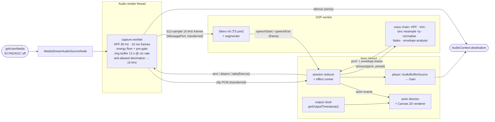
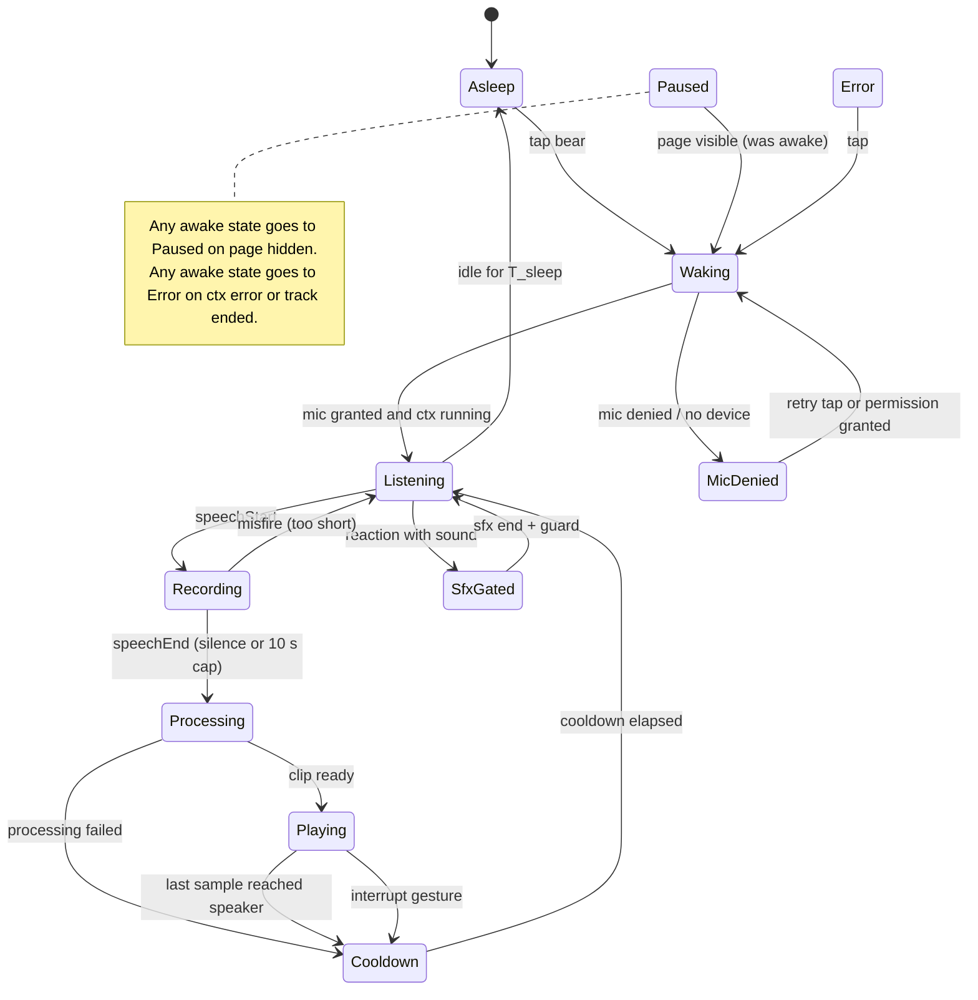
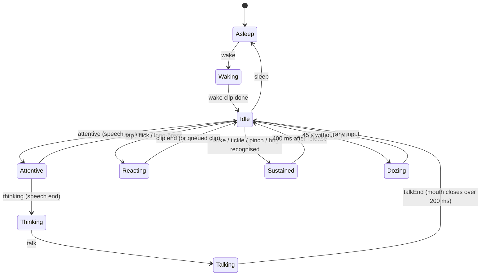

# Talking Bear: implementation plan

**Status:** plan only. No application code exists yet.
**Date:** 2026-09-26.
**Scope:** a client-side-only, installable, offline PWA. You talk to an original bear character, and it repeats what you said in a high voice. You can also poke, pet and tickle it.
**Targets:** Android Chrome first, desktop Chrome second. iOS/Safari is out of scope, but blockers found along the way are listed in [§4.11](#411-ios-blockers-noted-not-designed-around).

---

## 0. How to read this document

### Evidence tags

Every non-obvious factual claim carries one of these tags.

| Tag | Meaning |
|---|---|
| **[V]** | Read in the primary source during this planning session: spec source, Chromium/AOSP source, MDN content or browser-compat-data, library source/README, or the npm registry. |
| **[E]** | Measured or reproduced **in this sandbox**: headless Chromium 141 via Playwright 1.56, or Node 22 on a 2.1 GHz Xeon VM. These are *not* phone measurements. |
| **[S]** | Seen only in a search-result snippet. Treat as a lead, not a fact. |
| **[M]** | From memory, reasoning or estimation. Unverified. Every [M] that matters has an experiment in [§5](#5-risks-unknowns-and-the-experiments-that-settle-them). |

### Source-access caveat

The research sandbox could **not** reach developer.mozilla.org, developer.chrome.com, web.dev, w3.org/w3c.github.io, whatwg.org or the Chromium bug tracker. Those sources were read through their GitHub mirrors instead:

- `mdn/content` and `mdn/browser-compat-data`
- `w3c/*` and `WebAudio/*` spec sources
- `whatwg/html` source
- the `chromium/chromium` GitHub mirror (`main`, fetched 2026-09-26)
- `aosp-mirror/*`
- the `GoogleChrome/developer.chrome.com` repo

Chromium `main` is roughly 1–2 milestones ahead of Stable. Where behaviour changed recently, this is called out.

Chromium bug-tracker entries are cited only from search snippets and are tagged [S].

### What was verified by hand

I re-checked the following against source or by running them myself.

- The Android input-preset logic: `aaudio_stream_wrapper.cc:517-534`.
- The constraint-default logic: `media_stream_constraints_util_audio.cc:631-641`.
- The installed-web-app autoplay exemption: `autoplay_policy.cc:71`.
- The Web Audio `playbackRate` interpolation: `audio_buffer_source_handler.cc:334-355, 870-881`.
- The Silero TypeScript-port parity result: re-ran it [E].
- The fake-microphone Playwright loop, including the `%noloop` behaviour at end of file [E].
- The CSP behaviour of AudioWorklet and WASM [E].

The research scratch scripts live in the (ephemeral) session scratchpad, not in this repo.

---

## 1. Decisions at a glance

| Area | Decision | Main alternatives rejected | Details |
|---|---|---|---|
| Capture API | `AudioWorklet` in the same `AudioContext` that plays back, posting **transferred** `Float32Array`s. No `SharedArrayBuffer`, so no COOP/COEP needed. | `MediaRecorder` + `decodeAudioData` (no pre-roll, lossy, decode latency); `MediaStreamTrackProcessor` (main-thread only in Chrome, drops frames); SAB ring (needs cross-origin isolation for no gain) | [§4.1](#41-audio-capture) |
| Capture constraints | `echoCancellation:false, noiseSuppression:false, autoGainControl:false`; own high-pass + normalisation | Browser defaults: on Android they put the device in call mode with call-volume routing; noise-suppression artefacts get amplified by pitch-up; AGC pumping on desktop | [§4.1](#41-audio-capture) |
| Sample rate | Native context rate (usually 48 kHz), `latencyHint:'interactive'`; never force a rate | Forced 16/44.1 kHz context (extra resampling and latency) | [§4.1](#41-audio-capture) |
| VAD | **Silero VAD v6 (16 kHz) via a hand-written TypeScript port** in a Worker. Weights are extracted from the pinned upstream ONNX file, and ONNX Runtime is kept only as a CI parity oracle. **Energy VAD** in the worklet serves as pre-gate, level meter and fallback. | WebRTC VAD (collapses at SNR ≤ 10 dB); `@ricky0123/vad-web` as-is (main-thread inference, 16 kHz-only audio, anti-aliasing-free resampler); onnxruntime-web at runtime (14.2 MB wasm); TEN VAD (licence) | [§4.2](#42-speech-detection-vad) |
| Voice effect | **Offline windowed-sinc resampling in TypeScript** (pitch and tempo move together: the authentic "Talking Tom" sound). Presets: Bear cub ×1.6, Chipmunk ×2.0, Big bear ×0.75. | Raw `playbackRate` (Chromium uses linear interpolation with **no anti-aliasing**); SoundTouchJS (slow, aliasing, licence provenance); phase vocoder (slow, phasey); Rubber Band (GPL) | [§4.3](#43-voice-transformation) |
| Feedback loop | **Half-duplex.** The mic stays open, but capture is disarmed from end-of-speech until the playback's last sample has left the speaker plus a cooldown. Barge-in is by touch only. | Relying on AEC: on Android, Chrome does not cancel Web Audio playback unless the OEM platform echo canceller happens to | [§4.4](#44-feedback-loop) |
| Rendering | **Procedural Canvas 2D.** Art is authored as SVG path data, a 2D rig with springs, and geometric hit regions. | Rive (proprietary editor/CLI, 360–900 KB gzip wasm, paid export); Lottie (timeline-first, stale player); sprites / three.js (non-code art pipelines) | [§4.6](#46-character-and-animation) |
| Mouth | RMS envelope plus a 2-band spectral ratio, precomputed from the **processed** buffer and synced via `getOutputTimestamp()` | Visemes (wLipSync needs Unity-calibrated profiles and breaks on pitch-shifted formants; Rhubarb is a 42 MB wasm port) | [§4.6](#46-character-and-animation) |
| Gestures | Hand-rolled Pointer Events recogniser, with thresholds from Android `ViewConfiguration` | Hammer.js (last release 2016), `@use-gesture` (no region/tickle semantics) | [§4.6](#46-character-and-animation) |
| PWA | `vite-plugin-pwa` 1.3.0 in `generateSW` mode, `registerType:'prompt'`, everything precached, updates applied only when idle **and** hidden | `autoUpdate` (reloads mid-recording); `injectManifest` / hand-written service worker (no custom fetch logic needed) | [§4.7](#47-pwa) |
| Serving | **Tiny Go server** (~200 lines, stdlib only, `embed.FS`) on `distroless/static:nonroot`, pinned by digest. Headers live in code, served precompressed with content-hash ETags; zero writes. | static-web-server (fine, but Last-Modified only, and its scratch image runs as root); nginx-unprivileged (no brotli, needs tmpfs); Caddy (root by default, writable dirs) | [§4.8](#48-image-serving-and-headers) |
| Toolchain | Vite 8.3 (Rolldown), TypeScript 7.0 (native `tsc`), oxlint + tsgolint, Prettier, Vitest 5, Playwright 1.63, pnpm 12, Node 24 LTS | ESLint + typescript-eslint (not compatible with TypeScript 7 yet); Rsbuild / esbuild / Parcel (no better worklet + PWA story) | [§8](#8-dependencies) |

---

## 2. Goals, non-goals, constraints

### Goals

- **The loop:** speak, then the bear listens, then replays you pitched up, with its mouth in sync.
- **Touch:** reactions to poke, pet, tickle, long-press and multi-touch.
- **Idle life:** blinking, breathing and gaze.
- **Privacy:** fully client-side. Audio never leaves the device: no network I/O apart from fetching the app itself.
- **Install:** installable PWA that works fully offline after the first load.

### Non-goals

- Accounts, analytics, telemetry, cloud speech, and recording or sharing to files (MVP).
- iOS support.

### Deployment constraints (the output of this repo)

- **Image:** `ghcr.io/chethan123/talking-bear:<version>`. It must be small, pinned, non-root, and serve static files.
- **Runtime:** the container runs with `read_only: true`, all capabilities dropped, no egress, and tight memory/pid limits.
- **Topology:** per-app Caddy sidecar → app over plain HTTP. TLS terminates at a front Caddy; the site is served at `bear.<domain>`.
- **Out of scope:** the hosting package itself.
- **Repo:** this one is **private** and MIT-licensed. That matters for licences ([§8](#8-dependencies)), fixture storage ([Q2](#12-open-questions-asked-one-at-a-time)) and GitHub artifact attestations ([§9](#9-ci-outline)).

---

## 3. Architecture

### 3.1 Threads and ownership

| Thread | Code | Owns |
|---|---|---|
| Main | `app/*`, `anim/*`, `input/*`, `audio/engine.ts`, `audio/player.ts` | Session state machine (a pure reducer plus an effect runner), animation loop (rAF), gesture recognition, AudioContext lifecycle, playback scheduling, wake lock, visibility and permissions |
| Audio render thread | `audio/capture.worklet.ts` | Per-quantum capture work, listed below |
| DSP Worker (module) | `workers/dsp.worker.ts` | Silero inference and the segmenter while listening; the voice-effect chain and envelope analysis while processing. These never overlap, because the loop is half-duplex. |

The capture worklet does the following on every 128-frame quantum:

- 80 Hz high-pass filter.
- Splits the input into 10 ms frames.
- Tracks the energy noise floor and runs the energy pre-gate.
- Keeps a **12 s ring buffer at the context rate**.
- Downsamples to 16 kHz with an anti-alias filter.
- Applies arm/disarm gating.

**Timeline.** One clock is canonical: **the capture frame index** in the AudioWorklet's `currentFrame` domain, which is the context-rate frame counter.

- Every VAD event carries a frame index.
- Clip extraction is by frame range.
- Playback timing uses `AudioContext` time, which is the same clock divided by the sample rate.

Wall-clock time is used only for UI timers (idle/sleep). It is injected as a `Clock` so tests are deterministic.

### 3.2 Audio pipeline (data flow)



**Why the worklet connects to `destination` even though it outputs silence.** Chromium wraps the Web Audio sink in a `SilentSinkSuspender`. After 30 s of exact-zero output, it releases the hardware output and drives rendering from a fake sink. That detection is **disabled** when the graph contains "automatic pull" nodes, and an `AudioWorkletNode` with unconnected outputs is one of those [V `silent_sink_suspender.cc`, `audio_worklet_handler.cc`]. Connecting it lets Chrome power the output path down while we are only listening. Capture continuity and resume latency are experiment **X-R4**.

**Message budget.** At 48 kHz, 16 kHz frames of 512 samples mean **31.25 messages/s** from the worklet to the worker. The main thread gets only events and a ~30 Hz level value. Nothing streams audio to the main thread except the one clip transfer per utterance.

### 3.3 Module map and interfaces

These are illustrative TypeScript signatures. Everything under `src/dsp/` is DOM-free and runs unchanged in Node, the worklet and the worker.

```ts
// ---- src/dsp (pure; Float32Array in/out; no globals) -------------------------------
export interface Biquad { process(x: Float32Array, out?: Float32Array): Float32Array; reset(): void }
export function butterworthHighpass(fs: number, fc: number): Biquad;

export class RingBuffer {                       // single-producer/single-consumer, frame-indexed
  constructor(capacityFrames: number);
  write(block: Float32Array, startFrame: number): void;
  read(fromFrame: number, toFrame: number): Float32Array; // throws RangeError if evicted
}

export interface Resampler {                    // Kaiser-windowed sinc, polyphase, arbitrary ratio
  readonly ratio: number;                       // outRate / inRate
  process(input: Float32Array): Float32Array;   // streaming (keeps history); used in worklet
  flush(): Float32Array;
}
export function createResampler(inRate: number, outRate: number, opts?: { zeroCrossings?: number; cutoff?: number }): Resampler;
export function resampleOffline(x: Float32Array, ratio: number): Float32Array; // same kernel, one shot

export interface FrameFeatures { frame: number; db: number; floorDb: number; voiced?: boolean }
export interface EnergyGateParams { onsetMarginDb: number; offsetMarginDb: number; absMinDb: number;
  floorDownTauMs: number; floorUpTauMs: number; floorInSpeechTauMs: number; ignoreBelowDb: number }
export function energyGateStep(s: EnergyGateState, f: FrameFeatures, p: EnergyGateParams): EnergyGateState;

// One segmenter for both backends: consumes per-frame speech probability (Silero) or 0/1 (energy).
export type SegEvent =
  | { kind: 'start'; frame: number }
  | { kind: 'end'; frame: number; lastSpeechFrame: number; reason: 'silence' | 'maxLength' }
  | { kind: 'misfire'; frame: number };
export interface SegParams { posThreshold: number; negThreshold: number; hangoverMs: number;
  minSpeechMs: number; maxUtteranceMs: number; frameMs: number }
export function segmenterStep(s: SegState, p: SegParams, frame: number, prob: number): [SegState, SegEvent | null];

export interface SileroModel { reset(): void; process(frame16k: Float32Array /* 512 */): number /* p(speech) */ }
export function createSilero(weights: SileroWeights): SileroModel;   // TS port, fp16→fp32 weights at load

export interface VoicePreset { id: 'cub' | 'chipmunk' | 'bigbear' | 'custom'; pitchRatio: number }
export interface Envelope { hopMs: 10; jaw: Float32Array; width: Float32Array; round: Float32Array }
export function processVoice(pcm: Float32Array, fs: number, preset: VoicePreset):
  { pcm: Float32Array; envelope: Envelope; durationSec: number };

// ---- src/audio/messages.ts (structured-clone protocol; all audio frames transferred) --
export type MainToWorklet =
  | { t: 'arm'; restoreFloorDb?: number } | { t: 'disarm' }
  | { t: 'take'; id: number; fromFrame: number; toFrame: number }
  | { t: 'mode'; vad: 'silero' | 'energy' };
export type WorkletToMain =
  | { t: 'level'; frame: number; db: number; floorDb: number }            // ~30 Hz, UI/debug
  | { t: 'seg'; ev: SegEvent }                                            // energy-fallback mode only
  | { t: 'clip'; id: number; pcm: Float32Array; fromFrame: number; sampleRate: number }
  | { t: 'floorSnapshot'; floorDb: number };
export type WorkerToMain =
  | { t: 'seg'; ev: SegEvent } | { t: 'vadStats'; p95Ms: number }
  | { t: 'processed'; id: number; pcm: Float32Array; envelope: Envelope; durationSec: number }
  | { t: 'error'; where: 'vad' | 'fx'; message: string };

// ---- src/app/machine.ts (pure) -----------------------------------------------------
export function reduce(s: SessionState, e: SessionEvent): { state: SessionState; effects: Effect[] };
export type Effect =
  | { k: 'openMic' } | { k: 'closeMic' } | { k: 'resumeCtx' } | { k: 'suspendCtx' }
  | { k: 'arm'; restoreFloorDb?: number } | { k: 'disarm' } | { k: 'take'; fromFrame: number; toFrame: number }
  | { k: 'process'; preset: VoicePreset } | { k: 'play' } | { k: 'stopPlayback' }
  | { k: 'timer'; name: 'cooldown' | 'sfxGate' | 'sleep' | 'doze'; ms: number } | { k: 'cancelTimer'; name: string }
  | { k: 'wakeLock'; on: boolean } | { k: 'anim'; ev: AnimEvent } | { k: 'sfx'; id: SfxId }
  | { k: 'ui'; show: 'tapToWake' | 'micHelp' | 'tooNoisy' | 'error' | null };

// ---- src/audio/output-clock.ts -----------------------------------------------------
/** Seconds of the scheduled clip that have actually reached the output device "now". */
export function clipTimeNow(ctx: AudioContext, scheduledStartCtxTime: number): number;
// = ts.contextTime + (performance.now() - ts.performanceTime)/1000 - scheduledStartCtxTime
// where ts = ctx.getOutputTimestamp(); contextTime already accounts for output latency [V spec].

// ---- src/input/recognizer.ts (pure) ------------------------------------------------
export interface PointerSample { id: number; t: number; x: number; y: number; type: 'down' | 'move' | 'up' | 'cancel' }
export type Gesture =
  | { g: 'tap'; region: RegionId; x: number; y: number } | { g: 'longPress'; region: RegionId; phase: 'start' | 'end' }
  | { g: 'stroke'; region: RegionId; phase: 'start' | 'update' | 'end'; pathPx: number; dir: number }
  | { g: 'tickle'; region: RegionId } | { g: 'flick'; region: RegionId; vx: number; vy: number }
  | { g: 'pinch'; regions: [RegionId, RegionId]; spanRatio: number } | { g: 'hug' };
export function recognize(s: RecState, sample: PointerSample, hit: (x: number, y: number) => RegionId): [RecState, Gesture[]];

// ---- src/anim ------------------------------------------------------------------------
export const enum Ch { HeadRot, HeadTilt, Jaw, MouthW, MouthRound, LidL, LidR, IrisX, IrisY, EarRotL, EarRotR,
  EarFoldL, EarFoldR, BrowY, BodySquash, BellyJiggle, TuftRot, Blush, ArmRotL, ArmRotR, /* … ~40 */ Count }
export type Pose = Float32Array; // length Ch.Count, preallocated
export interface Layer { update(dt: number, pose: Pose, ctx: AnimContext): void }
export function directorReduce(s: DirectorState, e: AnimEvent): DirectorState;   // pure, testable
export function render(g: CanvasRenderingContext2D, rig: Rig, pose: Pose): void; // no allocation
```

Design rules:

1. **DSP and state are pure.** Side effects happen only in effect runners and the DOM, worklet and worker adapters.
2. **The worklet contains glue only.** `process()` calls into `src/dsp/*`, and it is tested in Node with a stubbed `AudioWorkletGlobalScope` ([§4.9](#49-testing)).
3. **No allocation in hot loops** (the `process()` quantum and the rAF frame). Buffers are preallocated and reused, except for the transferred messages.
4. **VAD backend behind an interface.** `mode:'silero'|'energy'` switches the backend at runtime, and the segmenter is shared. That makes the fallback a one-line switch.

### 3.4 Session (conversation) state machine



"Awake" means every state except `Asleep`, `Paused` and `Error`. **The mic is gated** (capture disarmed) in `Processing`, `Playing`, `Cooldown` and `SfxGated`. The mic **stream** stays open throughout the awake period. It is closed only in `Asleep`, `Paused`, `Error` and `MicDenied`.

The reasons for keeping the stream open:

- Reopening it re-triggers Android audio-mode and routing changes [V `AudioManagerAndroid.java`].
- Reopening costs stream-open latency [M].
- Reopening flickers the privacy indicator.

| # | From | Event | Guard | To | Effects |
|---|---|---|---|---|---|
| 1 | Asleep | `tapBear` | — | Waking | `resumeCtx`, `openMic`, `wakeLock on`, `anim wake` |
| 2 | Waking | `micGranted` | `ctx.state==='running'` | Listening | `arm`, `timer sleep`, `anim idle` |
| 3 | Waking | `micDenied` \| `noDevice` | — | MicDenied | `ui micHelp`, `anim shrug`. Touch reactions still work. |
| 4 | MicDenied | `tapRetry` \| `permissionChanged(granted)` | — | Waking | `openMic` |
| 5 | Listening | `seg.start{frame}` | — | Recording | `cancelTimer sleep`, `anim attentive` |
| 6 | Listening | `reaction{sfx}` | reaction has sound | SfxGated | `disarm`, `sfx id`, `timer sfxGate = sfxDur + 250 ms` |
| 7 | Listening | `reaction{no sfx}` | — | Listening | `anim reaction`, reset `timer sleep` |
| 8 | SfxGated | `timer sfxGate` | — | Listening | `arm(restoreFloorDb)` |
| 9 | Recording | `seg.misfire` | — | Listening | `anim earTwitch` ("huh?") |
| 10 | Recording | `seg.end{frame,lastSpeechFrame,reason}` | — | Processing | `disarm`, `take(onset − preRoll, lastSpeechFrame + 150 ms)`, `anim thinking` |
| 11 | Recording | `reaction` | — | Recording | animation only. No sfx, so the take is not polluted. |
| 12 | Processing | `processed` | — | Playing | `play`, `anim talk(envelope, startCtxTime)` |
| 13 | Processing | `error(fx)` | — | Cooldown | `anim confused`, `timer cooldown` |
| 14 | Playing | `playbackAtSpeakerEnded` | — | Cooldown | `timer cooldown = 250 ms` (tuned by X-E5) |
| 15 | Playing | `reaction{priority ≥ 3}` | — | Cooldown | `stopPlayback`, `anim reaction`, `timer cooldown` |
| 16 | Playing | `reaction{priority < 3}` | — | Playing | additive flinch only |
| 17 | Cooldown | `timer cooldown` | — | Listening | `arm(restoreFloorDb)`. The worklet clears the pre-roll ring and blocks onsets for 100 ms. |
| 18 | Listening | `timer sleep` | no speech or touch for `T_sleep` = 120 s (decided in Q1; configurable in settings) | Asleep | `disarm`, `closeMic`, `suspendCtx`, `wakeLock off`, `anim sleep` |
| 19 | any awake | `visibility hidden` \| `pagehide` \| `freeze` | — | Paused | abort take/playback, `closeMic`, `suspendCtx`, `wakeLock off` |
| 20 | Paused | `visibility visible` | was awake | Waking | `resumeCtx`, `openMic` (normally no prompt), `wakeLock on` |
| 21 | any awake | `ctxError` \| `track ended` \| `devicechange` affecting input | — | Error | `closeMic`, `ui error: tap to retry` |
| 22 | Error | `tapBear` | — | Waking | as row 1 |
| 23 | Recording | `seg.end{reason:'maxLength'}` | 10 s cap reached | Processing | as row 10. After 3 consecutive capped takes with a low voiced ratio: `ui tooNoisy` and raise margins by 3 dB each time (see [§4.4](#44-feedback-loop)). |

Timing detail:

- `playbackAtSpeakerEnded` is **not** `AudioBufferSourceNode.onended`, which fires when rendering stops.
- The player waits for `onended`, then polls `getOutputTimestamp()` until `contextTime ≥ startTime + duration`. At that point the last sample has actually left the device ([§4.4](#44-feedback-loop)).

### 3.5 Animation director (separate from, and driven by, the session)

This machine only consumes events from the session:

- `wake`, `sleep`, `attentive`, `thinking`, `talk{envelope,start}`, `talkEnd`, `reaction{…}`

It emits `requestStopPlayback` and `sfx` back to the session. The two machines share **no state**, only a typed event bus, so each is unit-testable alone.



**Structure.**

- **Base layer:** exactly one of the states above, crossfaded over 150 ms.
- **Additive layers, always running and weighted by state:** blink, breathing, gaze/look-at, ear twitch, spring physics (tuft, ears, belly, neckerchief tails) and mood (`joy`/`annoy` scalars decaying with τ = 8 s).
- **Reaction priorities:**
  - P1: ambient fidget
  - P2: tap reaction
  - P3: sustained reaction
  - P4: "big" reaction (laugh fit, dizzy, hug)
- **Interruption rule:** a new reaction interrupts only if its priority ≥ the current one. Otherwise it is queued (queue length 1, dropped after 500 ms).
- **Cooldown:** 800 ms per (region, gesture).
- **Escalation:** the same reaction ×3 within 4 s escalates to its P4 variant.
- **While `Talking`:** P2 is additive flinch only; P3 and above emit `requestStopPlayback` (session row 15).

---

## 4. Research findings and decisions

References `[R#]` resolve in [§13](#13-references).

### 4.1 Audio capture

#### 4.1.1 Constraints: what `echoCancellation` / `noiseSuppression` / `autoGainControl` really do in Chrome

- **Defaults follow `echoCancellation`.** In `UpdateDefaultValues`, `auto_gain_control &= default` and `noise_suppression &= default`, and that default comes from the echo-cancellation (EC) constraint [V R2, hand-checked]. So `{echoCancellation:false}` alone turns noise suppression (NS) and auto gain control (AGC) off too, unless they are explicitly `true`.
- **Software processing is WebRTC's audio processing module (APM)** [V R5]:
  - NS runs at `kHigh`.
  - On Android, AGC is AGC2 with a **fixed +6 dB** digital gain.
  - On desktop, AGC is AGC2 adaptive, plus an input-volume controller.
  - The echo canceller is AEC3, used only when Chrome itself provides the echo cancellation.
  - The APM runs at 48 kHz on every platform. Android moved from 16 kHz to 48 kHz in June 2024 [V R6 `9720e66`].
- **Android: which preset and which audio mode.** These are the effects that matter most.
  - Chrome advertises the platform `ECHO_CANCELLER` effect iff `AcousticEchoCanceler.isAvailable()` [V R3]. It never advertises platform NS/AGC.
  - When echo cancellation is requested and available, AAudio input uses `AAUDIO_INPUT_PRESET_VOICE_COMMUNICATION`. Otherwise it uses **`GENERIC`** [V R1, hand-checked lines 517–534].
  - The GENERIC preset landed on 2026-08-13 (commit `054d2dc`); previously it was `CAMCORDER`. A rollback flag `kForceAAudioCamcorderInputPreset` exists with a "remove once M153 hits stable" TODO. **Expect CAMCORDER on current Stable devices and GENERIC on newer ones** [V R1, R6].
  - Chrome deliberately never uses `UNPROCESSED` because "lack of automatic gain control results in quiet, sometimes silent, streams" [V R1].
  - The commit message says GENERIC "still enables AGC". So **"all off" is not raw audio on Android**: some OEM MIC-path processing remains [V R6].
  - If the first input stream's effects are non-empty, Chrome calls `setMode(MODE_IN_COMMUNICATION)`. Output streams created afterwards then get `AAUDIO_USAGE_VOICE_COMMUNICATION`, which means call-volume routing [V R3, R4].
- **What the processing does to a record-then-replay clip** [M, well-known WebRTC behaviour]:
  - NS at kHigh leaves "musical noise" and smears consonant onsets. Pitch-shifting up makes both more audible.
  - Adaptive AGC ramps gain over hundreds of ms, which pumps at the start of an utterance.
  - AEC3 only matters if you record during playback, which we never do.
- **Newer constraint values:**
  - `echoCancellation: "all" | "remote-only"` is in the spec [V R19]. It is stable in Chrome [V `runtime_enabled_features.json5`] and shipped around M141 [S]. On Android "remote-only" is not offered, and "all" is offered only when a platform echo canceller exists [V R2].
  - `voiceIsolation` is in Media Capture Extensions [V R20]. It is experimental in Chrome and ChromeOS-only [V].
- **`sampleRate` / `channelCount` / `latency` constraints** [V R2]:
  - Each processing path accepts exactly one sample rate: 48 kHz with APM, the device rate without. An exact mismatch gives `OverconstrainedError`; an `ideal` value is ignored.
  - Android input is mono.
  - `latency` is honoured only on the unprocessed path.

**Decision.** Request exactly this:

```js
{ audio: { echoCancellation:false, noiseSuppression:false, autoGainControl:false } }
```

Then do our own 80 Hz high-pass, trim and peak normalisation (gain cap +18 dB). On Android this avoids `MODE_IN_COMMUNICATION` and call-volume routing, and the bear plays on the loudspeaker at media volume (see [§4.5](#45-android-chrome-specifics)).

- **Optional "noisy room" toggle, off by default:** `noiseSuppression:true` alone. That is software NS only, still the GENERIC preset, and no communication mode [V R1–R3].
- **Rejected: the defaults (all `true`).** They bring communication mode and call volume on Android, NS artefacts, and AGC pumping on desktop. Echo cancellation is unnecessary with half-duplex.

#### 4.1.2 Getting samples: AudioWorklet vs MediaRecorder vs others

| Option | Findings | Verdict |
|---|---|---|
| **AudioWorklet**, transferring `Float32Array`s via `port.postMessage(buf,[buf.buffer])` | Runs on the audio render thread in 128-frame quanta. Transfer is zero-copy and needs no special headers. An `AudioWorkletNode` with `numberOfOutputs:0` is pulled automatically [V R8, E]. At 48 kHz mono the data rate is 192 KB/s, trivial for `postMessage`. | **Chosen** |
| AudioWorklet + `SharedArrayBuffer` ring | Needs cross-origin isolation (COOP+COEP) [V R31]. No throughput benefit at this data rate. | Rejected; revisit only if message jitter shows up in X-R4 |
| `MediaRecorder` + `decodeAudioData` | Chrome encodes Opus in webm/mp4 using **60 ms Opus frames**, so `timeslice` granularity is ≥ 60 ms [V R16]. There is **no pre-roll**: recording must already be running before the onset, and later chunks are not independently decodable [M]. It is lossy. Decoding adds latency and resamples to the context rate [V R21]. | Rejected |
| `MediaStreamTrackProcessor` (audio) | Chrome exposes it on **Window only**, whereas the spec says DedicatedWorker [V R30]. The main thread would receive `AudioData` and drop frames under jank; `discardedFrames` stats exist since Chrome 150 [V R30]. | Rejected |

**Worklet design.** One `capture` processor handles the following:

- **Per quantum:**
  - Down-mix to mono.
  - Run the 80 Hz high-pass.
  - Accumulate 10 ms frames and compute their dB.
  - Update the energy gate.
  - Write the ring buffer, which holds 12 s at the context rate: 2.3 MB at 48 kHz.
  - Stream into the 48→16 kHz decimator, then accumulate 512-sample frames and post them to the worker port.
- **Output:** writes zeros to its output, which is connected to `destination`; see [§3.2](#32-audio-pipeline-data-flow).
- **Commands:** `arm`, `disarm` and `take{from,to}`. A `take` copies the range out of the ring into a fresh buffer and transfers it.

The processor has no timers and no `performance` object [V R73], so it is purely frame-driven.

**Measured cost** of this kind of loop: 0.64 µs per 128-frame quantum for energy plus ring write, i.e. 0.024 % of a core, on a 2.1 GHz Xeon VM [E]. The decimator costs about 1.5 ms per second of audio, i.e. 0.15 % of a core [E]. Assume 5–10× slower on a Cortex-A55 [M]; that is still negligible next to Chrome's own capture and output pipeline.

#### 4.1.3 Sample-rate handling

- **Android context rate.** The default `AudioContext` rate on Android is `AudioManager.PROPERTY_OUTPUT_SAMPLE_RATE`, falling back to 44100 if that is null [V R4]. That is usually 48 kHz; some devices report 44.1 kHz [M].
- **Mic track rate.** The track delivers 48 kHz on the APM path, or the device rate on the raw path [V R2].
- **Resampling to the context.** `MediaStreamAudioSourceNode` resamples to the context rate with a SincResampler and a FIFO; FIFO overruns drop audio [V R21, `webaudio_media_stream_audio_sink.cc`].
- **Forcing a rate.** `new AudioContext({sampleRate})` works (Chrome 74+) but forces output resampling, which the spec warns may add latency "by a large amount" [V R21, R30].
- **`latencyHint`.** `'interactive'` maps to AAudio `PERFORMANCE_MODE_LOW_LATENCY`; `'playback'` maps to `POWER_SAVING` [V R1]. A snippet reports AudioWorklet glitches with `'playback'` on Android [S crbug 40133762].
- **Headless test context.** In this sandbox, headless Chromium ran the context at **44.1 kHz** and the fake track at 44.1 kHz stereo, and it resampled both 48 kHz and 16 kHz WAV fixtures without trouble [E].

**Decision.**

- Never pass `sampleRate`. Use `ctx.sampleRate` everywhere.
- The 16 kHz VAD path uses the generic polyphase sinc resampler. It handles both 48k→16k (an integer factor of 3) and 44.1k→16k (rational 160/441), with the same code as the voice effect.
- Keep `latencyHint:'interactive'`.
- **Rejected:** a forced 16 kHz or 48 kHz context.

### 4.2 Speech detection (VAD)

All numbers in this section come from a synthetic evaluation in this sandbox [E]:

- **Speech:** 10 utterances from one speaker, taken from `silero-vad/tests/data/test.wav`, separated by 3 s gaps.
- **Noise:** pink noise ("fan"), amplitude-modulated pink, low-passed second speaker ("TV"), and 40 ms knocks.
- **Ground truth:** a clean-signal energy oracle.

The results are **directional only**: synthetic noise, one speaker, n = 10. [§7 M2](#m2--vad-tuning) replaces them with on-device fixtures.

#### 4.2.1 The three candidates

**Energy/RMS with an adaptive floor**

Grounding: G.729 Annex B; Sohn 1999; Martin 2001 minimum statistics [M R44]. Common JS libraries such as `hark` and Jam3 use fixed thresholds and never adapt [V R43].

Proposed algorithm (10 ms frames):

1. **Band-limit:** 2× high-pass at 200 Hz, then a low-pass at 3.4 kHz (biquads).
2. **Level:** `E` in dBFS.
3. **Noise floor `N`:** asymmetric EMA in dB.
   - Falls fast (τ ≈ 45 ms).
   - Rises slowly (τ ≈ 2.5 s).
   - During speech it only drifts up (τ ≈ 20 s).
   - **Ignores frames below −100 dBFS** (digital silence).
4. **Hysteresis:** onset when `E > max(N+10 dB, −65 dBFS)`; offset when `E < N+5 dB`.
5. **Voicing gate:** normalised autocorrelation peak > 0.5, for F0 in 70–600 Hz, computed **on the 16 kHz stream**. An utterance needs ≥ 60 ms of voiced frames.
6. **Segmenter:** min speech 150 ms, hangover **800 ms**, pre-roll 300 ms, max 10 s.

Why step 3 ignores digital silence: my first toy VAD in the headless loop false-triggered at t = 20 ms. The floor had collapsed to −81 dB on the fake device's leading digital silence, and then −65 dB background noise looked like speech [E]. The guard fixed it.

Cost: 10 µs per frame at 16 kHz, plus 86 µs for voicing [E].

**WebRTC VAD (libfvad → WASM)**

- A GMM over 6 sub-band energies, computed internally at 8 kHz, with modes 0–3 [V R41].
- Maintained ports: `@echogarden/fvad-wasm` 0.2.0 (BSD-3, 7 KB brotli wasm) and `auditok-webrtcvad` 0.1.0 [V R41].
- It is extremely cheap (2–6 µs per frame) but inaccurate in noise:
  - Silero's own benchmark: ROC-AUC 0.73 vs 0.97 for Silero v6, and 0.00 whole-clip accuracy on ESC-50 noise [V R38; vendor benchmark, so possibly biased].
  - Here: 19–24 false triggers/min on fan noise at SNR 10, and it latched on until the 10 s cap at SNR ≤ 5 [E].

**Silero VAD** [V R38]

- **Model:** v6 (2025-08; v6.2 2025-12) takes 512-sample frames at 16 kHz plus 64 samples of context. Its state is `[2,1,128]`. MIT licensed.
- **Upstream files:** `silero_vad.onnx` is 2.33 MB (8k+16k); **`silero_vad_16k_op15.onnx` is 1.29 MB and 16k-only**, a drop-in replacement.
- **`@ricky0123/vad-web` 0.0.31** [V R39] is not usable as-is:
  - It runs inference **on the main thread**.
  - Its worklet resamples by **boxcar averaging** (no anti-alias filter).
  - `onSpeechEnd` returns 16 kHz audio only, with no timestamps.
  - Its CJS bundle pulls in two onnxruntime builds (430 KB JS).
  - Its default model is still `legacy`.
- **`onnxruntime-web` 1.30.0** [V R40, E]:
  - The only CPU wasm is **14.24 MB raw / 2.30 MB brotli**. No single-threaded build has existed since 1.19; it runs one thread when not cross-origin isolated.
  - Measured 0.41 ms per frame (1 thread, x86) [E].
  - It needs `'wasm-unsafe-eval'`.
  - The files exceed Workbox's 2 MiB default per-file precache limit and are **silently dropped** from the precache (with only a build warning) [V R57].
- **Hand-written TypeScript port.** The upstream `tinygrad_model.py` documents the graph [V R38]:
  - reflect-pad 64
  - STFT as a 258×256 stride-128 convolution, then magnitude
  - 4 × conv (k = 3) with ReLU
  - LSTMCell(128)
  - ReLU → 1×1 conv → sigmoid

  Ported to about 60 lines, with weights extracted from `silero_vad_16k_op15.onnx`, its maximum probability error against onnxruntime is **2.4 × 10⁻⁶**, with **0 of 1875 frames flipping** their decision at 0.5. I re-ran this [E]. A deliberately wrong LSTM gate order produces garbage, which is a useful negative control [E].

  Performance and size:
  - About 0.9–1.0 ms per frame in plain scalar JS (x86) [E].
  - fp16 weights, excluding the STFT basis (which is generated in code), are **487 KB raw / 435 KB brotli**, still with 0 flips [E].
  - No WASM, so no `'wasm-unsafe-eval'` for this path.

#### 4.2.2 Comparison

| | Energy + floor + voicing | WebRTC VAD (WASM) | Silero v6 via ORT-web | **Silero v6 TS port** |
|---|---|---|---|---|
| Download (brotli) | ~4 KB | 7–18 KB | **~3.3 MB** (15.6 MB raw) | **~0.44 MB** |
| x86 CPU per frame [E] | 10 µs / 10 ms (+86 µs voicing) | 2–6 µs / 10 ms | 0.41 ms / 32 ms | 0.9–1.0 ms / 32 ms |
| Mid-range Android CPU (est. ×1.5–3 big core, ×4–8 little core) [M] | < 1 % | ~0 | 2–5 % big / ~10 % little | 5–10 % big / 12–25 % little **while running** |
| False triggers/min, steady fan [E] | 0 | 19–24 at SNR 10; latches at ≤ 5 | 0 | = ORT |
| Modulated fan [E] | 10–11 (0 with voicing gate) | 16–17 | 0 | = ORT |
| **TV speech** [E] | 8–10 | 7–9 | **8** | = ORT |
| Speech in fan at SNR 5 [E] | 3/10 split, tails cut | latched to cap | 0 splits | = ORT |
| Hangover needed for 0 splits [E] | ≥ 800 ms | n/a | **600 ms** | 600 ms |
| CSP needs | none | `'wasm-unsafe-eval'` | `'wasm-unsafe-eval'` | none |
| Precache (2 MiB default) | fits | fits | breaks without config | fits |

**No VAD rejects TV speech.** Every method false-triggered 7–10 times/min on it [E]. This is a product problem, handled by:

- a proximity gate: the utterance's active level must be ≥ background + X dB;
- the "too noisy" hint;
- an optional hold-to-talk fallback ([§4.4](#44-feedback-loop), [§7 M8](#m8--polish)).

#### 4.2.3 Decision

- **Primary: Silero v6 16k, TS port, in the DSP worker**, fed 512-sample 16 kHz frames from the worklet over a transferred `MessagePort`.
  - The weights are extracted at dev time by `scripts/extract-silero-weights.ts` from a **pinned** upstream file (commit plus SHA-256), stored as fp16 and committed with a provenance JSON. That keeps builds hermetic.
  - `onnxruntime-web` is a **devDependency only**: it is the parity oracle in CI (`max|Δp| < 1e-3` and 0 flips on the fixtures).
- **Pre-gate, level meter and fallback: the energy VAD in the worklet.**
  - Silero runs only while the energy gate reports "above floor + 6 dB", or while in `Recording`.
  - On gate-open, the worklet first replays the last 320 ms from a small 16 kHz ring to warm the LSTM state.
  - If the worker fails or the model is loading, `mode:'energy'` switches the segmenter's input to the energy gate (with the 800 ms hangover).
  - The pre-gate is an **optimisation to be kept only if M2 shows it saves meaningful CPU without hurting onset accuracy**.
- **Default parameters (Silero):**

  | Parameter | Value |
  |---|---|
  | Positive / negative threshold | 0.5 / 0.35 |
  | Hangover | 600 ms |
  | Minimum speech | 150 ms, else misfire |
  | Pre-roll | 300 ms, taken from the context-rate ring |
  | Maximum utterance | 10 s |
  | Clip trim | ends at `lastSpeechFrame` + 150 ms, so the bear never replays 600 ms of hangover silence |
  | LSTM state | reset at every re-arm |

- **Gate to keep the TS port (M2).** On-device p95 must be **≤ 8 ms per 32 ms frame** on the mid-range reference phone.
  - If it misses: first optimise (real FFT for the STFT, loop tuning).
  - Then fall back to the ORT backend (+3.3 MB, precache limit raised to 16 MiB, `'wasm-unsafe-eval'`).
  - Or accept energy-only.
- **Rejected:**
  - WebRTC VAD (noise false positives).
  - `vad-web` as-is (reasons above).
  - TEN VAD: Apache-2.0 **plus Agora non-compete conditions** [V R42].
  - FluidVad 0.2.0: 1.9 MB brotli, slower than ORT, 2 months old [V/E].
  - A custom minimal ORT build: undocumented size, Emscripten build burden [V R40].

End-to-end latency from end of speech to the start of the bear's voice:

| Component | Time |
|---|---|
| Hangover | 600 ms |
| Clip take | < 5 ms |
| Voice processing | 36–90 ms, est. [M] |
| Scheduling margin | 50 ms |
| Output latency | 20–50 ms on the speaker [M] |
| **Total** | **≈ 0.7–0.8 s** |

This is comparable to the original app [M].

### 4.3 Voice transformation

#### 4.3.1 `playbackRate` in Chromium is linear interpolation, with no anti-aliasing

- **The spec leaves interpolation to the UA** [V R21].
- **Chromium's implementation.** `AudioBufferSourceHandler::ProcessInterpolatedPath` computes `(1−f)·s[i] + f·s[i+1]` and has no pre-filter anywhere. Its own comment says high rates exist "to minimize linear interpolation aliasing". An `AudioBuffer` tagged with a different `sampleRate` goes through **the same path**, because `sample_rate_factor` just multiplies the rate [V R8, hand-checked lines 334–355, 870–881].
- **Measured with a Chromium-clone interpolator on synthetic voice [E]:**
  - At r = 2.0, 14/18/20 kHz tones alias to 20/12/8 kHz at **full level** (−6 dBFS in → −6 dBFS out).
  - At r = 1.7, aliases reach −9 dBFS.
  - An 8-zero-crossing Kaiser sinc brings aliasing to ≤ −100 dB relative.
- **The `decodeAudioData` trick.** Wrap the PCM in a WAV header claiming rate `48000·r` and decode it on a 48 kHz context. Chromium then resamples with its 32-tap `SincResampler` (cutoff 0.9·min(1,1/ratio)), which *does* anti-alias [V R11]. It is clever but obscure and untested in a browser, so it is kept only as a fallback experiment.

Audibility is subjective. Aliasing lands on sibilants ("grainy s"), is probably masked on a phone speaker, and is audible on headphones [M]. Eliminating it costs ~0.8 KB of code, so we do.

#### 4.3.2 Candidates

CPU is per 5 s clip at 48 kHz on the VM [E]. The phone column is an estimate [M]. Quality judgements are subjective.

| Approach | Duration | Formants | CPU / 5 s clip, VM [E] | Phone est. [M] | Size min / gzip [E] | Licence | Notes |
|---|---|---|---|---|---|---|---|
| ABSN `playbackRate` | ÷r | ×r | native | native | 0 | — | aliasing (above) |
| **Offline sinc resample (own TS)** | ÷r | ×r | **12–15 ms** | 36–90 ms | 0.8 / 0.5 KB | own | clean; authentic |
| SoundTouchJS `@soundtouchjs/core` 2.1.1 | = | ×r | 88–116 ms (Lanczos), 22–26 ms (linear) | 66–700 ms | 24.8 / 6.3 KB | MPL-2.0 *(relicensed from LGPL-2.1 in 2.0.1; provenance unclear)* | WSOLA flutter; **no anti-alias filter** [V/E] |
| Phase vocoder (SoundTouch PV / `@audio/shift`) | = | ×r | 87–335 ms | 260–2000 ms | 8 KB gzip | MPL / MIT | phasiness |
| Own TD-PSOLA + YIN | = | preserved or tunable | 47–62 ms | 140–370 ms | 1.6 KB gzip | own | pitch-mark errors; octave errors |
| `@audio/shift` `formant` (cepstral) | = | mostly preserved | ~118 ms | 350–710 ms | 6.1 KB gzip | MIT | |
| **Signalsmith Stretch** 1.3.2 | = | ×r, compensated, or shifted | 37–72 ms; 85–102 with formants | real-time in a worklet | 44.4 KB gzip (wasm inlined) | MIT | best overall [M]; default blob: worklet → set `moduleUrl` same-origin; needs `'wasm-unsafe-eval'` |
| Rubber Band wasm | = | options | — | — | 116 KB gzip | **GPL** | rejected |

Sources: [V R45–R48], measurements [E].

- `pitchfinder` (a common JS pitch-detection library) is **GPL-3** [V R47]. Write your own YIN (~40 lines) if one is ever needed.
- **SoundTouchJS licence risk.** The move from LGPL-2.1 to MPL-2.0 needs every copyright holder's consent, and `Stretch.js` still carries Olli Parviainen's copyright [V R45]. If the relicensing is invalid, the LGPL-2.1 relink obligations would apply. A service-worker-cached minified bundle makes those awkward [M, not legal advice].

#### 4.3.3 Formants and "cute"

Resampling scales F0 **and** the spectral envelope by r. The formants rise as if the vocal tract were r× shorter, which is the chipmunk/helium sound. The measured centroid ratio was 1.37× at r = 1.5 [E].

Formant-preserving methods (PSOLA, LPC, cepstral) sound like the *same person* in falsetto, which is less cartoonish [M].

Perceived size is driven jointly by glottal pulse rate and vocal-tract length [S R49]. A "cub" preset with pitch ×1.7 but formants only ×1.3 would likely be cuter and more intelligible for children's already-high voices. Only PSOLA-with-grain-resampling or Signalsmith can express that.

#### 4.3.4 Decision and the "voice knob"

**MVP: offline windowed-sinc resampling in TS, in the DSP worker.**

- 8 zero-crossings, Kaiser window, cutoff 0.9 × min(1, 1/r).
- Polyphase table cached per ratio.
- **The same kernel** as the streaming VAD decimator.

Chain: `clip → HPF 80 Hz (2nd-order Butterworth) → resample ×(1/p) → peak-normalise to −1 dBFS (gain ≤ +18 dB; skipped if no voiced frames) → 8 ms raised-cosine fades → envelope analysis`.

The result plays through an `AudioBufferSourceNode` at rate 1. Fades and envelope come from the **exact** buffer that plays.

**Knob: yes.** In the MVP, presets are nearly free: one parameter on one code path.

| Preset | Pitch ratio p | Tempo | Algorithm | When |
|---|---|---|---|---|
| **Bear cub** (default, [M] ≈ Talking Tom) | 1.6 (+8.1 st) | ×1.6 | sinc | MVP |
| Chipmunk | 2.0 (+12 st) | ×2.0 | sinc | MVP |
| Big bear | 0.75 (−5 st) | ×0.75 | sinc (upsampling, so no aliasing) | MVP |
| Custom slider | 0.7–2.2 | coupled | sinc | MVP (settings) |
| Tiny & clear | 1.8 | ×1.25 | WSOLA stretch + sinc | later |
| Cartoon cub | 1.7, formants ×1.3 | = | Signalsmith (`formantSemitones` + compensation) or own PSOLA | later |
| Adaptive | `clamp(targetF0/medianF0, 1.3, 2.1)` | coupled | YIN + sinc (~8 ms/s of audio [E]) | later |

The default ratio is settled by the M3 listening test ([§7](#7-milestones-build-order)).

**Rejected:**

- Raw `playbackRate`: avoidable aliasing.
- SoundTouchJS: speed, aliasing, licence provenance.
- Phase vocoder: speed, phasiness.
- Rubber Band and `pitchfinder`: GPL.
- WORLD vocoder: CPU and complexity.
- Tone.js `PitchShift`: delay-line artefacts [M].

### 4.4 Feedback loop

**Can AEC do the job? Not on Android.**

- **Desktop (Win/Mac/Linux):** yes in principle. With echo cancellation on, Chrome-wide AEC3 uses Chrome's own output mix as its reference, including Web Audio [V R5, `media_switches.cc`].
- **Android: no.**
  - If the device has a platform echo canceller, Chrome defers to it. Whether the HAL's echo reference includes Chrome's Web Audio stream is OEM-specific [M].
  - If it has none, Chrome's software AEC3 references **only RTCPeerConnection playout**, which is the definition of "remote-only". So Web Audio echo is not cancelled at all [V R2, R19].
  - Even a good AEC leaves residual echo from a phone speaker a few cm from the mic at full volume [M].
  - Echo cancellation on Android also forces call mode ([§4.1](#41-audio-capture)).

**Decision: half-duplex** (state machine in [§3.4](#34-session-conversation-state-machine)).

1. **Mic open, capture gated.** One `getUserMedia` stream stays open for the whole awake period. The worklet ignores input from `speechEnd` until the end of `Cooldown`: no VAD feeding, and the floor is frozen.
2. **"Playback ended" means at the speaker.** After `onended`, wait until `ctx.getOutputTimestamp().contextTime ≥ start + duration`. Chrome derives that timestamp from AAudio `getTimestamp`, and reports **0 delay if that call fails** [V R10]. So also wait a minimum of `outputLatency` or 50 ms, whichever is larger.
3. **Cooldown ≥ 250 ms** for room tail and speaker ring-down. Tune with X-E5.
4. **Re-arm hygiene.** Restore the floor saved at onset. **Clear the pre-roll ring**, so the bear's own tail is never pre-rolled into the next take. Ignore onsets for the first 100 ms.
5. **Reaction sounds are gated the same way** (`SfxGated`). During `Recording`, reactions are silent.
6. **Barge-in is touch-only.** Tap the bear to stop it (P ≥ 3 gestures). Acoustic barge-in during a loud replay cannot be told apart from the echo without AEC [M].

**Edge cases**

| Case | Handling |
|---|---|
| User speaks during playback | Ignored by design. The bear's "talking" pose is the affordance; tapping interrupts. |
| Background noise never falls silent | Steady noise is absorbed by the adaptive floor. If floor > −35 dBFS, show "too noisy". If 3 consecutive takes hit the cap with a low voiced ratio: raise the margins by 3 dB each time, then offer hold-to-talk. This breaks noise→replay→noise loops. |
| Too short (< 150 ms speech; knocks, clicks) | `misfire` → ear-twitch "huh?", no replay |
| Too long | Hard cap at 10 s (ring buffer 12 s), then replay what was captured |
| Clipping (shouting) | Detect ≥ 0.1 % samples at \|x\| > 0.99. Normalisation cannot fix it; optionally show a playful "too loud!" reaction (M8). |
| Mic muted by the OS (phone call, privacy toggle) | Track `mute` → show a mic-muted indicator. Chrome started reporting Android mic-mute state on 2026-09-04 [V R6 `c187abd` title]. |

### 4.5 Android Chrome specifics

**Autoplay and user gesture**

- Top-level documents need **sticky** user activation for Web Audio [V R7, R32].
- A document that is **capturing the mic may start audio** [V R7].
- **Inside an installed web app's scope, the policy is `kNoUserGestureRequired`** [V R7 `autoplay_policy.cc:71`, hand-checked]. On Android the scope comes from the WebAPK's manifest scope [V].
- Decision: we still **require one tap** ("tap the bear to wake him"), because:
  - the mic prompt should follow a user action;
  - behaviour stays identical in a tab and in the installed app;
  - it doubles as the "Asleep" affordance.

**AudioContext states**

- The states are `suspended | running | closed | interrupted` [V R8]. `interrupted` exists since Chrome 136 [V R30].
- Chromium enters `interrupted` only when the `media-playback-while-not-visible` Permissions-Policy blocks playback in a hidden frame [V R8].
- Phone calls and audio-focus loss appear to **duck** rather than interrupt [V R8; effect M → X-E8].
- Render errors fire `onerror` (Chrome 128) and suspend the context [V R8, R30].

**Earpiece or loudspeaker?**

- Every input stream re-selects the "communication device". For the default device the priority is **wired headset > USB > Bluetooth > speakerphone**, and the earpiece is never the default [V R4].
- With echo cancellation off (our choice), there is no `MODE_IN_COMMUNICATION` and output keeps `USAGE_MEDIA`. **Result: loudspeaker (or headset / A2DP) at media volume** [V R3, R4; X-E1 confirms on device].
- With echo cancellation on, the loudspeaker is still used, but on the **voice-call stream**. That stream is quieter, and its volume slider cannot go below ~20 % [V R4].
- **Trap:** on phones `enumerateDevices()` returns *synthetic* input labels such as "Speakerphone", "Headset earpiece" and "Bluetooth headset" [V R4]. Picking "Headset earpiece" routes communication audio to the earpiece. Never pick inputs by list position.
- `HTMLMediaElement.setSinkId` is not on Android. `AudioContext.setSinkId` exists (Chrome 110), but the only Android output is "default". `selectAudioOutput` is not shipped [V R30].

**Bluetooth**

- With a Bluetooth headset connected, Chrome selects it as the communication device [V R4].
- When SCO is on, AOSP suspends A2DP/LE Audio [V R36]. The mic and communication output then run over HFP: 8 kHz CVSD, 16 kHz mSBC, or 32 kHz LC3-SWB on newer devices [M].
- Chrome briefly forced communication mode for Bluetooth mics "to prevent no sound issues", then reverted it (Nov 2024 → Jul 2025) [V R6].
- **Plan:** after permission is granted, if a "Bluetooth headset" input exists, request `deviceId:{exact:<"Speakerphone" id>}`. That keeps the phone mic, SCO off and playback on A2DP. Offer "use headset mic" as an opt-in. **Implement only after X-E4 confirms the behaviour on devices.**

**Mic permission persistence**

- Grants are per-origin in Chrome's site settings; the WebAPK shares Chrome's permission store [M].
- Android shows "Allow while visiting the site", "Allow this time" and "Don't allow" [V R18].
- One-time grants expire on page close, after 16 h, or after more than 5 min in the background. That is documented for desktop [V R33]; assume the same on Android [M → X-E7].
- Unused-site auto-revocation covers the mic on Android [S]. The feature flag is off by default in code and presumably rolled out via server config [V R18; M].
- **Handling:** `navigator.permissions.query({name:'microphone'})` (Chrome 64+) plus `onchange`, re-checked on every `visibilitychange` [V R30].

**Background and screen lock**

- The AudioContext keeps rendering when the page is hidden [V R8].
- Android 9+ blocks background mic access [V R37]. Chrome's microphone foreground service is behind `kAndroidEnableBackgroundMediaCapturing`, **disabled by default** [V R17].
- Freezing is enabled on mobile [V R17]; tabs are frozen after about 5 min in the background [S].
- **Decision** ([§3.4](#34-session-conversation-state-machine) rows 19–20):
  - On `visibilitychange→hidden`, `pagehide` or `freeze`: abort the take, `track.stop()`, `ctx.suspend()`, release the wake lock.
  - On `visible`: re-open the mic, `resume()`, re-acquire the wake lock.

**Screen Wake Lock**

- Available on Chrome and Chrome Android since 84 [V R30].
- The request is rejected if the document is hidden. The lock is auto-released on hide. The UA may deny it for battery reasons. It is governed by the `screen-wake-lock` Permissions-Policy (default `'self'`) [V R22].
- **Decision:** hold it while awake; release it in `Asleep`/`Paused`; re-request on `visible` if awake.

**Output latency and lip-sync**

- `baseLatency` (Chrome 58), `outputLatency` (Chrome 102) and `getOutputTimestamp` (Chrome 57) are all available [V R30].
- `outputLatency` is quantised to 8 ms, or 1 ms after mic permission is granted [V R10].
- Android defaults to AAudio from Q (Android 10) onwards [V R10].
- The AAudio buffer is 2× burst [V R10].
- The CDD target is ≤ 45 ms for low-latency devices [S]. Bluetooth A2DP adds 150–300 ms [M].
- **Decision:** drive the mouth from `getOutputTimestamp()`, which includes output latency by definition [V R21], with a +40 ms visual lead ([§4.6](#46-character-and-animation)).
- **Rejected:** a live `AnalyserNode`. It reflects the signal before the output latency, so the mouth would be visibly early on Bluetooth.

### 4.6 Character and animation

#### 4.6.1 Rendering technology

The key constraint is that **an AI agent writes most of the code**, so art must be authorable as text.

| | SVG DOM | **Canvas 2D (chosen)** | Rive | Lottie / dotLottie | Sprite sheets | three.js + glTF |
|---|---|---|---|---|---|---|
| Authoring as code | full | full (SVG path data + TS) | partial: RML text → proprietary CLI (new in 2026) | JSON is possible but verbose, and you lose runtime control | no | no (Blender) |
| Human editor work | none (optional art review) | none (optional art review) | editor for polish; **runtime export requires a paid plan** | After Effects / Creator | every frame | model, rig, shape keys |
| Runtime size (gzip) | own code only | own code only (est. 20–30 KB [M]) | 360 KB (lite) – 907 KB wasm + JS [V] | 510 KB (dotLottie) / 46–54 KB (lottie-web light) [V] | MBs of art | 159 KB + .glb [V] |
| Per-frame cost | main-thread style/layout/paint for ~60 nodes [M] | ~1–3 ms to record a ~60-path frame [M] | efficient wasm [M] | fine for playback | cheap draw, heavy memory | GPU and battery |
| Hit-testing | per element, but touch has implicit capture, so strokes still need geometric tests [V R29] | geometric regions attached to bones | built-in listeners | state-machine events | manual | raycast |
| Procedural / secondary motion | JS springs | JS springs | constraints, scripting | baked only | baked only | bones |
| Risk | low | low | vendor + brand-new CLI | lottie-web barely maintained | art pipeline | high |

Sources: [V R50–R52], sizes measured with esbuild + gzip [E].

Notes on the alternatives:

- **Rive.** `.riv` is a binary format [V R50]. RML is an XML serialisation compiled by the proprietary `rive` CLI offline. Unsigned files work on the web unless they contain scripts, but `--publish` watermarks the output on the free plan [V R50]. The runtime defaults to fetching wasm **from unpkg with a jsdelivr fallback**, so you must call `RuntimeLoader.setWasmUrl()` and `setWasmFallbackUrl(null)` [V R50]. It is the right tool if a human animator ever joins. It is not right for code-first art today.
- **Lottie.** `lottie-web` 5.13.0 has had no commits since Nov 2024. Its full build contains `eval` for After Effects expressions; the light builds do not [V R51]. `dotlottie-web`'s wasm-bindgen glue contains `Function(...)` [V], so it would need CSP testing.

**Decision: procedural Canvas 2D.**

- **Source of truth:** `art/bear.svg`, one file with an `id` per part, `data-pivot` and `data-parent` attributes. Agents and humans can both edit it and preview it in any browser.
- **Generated module:** `scripts/gen-bear-parts.ts` compiles it to `src/art/bear-parts.gen.ts`, containing path strings, fills, pivots and a parent tree.
- **Rendering:**
  - Build `Path2D` objects once from the SVG path strings [V R31].
  - Each frame, walk the rig with `setTransform`.
  - Draw the mouth parametrically with `bezierCurveTo`, so no strings are built per frame.
  - Canvas backing store = CSS size × `min(devicePixelRatio, 2)`.
  - `getContext('2d', { alpha: false })`.
- **Keep SVG DOM as a debug view** of the same data (dev only).
- **OffscreenCanvas-in-worker is a later option.** Rendering is a pure function of a `Float32Array` pose, so moving it is cheap.

#### 4.6.2 Mouth movement

**Decision: an RMS envelope plus a 2-band spectral ratio**, computed in the DSP worker from the **processed** buffer (after pitch-shifting, so the tempo is already baked in).

1. **Framing and level:** 10 ms hop, 25 ms Hann window, RMS in dB.
2. **Normalisation:** floor = 20th percentile + 6 dB, ceiling = 95th percentile, `n = clamp((dB−floor)/(ceil−floor))`.
3. **Smoothing:** asymmetric one-pole, attack 15 ms and release 70 ms. `jaw = n^0.7`. The mouth closes after 120 ms of silence.
4. **Shape tracks:** a 512-point FFT per hop gives `E_lo` (150–900 Hz × p) and `E_hi` (1.5–4.5 kHz × p), where p is the pitch ratio.
   - `width = E_hi/(E_lo+E_hi)`.
   - Low `width` at high energy means `round`.
   - Energy above 5 kHz dominating at low RMS means a "teeth" pose.
5. **Sync:** each rAF samples at `clipTimeNow(ctx, start) + 40 ms`.
   - Viewers tolerate video that leads audio better than video that lags it. ITU-R BT.1359 gives roughly +45/−125 ms detectability [M R74].
   - `getOutputTimestamp().contextTime` already includes output latency [V R21].

**Rejected: visemes.**

- wLipSync (MIT) needs profiles calibrated in Unity/uLipSync. Its `-single` build loads its worklet and wasm from `data:` URLs, which a strict CSP blocks. Its vowel classification degrades on pitch-shifted formants [V R53; M].
- Rhubarb (MIT) is a PocketSphinx-based offline CLI whose wasm port is 42 MB [V R53].

#### 4.6.3 Gestures

**Decision: a hand-rolled Pointer Events recogniser.** It is pure (`recognize(state, sample, hitTest)`), fed by a thin DOM adapter using `getCoalescedEvents()`.

Thresholds come from AOSP `ViewConfiguration`, which Chrome Android's gesture config also reads [V R35, R15]:

| Constant | Value |
|---|---|
| Touch slop | 8 dp |
| Long-press timeout | 400 ms |
| Double-tap timeout | 300 ms |
| Double-tap slop | 100 dp |
| Minimum fling velocity | 50 dp/s |

A CSS px is ≈ 1 dp on Chrome Android [M].

| Gesture | Rule (CSS px, ms) |
|---|---|
| Tap / poke | up within < 400 ms, moved < 10 px. React on *down*, confirm on up. |
| Multi-poke | next down ≤ 300 ms after up, within 100 px. Escalates the reaction instead of delaying single taps. |
| Long-press | held ≥ 500 ms, moved < 10 px. Deliberately above the platform's 400 ms so the start of a pet isn't misread. |
| Stroke / pet | moved > 10 px, speed 40–1200 px/s, ≤ 1 reversal per 300 ms. Path length ≥ 120 px inside the region; the pet level integrates path length. |
| Tickle | ≥ 4 reversals within 600 ms, each 4–40 px; **or** ≥ 3 taps within 900 ms on the belly or feet |
| Flick | release velocity ≥ 800 px/s over the last 80 ms, duration < 250 ms |
| Pinch cheeks | 2 pointers starting on the left and right cheeks; span shrinks > 16 px (= 2 × slop [V R15]) |
| Hug | 2 pointers on opposite flanks, converging |
| ≥ 3 pointers | "all-over tickle". Expect `pointercancel` [V R29]. |

**DOM hygiene:**

- `touch-action: none` and `user-select: none` on the canvas.
- `preventDefault()` on `contextmenu`, which Chrome Android fires on long-press [M → X-A5].
- `setPointerCapture` for the mouse. Touch has implicit capture [V R29].
- `pointercancel` aborts the gesture with no reaction.

**Haptics:**

- `navigator.vibrate` needs **sticky** activation. For touch, only `pointerup`/`touchend` activates [V R31]. So the very first poke vibrates on up, not down.
- Patterns: poke 12 ms; tickle `[8,40,8,40,8]`; purr `[15,35]…`.
- Haptics are a user setting.

**Rejected libraries:**

- Hammer.js: last release 2016-04-22 [V R54].
- `@use-gesture/vanilla` 10.3.1 (9 KB gzip): no region or tickle semantics [V R54].

#### 4.6.4 Gesture × region → reaction

All sound effects are **synthesised with Web Audio** (oscillators, filtered noise, envelopes), so there are no audio assets. Every reaction with sound goes through the `SfxGated` path.

| Region | Tap | Long-press | Stroke | Tickle | Other |
|---|---|---|---|---|---|
| Nose | Sneeze: anticipation 300 ms, then snap (head −15°, squash 0.9), noise burst + "choo". ×3 → big sneeze. | Nose wrinkle, cross-eyed at finger | — | — | — |
| Head top / tuft | Tuft boing (spring impulse), "boing" | Head presses up into finger | **Pet:** eyes close, leans into stroke, purr-hum (110 Hz saw, 25 Hz AM, low-passed), blush. Against the fur: brows down, head shake. | — | Flick: head knocked sideways ∝ velocity. ×3 in 3 s → dizzy (P4). **See Q3.** |
| Ear L/R | Ear flick, "hm?" | **Ear droops** (fold→1), half-lids, low hum; springs back on release | Ear flattens along the stroke | — | — |
| Eyes | Hard blink, paw rubs eye, soft "ow" | — | — | — | — |
| Cheeks | Cheek puff | — | Blush | — | **Pinch: squish** (head scaleX↓ scaleY↑), puckered lips, "pop" on release |
| Belly | **"Oof"** (sine 300→120 Hz + noise), jiggle, squash | Belly rub: content sigh | Pet (belly) | **Giggle** (5–7 chirps at 700–1100 Hz with vibrato). > 3 s → laugh fit, falls back (P4). | Hug: arms wrap, squeal |
| Paw | Waves back | High-five: paw rises to finger, "hi!" on release | — | — | — |
| Feet | Pulls foot back, "hey!" | — | — | Giggle + leg kicks | — |
| Neckerchief | Paw adjusts the knot; tails swing | — | — | — | — |
| Background | Gaze to the point; ears orient | — | Eyes track the finger | — | — |

#### 4.6.5 Concrete bear design (working name "Juni"; see Q4)

**Silhouette.** A seated chibi. The head is wider than the body, head:body ≈ 1:1.3, with a pear-shaped, bottom-heavy seated torso and forward-facing soles.

**Signature traits:**

- a three-spike cowlick **tuft**, which gives constant secondary motion;
- a **notch in the right ear**;
- a cream **blaze** stripe running from the forehead to the nose;
- a **mustard neckerchief** knotted at the side, with two swinging tails;
- a plain oval belly patch with **no emblem**.

**Palette:**

| Role | Colour |
|---|---|
| Fur | `#2F7A6D` juniper teal (shade `#225A51`, highlight `#3F9282`) |
| Muzzle, belly, inner ear | `#EBD9B4` oat |
| Blaze | `#F6EEDC` |
| Nose | `#2B1D2A` |
| Mouth | `#5A1E2E` |
| Tongue | `#E07A7A` |
| Pads | `#7B4B5A` |
| Iris | `#E3A43A` amber |
| Pupil | `#1A1216` |
| Neckerchief | `#E2B33C` (stitch `#B9861E`) |
| Blush | `#F2A07B`, α ≤ 0.35, reactions only (never permanent round red cheeks) |
| Background | `#FFF4E0` → `#F3D6B3` |

**Why it's distinct:**

- Teal fur and amber eyes are unlike Talking Tom's grey fur and green eyes.
- The colours are unlike the brown, golden, white, black, pink or lavender of famous bears. Gummibär is lime.
- There is no hat, bow tie, coat, shirt, crescent or belly emblem. That rules out Paddington, Pooh, the Care Bears, Rilakkuma, Freddy Fazbear and Fozzie.
- No panda or polar colouring.
- A reverse-image search and a light IP review are still an M8 task [M].

**Rig and geometry** (design box 1000 × 1400, y down; `~` marks a spring):

```
root(feet contact) └ body(~squash, pivot at base)
  ├ legL/R → footL/R(pad, 3 toe beans)      ├ belly(~jiggle)
  ├ neckerchief → knot, tailA~, tailB~      ├ armL/R(shoulder) → pawL/R
  └ neck → head(~rot, tilt, squishX/Y)
      ├ earL~/earR~(notch; fold param) → innerEar   ├ tuft~   ├ blaze   ├ browL/R
      ├ eyeL/R: sclera(clip) → iris+pupil(gaze offset) → highlight; lidUpper, lidLower
      ├ cheekBlushL/R
      └ muzzle → nose(~sniff), upperLip, jaw(rot/translate) → mouthInterior(param path) → tongue, teeth
```

| Part | Shape and position |
|---|---|
| Head | squircle-ellipse rx 290, ry 235 at (500, 400) |
| Ears | r 85 at (285/715, 195), turned outward 20° |
| Eyes | sclera rx 38, ry 46 at (405/595, 385); iris r 30; pupil r 16 |
| Muzzle | rx 125, ry 90 at (500, 500) |
| Nose | rounded triangle 70 × 48 |
| Mouth | anchor (500, 525), width 60–150, open 0–110 |
| Body | pear from y 600 to y 1250 |
| Belly | rx 190, ry 220 |
| Arms | capsules 90 × 260, pivots at (300/700, 700) |
| Feet | rx 110, ry 85 at (350/650, 1270) |

That comes to about **60 filled paths**, i.e. about 60 draw calls, from about 30 unique `Path2D` objects (mirrored parts reuse paths with `scale(-1,1)`).

**Animations mapped to channels:**

| Animation | Channels |
|---|---|
| Breathing | body scaleY 1 ± 0.012 at 0.25 Hz; belly phase +0.2 |
| Blink | Poisson, mean 3.5 s; 15 % doubles; 60/40/80 ms close/hold/open |
| Look-around | iris offset ≤ 10 units; head follows at 30 % (spring f = 2 Hz, ζ = 0.8); saccade every 1.5–4 s |
| Listening | tilt 8°, ears −10°, brows +6, lean 3° |
| Talking | jaw, width and roundness from the envelope; head bob from d(envelope)/dt; brow lift on peaks |
| Sneeze, squish, laugh, dizzy | keyframed curves on the same channels, plus spring impulses |

#### 4.6.6 Frame loop

- **One rAF loop.** `dt` is clamped to ≤ 50 ms.
- **Physics:** fixed-step at 120 Hz with an accumulator, using semi-implicit Euler springs with `k=(2πf)²` and `c=2ζ·2πf`. This is stable for f ≤ 10 Hz [M].
- **Allocation:** the pose `Float32Array`, spring state, matrix stack and gesture ring buffers are all preallocated. Nothing allocates per frame.
- **Idle throttling:** when nothing moves apart from the breathing and blink layers, render at 30 fps (still dt-based). Rendering stops entirely in `Asleep` apart from a slow breathing loop at 15 fps, and while the page is hidden (rAF pauses anyway [V R31]).
- **`prefers-reduced-motion`:**
  - squash, sway and knockback scaled × 0.3;
  - dizzy and laugh fits replaced by gentle variants;
  - spring damping ζ ≥ 0.9;
  - blinks, mouth and gaze kept.

### 4.7 PWA

**Installability (current Chromium `main`)** [V R13]

- **Required:** a parseable manifest with a specified `start_url`, a non-empty `name` or `short_name`, and a `display` mode in {`standalone`, `fullscreen`, `minimal-ui`, `window-controls-overlay`, `unframed`, `tabbed`}. If `display_override` is set, its first recognised value is validated instead.
- **Icon:** at least one **purpose `any` icon ≥ 144 px** in PNG, SVG or WebP, with `sizes` set. Maskable-only sets fail.
- **Origin:** a secure origin (localhost counts; a self-signed cert does not). Not incognito.
- **No service-worker or fetch-handler requirement.** Dropped in Chrome 108 (Android) and 112 (desktop) [S R34; code V R13]. We use a service worker for offline, not for installability.
- **Richer install UI on Android:** needs ≥ 1 `narrow` screenshot. Desktop uses only `wide`. Limits: ≤ 8 screenshots, 320–3840 px, aspect ≤ 2.3, all with the same aspect ratio [V R13].
- **WebAPK updates** [V R14]:
  - A check runs on launch if ≥ 1 day has passed since the last one.
  - It is **dropped if `id` changes**.
  - It compares name, icons, colours, scope, `start_url`, display, orientation and shortcuts.
  - That is why **the manifest is never long-cached** and `id` never changes.

**Manifest** (via `VitePWA({ manifest })`):

```json
{
  "id": "/", "start_url": "/", "scope": "/",
  "name": "Talking Bear", "short_name": "Bear", "lang": "en",
  "description": "Talk to the bear and it repeats you in a funny voice. Works offline; audio never leaves your device.",
  "display": "standalone", "orientation": "portrait",
  "theme_color": "#2F7A6D", "background_color": "#FFF4E0",
  "launch_handler": { "client_mode": "focus-existing" },
  "icons": [
    { "src": "/icons/icon-192.png", "sizes": "192x192", "type": "image/png", "purpose": "any" },
    { "src": "/icons/icon-512.png", "sizes": "512x512", "type": "image/png", "purpose": "any" },
    { "src": "/icons/maskable-512.png", "sizes": "512x512", "type": "image/png", "purpose": "maskable" }
  ],
  "screenshots": [
    { "src": "/screenshots/phone-1.webp", "sizes": "1080x1920", "type": "image/webp", "form_factor": "narrow", "label": "The bear listening" },
    { "src": "/screenshots/phone-2.webp", "sizes": "1080x1920", "type": "image/webp", "form_factor": "narrow", "label": "The bear talking back" },
    { "src": "/screenshots/desktop-1.webp", "sizes": "1920x1080", "type": "image/webp", "form_factor": "wide", "label": "Desktop" }
  ]
}
```

Field notes:

- **`launch_handler: focus-existing`** avoids a second window holding the mic. Support is Chrome 110 on desktop [V R30]; Android support is unverified.
- **Left out:**
  - `shortcuts`: any change forces a WebAPK update.
  - `prefer_related_applications`: routes to the Play Store path.
  - `display_override`: not needed.
- **Icons:** the maskable safe zone is a circle of radius 40 % [V R25]. Icons are generated once with `@vite-pwa/assets-generator` from `art/icon.svg` and committed. That keeps sharp/libvips out of CI.

**Service worker: `vite-plugin-pwa` 1.3.0 (`generateSW`) with Workbox 7.4.1** [V R56, R57]

```ts
build: { assetsInlineLimit: 0 },   // Vite inlines < 4 KiB assets as data: URLs — incl. a small ?url worklet [V]; breaks CSP
worker: { format: 'es' },
VitePWA({
  injectRegister: false,           // no inline <script>; we import virtual:pwa-register
  registerType: 'prompt',          // we choose when to activate
  includeManifestIcons: false,
  manifest: { /* above */ },
  workbox: {
    globPatterns: ['**/*.{html,js,css,webmanifest,png,svg,webp,bin,json}'], // default is js,wasm,css,html only [V]
    globIgnores: ['**/*.{br,gz,map}', 'screenshots/**'],                      // screenshots only matter to the installer
    maximumFileSizeToCacheInBytes: 2 * 1024 * 1024, // default; fail the build if anything exceeds it (see check-dist)
    inlineWorkboxRuntime: true,     // single sw.js, no importScripts [V]
    // navigateFallback 'index.html' and cleanupOutdatedCaches: true are plugin defaults [V]
  },
})
```

- **Why precache everything.** Runtime caching stores only what was requested. A user who goes offline before their first tap must still have the worklet, the weights and everything else.
- **Build check.** `scripts/check-dist.mjs` fails the build if any emitted file is not in the precache manifest. Workbox silently skips oversize files [V R57].
- **Rejected:**
  - `injectManifest`: no custom fetch logic is needed.
  - A hand-written service worker: it would re-implement revisioned precache, atomic install and cleanup.

**Update flow**

- **Why `prompt` and not `autoUpdate`:** `autoUpdate` calls `location.reload()` on activate. That could cut a recording, and the new SW's activate deletes old precache entries, so old lazy chunks would 404 [V R56].
- Our policy:
  - `onNeedRefresh` sets `updateReady`.
  - Apply with `updateSW()` **only when the session is `Asleep` or `Listening`-idle and the page is hidden**, or when the user taps "new version – restart" in settings.
  - All lazy resources (worklet, worker, weights, art) are loaded at wake, so an old page never needs old URLs after activation.
- **Update checks:** browsers re-check `sw.js` on navigation, or on subresource fetches only after 24 h [V R26]. A never-navigating single-page app therefore calls `reg.update()` on `visibilitychange→visible` and hourly.
- **HTTP caching of `sw.js`:** `updateViaCache` defaults to `'imports'`, so the top-level `sw.js` fetch always bypasses the HTTP cache [V R26]. We still serve it `no-cache`.

**Offline guarantees**

- After the first `offlineReady`, call `navigator.storage.persist()`. Chrome grants it heuristically, favouring installed apps [V R31].
- Log `persisted()` and `estimate()` in the debug overlay.
- Best-effort storage can be evicted (LRU under pressure), which removes the service worker too [V R31]. The expected footprint without ORT is **< 1.5 MB**.

### 4.8 Image, serving and headers

#### 4.8.1 Server choice

| Option | Read-only rootfs | Non-root | Size (compressed) | Header control | Precompressed | Validators | Verdict |
|---|---|---|---|---|---|---|---|
| **Custom Go server + `embed.FS`** on `distroless/static-debian13:nonroot` | zero writes [E prototype] | uid 65532 | ≈ 1 MB base + ~6 MB binary with assets | full; unit-tested | br + gz, honours `q=0` | strong SHA-256 ETag | **chosen** |
| static-web-server 2.44.0 | yes | `-alpine`/`-debian` run as `sws`; **the scratch tag runs as root** | 3.8–35 MB | TOML globs | br/gz/zst | **Last-Modified only** (changes every build) | good alternative |
| caddy:2-alpine | needs tmpfs for `/data` and `/config` | **root** by default | 24 MB | full | yes | yes | viable but heavier |
| nginx-unprivileged slim | needs tmpfs `/tmp` | uid 101 | 5.7 MB | `add_header` inheritance pitfalls | gzip only (brotli needs a module) | yes | rejected |
| busybox / darkhttpd / lighttpd | ok | ok | tiny | limited per-path headers | limited | varies | rejected |

Sources: [V R68–R71, E prototype tested with curl in the research sandbox].

**Why Go:**

- About 200 lines of stdlib code, with the header table in code under table-driven tests.
- The only parser exposed to requests is `net/http`.
- No filesystem at runtime and no config drift.
- **Cost:** you own it, and must rebuild promptly for Go security releases (Dependabot/Renovate on the base images).

**Server behaviour:**

- `//go:embed all:dist`. The `all:` prefix matters: Rolldown emits `_`-prefixed chunks, which a plain embed skips [V R70].
- On startup: walk `dist`, pair each file with its `.br`/`.gz` variants, and precompute content type, Cache-Control and `ETag = "<b64(sha256)[:16]>"` (variants get `.br`/`.gz` suffixes).
- Only `GET` and `HEAD`; anything else is 405.
- `/` → `/index.html`. `/healthz` → 204. Unknown paths → 404 with `no-store`. There is no SPA fallback server-side; offline, the SW's `navigateFallback` covers in-scope navigations.
- `http.ServeContent` handles `If-None-Match`/304, `Range`/206 and HEAD.
- **Gotcha:** it omits `Content-Length` when `Content-Encoding` is set [V R70], so the server sets it explicitly.
- **Gotcha:** `embed.FS` mod-times are zero [V R70], hence the content-hash ETags.
- Timeouts: `ReadHeaderTimeout 5s`, `ReadTimeout 10s`, `WriteTimeout 60s`, `IdleTimeout 120s`, `MaxHeaderBytes 16 KiB`.
- A `-probe` flag GETs `127.0.0.1:8080/healthz` and exits 0/1, for compose healthchecks (distroless has no shell or curl).

#### 4.8.2 Dockerfile sketch

Digests were resolved 2026-09-26 [V R72]. Re-resolve at M7, and let Dependabot maintain them.

```dockerfile
# syntax=docker/dockerfile:1
ARG BUILD_MODE=production            # "e2e" builds dist with test hooks for the CI e2e image

FROM --platform=$BUILDPLATFORM node:24.21.0-alpine3.24@sha256:ebfe2f90462722a7a4de65e91990e97fe0d401c70e0e762c5b53302f905ec1c1 AS web
ARG BUILD_MODE
WORKDIR /src
RUN npm install -g pnpm@12.6.0 --ignore-scripts
COPY package.json pnpm-lock.yaml ./
RUN pnpm install --frozen-lockfile
COPY . .
RUN pnpm build --mode "$BUILD_MODE" && node scripts/precompress.mjs dist   # after SW generation → .br/.gz never precached

FROM --platform=$BUILDPLATFORM golang:1.27.1-alpine3.24@sha256:8a5910f31396cd4d89662f56c68b3ae31d374308270a1c3bd96672ee5ed43414 AS server
ARG TARGETOS TARGETARCH
WORKDIR /src
COPY server/ ./
COPY --from=web /src/dist ./dist
RUN go vet ./... && go test ./... && \
    CGO_ENABLED=0 GOOS=$TARGETOS GOARCH=$TARGETARCH go build -trimpath -ldflags="-s -w -buildid=" -o /out/bearserve .

FROM gcr.io/distroless/static-debian13:nonroot@sha256:e2e927ec666bae08560abb3c55d0659eceabb657f56b6782ab500a9fc7f555e3
COPY --from=server /out/bearserve /bearserve
USER 65532:65532
EXPOSE 8080
ENTRYPOINT ["/bearserve"]
```

- **Multi-arch without QEMU.** Both build stages run on `$BUILDPLATFORM`, and Go cross-compiles for `$TARGETARCH`. The build output (`dist`) is architecture-independent.
- **`precompress.mjs`** uses Node's `zlib`, so there are no extra packages:
  - brotli q11 (lgwin 24) and gzip -9;
  - only `html js css json webmanifest svg bin`;
  - skip files under 1 KB or where compression saves less than 5 %.
- **Expected runtime flags** (the monorepo sets these; listed here because CI smoke-tests with them):

  ```
  --read-only --cap-drop=ALL --security-opt=no-new-privileges --user 65532:65532 --pids-limit 64 --memory 64m
  ```

  Embedded assets are rodata. Set `GOMEMLIMIT=48MiB` in the image environment.

#### 4.8.3 Headers

**How the CSP was derived** [V R23, R24, R21, R28]

- **AudioWorklet.** `audioWorklet.addModule()` fetches with destination `audioworklet`, which CSP maps to `script-src-elem`, falling back to `script-src`.
  - Worklets inherit the **document's** policy container.
  - Module fetches require a JavaScript MIME type.
  - **Verified in this sandbox [E]:** with `script-src 'self'`, a same-origin worklet file loads; a `blob:` worklet fails (`AbortError: Unable to load a worklet's module`); with no CSP, the `blob:` worklet loads.
- **Workers and the service worker** are governed by `worker-src`. A worker's policy comes from **its own response**, so the server sends the CSP on JS responses too. The manifest is governed by `manifest-src`, and `fetch()` of weights by `connect-src`.
- **WASM** needs `'wasm-unsafe-eval'` (Chrome 97+).
  - **Verified [E]:** without it, `WebAssembly.compile` throws `CompileError: … 'unsafe-eval' is not an allowed source of script`.
  - The **MVP ships no WASM** (TS Silero port, TS resampler), so the MVP CSP **omits `'wasm-unsafe-eval'`**. Add it only if M2 or M3 adopts ORT or Signalsmith.
- **Vite `data:` inlining.** Vite inlines assets under 4 KiB as `data:` URLs, including a small `?url` worklet [V R55]. Use `build.assetsInlineLimit: 0` and import worklets as `?worker&url` [V R55]. A CI check asserts that `dist/**/*.js` contains no `data:text/javascript`.
- **Trusted Types.** Relevant sinks are `new Worker`, `importScripts` and `serviceWorker.register`.
  - Feasible with a `default` policy that allows only same-origin script URLs.
  - Put the TT directives **on HTML only**: on worker scripts they would break `importScripts`.
  - Roll out as Report-Only first and collect violations in Playwright. There is no report endpoint, by design.

**Header table** (set by the Go server on every response unless noted)

| Header | Value |
|---|---|
| `Content-Security-Policy` | `default-src 'none'; script-src 'self'; worker-src 'self'; connect-src 'self'; img-src 'self'; media-src 'self'; font-src 'self'; style-src 'self'; manifest-src 'self'; base-uri 'none'; form-action 'none'; frame-ancestors 'none'; object-src 'none'` (**+ `'wasm-unsafe-eval'` in `script-src` only if a WASM dependency is adopted**) |
| …HTML only (M7 Report-Only → M8 enforce) | `require-trusted-types-for 'script'; trusted-types default` |
| `Permissions-Policy` | `microphone=(self), screen-wake-lock=(self), autoplay=(self), fullscreen=(self), camera=(), geolocation=(), display-capture=(), usb=(), serial=(), hid=(), bluetooth=(), midi=(), payment=(), accelerometer=(), gyroscope=(), magnetometer=(), idle-detection=(), publickey-credentials-get=(), browsing-topics=()` |
| `Cross-Origin-Opener-Policy` | `same-origin` |
| `Cross-Origin-Resource-Policy` | `same-origin` |
| `Cross-Origin-Embedder-Policy` | **omitted**: no `SharedArrayBuffer` needed. If ever needed, add `require-corp` and assert `crossOriginIsolated`; everything is same-origin, so nothing breaks. |
| `X-Content-Type-Options` | `nosniff` |
| `Referrer-Policy` | `no-referrer` |
| `Vary` | `Accept-Encoding` on files with precompressed variants |
| `Strict-Transport-Security` | **front Caddy only**: browsers ignore it over plain HTTP, and `includeSubDomains` is a domain-wide decision |

Header notes:

- **Permissions-Policy syntax** is a structured-field dictionary: `()` is an empty allowlist and `self` a bare token [V R27].
- **`microphone=(self)`** is the default for the top-level page anyway. It blocks delegation to frames and documents intent.
- **A future option:** `media-playback-while-not-visible=()` would make Chromium put the context into `interrupted` when hidden [V R8]. Whether it is exposed by default is unknown; that is experiment X-P6.

**Cache-Control**

| Path | Value |
|---|---|
| `/assets/*` (Vite `[name]-[hash]`) | `public, max-age=31536000, immutable` |
| `/`, `/index.html` | `no-cache` |
| `/sw.js` | `no-cache` |
| `/manifest.webmanifest` | `no-cache` |
| `/icons/*`, `/screenshots/*`, other unhashed `public/` files | `no-cache` (content-hash ETag → cheap 304s) |
| 404, `/healthz` | `no-store` |

**MIME types**

| Extension | Content-Type |
|---|---|
| `.html` | `text/html; charset=utf-8` |
| `.js`, `.mjs` (including the worklet and `sw.js`) | `text/javascript; charset=utf-8` (module scripts and worklets **require** a JS MIME type [V R24]) |
| `.css` | `text/css; charset=utf-8` |
| `.webmanifest` | `application/manifest+json` |
| `.wasm` | `application/wasm`, **exactly, with no parameters**. `instantiateStreaming` rejects even `application/wasm;` [V R28]. |
| `.bin` (Silero weights), `.onnx`, `.riv` | `application/octet-stream` |
| `.json` (incl. Lottie) | `application/json` |
| `.glb` | `model/gltf-binary` |
| `.svg` | `image/svg+xml` |
| `.png` | `image/png` |
| `.webp` | `image/webp` |
| `.woff2` | `font/woff2` |
| `.wav` | `audio/wav` (never precompressed) |

**Where headers live** (recommendation; **Q5** confirms, because it constrains your Caddy configs)

| Layer | Responsibility |
|---|---|
| Image | Every app-specific header above. Versioned with the app and asserted in CI against the actual image. |
| Sidecar Caddy | Plain `reverse_proxy app:8080`. **No `header` directives and no `encode`.** |
| Front Caddy | TLS, HTTP→HTTPS redirect, HSTS. Any shared baseline header must use `?Header` (set only if absent) or `>Header` (deferred), never a plain set. |

The Caddy constraints have two causes:

- **Duplicates:** `reverse_proxy` copies upstream headers with `Header.Add`. A plain `header Content-Security-Policy …` at either Caddy yields **two CSPs**, and browsers enforce both [V R69].
- **`encode` side effects:** it skips responses that are already encoded, but it compresses identity responses, drops `Accept-Ranges` and rewrites ETags [V R69].

### 4.9 Testing

#### 4.9.1 Unit tests (Vitest 5, `environment: 'node'`)

**Code shape that makes this possible:**

- `src/dsp/*` is pure `Float32Array` functions.
- `app/machine.ts` and `anim/director.ts` are pure reducers `(state, event) → {state, effects}`.
- `input/recognizer.ts` is pure over `PointerSample` streams.
- Time is always passed in: audio frames for audio, an injected `Clock` for UI.

**Fixtures:**

- `scripts/gen-fixtures.ts` generates WAVs from a seeded PRNG: 48 kHz mono s16, each with a sidecar JSON of ground truth (onset/offset samples, f0).
- Signals:
  - digital silence and −60 dBFS noise
  - white and pink noise at a target RMS
  - sines
  - an 80→400 Hz log chirp
  - a "synthetic vowel": a jittered impulse train through F1/F2/F3 resonators (700/1220/2600 Hz) with a 4 Hz syllabic envelope
  - mixes at a set SNR
  - knock bursts
- Every fixture **starts with ≥ 1 s of silence and ends with ≥ 300 ms of digital zeros** (see [§4.9.3](#493-end-to-end-playwright--chromium-fake-media)).
- Real-voice fixtures are covered by **Q2**.

**Property-based tests (fast-check 4.10):**

| Module | Properties |
|---|---|
| Resampler | output length `round(n·r) ± 1`; RMS of in-band sines preserved within ±0.5 dB; pitch of a resampled sine = f·(1/r) within 1 %; an out-of-band tone aliases below −60 dBFS |
| Segmenter | events alternate start/end, and end never comes first; every segment ≥ `minSpeech`; all-zero input never triggers; appending silence after `end` never yields `start` |
| Ring buffer | model-based test against an array model across wrap-around |
| Session reducer | on random event sequences: **no `arm` while in `Playing`, `Cooldown` or `SfxGated`**; every effect is legal for its state; the mic is open iff the state is awake |
| Recogniser | `pointercancel` never yields a reaction; taps are position-invariant within slop |

**Worklet code in Node.** Stub `sampleRate`, `currentFrame`, `AudioWorkletProcessor` (with a `MessageChannel` port) and `registerProcessor` via `vi.stubGlobal` **before** importing the module, because `class X extends AudioWorkletProcessor` runs at import time. Then drive `process()` quantum by quantum [V R61].

**Silero parity.** The TS port is compared against `onnxruntime-web` in Node: `max|Δp| < 1e-3` and 0 decision flips across all fixtures. This is exactly the check I reproduced [E].

**Coverage.** v8 provider, ≥ 90 % lines and branches on `src/dsp`, `src/app` and `src/input`.

#### 4.9.2 Browser-level unit tests (Vitest Browser Mode, Chromium via Playwright)

- Run the **real** worklet module in an `OfflineAudioContext`: `AudioBufferSource(fixture) → capture worklet → destination`, then `startRendering()`.
- That is deterministic and faster than real time, and covers message framing, decimation and gating without a mic [M: `OfflineAudioContext` exposes `audioWorklet` via `BaseAudioContext`; confirm in M1].
- Renderer smoke test: draw a set of poses to a canvas and compare pixels against committed PNGs (tolerance-based).

#### 4.9.3 End-to-end: Playwright + Chromium fake media

This was **verified hands-on in this sandbox** [E] with headless Chromium 141 (Playwright 1.56). A throwaway page ran the full loop: `getUserMedia` → worklet → energy VAD → `AudioBufferSourceNode` at ×1.6 → output tap.

| Check | Expected | Measured |
|---|---|---|
| Onset | 1000 ms + 30 ms confirmation | 1020 ms |
| End of speech | 2500 ms + 400 ms hangover | 2900 ms |
| Output f0 | 240 Hz | 239.7 Hz |
| Playback length | 1.175 s | 1.18 s |

- Identical results with `chromium-headless-shell` and with `channel:'chromium'` (new headless), and with 48 kHz and 16 kHz fixtures.
- The AudioContext clock ran in real time with no audio hardware in the container [E].

**Flags** [V R12, E]:

```ts
const mic = (wav: string) => [
  '--use-fake-device-for-media-stream',        // fake camera + mic
  '--use-fake-ui-for-media-stream',            // auto-accept; '=deny' tests the denial path [V]
  `--use-file-for-fake-audio-capture=${path.resolve(wav)}%noloop`,
];
```

**Semantics:**

- **Formats:** WAV, PCM 8/16/32-bit or float 32/64; **24-bit is rejected**. Any rate or channel count; Chrome converts [V R12].
- **Silent failure:** a load failure gives **silent input, no error** [V R12]. So every e2e test first asserts input RMS > threshold within 3 s, with a message like "fake mic silent: check WAV path/format".
- **`%noloop` at end of file:** the fake device **re-delivers its last buffer forever** [V R12, **E**]. A tone file ending abruptly kept reading −15 dBFS for 2.5 s after EOF; the same file with a 300 ms zero tail read −120 dB. Hence the fixture rule above.
- **No fixture:** the fake mic emits a 400 Hz, 20 ms beep every 500 ms [V R12], which can trigger an energy VAD.
- **Flag clash:** `--use-fake-ui-for-media-stream` and `--auto-accept-camera-and-microphone-capture` together hit a CHECK and crash the browser [V R12].
- **Autoplay:** unlock the AudioContext with a trusted `locator.click()`/`tap()`. `dispatchEvent` produces untrusted events [V R62].
- **Per-worker flags:** `launchOptions` is worker-scoped, so a different WAV means a different project or file-level `test.use()` [V R62].
- **Clock:** `page.clock` **cannot** control `AudioContext` time; never use it in audio specs [V R62, M].

**Asserting the loop.** Build mode `e2e` sets `VITE_BEAR_TEST_HOOKS=1`. All test code sits behind `if (import.meta.env.VITE_BEAR_TEST_HOOKS === '1')`, so it is dead-code-eliminated in production, and CI greps `dist/` to prove it.

The hooks provide:

- `window.__bearTest.log`: `{frame, from, to, event}` state transitions.
- A test-only output-tap `AudioWorkletNode` before `destination`.
- The input RMS probe.

Assertions:

- Played frames ≈ (speech + pre-roll + tail) / p, within ±2 VAD frames.
- YIN f0(out) ≈ f0(in) · p within ±3 %.
- No `arm` while `Playing`.
- Zero `securitypolicyviolation` events.

The production image also exposes `data-state` on the bear element, so a hook-free smoke test can assert transitions.

**Specs:**

| Spec | What it covers |
|---|---|
| `loop` | fixtures: vowel at 140 Hz, child-like 300 Hz, speech in pink noise at SNR 10 |
| `too-short` | knock → `misfire` |
| `too-long` | 12 s → capped at 10 s |
| `deny` | `=deny` → MicDenied UI |
| `sfx-gating` | a reaction sound never starts a recording |
| `gestures` | CDP `Input.dispatchTouchEvent` for multi-touch |
| `offline` | SW ready → `context.setOffline(true)` → reload → full loop |
| `update` | serve v1, start recording, deploy v2, `reg.update()` → no reload until idle and hidden, no 404s |
| `installability` | CDP `Page.getInstallabilityErrors` returns `[]` [M: CDP method name] |
| `csp` | zero violations over the full flow |

**CI browsers.** Use `pnpm exec playwright install --with-deps --no-shell chromium` on `ubuntu-24.04`. Playwright advises against caching browsers [V R62].

#### 4.9.4 Manual device checklist

See [§10](#10-manual-device-checklist).

### 4.10 Performance and battery budget (mid-range Android reference: Pixel 6a or Galaxy A5x)

Nothing here has been measured on a phone yet, so every budget is an estimate [M] until M2/M4/M8 measure it.

| Metric | Budget | Reasoning | Measured with |
|---|---|---|---|
| Worklet DSP per 128-frame quantum | p99 ≤ 50 µs (≤ 2 % of 2.67 ms) | energy + ring + decimator ≈ 1 µs on x86 [E] | `/lab/bench` runs the same DSP in a Worker on device (the worklet has no `performance` [V R73]) |
| Silero TS port | p95 ≤ 8 ms per 32 ms frame; runs only when pre-gated | ~1 ms on x86 [E] × 1.5–8 [M] | `/lab/bench` + Perfetto |
| Whole-app CPU, idle listening | ≤ 5 % of one core above a static-page baseline | Chrome's capture and output dominate | `adb shell top -H -p <renderer pid>`, `dumpsys cpuinfo`, Perfetto |
| Main thread while talking | p95 ≤ 4 ms/frame at 60 fps; 30 fps when only idle layers move; ~0 in `Asleep`/hidden | headroom for GC and compositor | DevTools Performance (remote), Long Animation Frames API |
| End of speech → bear audible | ≤ hangover + 150 ms | [§4.2.3](#423-decision) | e2e frame log; filmed on device |
| Voice processing, 10 s clip | ≤ 150 ms p95 (in the worker) | 12–15 ms per 5 s on x86 [E] | `/lab/bench` |
| Initial JS / CSS | ≤ 60 KB / 10 KB brotli | no framework | `size-limit` (brotli default [V]) |
| Total precache | ≤ 1 MB brotli, incl. ~435 KB Silero weights | | `size-limit` over `dist/**` |
| LCP / TBT (Lighthouse mobile preset) | ≤ 2.0 s / ≤ 150 ms | Lighthouse emulates a moto g power (2022), 4× CPU, slow 4G [V R63] | LHCI on `main` (optional) |
| First bear frame, warm start (SW cache) | ≤ 500 ms on device | | `performance.mark` + remote trace |
| Tap → listening (permission already granted) | ≤ 300 ms | | `performance.mark` |
| Battery, 10 min idle listening, screen on | ≤ +250 mW average over a static-page baseline | the screen is the baseline | Perfetto battery counters [V R64], 3 runs, airplane mode |
| Thermal | status ≤ LIGHT after 10 min | | `adb shell dumpsys thermalservice` |

**Battery levers, in order of expected effect** [M]:

1. `Asleep` after `T_sleep`: mic closed, context suspended, wake lock released (Q1).
2. The silent-sink suspender releasing the output device while listening (X-R4).
3. The Silero pre-gate.
4. 30 fps idle rendering.
5. DPR cap at 2.

### 4.11 iOS blockers noted (not designed around)

- AudioContext goes `interrupted` on backgrounding, calls or Siri, and needs `resume()` from a gesture [V R31; details M].
- An active mic forces a play-and-record audio session. Replay is often quieter or routed to the receiver, and Web Audio has no `setSinkId` to fix it [M].
- Home-screen web apps historically re-prompt for the mic every launch, and `getUserMedia` was once unavailable in standalone mode [M].
- `echoCancellation:false` is historically not fully honoured (voice processing stays on) [M].
- Screen Wake Lock arrived only in iOS Safari 18.4, with early home-screen bugs [V R30; M].
- Capture stops whenever the app is backgrounded [M].

---

## 5. Risks, unknowns, and the experiments that settle them

**Device matrix for every "on device" experiment:**

- **D1:** Pixel (reference mid-range, e.g. Pixel 6a/7a).
- **D2:** Samsung One UI mid-range (Galaxy A5x).
- **D3:** a low-end MediaTek or Unisoc phone, if available.
- **Desktop:** Chrome on Linux or Windows.

Record the Chrome version (`chrome://version`) with every result in `docs/device-notes.md`.

The lab pages are **dev-only Vite entry points** under `lab/`, never shipped in `dist`.

| ID | Risk / unknown | Experiment (what to build, what to observe) | Settles | When |
|---|---|---|---|---|
| X-E1 | Output routing and volume stream with the mic open | `lab/routing.html` (~40 lines): toggles for EC on/off and for creating the context before or after `getUserMedia`; plays a speech clip via `AudioBufferSourceNode`. Observe earpiece vs speaker, which volume slider (media or call) changes the level, and SPL. Log `adb shell dumpsys audio` (mode) and `dumpsys media.audio_flinger` (usage/device). On D1–D3. | Constraint choice; the speaker claim | M1 |
| X-E2 | Input preset (CAMCORDER on Stable vs GENERIC on newer) and residual OEM processing | Record white noise played from a second device, EC on vs off; FFT it. Look for a cutoff near 8 kHz (voice processing), gain drift (OEM AGC), and whether a wired-headset mic is selected. | How much processing we fight | M1 |
| X-E3 | Does AEC cancel Web Audio playback? (We don't rely on it; this confirms the rejection.) | EC on, play loud speech via Web Audio, record silence, compute residual level; context created before and after `getUserMedia`; Android and desktop. | [§4.4](#44-feedback-loop) rationale | M1 (optional) |
| X-E4 | Bluetooth: SCO forcing, silence or narrowband audio | Connect an HFP/A2DP headset. Run default `getUserMedia` (EC off) → play; log `enumerateDevices` labels. Repeat with `deviceId` = "Speakerphone". | Bluetooth handling in [§4.5](#45-android-chrome-specifics) | M1, implement in M8 |
| X-E5 | Output latency, lip-sync accuracy, echo tail → cooldown length | `lab/latency.html`: click via Web Audio, detect it in the mic, compute round-trip vs `baseLatency+outputLatency`. Film a screen flash + click at 240 fps on the speaker and on Bluetooth. Measure the room/speaker tail to set the cooldown. | Cooldown value; the +40 ms lead | M1, re-check in M4 |
| X-E6 | Backgrounding and screen lock | Capture with RMS logging. Home for 10 s and 6 min; lock/unlock. Log `visibilitychange`, `freeze`/`resume`, track `mute`/`ended`, RMS, `ctx.state` and the notification shown. | [§3.4](#34-session-conversation-state-machine) rows 19–20 | M1 |
| X-E7 | Mic permission persistence in the WebAPK, "Allow this time" | Install; grant once; background > 5 min; relaunch; log `permissions.query` and whether a prompt appears. Check auto-revocation after a long idle (optional). | MicDenied UX | M6 |
| X-E8 | Phone call or alarm during capture and playback | Log `ctx.state`, track `mute`, mic RMS, and whether playback is audible (ducked or muted). | Error/Paused handling | M8 |
| X-E9 | Autoplay exemption inside the WebAPK | Create the context on load; log `state` in the WebAPK vs a tab. | Informational (we require a tap anyway) | M6 |
| X-E10 | 44.1 kHz devices; actual rates | Log `ctx.sampleRate`, `baseLatency`, `outputLatency` and `track.getSettings()` per constraint set. | Resampler paths | M1 |
| X-E11 | Wake lock under battery saver, lock/unlock | Acquire; lock/unlock; toggle battery saver; log `release` events and rejections. | Wake-lock policy | M1 |
| X-R4 | Silent-sink suspension: does connecting the worklet let Chrome release the output device while capture continues, and at what resume cost? | Graph A: worklet output unconnected. Graph B: its zero output → destination. After 40 s of silence, check `dumpsys media.audio_flinger` for an active output track and that capture RMS continues; measure 10-minute drain; measure first-playback start latency after suspension. | [§3.2](#32-audio-pipeline-data-flow) wiring | M1 |
| X-V1 | VAD on real devices, voices and rooms (children, TV, fans) | [§7 M2](#m2--vad-tuning) harness and corpus | Parameters; pre-gate | M2 |
| X-V2 | Silero TS port CPU on the phone | `lab/bench`: 60 s of audio through the TS port (and ORT for comparison) in a Worker on D1–D3; p50/p95/max per frame; thermals after 10 min. **Gate: p95 ≤ 8 ms.** | TS port vs ORT vs energy-only | M2 |
| X-V3 | Children's voices | Include child speakers in the corpus; compare hit rate and splits. | Thresholds | M2 |
| X-F1 | Which pitch ratio and algorithm people like | `lab/voices.html`: A/B/X of linear `playbackRate`, sinc, (optional) Signalsmith with formant compensation, and PSOLA, at 1.4, 1.7 and 2.0, on the phone speaker and headphones, ≥ 5 listeners including children. | Default preset; whether formant presets are worth it | M3 |
| X-F2 | Real high-frequency content of Android captures (how audible aliasing would be) | Record 20 sibilant-rich phrases on D1–D3; run the aliasing analysis. | Confidence in the sinc choice (low stakes) | M3 |
| X-F3 | Voice-chain time on the phone | `lab/bench` with 1/5/10 s clips | 150 ms budget | M3 |
| X-A1 | Canvas cost at DPR 2–2.6 | Render the ~60-path rig with all springs active; remote DevTools trace; ≤ 4 ms main thread per frame and 0 dropped frames over 60 s; DPR cap 2 vs native. | Renderer choice holds; DPR cap | M4 |
| X-A2 | A/V sync | Click-train clip with the mouth flashing; film at 240 fps; target mouth lead 0–40 ms; repeat on Bluetooth while logging `outputLatency`. | Lookahead constant | M4 |
| X-A3 | Spectral mouth features after pitch-shift | Plot width/round tracks for 10 phrases; check vowels separate; decide whether band edges scale with p. | Mouth mapping | M4 |
| X-A4 | Allocation-free loop | DevTools allocation timeline, 5 min idle plus interaction: heap must stay flat. | No GC stutter | M4 |
| X-A5 | Long-press side effects | On device: no context menu, selection handles or system haptic with `contextmenu` `preventDefault` + `user-select:none` + `touch-action:none`. | DOM hygiene | M5 |
| X-A6 | Vibrate activation | Log `navigator.vibrate()` return values for the first down and the first up. | Haptics UX | M5 |
| X-A7 | Gesture thresholds | Record pointer traces from ≥ 5 people (incl. children); replay through the recogniser; confusion matrix ≥ 90 % correct for tap, pet, tickle and long-press. | Thresholds | M5 |
| X-P1 | Installability regressions | CI: CDP `Page.getInstallabilityErrors` against the built image on `http://localhost` (a secure context). | Manifest validity | M6/M7 |
| X-P2 | WebAPK update propagation | On device: install, change `theme_color`, deploy, `chrome://webapks` → Update; also time natural propagation. | Release notes / expectations | M6 |
| X-P3 | Persistence | Log `storage.persisted()` and `estimate()` on a fresh profile, installed vs not. | Offline guarantee | M6 |
| X-P4 | Header drift through two Caddies | Compose job: front + sidecar Caddy + image; assert exact headers per path, and `sort \| uniq -d` finds no duplicate header lines. | Q5 decision holds | M7 |
| X-P5 | Trusted Types feasibility | Run the full flow under TT Report-Only; zero violations → enforce. | Final CSP | M7→M8 |
| X-P6 | `media-playback-while-not-visible=()` exposure | Set it; hide the page; check whether `ctx.state` becomes `interrupted`. | Optional defence in depth | M8 |
| X-T1 | TypeScript 7 tool compatibility | Skeleton project: `tsc -b`, `oxlint --type-aware`, Vitest, Vite build. If anything needs the TS JS API, pin TS 6.0.3. | Toolchain | M1 |
| X-T2 | Rolldown output for `?worker&url` worklets | Build and assert the worklet chunk has no `import`, `import.meta`, `document` or `self` references; load it with `addModule` in Browser Mode. | Worklet bundling | M1 |
| X-L1 | Character too close to existing IP | Reverse-image search of renders; brief IP review. | Launch readiness | M8 |

---

## 6. Repository layout

```
talking-bear/
├── .github/
│   ├── workflows/ci.yml            # PR + main: verify, build, image-smoke, e2e
│   ├── workflows/release.yml       # tag v*.*.*: multi-arch build + push to GHCR
│   └── dependabot.yml              # npm, gomod, docker (digests), github-actions (SHAs)
├── Dockerfile
├── .dockerignore                   # node_modules, dist*, .git, test-results, fixtures corpus
├── server/                         # Go static server (stdlib only)
│   ├── go.mod
│   ├── main.go                     # embed, handler, probe flag
│   ├── headers.go                  # CSP / Permissions-Policy / cache / MIME tables
│   └── main_test.go                # table-driven header, ETag, 304, 206, 404, 405 tests
├── index.html
├── art/
│   ├── bear.svg                    # source art: one id per part, data-pivot, data-parent
│   └── icon.svg                    # icon source → generated PNGs committed in public/icons
├── public/
│   ├── icons/                      # generated once by @vite-pwa/assets-generator
│   └── screenshots/                # installer screenshots (not precached)
├── src/
│   ├── main.ts                     # bootstrap + wiring
│   ├── app/     machine.ts effects.ts events.ts settings.ts clock.ts
│   ├── audio/   engine.ts capture.worklet.ts player.ts output-clock.ts sfx.ts messages.ts
│   ├── workers/ dsp.worker.ts
│   ├── dsp/     biquad.ts ring-buffer.ts resample.ts energy-gate.ts voicing.ts segmenter.ts
│   │            envelope.ts fft.ts normalize.ts fades.ts yin.ts
│   │            silero/{model.ts,weights.ts,weights.bin,weights.provenance.json}
│   ├── anim/    rig.ts pose.ts springs.ts director.ts renderer.ts loop.ts layers/*.ts clips/*.ts
│   ├── art/     bear-parts.gen.ts      # generated from art/bear.svg (committed)
│   ├── input/   recognizer.ts pointer-adapter.ts regions.ts
│   ├── reactions/ table.ts
│   ├── platform/ wake-lock.ts visibility.ts permissions.ts storage.ts
│   ├── pwa/     register.ts
│   ├── ui/      overlay.ts debug-overlay.ts styles.css
│   └── test-hooks.ts               # only reachable when VITE_BEAR_TEST_HOOKS==='1'
├── lab/                            # dev-only pages: routing, latency, record, voices, bench, gestures
├── scripts/
│   ├── gen-bear-parts.ts   extract-silero-weights.ts   gen-fixtures.ts
│   ├── precompress.mjs     check-dist.mjs              check-headers.sh
│   └── vad-eval.ts                 # offline VAD evaluation harness (same TS modules)
├── test/                           # helpers: wav.ts, worklet-scope.ts, fixtures/*.wav(+.json)
├── e2e/                            # Playwright specs + fixtures/*.wav
├── docs/
│   ├── plan.md                     # this document
│   ├── device-notes.md             # experiment results per device / Chrome version
│   └── adr/                        # one short ADR per gated decision (VAD backend, default voice, …)
├── package.json  pnpm-lock.yaml  .npmrc
├── tsconfig.json                   # references: app, worklet, worker, node
├── tsconfig.app.json  tsconfig.worklet.json  tsconfig.worker.json  tsconfig.node.json
├── vite.config.ts  vitest.config.ts  playwright.config.ts
├── .oxlintrc.json  .prettierrc  .size-limit.json
└── LICENSE  README.md  THIRD_PARTY_NOTICES.md   # Silero (MIT) weights notice, etc.
```

Unit tests are colocated as `*.test.ts`.

`tsconfig.worklet.json` uses `lib: ["ES2023"]` (no DOM) and `types: ["audioworklet"]`. TypeScript ships no `audioworklet` lib [V R73].

---

## 7. Milestones (build order)

Every milestone ends in something runnable, with CI green. "Device" means the D1 reference phone unless stated otherwise, reached over `adb reverse tcp:5173 tcp:5173` so `http://localhost` is a secure context, and debugged via `chrome://inspect`.

### M1 — Audio loop with a placeholder circle

**Build**

- **Repo scaffold:** Vite 8.3, TypeScript 7 project references (app, worklet, worker, node), oxlint (type-aware), Prettier, Vitest 5 (node + browser projects), Playwright 1.63, pnpm 12, Node 24.
- **CI `verify` job:** lint, format check, typecheck and unit tests. The `ci.yml` skeleton goes in now.
- **`audio/engine.ts`:** context lifecycle, `getUserMedia` with the §4.1 constraints, and `statechange`/`onerror` handling.
- **`capture.worklet.ts`:** HPF, 10 ms frames, energy gate, ring buffer, `arm`/`disarm`/`take`, and a zero output connected to `destination`.
- **DSP:** `dsp/energy-gate.ts` and `dsp/segmenter.ts` (the energy backend only for now), plus `dsp/ring-buffer.ts`.
- **Session:** `app/machine.ts` implementing **all** of §3.4 except `SfxGated`, plus the effect runner. Wake lock, visibility handling and permission tracking are in.
- **Placeholder playback:** `AudioBufferSourceNode` with `playbackRate = 1.6`, to be replaced in M3. The end of playback is detected at the speaker via `getOutputTimestamp`.
- **UI:** a single `<canvas>` circle. Radius follows the input level, colour follows the session state; a "tap to wake" overlay; the mic-denied screen.
- **Lab pages:** `lab/routing`, `lab/latency` and `lab/record` (saves WAV via download; client-side only).
- **Device experiments:** run X-E1, X-E2, X-E4, X-E5, X-E6, X-E10, X-E11, X-R4, X-T1 and X-T2, and record the results in `docs/device-notes.md`.

**Tests**

- Unit and property tests for the ring buffer, energy gate, segmenter and session reducer (including the half-duplex invariant).
- Worklet `process()` in Node with the stubbed scope.
- Browser Mode: worklet in an `OfflineAudioContext`.
- E2E `loop`, `too-short`, `too-long` and `deny` with fake-mic fixtures, following the recipe proven in [§4.9.3](#493-end-to-end-playwright--chromium-fake-media).

**Exit criteria**

- CI green.
- On D1, the bear loop works from the **loudspeaker at media volume**: speak, hear the ×1.6 replay.
- **No self-trigger over 20 consecutive loops** at maximum volume.
- Backgrounding releases the mic: the indicator goes off.
- `device-notes.md` has results for every M1 experiment.
- Any finding that contradicts [§4.1](#41-audio-capture), [§4.4](#44-feedback-loop) or [§4.5](#45-android-chrome-specifics) has an ADR and an updated plan.

### M2 — VAD tuning

**Build**

- **Resampling:** `dsp/resample.ts`, the Kaiser polyphase sinc used in streaming and offline modes. Worklet streaming 48k/44.1k → 16 kHz.
- **Silero:** `scripts/extract-silero-weights.ts` pins the upstream commit and SHA-256 of `silero_vad_16k_op15.onnx`, and emits fp16 `weights.bin` plus provenance. `dsp/silero/model.ts` is the TS port.
- **DSP worker:** VAD mode wired end to end, plus the pre-gate and LSTM warm-up.
- **Harness:** `scripts/vad-eval.ts` streams WAVs through the **same modules** and reports hit rate, split rate, truncation, onset and end-of-speech latency (median/p90), and false triggers per minute.
- **Debug overlay:** probability trace, floor and per-frame timings.
- **Corpus:** record with `lab/record` through the production worklet (48 kHz float WAV, production constraints).
  - Conditions: quiet, fan low and high, TV dialogue, music, kitchen, arm's length vs on a table.
  - Speakers: ≥ 5, including children.
  - Content: single words, 10 s monologues, whispers, shouts.
  - Plus 10–20 min of noise-only audio per condition.
  - Labelled with Audacity label tracks exported to JSON. **Storage per Q2.**
- **Grid search:**
  - positive threshold {0.4, 0.5, 0.6};
  - negative = positive − {0.1, 0.15, 0.2};
  - hangover 400–900 ms;
  - minimum speech {100, 150, 200, 250} ms.

**Tests**

- Parity: TS port vs `onnxruntime-web` in CI (`max|Δp| < 1e-3`, 0 flips).
- Metric regression on the committed synthetic fixtures (and the private corpus locally or in a private job).
- Decimator anti-aliasing property test.
- X-V2 on D1–D3.

**Exit criteria**

- On the corpus:
  - hit rate ≥ 98 %;
  - splits ≤ 2 %;
  - end-of-speech p90 ≤ 900 ms;
  - false triggers ≤ 0.1/min on fan and music noise;
  - TV-speech rate documented, with the proximity gate tuned.
- X-V2 gate passed on D1: p95 ≤ 8 ms per frame.
- Idle-listening CPU within the [§4.10](#410-performance-and-battery-budget-mid-range-android-reference-pixel-6a-or-galaxy-a5x) budget.
- An ADR records the VAD backend (TS port / ORT / energy-only) and the pre-gate decision. **If ORT is chosen:** add `'wasm-unsafe-eval'`, raise the precache limit to 16 MiB, and update [§4.8](#48-image-serving-and-headers).

### M3 — Voice effect

**Build**

- **Voice chain in the DSP worker:** HPF → trim → sinc resample → normalise (cap +18 dB, skip if unvoiced) → fades.
- **Envelope analysis:** jaw, width and round tracks at a 10 ms hop, computed now even though M4 consumes them.
- **Presets:** Bear cub, Chipmunk, Big bear, plus a custom slider in a minimal settings sheet, persisted in `localStorage` wrapped in try/catch.
- **Player:** switched to rate-1 playback of the processed buffer.
- **Listening test:** `lab/voices`, for X-F1.
- **Clipping detection:** flag set for M8.

**Tests**

- Property tests on length, pitch and RMS.
- Alias test: an 18 kHz tone at ratio 2 must alias below −60 dBFS.
- Envelope unit tests (silence → closed; known AM → matching jaw).
- E2E: f0 ratio within ±3 % and duration.
- `lab/bench` (X-F3).

**Exit criteria**

- Listening test completed and the default preset chosen (ADR).
- 10 s clip processed in ≤ 150 ms p95 on D1.
- No clicks at clip boundaries: spectral check in the unit test, plus by ear.

### M4 — The bear and animation

**Build**

- **Art pipeline:** `art/bear.svg` (Juni, [§4.6.5](#465-concrete-bear-design-working-name-juni-see-q4)) and `scripts/gen-bear-parts.ts`.
- **Renderer and loop:** rig, pose channels, Canvas renderer, springs, fixed-step loop, DPR cap, hidden-page pause, reduced motion.
- **Layers:** blink, breathing, gaze, ear twitch, mouth.
- **Director:** the [§3.5](#35-animation-director-separate-from-and-driven-by-the-session) state machine, driven by session events.
- **Mouth:** from the M3 envelope, with the `getOutputTimestamp` clock and a +40 ms lead.
- **Debug:** SVG DOM debug view (dev only).

**Tests**

- Director reducer tests.
- Spring stability (property test: bounded energy for f ≤ 10 Hz at dt ∈ [1/240, 1/30]).
- Envelope-to-mouth mapping tests.
- Playwright screenshot tests of key poses at a fixed seed and time (`page.clock` is fine here: no audio).
- X-A1, X-A2 and X-A4 on the device.

**Exit criteria**

- 60 fps with p95 ≤ 4 ms main-thread time per frame on D1.
- Mouth leads audio by 0–40 ms on the speaker (240 fps film).
- Flat heap over 5 minutes.
- Screenshot tests stable across 3 CI runs.

### M5 — Interactions

**Build**

- **Input:** pointer adapter, recogniser and region hit-testing on bones.
- **Reactions:** the [§4.6.4](#464-gesture--region--reaction) table, reaction clips, and synthesised sound effects.
- **Director rules:** priorities, cooldowns and escalation.
- **Session:** the `SfxGated` state, and the touch barge-in during playback (row 15).
- **Haptics:** with a settings toggle.
- **Lab:** `lab/gestures`, which records pointer traces (for X-A7).

**Tests**

- Recogniser unit tests on synthetic traces: tap, long-press, stroke, tickle, flick, pinch, hug, `pointercancel`, 3+ pointers.
- Recorded-trace replay (confusion matrix).
- E2E `gestures` (CDP multi-touch) and `sfx-gating`.
- X-A5 and X-A6.

**Exit criteria**

- X-A7 confusion matrix ≥ 90 % correct.
- No context menu or selection on long-press on D1.
- **Sound effects never start a recording** (e2e and 5 min of manual play).
- Barge-in stops playback within one frame.

### M6 — PWA and offline

**Build**

- **Manifest and icons:** manifest per [§4.7](#47-pwa); icons generated and committed; screenshots.
- **Service worker:** `vite-plugin-pwa` config, `pwa/register.ts` with an idle-and-hidden update policy, `storage.persist()`.
- **Build check:** `check-dist.mjs` (every emitted file is precached; no `data:` JS; no test hooks).

**Tests**

- E2E `offline`, `update` and `installability`.
- X-E7, X-E9, X-P2 and X-P3 on the device.

**Exit criteria**

- Installed on D1 as a WebAPK (`chrome://webapks` lists it).
- **Airplane-mode cold start runs the full loop.**
- An update never reloads during `Recording`/`Playing` (e2e), and it is applied after going idle and hidden.
- The installability errors list is empty.

### M7 — Image, headers and CI

**Build**

- **Server:** `server/` Go server and tests.
- **Dockerfile** ([§4.8.2](#482-dockerfile-sketch)) and `precompress.mjs`.
- **CI jobs:**
  - `image-smoke`: build amd64, run with the production flags, run `check-headers.sh`, a table-driven curl over `/`, `/sw.js`, `/manifest.webmanifest`, an `/assets/*.js`, `/healthz`, 404, 405, 304 and 206.
  - `e2e`: runs **against the e2e-mode image**, not `vite preview`, so real headers are under test.
  - `release.yml`: on a `v*.*.*` tag, multi-arch build and push to GHCR with provenance and SBOM.
- **Trusted Types:** in Report-Only.
- **Compose smoke:** front Caddy + sidecar Caddy + image (X-P4).

**Tests**

- Go unit tests.
- The header script.
- The CSP-violation e2e.
- The compose duplicate-header check.

**Exit criteria**

- Pushing tag `v0.1.0` produces `ghcr.io/chethan123/talking-bear:0.1.0` (and `:0.1`) for amd64 and arm64, with provenance and SBOM. The digest is printed in the job summary.
- The image runs with `--read-only --cap-drop=ALL`, as a non-root user and without egress.
- All e2e tests pass **against the image**.
- Zero CSP violations.

### M8 — Polish

**Build**

- **Onboarding:** a first-run hint, "tap the bear", with no text-heavy UI.
- **Status and help:**
  - "too noisy" hint and hold-to-talk fallback;
  - "too loud" reaction;
  - mic-muted indicator;
  - Bluetooth input handling per X-E4;
  - phone-call handling per X-E8.
- **Sleep:** dozing and asleep behaviour (Q1).
- **Settings:** voice, haptics, noisy-room NS toggle, sleep timeout.
- **Accessibility:** accessible names on controls; `aria-live` state announcements; reduced motion verified.
- **Licensing and security:** licences page / `THIRD_PARTY_NOTICES.md` (Silero MIT); enforce Trusted Types if X-P5 is clean.
- **Performance and budgets:** performance pass against [§4.10](#410-performance-and-battery-budget-mid-range-android-reference-pixel-6a-or-galaxy-a5x); battery measurement; `size-limit` budgets enforced in CI.
- **IP review:** character review (X-L1).

**Tests**

- Full [§10](#10-manual-device-checklist) checklist on D1–D3 and desktop.
- Battery and thermal runs.
- Optional Lighthouse CI on `main`.

**Exit criteria**

- Manual checklist passes on D1–D3.
- Every [§4.10](#410-performance-and-battery-budget-mid-range-android-reference-pixel-6a-or-galaxy-a5x) budget met or explicitly waived in an ADR.
- `v1.0.0` tagged.

---

## 8. Dependencies

Versions were checked against the npm registry on 2026-09-26 [V]. They are pinned exactly (`save-exact=true` in `.npmrc`). pnpm's `minimumReleaseAge` delays brand-new releases by 24 h [V R66].

### Runtime (shipped to the browser)

| Package | Version | Why | Licence |
|---|---|---|---|
| `workbox-window` | 7.4.1 | used by `virtual:pwa-register` (SW registration and update events) | MIT |
| *(data)* Silero VAD v6 16k weights, fp16 | upstream pinned | VAD model, extracted from `silero_vad_16k_op15.onnx` | MIT (notice in `THIRD_PARTY_NOTICES.md`) |

Everything else that runs in the browser (DSP, VAD model code, renderer, gestures, state machines) is our own code: **no runtime framework**.

### Development and build

| Package | Version | Purpose | Licence |
|---|---|---|---|
| `vite` | 8.3.1 | dev server and bundler (Rolldown + Oxc) [V R55] | MIT |
| `typescript` | 7.0.2 | typecheck with native `tsc` [V R58]; fallback 6.0.3 if X-T1 fails | Apache-2.0 |
| `vite-plugin-pwa` | 1.3.0 | manifest + SW generation; peer `vite ^8`, `workbox-* ^7.4.1` [V] | MIT |
| `workbox-build` | 7.4.1 | (via plugin) precache manifest | MIT |
| `vitest` | 5.0.2 | unit tests | MIT |
| `@vitest/coverage-v8` | 5.0.2 | coverage | MIT |
| `@vitest/browser-playwright` | 5.0.2 | Browser Mode (worklet in `OfflineAudioContext`) | MIT |
| `@playwright/test` | 1.63.0 | e2e; bundles Chromium 153 [V R62] | Apache-2.0 |
| `oxlint` | 1.85.0 | lint | MIT |
| `oxlint-tsgolint` | 7.0.2003 | type-aware lint rules on typescript-go (59 of 61 targeted typescript-eslint rules) [V R60] | MIT |
| `prettier` | 3.9.9 | format | MIT |
| `fast-check` | 4.10.2 | property-based tests | MIT |
| `@types/audioworklet` | 0.0.100 | `AudioWorkletGlobalScope` types [V R73] | Apache-2.0 |
| `@types/node` | 24.19.0 | Node types for scripts and tests (matches Node 24) | MIT |
| `size-limit` + `@size-limit/file` | 14.0.1 | bundle budgets (brotli) | MIT |
| `onnxruntime-web` | 1.30.0 | **dev only**: Silero parity oracle in CI; drop-in backend if the X-V2 gate fails | MIT |

### Tools (not npm dependencies)

| Tool | Version | Notes |
|---|---|---|
| Node | 24.21.0 (Active LTS) | Node 26 becomes LTS on 2026-10-28 [V R65]; move after M1 |
| pnpm | 12.6.0 | strict dependency build scripts and release-age delay by default [V R66] |
| Go | 1.27.1 | server; stdlib only |
| `@vite-pwa/assets-generator` | 2.0.0 | run once with `pnpm dlx`; outputs committed. Its peer range in the plugin is `^1`, so it is not installed as a dependency [V]. |

### Rejected

| Tool | Reason |
|---|---|
| `eslint` 10.11 + `typescript-eslint` 8.70.1 | peer `typescript >=4.8.4 <6.1.0`, so **no TypeScript 7** [V R59]. Revisit when typescript-eslint supports TS 7 (issue #12518 [S]). |
| `@biomejs/biome` 2.5.14 | its type-aware rules use its own inference, not the TS checker [M] |
| jsdom / happy-dom | real Chromium via Browser Mode instead |
| `@ricky0123/vad-web` | [§4.2](#42-speech-detection-vad) |
| Rive / Lottie / three.js runtimes | [§4.6](#46-character-and-animation) |
| SoundTouchJS, Rubber Band, `pitchfinder` | [§4.3](#43-voice-transformation) |

### Why Vite over alternatives

- Rsbuild 2.2.9 is viable, but it lacks the vite-plugin-pwa + Vitest shared-config integration.
- Plain esbuild would mean hand-writing the dev server, HTML and SW glue.
- Parcel's release cadence is slow (last publish Feb 2026).

[V R55; npm registry]

**Vite 8 specifics that matter here** [V R55]:

- `build.rollupOptions` is now `build.rolldownOptions`.
- `worker.format` defaults to `'iife'`, and `import.meta.url` is no longer polyfilled in IIFE output. We set `worker.format: 'es'` and load worklets via `?worker&url`.
- `assetsInlineLimit: 0` ([§4.8.3](#483-headers)).

---

## 9. CI outline

Everything runs on GitHub Actions, `ubuntu-24.04`.

- **Permissions:** `contents: read` by default. `release.yml` adds `packages: write`.
- **Pinning:** actions are pinned **by commit SHA** [V R67]. Dependabot bumps them.

| Action | Tag |
|---|---|
| `actions/checkout` | v7.0.1 |
| `actions/setup-node` | v7.0.0 |
| `pnpm/action-setup` | v6.1.0 |
| `actions/upload-artifact` | v7.0.1 |
| `actions/download-artifact` | v8.0.1 |
| `docker/setup-buildx-action` | v4.4.1 |
| `docker/metadata-action` | v6.2.0 |
| `docker/login-action` | v4.6.0 |
| `docker/build-push-action` | v7.4.0 |

The exact SHAs are resolved when `ci.yml` is written in M1 (via `git ls-remote --tags`).

```
ci.yml (pull_request, push to main)
┌──────────────────────────────────────────────────────────────────────────────┐
│ verify:  pnpm install --frozen-lockfile                                      │
│          oxlint --type-aware · prettier --check · tsc -b                     │
│          vitest run --project node --coverage   (thresholds on dsp/app/input)│
│          vitest run --project browser           (Chromium, OfflineAudioCtx)  │
│          silero parity (TS port vs onnxruntime-web)                          │
├──────────────────────────────────────────────────────────────────────────────┤
│ build (needs verify): vite build → dist ; size-limit ; check-dist.mjs        │
│          (all files precached · no data: JS · no __bearTest · worklet chunk  │
│           self-contained)                                                    │
├──────────────────────────────────────────────────────────────────────────────┤
│ image-smoke (needs verify): buildx --load linux/amd64, BUILD_MODE=production │
│          go test (inside the Dockerfile) · docker run --read-only            │
│          --cap-drop=ALL --user 65532 · check-headers.sh                     │
│          · Playwright smoke (no hooks: data-state, CSP=0, offline)           │
├──────────────────────────────────────────────────────────────────────────────┤
│ e2e (needs verify): buildx --load BUILD_MODE=e2e → run container →           │
│          playwright install --with-deps --no-shell chromium →                │
│          specs: loop/too-short/too-long/deny/sfx-gating/gestures/offline/    │
│          update/installability/csp · upload traces on failure                │
├──────────────────────────────────────────────────────────────────────────────┤
│ compose-headers (M7+, needs image-smoke): front Caddy + sidecar + image;     │
│          assert headers end-to-end, no duplicates                            │
├──────────────────────────────────────────────────────────────────────────────┤
│ lighthouse (main only, optional, M8)                                         │
└──────────────────────────────────────────────────────────────────────────────┘

release.yml (push tag v*.*.*)
  needs: the ci.yml jobs on the tagged commit (reusable workflow call)
  docker/metadata-action: tags X.Y.Z and X.Y (type=semver), labels (OCI)
  docker/login-action → ghcr.io with GITHUB_TOKEN
  docker/build-push-action: platforms linux/amd64,linux/arm64 (cross-compiled, no QEMU),
      provenance: mode=max, sbom: true, cache-from/to: type=gha
  job summary: image digest (the monorepo pins by digest)
```

Notes:

- **Artifact attestations** (`actions/attest`) on **private** repositories require GitHub Enterprise Cloud [V R67]. This repo is private, so we rely on BuildKit provenance and SBOM attached to the image. Revisit if the repo becomes public.
- **Tag format:** git tag `v1.2.3` → image tags `1.2.3` and `1.2`. No `latest`: the monorepo pins by version and digest.
- **Release caching:** no dependency cache in `release.yml`. setup-node recommends that for privileged workflows [V R67].

---

## 10. Manual device checklist

Run on D1–D3 and desktop Chrome before each minor release. Record the results in `docs/device-notes.md` with the Chrome version.

**Setup.** Use `adb reverse` for dev builds and `chrome://inspect` for remote DevTools. Use wireless adb for battery runs, because USB charging distorts power numbers [M].

| # | Scenario | Pass condition |
|---|---|---|
| 1 | Install via menu or bottom sheet; launch from the icon | standalone; correct icon, splash and theme colour; WebAPK listed in `chrome://webapks` |
| 2 | First run: tap → mic prompt → Allow / Allow this time / Don't allow; later revoke in site settings | each path handled; revoke detected on next wake |
| 3 | Audio before any tap | none; the context is `running` only after the first tap |
| 4 | Output route with the mic open | loudspeaker at **media** volume; volume keys change media volume; `dumpsys audio` mode normal |
| 5 | Wired headset; Bluetooth headset (A2DP vs SCO); hot-plug mid-session | routing follows the device; no silent state; no stuck mic |
| 6 | Quiet room; fan; TV dialogue; music; kitchen | false triggers ≤ M2 targets; "too noisy" hint when expected |
| 7 | Utterances: "hi" (≈150 ms), 3 s, 15 s monologue, whisper, shout | misfire / normal / 10 s cap / detection / clipping reaction |
| 8 | Speaking during playback; tapping during playback | ignored / interrupts |
| 9 | Home, lock/unlock, app switch, incoming call, alarm | mic released while hidden (indicator off); clean resume |
| 10 | Rotate, split-screen, large font, dark mode | layout and hit regions correct |
| 11 | Airplane mode after install; cold start | full loop works |
| 12 | New version deployed | update applied only when idle and hidden; no broken assets |
| 13 | 10 min idle listening, fixed brightness | CPU, battery and thermal within [§4.10](#410-performance-and-battery-budget-mid-range-android-reference-pixel-6a-or-galaxy-a5x) |
| 14 | `T_sleep` elapses | bear falls asleep; mic indicator off; tap wakes it |
| 15 | Long-press, multi-touch, rapid tickle | no context menu or selection; correct reactions |
| 16 | Reduced motion enabled (Android "Remove animations") | gentle variants |

**Useful commands** [M]:

- `adb shell dumpsys audio | grep -i mode`
- `adb shell dumpsys media.audio_flinger`
- `adb shell top -H -d 5 -p $(adb shell pidof -s com.android.chrome)`, plus the renderer's `sandboxed_process*` pid
- `adb shell dumpsys batterystats --reset` … `dumpsys batterystats com.android.chrome`
- `adb shell dumpsys thermalservice`
- Perfetto via `tools/record_android_trace`, with `power/cpu_frequency`, `android.power` battery counters and atrace `audio sched freq` [V R64].

---

## 11. Licensing notes

| Item | Licence | Obligation |
|---|---|---|
| App (this repo) | MIT | none |
| Silero VAD weights and graph | MIT [V R38] | include the copyright and licence text in `THIRD_PARTY_NOTICES.md` and on the licences screen |
| `workbox-window` | MIT | include the notice |
| Avoided | Rubber Band (GPL-2.0+), `pitchfinder` (GPL-3), SoundTouchJS (MPL-2.0 with unclear LGPL-2.1 provenance), TEN VAD (Apache-2.0 + non-compete conditions) | — |

Test fixtures made with espeak-ng (GPL-3.0+, [S]) would be *program output*, which generally isn't covered by the GPL [M]. Synthetic fixtures avoid the question entirely.

---

## 12. Open questions (asked one at a time)

These are decisions that are yours and that change the plan. Each has my recommendation first. I will ask them in chat **one at a time**, in this order, and fold each answer back into this document.

| # | Question | My recommendation | Affects |
|---|---|---|---|
| **Q1** ✅ | When nobody interacts, should the bear **fall asleep and close the mic** (the privacy indicator turns off and the context suspends; tap to wake), or keep listening for as long as the app is visible? | **Decided 2026-09-26:** sleep after **2 min** with no speech or touch; doze visuals from 45 s. Configurable in settings. | §3.4 row 18, battery budget, privacy |
| **Q2** | For VAD tuning, will you record **real voices** (family, friends, children), and where may those recordings live? | Record them, with consent. Keep them **out of this repo** in a separate private location that only local runs or a private CI job read. Commit only synthetic fixtures here. | M2 corpus, CI |
| **Q3** | Who is the **primary audience**: young children, or general or all ages? | Family-friendly, 4+: text-free UI, gentle slapstick (a knock gives "dizzy" but nothing framed as hitting), haptics on. | Reaction table §4.6.4, default voice, UI copy |
| **Q4** | Do you approve the **character direction** ("Juni": a juniper-teal bear with an amber-eyed, tufted head, a notched ear and a mustard neckerchief), or do you want a different look or name? | Approve as the working design; review the first render in M4. | M4 art |
| **Q5** | Should the **app image own all app headers**, with the sidecar Caddy a plain `reverse_proxy` (no `header`, no `encode`) and the front Caddy doing TLS and HSTS only? | Yes. | §4.8.3, your Caddy configs |
| **Q6** | Should the **GHCR package be public or private**? | Public. The image only contains the web bundle that `bear.<domain>` serves publicly anyway, and it saves managing pull tokens on the host. The source repo stays private. | release.yml, host pull config |
| **Q7** | Which **Android phone(s)** can you test on? The plan assumes D1 = a Pixel-class mid-range phone. | Tell me the models; I'll adjust the device matrix and budgets. | M1+ exit criteria |

---

## 13. References

**Access note.** Canonical URLs are given below, but most were read through GitHub mirrors, as explained in [§0](#0-how-to-read-this-document):

- Chromium: `https://raw.githubusercontent.com/chromium/chromium/main/<path>` (canonical `https://source.chromium.org/chromium/chromium/src/+/main:<path>`), read 2026-09-26.
- Specs: `raw.githubusercontent.com/{w3c,WebAudio,whatwg,WebAssembly}/…`.
- MDN: `raw.githubusercontent.com/mdn/{content,browser-compat-data}/main/…`.

### Chromium and AOSP

| ID | Source |
|---|---|
| R1 | `media/audio/android/aaudio_stream_wrapper.cc` (input preset selection, performance mode) |
| R2 | `third_party/blink/renderer/modules/mediastream/media_stream_constraints_util_audio.cc` (constraint defaults, per-container sample rates, EC modes) |
| R3 | `media/audio/android/audio_manager_android.cc` (effects bits, communication mode, output usage) |
| R4 | `media/base/android/java/src/org/chromium/media/AudioManagerAndroid.java`, `CommunicationDeviceSelector{,PreS,PostS}.java` (device priority, speakerphone, synthetic device names, native sample rate) |
| R5 | `media/webrtc/helpers.cc`, `media/base/audio_processing.h`, `media/base/media_switches.cc` (APM config, Chrome-wide AEC) |
| R6 | Chromium commits `054d2dc` (GENERIC preset), `9720e66` (48 kHz APM on Android), `78d0de1` and `66c77cd` (Bluetooth communication mode and revert), `c187abd` (Android mic-mute reporting): `https://github.com/chromium/chromium/commit/<sha>` |
| R7 | `third_party/blink/renderer/core/html/media/autoplay_policy.cc` |
| R8 | `third_party/blink/renderer/modules/webaudio/{audio_context.cc, audio_context.idl, audio_worklet_handler.cc, audio_buffer_source_handler.cc}` |
| R9 | `media/base/silent_sink_suspender.cc`, `content/renderer/media/renderer_webaudiodevice_impl.cc` |
| R10 | `media/base/audio_latency.cc`, `media/audio/audio_features.cc`, `media/media_options.gni` |
| R11 | `media/base/sinc_resampler.cc`, `third_party/blink/renderer/platform/audio/audio_bus.cc` |
| R12 | `media/audio/simple_sources.cc`, `media/audio/fake_audio_input_stream.cc`, `media/audio/wav_audio_handler.cc`, `media/base/media_switches.cc`, `content/browser/renderer_host/media/media_stream_ui_proxy.cc` |
| R13 | `components/webapps/browser/installable/{installable_evaluator.cc, installable_data_fetcher.cc, installable_params.h}`, `components/webapps/common/constants.cc` |
| R14 | `chrome/android/java/src/org/chromium/chrome/browser/webapps/{WebApkUpdateManager.java, WebappDataStorage.java}`, `chrome/browser/android/webapk/webapk_update_data_fetcher.cc` |
| R15 | `ui/events/gesture_detection/gesture_configuration_android.cc` |
| R16 | `third_party/blink/renderer/modules/mediarecorder/{media_recorder_handler.cc, audio_track_opus_encoder.cc}`, `…/breakout_box/media_stream_track_processor.cc` |
| R17 | `chrome/browser/performance_manager/docs/freezing_opt_out_opt_in.md`, `chrome/android/java/src/org/chromium/chrome/browser/media/MediaCaptureNotificationServiceImpl.java` |
| R18 | `components/permissions_strings.grdp`, `components/content_settings/core/common/features.cc` |
| R35 | AOSP `core/java/android/view/ViewConfiguration.java`, `core/res/res/values/config.xml`: https://github.com/aosp-mirror/platform_frameworks_base |
| R36 | AOSP `media/java/android/media/AudioManager.java`, `services/core/java/com/android/server/audio/AudioDeviceBroker.java` |
| R37 | Android 9 behaviour changes (background mic): https://developer.android.com/about/versions/pie/android-9.0-changes-all |

### Specifications

| ID | Source |
|---|---|
| R19 | Media Capture and Streams: https://w3c.github.io/mediacapture-main/ |
| R20 | Media Capture and Streams Extensions: https://w3c.github.io/mediacapture-extensions/ |
| R21 | Web Audio API: https://webaudio.github.io/web-audio-api/ |
| R22 | Screen Wake Lock API: https://w3c.github.io/screen-wake-lock/ |
| R23 | Content Security Policy Level 3: https://w3c.github.io/webappsec-csp/ |
| R24 | WHATWG HTML (worklets, policy containers, module script MIME checks): https://html.spec.whatwg.org/ |
| R25 | Web Application Manifest: https://w3c.github.io/manifest/ |
| R26 | Service Workers: https://w3c.github.io/ServiceWorker/ |
| R27 | Permissions Policy: https://w3c.github.io/webappsec-permissions-policy/ |
| R28 | WebAssembly Web API (`application/wasm`): https://webassembly.github.io/spec/web-api/ |
| R29 | Pointer Events: https://w3c.github.io/pointerevents/ |

### MDN and Chrome documentation

| ID | Source |
|---|---|
| R30 | MDN browser-compat-data: https://github.com/mdn/browser-compat-data (`api/AudioContext.json`, `BaseAudioContext.json`, `WakeLock.json`, `MediaStreamTrackProcessor.json`, `HTMLMediaElement.json`, `MediaDevices.json`, `Permissions.json`, `manifests/webapp/*`) |
| R31 | MDN content: https://github.com/mdn/content (`navigator/vibrate`, user activation, `audiocontext/outputlatency`, `audiocontext/getoutputtimestamp`, storage quotas and eviction, `SharedArrayBuffer`, `Path2D`, `requestAnimationFrame`) |
| R32 | Chrome autoplay policy: https://developer.chrome.com/blog/autoplay |
| R33 | One-time permissions in Chrome: https://developer.chrome.com/blog/one-time-permissions |
| R34 | Revisiting Chrome's installability criteria [S]: https://developer.chrome.com/blog/update-install-criteria |

### Voice activity detection

| ID | Source |
|---|---|
| R38 | Silero VAD (README, wiki Quality and Performance Metrics, `utils_vad.py`, `tinygrad_model.py`, LICENSE): https://github.com/snakers4/silero-vad |
| R39 | ricky0123/vad (`@ricky0123/vad-web` 0.0.31): https://github.com/ricky0123/vad |
| R40 | onnxruntime-web 1.30.0 and its web build docs: https://github.com/microsoft/onnxruntime (`js/web`, `docs/build/web.md`, `docs/build/custom.md`) |
| R41 | libfvad: https://github.com/dpirch/libfvad ; `@echogarden/fvad-wasm`: https://github.com/echogarden-project/fvad-wasm ; `auditok-webrtcvad`: https://github.com/amsehili/auditok.js |
| R42 | TEN VAD (README, LICENSE): https://github.com/TEN-framework/ten-vad |
| R43 | hark: https://github.com/otalk/hark ; Jam3 voice-activity-detection: https://github.com/Jam3/voice-activity-detection |
| R44 | [M] Sohn, Kim, Sung, "A statistical model-based VAD", IEEE SPL 1999; Martin, "Noise PSD estimation based on optimal smoothing and minimum statistics", IEEE TSAP 2001; ITU-T G.729 Annex B |

### Voice transformation

| ID | Source |
|---|---|
| R45 | SoundTouchJS: https://github.com/cutterbl/SoundTouchJS ; `@soundtouchjs/core` on npm |
| R46 | Signalsmith Stretch: https://github.com/Signalsmith-Audio/signalsmith-stretch ; npm `signalsmith-stretch` 1.3.2 |
| R47 | `@audio/shift`: https://github.com/audiojs/shift ; `pitchfinder` on npm (licence field) |
| R48 | Rubber Band licence: https://breakfastquay.com/rubberband/license.html ; rubberband-wasm: https://github.com/Daninet/rubberband-wasm |
| R49 | [S] Smith & Patterson, JASA 118(5):3177 (2005): https://pubmed.ncbi.nlm.nih.gov/16334696/ |

### Animation and input

| ID | Source |
|---|---|
| R50 | Rive docs (pricing, exporting, `.riv` format, RML, CLI, web FAQ/CSP, preloading wasm): https://github.com/rive-app/rive-docs ; runtime licence: https://github.com/rive-app/rive-runtime |
| R51 | lottie-web: https://github.com/airbnb/lottie-web ; dotlottie-web (npm `@lottiefiles/dotlottie-web` 0.80.0); Lottie spec: https://github.com/lottie/lottie-spec |
| R52 | three.js 0.186.1 (npm) |
| R53 | wLipSync: https://github.com/mrxz/wlipsync ; Rhubarb Lip Sync: https://github.com/DanielSWolf/rhubarb-lip-sync |
| R54 | Hammer.js (npm `hammerjs`, last release 2016-04-22); `@use-gesture/vanilla` (npm) |

### Toolchain

| ID | Source |
|---|---|
| R55 | Vite docs (v8 migration, features/workers, assets, worker options) and issue #9952: https://github.com/vitejs/vite/tree/main/docs |
| R56 | vite-plugin-pwa 1.3.0 (package source `dist/index.js`, `client/build/register.js`; docs): https://github.com/vite-pwa/vite-plugin-pwa , https://github.com/vite-pwa/docs |
| R57 | Workbox 7.4.1 (`GenerateSWOptions` schema, `PrecacheController.ts`, size filtering): https://github.com/GoogleChrome/workbox |
| R58 | typescript-go README: https://github.com/microsoft/typescript-go ; [S] TypeScript 7.0 announcement |
| R59 | typescript-eslint peer range (npm registry); [S] issue #12518: https://github.com/typescript-eslint/typescript-eslint/issues/12518 |
| R60 | oxlint / oxlint-tsgolint README (npm); Oxc blog "Type-aware linting stable": https://oxc.rs/blog/2026-07-22-type-aware-linting-stable |
| R61 | Vitest docs (environments, Browser Mode, `vi.stubGlobal`): https://github.com/vitest-dev/vitest/tree/main/docs |
| R62 | Playwright docs and source (`browsers.md`, `ci.md`, `clock.md`, `class-browsercontext.md`, `chromium.ts`, `chromiumSwitches.ts`, v1.63.0 `browsers.json`): https://github.com/microsoft/playwright |
| R63 | Lighthouse `core/config/constants.js` (mobile emulation, throttling): https://github.com/GoogleChrome/lighthouse |
| R64 | Perfetto docs (battery counters, CPU frequency, `record_android_trace`): https://github.com/google/perfetto |
| R65 | Node release schedule: https://github.com/nodejs/Release/blob/main/schedule.json |
| R66 | pnpm settings (`minimumReleaseAge`, `strictDepBuilds`): https://github.com/pnpm/pnpm.io |
| R67 | GitHub Actions READMEs: `actions/attest`, `actions/setup-node`, `docker/build-push-action`, `docker/metadata-action` |
| R73 | `@types/audioworklet` (TypeScript-DOM-lib-generator): https://github.com/microsoft/TypeScript-DOM-lib-generator |

### Serving

| ID | Source |
|---|---|
| R68 | static-web-server v2 docs: https://github.com/static-web-server/docs ; v2.44.0 release [S] |
| R69 | Caddy source `modules/caddyhttp/encode/encode.go`, `modules/caddyhttp/reverseproxy/reverseproxy.go`; docs `header`, `encode`, `reverse_proxy`: https://github.com/caddyserver/caddy , https://github.com/caddyserver/website |
| R70 | Go standard library `embed/embed.go`, `net/http/fs.go`: https://github.com/golang/go |
| R71 | distroless: https://github.com/GoogleContainerTools/distroless |
| R72 | Docker official images (node, golang tags and digests): https://github.com/docker-library/official-images |

### Other

| ID | Source |
|---|---|
| R74 | [M] ITU-R BT.1359, relative timing of sound and vision for broadcasting |
