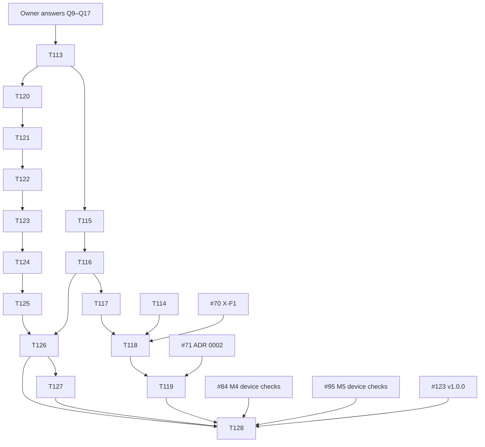

# Duck plan: a second character (Fenn the duckling) and a duck playback voice

**Status:** draft for owner review. Research and planning only. Nothing here is merged into `docs/plan.md` until task T113.
**Date:** 2026-10-24. **Base:** `main` at `fbefc72`.

Evidence tags follow plan §0, with one change of sandbox:

| Tag | Meaning here |
|---|---|
| **[V]** | Read in this repository at `fbefc72`, in a GitHub issue or CI log of `chethan123/talking-bear`, or in a primary source. |
| **[E]** | Measured in this session on an **aarch64 Neoverse-N1 VM (4 vCPU), Node 24.21.0**, with the throwaway spike `docs/research/spikes/09-duck-voice/`. This is not plan §0's 2.1 GHz Xeon and not D1. Some rows say [E N1], the form T113 uses in `docs/plan.md`; it means the same. |
| **[S]** | Search-result snippet only. |
| **[M]** | Memory, reasoning or estimate. Every [M] that matters has an experiment in §6. |

---

## 1. Summary

- **What gets built:** a second, complete character, **Fenn**, a mallard-style duckling (art, rig, idle layers, beak sync, regions, reactions, sound effects, screenshots), and a **Duckling** voice preset, the duck's default voice, which is also selectable for Juni.
- **Voice algorithm:** the existing sinc pitch-up (`p = 1.45`, pitch and tempo coupled), then a new **duck stage**: 70 Hz amplitude modulation (mix 0.35) → nasal EQ (HPF 320 Hz, −9 dB dip at 700 Hz, +10 dB at 1.6 kHz, +6 dB at 3.1 kHz, four low-pass sections at 5 kHz) → a peak-normalised cubic shaper. It costs 10.4 ms per 5 s clip [E]. Its aliasing is ≤ −67.5 dBFS [E], and its STOI against the plain pitch-up is 0.960 [E]. It sits between the resample and the loudness stage, so §4.3.4's loudness, ceiling, fades, envelope and Quiet-mode rules apply unchanged.
- **Engine:** the rig, renderer, hit regions, gaze, director, reaction table and BearView take a `CharacterSpec` instead of importing Juni's modules. Juni stays pixel-identical. The session state machine (§3.4) does not change.
- **Selection UX:** a 72 px swap button, shown **only while the session is Asleep**, with the other character's face on it. A tap swaps the sleeping character. It never wakes the character or opens the mic, so an accidental tap is harmless.
- **Release:** after `v1.0.0`, as `v1.1.0` (16 tasks, T113–T128). The one exception is T114, the voice-chain speed-up, which every preset needs and which may land before `v1.0.0`.

---

## 2. Owner decisions needed

Numbering continues plan §12 (Q1–Q8 are final). D1 is always the reference device, never a decision.

| # | Question | Options (recommendation first) | Affects |
|---|---|---|---|
| **Q9** | Character name and design | **"Fenn"**, a mallard-style duckling as in §4.4: brown down cap and back, butter face and belly, peach-orange bill with a darker nail, a single curl on the head, teal wing stripe, no clothing. Alternatives: name "Wick" or "Dabble"; an all-yellow duckling (rejected: too close to common cartoon ducks and bath toys [M]). The name stays a working name until T124, like Juni's under Q4. | T113, T123, T124, every `names` string, manifest description |
| **Q10** | Voice preset name (parent settings label) and code id | **Label "Duckling", id `duck`**. Alternatives: "Quacky"; "Squawk". Never a trademarked duck's name or a studio's name, anywhere (the IP rule, §4.3.5). | T116 (`SETTINGS_TEXT`, `PRESETS`) |
| **Q11** | Is the duck voice also selectable for Juni? | **Yes.** Every character offers the same five voices (Bear cub, Chipmunk, Big bear, Duckling, Custom), and each character remembers its own (`voice` for Juni, default `cub`; `fennVoice` for Fenn, default `duck`). Why: it is one more radio on one code path, with zero DSP cost (§4.3), and a quacking bear is harmless slapstick under Q3. Alternative: duck voice for Fenn only (one more conditional in the sheet, and no benefit). | T116, settings schema |
| **Q12** | How the user chooses a character | **A: swap button in Asleep only** (§3.3). B: settings sheet only (parent-gated by the 1 s gear hold; a child can never switch). C: both A and B. D: two large thumbnails while Asleep, a tap wakes the chosen one (conflicts with "a tap anywhere wakes", rows 1–3). | T126, §4.5 overlay rules |
| **Q13** | Before or after `v1.0.0`? | **After: ship as `v1.1.0`.** T114 may land before `v1.0.0`. Why: #123 is waiting on owner device runs (#84, #95, #102, #70), and the refactor (T121–T122) touches the rAF hot path that #214/#229/#281 stabilised. Landing it first would invalidate X-A1/X-A4 results and widen the release gate. Alternative: before `v1.0.0` (re-runs #84 and parts of #123). | T128 release, #123 |
| **Q14** | New dependencies | **None.** Everything is own code (§4.3, §8). Rejected: Signalsmith Stretch (MIT, 44.4 KB gzip, needs `'wasm-unsafe-eval'`, plan §4.3.2). | §8, CSP |
| **Q15** | Do this plan's T114 (voice-chain speed-up) now, or wait for X-F3 on D1 (#70)? | **Now.** On the N1 sandbox, the p95 per second of audio is already over the 15 ms/s budget for Big bear (22.2 ms/s) and for the duck (19.4 ms/s) [E, `bench4.mjs`], and #70's ORCH-NOTE saw Big bear at 16–20 ms/s on the plan sandbox [V]. T114 is the "Optimise processVoice" issue #70 tells you to file, filed early. Alternative: wait for #70 and file it then. | T114, #70 step 3, X-F5 |
| **Q16** | Manifest and icons | **Description mentions Fenn; add one narrow screenshot `phone-3.webp`; icons unchanged.** Description and screenshots are not WebAPK update fields (plan §4.7 [V]), so installed apps don't update. Alternative: a two-character icon (changes the icons → WebAPK update; needs new icon art). | T127, plan §4.7, `scripts/manifest.test.ts` |
| **Q17** | Keep the duck's pitch and tempo coupled (×1.45 faster)? | **Yes**, as all MVP presets do (plan §4.3.4). Rejected: tempo-preserving PSOLA with a formant shift (STOI 0.773, 94.5 ms per 5 s [E]). | T115 |

If an answer differs from the recommendation, T113 records it in `docs/plan.md`, and only the affected tasks change.

---

## 3. Research findings

### 3.1 Duck-voice DSP

**Target sound** [M]: the voice is raspy (rough amplitude fluctuation, 30–150 Hz), nasal and pinched (energy pushed into 1–3 kHz, little below 400 Hz), bright and high. It must stay intelligible: a child must recognise their own words.

**Method** [E]. The input is the committed espeak-ng TTS corpus (`test/corpus/speech`, 40 sentence renders, 10 of them at the "child-like" pitch 99; synthetic, Q2), upsampled to 48 kHz with the production sinc kernel. Each candidate D(x) is compared with a timing-matched clean reference R(x):

- for pitch-up chains, R(x) is the plain sinc pitch-up at the same p (the Juni-style replay, assumed intelligible);
- for tempo-preserving PSOLA, R(x) is the input.

The intelligibility proxy is STOI (Taal et al. 2011), simplified: silent frames are dropped in the STFT domain instead of by time-domain overlap-add. STOI measures only the extra damage a duck stage does on top of the pitch-up. It is a proxy, not a child listening test, which is X-F4.

In this table, CPU is the median of 11 runs after 3 warm-ups on one 5 s clip at 48 kHz (`bench.mjs`, round 1; `bench2.mjs`). The recommended stage's final numbers (§3.1.2) are medians and p95s of 30 runs (`bench4.mjs`).

**Comparison (round 1, all [E] unless tagged):**

| # | Family (configuration) | CPU / 5 s clip, stage only | Code size (gzip) [M] | STOI mean / min (n = 40) | Aliasing | Fit with resampler / YIN | Verdict |
|---|---|---|---|---|---|---|---|
| 1 | Pitch-up + formant shift: TD-PSOLA pitch 1.8, formant 1.35 (`lab/algos/psola.ts`) | 94.5 ms, including its pitch track | 1.6 KB (plan §4.3.2 [E]) | 0.773 / 0.581, vs the unshifted input | grain resampling has no anti-alias filter [M] | needs pitch marks (a per-frame YIN track, which `src/dsp` lacks); preserves tempo, so it breaks the coupled-tempo style; X-F1 already tests PSOLA | rejected |
| 2 | Ring / amplitude modulation: `y·(1 − m + m·sin 2π·fc·t)`, fc 90 Hz, m 1.0 / 0.5 | 3.6 ms | 0.1 KB | 0.870 / 0.767 (m 1.0); 0.937 / 0.889 (m 0.5) | none: a linear time-varying gain moves content by ±fc, and nothing reaches Nyquist after the resample's 0.9 cutoff [arithmetic] | trivial | **kept, at fc 70 Hz, m 0.35** |
| 3 | Band-pass / nasal resonance EQ: HPF 320, −9 dB at 700, +10 dB at 1.6 k, +6 dB at 3.1 k, LPF 5.6 k (5 biquads; the final stage uses 4 LPF sections at 5 kHz, §3.1.2) | 3.8 ms | 0.3 KB | 0.993 / 0.989 | none (linear) | reuses `biquad.ts`; needs a peaking section | **kept** |
| 4 | Waveshaping: tanh, drive 3, at 1× / 2× / 4× (production sinc for over-sampling) | 4.1 / 54.7 / 108.9 ms | 0.2 KB | 0.963 / 0.920 at every rate (STOI's 10 kHz band hides the aliases) | 7 kHz tone: −21.5 / −39.9 / −40.6 dB re total; round 2: ADAA-1 at 1× is 6.8 ms and −18.8 dB at 9 kHz; a 31-tap half-band 2× is 41.8 ms and −29 dB | 2× with the production kernel blows the budget | replaced by a cubic shaper after the LPF (§3.1.2) |
| 5 | Subharmonic: pitch-synchronous AM at f0/2, depth 0.5 (period doubling); pulse buzz at f0, depth 0.6 | 7.7 ms, plus a pitch track: 47.7 ms (lab YIN-lite) or 22.9 ms (YIN at 8 kHz, 10 ms hop) | 0.2 KB + 0.6 KB tracker | 0.976 / 0.878 (sub); 0.951 / 0.860 (pulse) | none: the gain is smooth | needs a new per-frame YIN track (`src/dsp/yin.ts` has only a single-f0 estimate, used by tests [V]) | **fallback** (§3.1.3) |
| 6 | Source-filter: LPC order 18 at 16 kHz, 70 % of the voiced residual replaced by a pulse train at the tracked f0 | 35.4 ms, plus the track | 1.2 KB | 0.925 / 0.832 | the output is band-limited to 7.2 kHz by the 16 kHz path; the impulse train is quantised to 16 kHz samples (≤ 1 % period jitter at 300 Hz) | decimates and interpolates with the production resampler; Levinson-Durbin is ≈ 60 lines | rejected: worst STOI per ms |
| A | 5 + 3 + tanh 2× | 113.4 ms | — | 0.957 / 0.866 | as 4 | as 5 | rejected (CPU) |
| B | 6 + 3 | 35.4 ms + track | — | 0.920 / 0.841 | as 6 | as 6 | rejected |
| C | 2 + 3 + tanh 2× | 61.5 ms | — | 0.948 / 0.850 | as 4 | none needed | became the recommendation, once its 2× tanh was replaced by a cubic shaper |

#### 3.1.2 Chosen chain, with exact parameters

Pitch-up (unchanged code): `resampleOffline(x, 1/p)`, with **p = 1.45** (+6.4 st, tempo ×1.45). Then `duckStage(y, fs, DUCK)`, in this order:

1. **AM:** `z[i] = y[i] · (1 − 0.35 + 0.35 · sin(2π · 70 · i / fs))`, with i counting from 0 at the first output sample.
2. **Nasal EQ**, in place, in this order:
   1. `butterworthHighpass(fs, 320)`;
   2. `peaking(fs, 700, −9, 1.4)`;
   3. `peaking(fs, 1600, +10, 3)`;
   4. `peaking(fs, 3100, +6, 2.5)`;
   5. `butterworthLowpass(fs, 5000)` **four times**: four cascaded RBJ 2nd-order sections, each Q √½, so −12 dB at 5 kHz and 48 dB/octave above it. This is not a Butterworth of order 8. Everywhere this document says "the LPF", it means these four sections.

   `peaking(fs, f0, gainDb, q)` is the RBJ cookbook peaking EQ, new in `biquad.ts`, with `highShelf`'s argument order [V `biquad.ts:136` `highShelfCoefficients`, `:168` `highShelf`].
3. **Cubic shaper:** with `peak = max|z|` (if peak = 0, return z unchanged), `u = z[i] / peak`, `c = 1.5 · peak · (u − u³/3)`, set `z[i] = clamp((1 − shapeMix) · z[i] + shapeMix · c, −peak, peak)`. `DUCK.shapeMix` = 1. The clamp only removes float rounding at the peak sample (u can differ from ±1 by an ulp).
   - It is a pure cubic, so it adds only third-order products: 3f and the AM-sideband combinations k·f ± j·amHz, with k ≤ 3 and j ≤ 3.
   - Peak normalisation makes the third harmonic of a lone tone 19 dB below it whatever its level. A product folds back only from content above fs/6, so the alias level is set by how far the LPF has already cut that content. With two sections at 5.5 kHz, 8 kHz tones aliased at −44.6 dBFS (round-2 review, R2-02). With four sections at 5 kHz, the worst case is −67.5 dBFS (table below).
   - |output| ≤ peak.

**Measured** (all [E N1]; `bench4.mjs`, `alias-onset.mjs`, `corners2.mjs`, `golden.mjs`; earlier rounds in `bench*.mjs`):

| Property | Result |
|---|---|
| Stage CPU, 5 s clip at 48 kHz, median / p95 of 30 | 10.4 / 13.5 ms (2.1 / 2.7 ms per second of audio) |
| Whole chain, 5 s clip, median / p95 of 30 (ms; ms/s) | duck p 1.45: **67.2 / 97.0 (13.4 / 19.4)**; plain sinc p 1.45: 56.7 / 62.4 (11.3 / 12.5); Bear cub 1.6: 53.6 / 55.2 (10.7 / 11.0); Chipmunk 2.0: 45.6 / 52.2 (9.1 / 10.4); Big bear 0.75: 98.6 / 110.9 (**19.7 / 22.2**). The §4.10 budget is a p95: the duck and Big bear are over it on this machine. The p95 of a 30-run series moves by ±25 % between runs on this VM (round 1 measured the duck at 82.3 ms) |
| Aliasing: tone at −6 dBFS with a 2048-sample raised-cosine onset; 65 536-point 4-term Blackman-Harris window from sample 8192; energy outside ±8 bins of k·f ± j·amHz (j = 0…3) | worst **−67.5 dBFS** over 13 tones (1130, 2310, 3710, 4930, 6130, 7310, 8000, 8500, 9000, 10000, 11330, 13700, 17990 Hz) × fs {44 100, 48 000} × amHz {60, 70, 80} × amMix {0.2, 0.35, 0.4} × peak1Db {6, 10, 12}; at 44.1 kHz, 8 kHz, amHz 80, amMix 0.2, peak1Db 10 |
| STOI vs plain sinc at the same p (40 sentences; the pitch-99 subset of 10) | p 1.30: 0.958 (min 0.894), pitch-99 0.947. **p 1.45: 0.960 (min 0.919), pitch-99 0.948 (min 0.919)**. p 1.60: 0.959 (min 0.930), pitch-99 0.946 |
| STOI on T115's 10 sentences | `DUCK`: mean 0.960, min 0.945. Worst over the 36 corners p {1.30, 1.45, 1.60} × amHz {60, 70, 80} × amMix {0.20, 0.40} × peak1Db {6, 12}: lowest mean 0.939 (p 1.30, amHz 60, amMix 0.40, peak1Db 12), lowest min 0.885 (p 1.30, amHz 80, amMix 0.40, peak1Db 12) |
| STOI port golden (`sentence-00-r0` at 48 kHz, plain = sinc p 1.45) | `stoi(plain, plain)` = 1.000000; `stoi(plain, y·(0.5 + 0.5·sin(2π·90·i/fs)))` = 0.939072 |
| Spectral centroid shift vs plain sinc (40 sentences) | +156 Hz at p 1.45 (+280 at p 1.30, +24 at p 1.60) |
| Added inharmonic energy on a steady harmonic complex (the AM sidebands are the rasp) | −9.8 dB re total at f0 200 Hz, −10.2 dB at 420 Hz; with the AM off, −92.4 dB (the cubic adds only harmonics) |
| Loudness after the unchanged §4.3.4 gain rule (5 s clip) | normal −20.00 LUFS, −5.61 dBTP; shouted (×4, clipped) −20.00 LUFS, −5.90 dBTP; whisper (×0.03) −39.61 LUFS vs plain −38.79 (the make-up cap holds) |
| Determinism | bit-identical on two runs (no RNG; the AM phase starts at sample 0) |
| Mouth envelope (`sentence-00-r0`, `sentence-03-r1`; plain → duck) | jaw max 1.00 → 1.00 and 0.96 → 0.97; mean width 0.13 → 0.30 and 0.17 → 0.28; mean round 0.49 → 0.41 and 0.54 → 0.48; teeth max 0.00 → 0.00 and 1.00 → 0.00 (the LPF empties the > 5 kHz × p band). **Decision:** accepted. Fenn has no teeth. Juni with the Duckling voice shows a wider mouth and never teeth; X-A8 checks it by eye |
| YIN f0 of the output (`yinF0`) | **unusable**: measured f0 ratio 0.650×, NaN and 0.533× on the 140 Hz vowel at p 1.30/1.45/1.60, and 2.606×, 1.935× and 1.600× on the 300 Hz vowel (`f0check.mjs`, final stage). AM plus the 320 Hz HPF break the periodicity YIN looks for, so the duck e2e cannot use plan §4.9.3's "f0 × p ± 3 %" assertion |
| e2e marker: 70 Hz line in the 1 kHz envelope spectrum, vs the median of 40–100 Hz excluding ±3 Hz | duck 33.2–46.4 dB; plain sinc −0.9 to 3.9 dB, on 3 vowel fixtures at 44.1 and 48 kHz |

**Where it sits in plan §4.3.4's chain** (the only change is step 4b):

`clip → clipping flag → HPF 80 Hz → trim → sinc resample (ratio 1/p) → `**`[duck stage, preset duck only]`**` → loudness normalise to −20 LUFS (make-up ≤ +12 dB, skipped if unvoiced) → true-peak ceiling −3 dBTP → 8 ms fades → envelope analysis`

- The voiced decision `isVoiced` runs on the pitch-shifted clip **before** the duck stage. The AM must not change the make-up-gain decision.
- The loudness and ceiling then run on the duck output, so the rasp and the EQ gain can never raise the level.
- The fades and the envelope come from exactly the buffer that plays.
- Quiet mode (−6 dB), the 0.7 master gain and the route-independent protection are unchanged (they sit on the bus, not in the chain).
- Sound effects stay ≥ 6 dB below the −3 dBTP ceiling.

**Fit with the resampler and YIN plans:**

- The recommended chain reuses `resampleOffline` unchanged and needs **no pitch tracker**.
- `PRESETS.cub` and ADR 0002 (#71) are independent of it: the duck preset always uses sinc plus the duck stage, whatever ADR 0002 decides for Juni's presets.
- The fallback (§3.1.3) would add a per-frame `yinTrack` to `src/dsp/yin.ts`.

#### 3.1.3 Fallback

If X-F4 rejects the frozen parameters, T119 applies the first variant that passes, in this order:

1. **"duckSoft" = `softenDuck(DUCK)`:** `amMix = max(0.05, DUCK.amMix − 0.15)`, `peak1Db = max(2, DUCK.peak1Db − 4)`, everything else unchanged. With the T115 defaults that is AM mix 0.2 and +6 dB at 1.6 kHz. It is tested in the same X-F4 session, always relative to the frozen pre-tune values.
2. **Pitch-synchronous rasp:** the AM replaced by a pitch-synchronous gain `1 − 0.45·(½ + ½·cos(φ/2))`, with φ the integrated phase of a YIN track (8 kHz, 32 ms windows, 10 ms hop, 100–1000 Hz). STOI 0.974 (min 0.887); stage CPU 33.2 ms per 5 s [E]. This needs a new task, filed by T119.
3. Neither passes: T119 stops and comments for an owner decision.

### 3.2 Character pipeline today (read in the code [V])

| Layer | Today | Juni-specific coupling |
|---|---|---|
| Art | `art/bear.svg`, a strict SVG subset (`art/README.md`) | — |
| Generator | `scripts/gen-bear-parts.ts`: a strict parser that writes `BONES`, `PARTS`, `BONE`, `PART` to `src/art/bear-parts.gen.ts`; `--check` in CI | `SVG_FILE`/`OUT_FILE` constants; `VIEW_BOX` `0 0 1000 1400`; mirror axis x = 500 |
| Art rules test | `scripts/bear-svg.test.ts` | the palette, the rig parent list and pivots are Juni's |
| Pose | `src/anim/pose.ts`: 36 channels (`CH_COUNT`), `Ch` const object | channel *names* are bear-ish, but nothing binds them to Juni's bones |
| Rig | `src/anim/rig.ts` imports `bear-parts.gen.ts` and builds **module-level** typed tables (`DRIVE_CH`, `DRIVE_K`, `PARENT`, `PIVOT_X/Y`, `IRIS_SIDE`) from a `DRIVES` table keyed by Juni's bone ids; `GAZE_PARTS`, `BLUSH_PARTS`, `lidUpperL/R`, `muzzle` → `mouthSlot` are by name; `createRig()` has no parameters | whole module |
| Renderer | `src/anim/renderer.ts` imports `PARTS`; module-level `BONE_BUF` sized by `BONE_COUNT`; `JAW`/`HEAD` indices; `MOUTH` (anchor (500, 525), parametric lips/tongue/teeth inside the parts loop, #214), `STARS`, `BG_TOP/BOTTOM` | whole module; the loop's shape is tuned against V8 tiering (#214, #229) |
| Regions | `src/input/regions.ts`: 17 ellipses on Juni's bones, compiled at module load; `hitTest` reads module tables; `REGION_IDS` in `region-ids.ts` | table and compile |
| Recogniser | `src/input/recognizer.ts`: pairs `cheekL/R` → pinch, `flankL/R` → hug; `TAP_TICKLE_GROUPS` belly and feet; "against" only on `headTop` | region-id semantics only, character-agnostic if the duck reuses these ids |
| Layers | blink, breathing, gaze, ear twitch, mood, mouth (`src/anim/layers/*`) write channels only, except `EYES_CENTER = (500, 385)`, defined in `gaze.ts` and also read by `ear-twitch.ts` (imported at `:33`, used at `:145`) | `EYES_CENTER` |
| Springs | `springs-map.ts`: 10 springs on channels | none: Fenn maps the same channels to its bones |
| Clips | `clips/session.ts`, `clips/reactions.ts` (34 base reaction clips + 5 gentle variants + 3 mimes [V `clips/reactions.ts:37-73`, `:815`]): channels and `SPRING` indices only; helpers `kick`, `gentle`, `lids` are module-private | none in content; helpers need exporting |
| Reactions | `src/reactions/table.ts`: frozen `REACTIONS` and `reactionFor`, switches on `RegionId` | whole module |
| Director | `src/anim/director.ts`: module-level `CLIPS` map (session + reaction + mime + flinch + mirrored pet), `REACTIONS[esc.to]` for escalation, `REACTION_TEMPLATE.r = REACTIONS['tuftBoing']` (hidden-class anchor, #281; checked by `check-dist`) | `CLIPS`, `REACTIONS` |
| View | `src/anim/bear-view.ts`: `mountBearView(root, deps)` owns rig, director, layers, springs and loop; `dispose()` exists; `A11Y_TEXT.stage` "Juni the bear" | imports of all the above |
| Sfx | `src/audio/sfx-ids.ts` (single `SfxId` union), `sfx-synths.ts` `SYNTHS`; `main.ts` passes `SYNTHS` | none |
| Text | `A11Y_TEXT`, `ANNOUNCEMENTS` (`a11y.ts`), `OVERLAY_TEXT` parent sheet (`overlay.ts`), `SETTINGS_TEXT.privacy` all say "Juni" | strings |
| Screenshots | `src/anim/poses.ts` (8 key poses), renderer browser baselines, `e2e/screenshots.spec.ts` baselines, `scripts/gen-screenshots.ts` | Juni-only |

**Generalised vs duplicated:**

- **Generalised:** the generator (a per-character table), rig, renderer, regions compile/hit-test, gaze (eyes centre), director (clip book and reactions as an argument), BearView (spec as a dependency) and text (names as data).
- **Duplicated per character:** the SVG and its rules test, the generated parts module, the drives table, the region table, the reaction table, character-only clips, and the design constants (mouth kind, stars, background, eyes centre).
- **Shared unchanged:** pose channels, springs map, layers (apart from the eyes centre), session clips, base poses, the recogniser, the sfx scheduler and the pose gallery.

### 3.3 Character selection UX under Q3

| Option | Text-free | Mid-session accident | Child can choose | Cost | Verdict |
|---|---|---|---|---|---|
| **A. Swap button in Asleep only** (72×72 CSS px, bottom-left, other character's face) | yes | impossible: hidden outside Asleep; in Asleep a tap only swaps a sleeping character (mic closed, context suspended, one tap reverts) | yes | 1 small module + remount | **recommended** |
| B. Settings sheet only (1 s gear hold) | sheet has parent text | impossible | no | radio group | rejected: a child cannot pick a friend |
| C. A + B | — | — | yes | both | rejected: two paths, same result |
| D. Two big thumbnails while Asleep; tapping one wakes it | yes | impossible | yes | conflicts with rows 1–3 "a tap anywhere wakes" and the paw overlay | rejected |
| E. Swipe/carousel while awake | yes | likely (pet strokes are swipes) | yes | gesture conflict | rejected |

### 3.4 Budgets today (from CI on `main` `fbefc72` [V])

| Budget | Limit | Now | Headroom |
|---|---|---|---|
| Initial JS (brotli) | 60 kB | 42.62 kB | 17.38 kB |
| Initial CSS | 10 kB | 1.23 kB | 8.77 kB |
| Total precache | 1 MB | 756.36 kB (Silero weights 678.1 kB br, DSP worker 8.9 kB br) | 243.6 kB |

---

## 4. Design

### 4.1 Interfaces

```ts
// ---- src/dsp/types.ts (changed) -----------------------------------------------------------------
export type VoiceId = 'cub' | 'chipmunk' | 'bigbear' | 'duck' | 'custom';
export interface VoicePreset { id: VoiceId; pitchRatio: number }
export const DUCK_PITCH_RATIO = 1.45; // added in T115 (no stage code in types.ts, so the main thread doesn't import duck.ts); T119 changes it
export const PRESETS: Record<Exclude<VoiceId, 'custom'>, VoicePreset>; // + duck: { id: 'duck', pitchRatio: DUCK_PITCH_RATIO } (T116)

// ---- src/dsp/biquad.ts (changed: new) -----------------------------------------------------------
export function peakingCoefficients(fs: number, f0: number, gainDb: number, q: number): BiquadCoefficients; // RBJ; highShelf's order
export function peaking(fs: number, f0: number, gainDb: number, q: number): Biquad;
export function butterworthHighpassCoefficients(fs: number, fc: number): BiquadCoefficients; // the existing sections' coefficients,
export function butterworthLowpassCoefficients(fs: number, fc: number): BiquadCoefficients;  // exposed for the EQ-response test

// ---- src/dsp/duck.ts (new; pure, erasable syntax, .ts imports) ----------------------------------
export interface DuckParams {
  amHz: number; amMix: number;
  hpHz: number;
  dipHz: number; dipQ: number; dipDb: number;
  peak1Hz: number; peak1Q: number; peak1Db: number;
  peak2Hz: number; peak2Q: number; peak2Db: number;
  lpHz: number;           // four cascaded butterworthLowpass sections (LP_SECTIONS = 4, a constant)
  shapeMix: number;       // 0 = no cubic, 1 = full
}
export const DUCK: Readonly<DuckParams>;        // { 70, 0.35, 320, 700, 1.4, −9, 1600, 3, 10, 3100, 2.5, 6, 5000, 1 }
export const LP_SECTIONS = 4;
/** X-F4 fallback 1: amMix = max(0.05, d.amMix − 0.15), peak1Db = max(2, d.peak1Db − 4), the rest of d. New frozen object. */
export function softenDuck(d: Readonly<DuckParams>): Readonly<DuckParams>;
/** Pre-tune bounds (T117 sliders; T115 tests cover the corners): p 1.30–1.60, amHz 60–80, amMix 0.20–0.40, peak1Db 6–12. */
export const DUCK_TUNE_BOUNDS: Readonly<Record<'p' | 'amHz' | 'amMix' | 'peak1Db', readonly [number, number]>>;
/** New buffer, same length as y. Throws RangeError unless fs is finite and ≥ 16000. Never modifies y. */
export function duckStage(y: Float32Array, fs: number, d?: Readonly<DuckParams>): Float32Array;

// ---- src/dsp/voice.ts (changed) -----------------------------------------------------------------
// processVoice: … y = resample(x, p); voiced = isVoiced(y, fs);
//   z = preset.id === 'duck' ? duckStage(y, fs, DUCK) : y; applyGain(z, fs, voiced); fades(z, fs); envelope(z, fs, p)
export const voiceStages: { clipDetect; hpfTrim; resample; isVoiced; duck: typeof duckStage; applyGain; fades; envelope };

// ---- src/app/settings.ts (changed; key stays 'bear.settings.v1', fields are additive) -----------
export type CharacterId = 'juni' | 'fenn';
export interface Settings {
  voice: VoiceId;        // Juni's voice (default 'cub'; meaning unchanged for stored v1 data)
  fennVoice: VoiceId;    // Fenn's voice (default 'duck')
  character: CharacterId; // default 'juni'
  customPitch: number; quietMode: boolean; gentleMode: boolean; haptics: boolean; noisyRoomNs: boolean; sleepTimeoutSec: number;
}
export function presetFor(s: Settings): VoicePreset; // voice of s.character; 'custom' → { id: 'custom', pitchRatio: customPitch }

// ---- src/characters/types.ts (new) --------------------------------------------------------------
import type { Bone, Part } from '../art/bear-parts.gen.ts';
export interface CharacterArt {
  readonly BONES: readonly Bone[]; readonly PARTS: readonly Part[];
  readonly BONE: Readonly<Record<string, number>>; readonly PART: Readonly<Record<string, number>>;
}
export type Term = readonly [ch: number, k: number];
export interface Drive { readonly rot?: Term; readonly tx?: Term; readonly ty?: Term; readonly sx?: Term; readonly sy?: Term }
export type MouthSpec =
  | { readonly kind: 'lips'; readonly bone: string /* Juni: 'jaw' */; readonly afterSubtree: string /* Juni: 'muzzle' */;
      readonly x: number; readonly y: number; // Juni: MOUTH.x/y (500, 525), renderer.ts
      readonly minWidth: number; readonly widthRange: number; readonly openRange: number; readonly tongueJaw: number;
      readonly teethMin: number; readonly interior: string; readonly tongue: string; readonly teeth: string }
  | { readonly kind: 'parts' }; // the beak is ordinary parts on bones driven by Jaw/MouthW; nothing parametric
export interface StarsSpec { readonly bone: string; readonly cx: number; readonly cy: number; readonly radius: number;
  readonly count: number; readonly outer: number; readonly inner: number; readonly fill: string }
export interface CharacterNames {
  readonly name: string;      // 'Juni' | 'Fenn'
  readonly stage: string;     // 'Juni the bear' | 'Fenn the duckling'
  readonly switchTo: string;  // the swap button's label when this is the *other* character: 'Switch to Fenn the duckling'
}
export interface CharacterSpec {
  readonly id: CharacterId;
  readonly art: CharacterArt;
  readonly drives: Readonly<Record<string, Drive>>;
  readonly gazeParts: readonly string[];          // iris, pupil, highlight of the left eye, then the right
  readonly lidParts: { readonly L: string; readonly R: string };
  readonly blushParts: readonly string[];
  readonly mouth: MouthSpec;
  readonly stars: StarsSpec;
  readonly background: { readonly top: string; readonly bottom: string };
  readonly eyesCenter: { readonly x: number; readonly y: number };
  readonly regions: readonly RegionDef[];        // priority order
  readonly names: CharacterNames;
  readonly cast: DirectorCast;                    // added in T122
  readonly reactionFor: (g: Gesture) => Reaction | null; // added in T122
}
export const CHARACTERS: Readonly<Record<CharacterId, CharacterSpec>>; // src/characters/index.ts
export const JUNI: CharacterSpec;   // src/characters/juni.ts
export const FENN: CharacterSpec;   // src/characters/fenn.ts
export const FENN_CLIPS: Readonly<Record<string, Clip>>;        // src/anim/clips/fenn.ts
export const FENN_REACTIONS: Readonly<Record<string, Reaction>>; // src/reactions/fenn-table.ts

// ---- src/anim/rig.ts (changed) ------------------------------------------------------------------
export interface Rig {
  readonly spec: CharacterSpec; readonly boneCount: number;
  readonly paths: readonly Path2D[]; readonly kind: Uint8Array;
  readonly mouthSlot: number;   // −1 for mouth kind 'parts' (the renderer's slot test is then never true)
  readonly jaw: number; readonly head: number; // bone indices (jaw −1 for 'parts'); head = stars.bone
  readonly parent: Int32Array; readonly pivotX: Float64Array; readonly pivotY: Float64Array;
  readonly driveCh: Int8Array; readonly driveK: Float64Array; readonly irisSide: Int8Array;
  readonly stack: Float64Array; readonly boneBuf: Float32Array; // boneBuf: the renderer's per-frame scratch
}
/** Allocates; setup only. `paths: false` leaves `paths` empty (no Path2D, for Node: scripts/gesture-eval.ts); every other field is built. */
export function createRig(spec: CharacterSpec, opts?: { paths?: boolean }): Rig;
export function boneMatrices(rig: Rig, pose: Pose, out: Float32Array): Float32Array; // unchanged signature
export function partMatrix(rig: Rig, pose: Pose, bones: Float32Array, part: number, out: Float32Array | Float64Array, o?: number): void;
export function boneIndex(rig: Rig, id: string): number; export function partIndex(rig: Rig, id: string): number;
// removed exports: BONE_COUNT (use rig.boneCount)

// ---- src/input/regions.ts (changed) -------------------------------------------------------------
export interface RegionTable { readonly defs: readonly RegionDef[]; readonly offset: Int32Array;
  readonly cx: Float64Array; readonly cy: Float64Array; readonly rx: Float64Array; readonly ry: Float64Array; readonly id: readonly RegionId[] }
export function compileRegions(rig: Rig): RegionTable; // from rig.spec.regions
export function hitTest(x: number, y: number, boneMatrices: Float32Array, view: View, table: RegionTable, padCssPx?: number): RegionId;

// ---- src/input/region-ids.ts (changed) ----------------------------------------------------------
// REGION_IDS += 'beak', 'wingL', 'wingR', 'tail' (appended before 'background')

// ---- src/anim/layers/gaze.ts (changed) ----------------------------------------------------------
// createGaze(…, eyesCenter) and createEarTwitch(…, eyesCenter), eyesCenter: { x: number; y: number }: EYES_CENTER becomes
// Juni's spec value, passed by bear-view from rig.spec.eyesCenter

// ---- src/anim/director.ts (changed) -------------------------------------------------------------
export interface DirectorCast {
  readonly clips: ReadonlyMap<string, Clip>;          // session + reaction + mime + character clips + flinch + mirrored
  readonly mirrored: ReadonlyMap<string, string>;     // clip name → mirrored clip name (today: pet → petMirrored)
  readonly reactions: Readonly<Record<string, Reaction>>; // escalation targets by name
}
export function createDirectorCast(clipSets: readonly Readonly<Record<string, Clip>>[],
  reactions: Readonly<Record<string, Reaction>>): DirectorCast; // adds FLINCH and the mirrored pet
// every listed function gains a trailing, non-optional `cast: DirectorCast`; `mouth` loses its default (`= false`
// today, director.ts:1142 and :1157) and every caller passes it:
// directorStep(s, i, cast), directorReduce(s, i, cast), evaluate(s, now, out, mouth, cast),
// evaluateFrom(…, cast), clipByName(name, cast). initialDirector(now) and mouthCloseScale are unchanged.

// ---- src/anim/bear-view.ts (changed) ------------------------------------------------------------
export interface BearViewDeps { /* … existing … */ character: CharacterSpec }

// ---- src/ui/character-switch.ts (new) -----------------------------------------------------------
export interface CharacterSwitchDeps {
  state(): StateName;                       // shown only while 'Asleep'
  current(): CharacterId;
  choose(id: CharacterId): void;            // main.ts: settings.set({ character: id })
  thumbnail(id: CharacterId, size: number): HTMLCanvasElement; // the other character's head, drawn once
}
export interface CharacterSwitch { refresh(): void; dispose(): void } // refresh on every session state change
export function mountCharacterSwitch(root: HTMLElement, deps: CharacterSwitchDeps): CharacterSwitch;
```

### 4.2 Module changes, file by file

**New**

| File | Content | Task |
|---|---|---|
| `src/dsp/duck.ts`, `duck.test.ts`, `duck.intelligibility.test.ts` | §4.1; tests §5 T115 | T115 |
| `test/stoi.ts` | Test-only STOI (the spike's simplified algorithm, typed) | T115 |
| `lab/duck.html`, `lab/duck.ts`, `lab/duck-words.ts` | X-F4 pre-tune and listening test | T117 |
| `art/duck.svg` | Fenn source art | T123 |
| `src/art/duck-parts.gen.ts` | generated | T123 |
| `scripts/duck-svg.test.ts` | Fenn's art rules (palette §4.4, rig list and pivots §4.4, 40–80 drawn parts, eye part order, blush opacity 0) | T123 |
| `src/characters/types.ts`, `src/characters/index.ts`, `src/characters/juni.ts` | spec types; Juni's spec (moved constants) | T121 (cast and reactionFor added in T122) |
| `src/characters/fenn.ts`, `fenn.test.ts` | Fenn's spec | T123, T125 |
| `src/anim/clips/fenn.ts` | Fenn-only clips | T125 |
| `src/reactions/fenn-table.ts`, `fenn-table.test.ts` | Fenn reactions | T125 |
| `src/ui/character-switch.ts`, `character-switch.browser.test.ts` | the swap button | T126 |
| `src/anim/frame-alloc-fenn.browser.test.ts` | the frame-allocation smoke on Fenn, run alone | T126 |
| `e2e/character.spec.ts` | swap, persistence, Fenn loop, quack gating | T126 |
| `docs/adr/<NNNN>-duck-voice.md` | ADR from X-F4; `<NNNN>` = 1 + the highest number in `docs/adr/` at PR time | T119 |
| `scripts/bench-voice.ts` | Node voice-chain timing (median and p95 of 30 runs after 4 warm-ups, every preset, 1/5/10 s, 44.1/48 kHz), printing ms and ms/s | T114 |

**Changed**

| File | Change | Task |
|---|---|---|
| `src/dsp/voice.ts` | `isVoiced` early exit (streaming, §5 T114); duck branch; `voiceStages.duck` | T114, T116 |
| `src/dsp/normalize.ts` | `truePeakDbtp` block skip (exact, §5 T114) | T114 |
| `src/dsp/biquad.ts` | `peaking`, `peakingCoefficients`, `butterworthHighpassCoefficients`, `butterworthLowpassCoefficients` (the existing constructors build from them; outputs unchanged) | T115 |
| `src/dsp/types.ts` | `DUCK_PITCH_RATIO` (T115); `VoiceId`, `PRESETS.duck` (T116) | T115, T116 |
| `src/app/settings.ts` | `character`, `fennVoice`, `presetFor` | T116 |
| `src/ui/settings-sheet.ts` | Duckling radio; the voice group edits the active character's field; `SETTINGS_TEXT.duck = 'Duckling'`; privacy text with `names` | T116, T121 |
| `lab/bench.ts` | duck preset row (X-F5) | T116 |
| `scripts/gen-bear-parts.ts` | per-character table `[{ id: 'juni', svg: 'art/bear.svg', out: 'src/art/bear-parts.gen.ts' }, { id: 'fenn', svg: 'art/duck.svg', out: 'src/art/duck-parts.gen.ts' }]`; `--check` checks every entry; `pnpm gen:bear` regenerates every entry; `--character <id>` limits to one | T120 (table), T123 (Fenn entry) |
| `src/anim/rig.ts`, `renderer.ts`, `src/input/regions.ts`, `src/anim/layers/gaze.ts`, `ear-twitch.ts`, `index.ts` | take the spec/rig (§4.1) | T121 |
| `src/anim/director.ts`, `src/reactions/table.ts`, `src/anim/bear-view.ts`, `src/main.ts`, `src/test-hooks.ts` | cast argument; `deps.character`; main passes `CHARACTERS.juni` (T122), then the stored character (T126) | T122, T126 |
| `src/anim/clips/reactions.ts` | export `kick`, `gentle`, `lids`, `track`, `k` (no behaviour change) | T125 |
| `src/audio/sfx-ids.ts`, `src/audio/sfx-synths.ts` | 7 new ids and recipes (§4.6) | T125 |
| `src/input/region-ids.ts` | 4 new ids | T123 |
| `src/ui/a11y.ts`, `src/ui/overlay.ts` | `A11Y_TEXT.stage`/`tapToWake`, `ANNOUNCEMENTS.Asleep`, `OVERLAY_TEXT.parentTitle`/`parentLocal`/`parentMicOff` become functions of `CharacterNames`; `mountOverlay` gets a `names()` getter | T121 |
| `src/ui/styles.css` | `.character-switch` | T126 |
| `package.json` | `test:browser` runs `frame-alloc-fenn.browser.test.ts` alone as a second step; the rest excludes both | T126 |
| `CLAUDE.md` | Commands (`test:browser`), Layout (`art/duck.svg`, `src/characters/`) | T113 (layout), T126 (command) |
| `art/README.md` | per-character sections; Fenn's palette and rig | T123 |
| `src/pwa-manifest.ts`, `scripts/manifest.test.ts`, `scripts/gen-screenshots.ts`, `public/screenshots/phone-3.webp` | Q16 | T127 |
| `e2e/screenshots.spec.ts` + snapshots; `src/anim/renderer.browser.test.ts` + `__screenshots__` | Fenn poses and `asleep-overlay-fenn`; Juni's baselines, `asleep-overlay` included, unchanged | T123 (renderer), T126 (e2e) |
| `lab/rig.ts` | character picker | T123 |
| `docs/lab.md` | `lab/duck` section | T117 |

**Unchanged but affected**

| File | Why it stays as is |
|---|---|
| `src/app/machine.ts`, `events.ts`, `session.ts`, `effects.ts` | `settingsChanged{preset}` already carries any preset in every state ([V] `onSettingsChanged`); a swap only happens in Asleep, outside the reducer |
| `src/audio/engine.ts`, `messages.ts`, `src/workers/dsp.worker.ts` | `process{preset}` passes the preset object through to `processVoice` [V] |
| `src/anim/pose.ts`, `springs-map.ts`, `base-poses.ts`, `layers/*` (except gaze and ear twitch), `clips/session.ts`, `src/input/recognizer.ts` | Fenn maps the same channels and region semantics |
| `server/headers.json`, CSP, `check-dist.mjs`, `vite.config.ts` | no WASM, no new origin, no new MIME type, no audio asset, no new lazy chunk |
| `public/icons/*`, `art/icon.svg` | Q16 |

### 4.3 Session state machine (§3.4) and director (§3.5) deltas

- **§3.4: no new state, event, row, timer or effect.**
  - The swap button exists only in Asleep, where the mic is closed and the context is suspended (§3.4 entry actions [V]), so no gating question arises.
  - `main.ts` applies a character change by calling `view.dispose()` and then `mountBearView(app, {…, character})`. It applies the change **only while the session is Asleep**. A change seen in any other state (only possible through the test hooks) is applied on the next entry into Asleep.
  - The voice follows through the existing `settings.subscribe → settingsChanged{preset}` path in every state.
  - The §4.9.1 property "no `arm` while any gated state is active or any sfx or playback is audible" is untouched.
- **§3.5: no new state or transition.**
  - The director gains an explicit `cast` argument (§4.1).
  - Fenn's cast holds every Juni clip, so the session clips (`wake`, `sleep`, `confused`, `earTwitch`, `shrug`), the mimes (`cuppedEar`, `tooLoud`, `tooLoudGentle`) and `FLINCH` play on Fenn by name. On Fenn, `EarRot` moves the fluff tufts and `ArmRot` the wings.
  - New clips: `quack`, `bigQuack`, `bigQuackGentle`, `beakNibble`, `fluffRuffle`, `wingFlapL`, `wingFlapR`, `tailWiggle`.
  - Priorities, cooldowns, escalation, queue, Talking flinch and release rules are unchanged.
  - A remount starts the director at `initialDirector(now)` (Asleep), matching the session's Asleep.
- **§4.6.3 (gestures): unchanged.** The recogniser's thresholds and gesture rules are character-agnostic; Fenn reuses the region ids it gives meaning to (`cheekL/R`, `flankL/R`, `belly`, `footL/R`, `headTop`).
- **Rig and renderer:** no new pose channel (`CH_COUNT` stays 36). Fenn uses mouth kind `'parts'`, so `rig.mouthSlot = −1`: the parts loop is unchanged and the lips branch never runs.

### 4.4 Fenn: concrete design (working design, Q9)

**Silhouette.** A seated chibi duckling in the same 1000 × 1400 design box as Juni:

- a round head wider than the body (head:body ≈ 1:1.2);
- an egg-shaped body;
- two big webbed feet forward;
- stubby wings;
- two tail feathers peeking out behind the right hip.

**Signature traits:**

- a single curled down feather on the crown (the `tuft` bone, so tuft boing and the spring work unchanged);
- a brown cap and a dark eye stripe over a butter face;
- a flat two-tone bill with a darker nail at the tip;
- a Juni-teal stripe (speculum) on each wing;
- fluffy down tufts at the sides of the head (the `fluffL/R` bones, driven by the ear channels).

No clothing, no hat, no bow, no emblem.

**Palette** (the only fills allowed in `art/duck.svg`):

| Role | Colour |
|---|---|
| Down: cap, back, wings, fluff | `#7A5A3A` (shade `#5E4329`, highlight `#94714C`) |
| Face, belly, cheeks | `#F4D27A` (shade `#DDB65A`) |
| Bill | `#F09A4A` (shade `#D67C30`), nail and nostrils `#8A4A20` |
| Feet | `#E8893A` (shade `#C46F26`) |
| Wing stripe | `#2F7A6D` |
| Sclera / iris / pupil / eye highlight | `#FFFFFF` / `#3A2A1E` / `#1A1216` / `#FFFFFF` |
| Bill interior / tongue | `#5A1E2E` / `#E07A7A` |
| Blush | `#F2A07B`, `fill-opacity="0"`, reactions only (α ≤ 0.35) |
| Background (renderer) | `#E9F5F0` → `#C9E6DC` |

**Why it's distinct** [M]:

- It is not white (Donald, Daisy), not black (Daffy), and not all-yellow with a three-hair tuft (Psyduck).
- It is not bath-toy shaped (rubber ducks), has no eggshell (Calimero), and wears no sailor shirt, hat or bow.
- Its colouring is a real mallard duckling's.
- The name and the art never reference any Disney character; X-L2 is an optional reverse-image search.

**Rig** (document order; pivots in design units; `~` marks a spring):

```
root(500,1340) └ body(500,1250; ~squash)
  ├ tailA(770,1060)~, tailB(782,1050)~        drawn first: behind the body
  ├ legL(400,1160) → footL(370,1275)          ├ legR(600,1160) → footR(630,1275)
  ├ belly(500,960; ~jiggle)                    ├ wingL(290,720), wingR(710,720)
  └ neck(500,640) → head(500,600; ~rot, tilt, squish)
      ├ fluffL(230,330)~, fluffR(770,330)~     ├ tuft(500,160)~
      ├ browL(400,312), browR(600,312)         ├ eyeL(400,380), eyeR(600,380): sclera(clip) → iris+pupil → highlight; lidUpper, lidLower
      ├ cheekBlushL(330,470), cheekBlushR(670,470)
      └ bill(500,505; ~bob) → jaw(500,540)
```

**Drives** (Fenn's `drives`; same `Term` semantics as Juni's table):

| Bone | Drives |
|---|---|
| `head` | rot `HeadRot`; tx `HeadX`; ty `HeadY`; sx `HeadSquishX`; sy `HeadSquishY` (all ×1) |
| `neck` | rot `HeadTilt` |
| `fluffL` / `fluffR` | rot `EarRotL` / `EarRotR`; sy `EarFoldL` / `EarFoldR` × −0.5 |
| `tuft` | rot `TuftRot` |
| `body` | rot `BodyLean`; sx `BodySquash` × −0.5; sy `BodySquash` × 1 |
| `belly` | sx, sy `BellyJiggle` |
| `wingL` / `wingR` | rot `ArmRotL` / `ArmRotR` |
| `footL` / `footR` | tx `FootL` × −30 / `FootR` × 30 |
| `tailA` / `tailB` | rot `KerchiefA` / `KerchiefB` |
| `bill` | ty `NoseY` × 1; sy `NoseWrinkle` × −0.1 |
| `jaw` | ty `Jaw` × 60; sx `MouthW` × 0.12 |
| `cheekBlushL/R` | sx, sy `CheekPuff` |
| `browL` / `browR` | ty `BrowL` / `BrowR` × −1 |

`MouthRound` and `Teeth` drive nothing on Fenn.

**Geometry:**

| Part | Shape and position |
|---|---|
| Head | ellipse rx 290, ry 250 at (500, 400): brown cap over the top half; butter face patch rx 230, ry 170 at (500, 470); eye stripe from each eye to the head edge |
| Fluff tufts | 3-lobed tufts ≈ 120 × 100 at (230/770, 330), behind the head outline |
| Crown curl | single curled feather in bbox [450, 60, 590, 170] |
| Eyes | sclera rx 44, ry 50 at (400/600, 380); iris r 32; pupil r 18; highlight r 9 offset (−11, −13); lids as Juni's (upper drawn closed, lower static) |
| Brows | feather strokes 60 × 14 at (400/600, 312) |
| Cheeks | blush rx 55, ry 35 at (330/670, 470) |
| Bill | upper bill bbox [385, 470, 615, 548] with nail and 2 nostrils (on `bill`); interior ellipse rx 85, ry 34 at (500, 548) on `bill`, drawn before the lower bill; tongue ellipse rx 40, ry 14 at (500, 566) and lower bill bbox [405, 536, 595, 590] on `jaw`. Draw order: interior, tongue, lower bill, upper bill, nostrils |
| Body | egg from y 640 to y 1250, half-width 280 at y 1000; belly patch rx 200, ry 220 at (500, 960) |
| Wings | teardrops ≈ 120 × 270 from the shoulder pivots down-outward to tips near (230/770, 980), teal stripe near the tip; left drawn, right mirrored |
| Feet | webbed paddles rx 120, ry 55 at (370/630, 1275), 3 toe scallops; mirrored |
| Tail | two feathers in bbox [745, 950, 875, 1080], behind the body, peeking out past the right hip |

Target: 40–80 drawn parts (Juni: 54 [V]).

Other spec constants:

- `eyesCenter` = (500, 380);
- `stars` = head bone, centre (500, 400), radius 330, 3 stars, outer 26, inner 11, `#E2B33C`;
- `mouth` = `{ kind: 'parts' }`;
- `names` = `{ name: 'Fenn', stage: 'Fenn the duckling', switchTo: 'Switch to Fenn the duckling' }`. Juni's `switchTo` is `'Switch to Juni the bear'`.

### 4.5 Fenn hit regions (priority order; ellipses in the bone's rest-pose design space; 12 px padding as today)

| # | id | bone | cx | cy | rx | ry |
|---|---|---|---|---|---|---|
| 1 | `eyeL` | head | 400 | 380 | 50 | 56 |
| 2 | `eyeR` | head | 600 | 380 | 50 | 56 |
| 3 | `beak` | bill | 500 | 528 | 120 | 65 |
| 4 | `cheekL` | head | 330 | 470 | 65 | 50 |
| 5 | `cheekR` | head | 670 | 470 | 65 | 50 |
| 6 | `wingL` | wingL | 255 | 860 | 70 | 140 |
| 7 | `wingR` | wingR | 745 | 860 | 70 | 140 |
| 8 | `footL` | footL | 370 | 1275 | 120 | 70 |
| 9 | `footR` | footR | 630 | 1275 | 120 | 70 |
| 10 | `tail` | tailA | 815 | 1015 | 55 | 55 |
| 11 | `belly` | belly | 500 | 960 | 200 | 220 |
| 12 | `headTop` | head | 500 | 400 | 290 | 250 |
| 13 | `headTop` | tuft | 520 | 115 | 70 | 60 |
| 14 | `flankL` | body | 275 | 1115 | 80 | 135 |
| 15 | `flankR` | body | 725 | 1115 | 80 | 135 |

- `headTop` (290 × 250) and `belly` (200 × 220) are at least Juni's size (290 × 235 and 190 × 220 [V]). So a pet stroke covers at least Juni's path lengths (#95/#96 note), and T85's tuned `STROKE_MIN_PATH` transfers.
- Pinch (cheeks), hug (flanks), the belly and feet tap-tickle groups, and "against" on `headTop` work through the unchanged recogniser.
- Checked [E, arithmetic on this table]: at the neutral pose, with padding 0, 24 or 31.6 design units (12 CSS px at view scale 0.5 or 0.38), every region's centre hits that region first. Juni's flanks (300/700, 1050, 90 × 150) would lose their centres to Fenn's larger belly, hence the lower flank position.

### 4.6 Fenn reaction table (`src/reactions/fenn-table.ts`)

- "Juni's" means the existing frozen `REACTIONS` entry, reused as is.
- New entries are built by a local `defClip(name, clip, priority, sfx, sustained, extras)`, where the clip may differ from the name.
- Haptics and mood use table.ts's constants (`HAPTIC_TAP`, `HAPTIC_PURR`, `HAPTIC_TICKLE`, `JOY`, `ANNOY`), module-private today (`table.ts:55-64` [V]) and exported unchanged in T122.
- Content stays within Q3: surprise, ticklishness, delight and mild grumpiness only.

| Region | Tap | Long-press | Stroke | Tickle | Other |
|---|---|---|---|---|---|
| `beak` | `quack`: P2, sfx `quack`, clip `quack`, haptic tap. Multi-poke `count ≥ 3` → `bigQuack`: P4, sfx `bigQuack`, clip `bigQuack`, `gentleClip` `bigQuackGentle`, haptic tap | `beakNibble`: P3, sustained, sfx `nibble`, `sfxLoopMs` 600, clip `beakNibble` | — | — | — |
| `headTop` | Juni's `tuftBoing` | Juni's `headPress` | update with `pathPx ≥ STROKE_MIN_PATH`: `petTrill` (P3, sustained, sfx `trill`, clip `pet`, haptic purr, mood joy, `sfxLoopMs` 1200); against: `fluffRuffle` (P3, sustained, sfx `hmph`, clip `fluffRuffle`, mood annoy) | — | flick: Juni's `wobble` (×3 in 3 s → `dizzy`) |
| `eyeL` / `eyeR` | `blinkPeepL/R`: P2, sfx `peep`, clip `hardBlinkL/R`, haptic tap, mood annoy | — | — | — | — |
| `cheekL` / `cheekR` | Juni's `cheekPuffL/R` | — | Juni's `blush` | — | pinch: Juni's `squish` |
| `wingL` / `wingR` | `wingFlapL/R`: P2, sfx `flap`, clip `wingFlapL/R`, haptic tap | `wingHighFiveL/R`: P3, sustained, sfx none, `sfxOnRelease` `peep`, clip `highFiveL/R` | — | — | — |
| `belly` | Juni's `bellyBoing` | `bellyRubTrill`: P3, sustained, sfx `trill`, clip `bellyRub` | `petTrill` (update, `pathPx ≥ STROKE_MIN_PATH`) | Juni's `giggle` (> 3 s → `laughFit`) | hug (flanks): Juni's `hug` |
| `footL` / `footR` | `footPatL/R`: P2, sfx `pat`, clip `footPullL/R`, haptic tap | — | — | Juni's `kickGiggle` | — |
| `tail` | `tailWiggle`: P2, sfx `rustle`, clip `tailWiggle`, haptic tap | — | — | — | — |
| `background` | gaze (as Juni) | — | eyes track | — | — |
| any 3 pointers | — | — | — | — | Juni's `giggle` |

- Every other (region, gesture) pair maps to `null`.
- Fenn's `cast.reactions` = `{ ...REACTIONS, ...FENN_REACTIONS }`, and the new names don't collide.
- Fenn's `cast.clips` = Juni's session, reaction and mime clips plus `FENN_CLIPS`, via `createDirectorCast`.

**New clips** (`src/anim/clips/fenn.ts`; every track starts at 0, and a non-sustained clip also ends at 0; signs follow the rig convention):

| Clip | Duration | Tracks and kicks |
|---|---|---|
| `quack` | 0.45 s | `Jaw` 0 → 0.8 @0.06 → 0.1 @0.16 → 0.6 @0.24 → 0 @0.40; `HeadY` 0 → −6 @0.06 → 0 @0.40; kick `SPRING.nose` peak 3 at t 0 |
| `bigQuack` | 1.2 s | three `quack` jaw shapes at 0, 0.35, 0.70 s (last peak 1.0); `BodySquash` 0 → −0.06 @0.1 → 0.04 @0.5 → 0 @1.1; `HeadRot` 0 → −0.05 @0.35 → 0.05 @0.7 → 0 @1.1; kicks `SPRING.tuft` and `SPRING.nose` at 0, 0.35, 0.70 |
| `bigQuackGentle` | `gentle(bigQuack)` (amplitudes × 0.3, as for Juni's gentle variants) | |
| `beakNibble` | 0.2 s, sustained | `Jaw` 0 → 0.25; `IrisConverge` 0 → 4; `LidL`/`LidR` 0 → 0.2 |
| `fluffRuffle` | 0.95 s | `BodySquash` 0, −0.03, 0.03, −0.02, 0 at 0, 0.1, 0.2, 0.3, 0.45; `EarRotL` 0 → −0.3 @0.15 → 0 @0.6; `EarRotR` 0 → +0.3 @0.15 → 0 @0.6; `BrowL`/`BrowR` 0 → −4 @0.2 → 0 @0.9; kick `SPRING.tuft` peak 0.3 at 0 |
| `wingFlapL` | 0.6 s | `ArmRotL` 0 → 0.6 @0.1 → 0 @0.2 → 0.6 @0.3 → 0 @0.4 → 0.4 @0.5 → 0 @0.6 |
| `wingFlapR` | 0.6 s | as `wingFlapL` on `ArmRotR` with negated values |
| `tailWiggle` | 0.8 s | `BodyLean` 0, +2°, −2°, +1°, 0 at 0, 0.15, 0.3, 0.45, 0.6; kicks `SPRING.kerchiefA` peak 0.35 and `SPRING.kerchiefB` peak −0.3 at 0 |

**New sound effects** (`SfxId` += `quack`, `bigQuack`, `nibble`, `trill`, `peep`, `flap`, `pat`).

Every recipe obeys the `sfx-synths.ts` rules and its browser test [V `sfx-synths.browser.test.ts:23-27` thresholds, `:121` the `tight` rule]: sample peak ≤ −9 dBFS and ≥ −30 dBFS, no rise faster than 5 ms, an exact duration (the sound is still above −60 dBFS within 30 ms before it), its last node into `out`, nothing that suggests pain, fear or crying. **Level:** each recipe has one named gain constant, set so that its sample peak, rendered alone at 48 kHz, is −10 ± 1 dBFS (like `BEEP_PEAK`, `sfx-synths.ts:255`). In the envelopes below, 1 means that peak. Every noise burst or click has a 5 ms linear attack and a linear decay to 0 over the rest of its length.

| Id | Duration | Recipe |
|---|---|---|
| `quack` | 0.22 s | sawtooth, exponential glide 620 → 440 Hz; band-pass 1.6 kHz Q 3; AM 70 Hz depth 0.35; envelope 0 → 1 @6 ms → 0.8 @160 ms → 0 @220 ms |
| `bigQuack` | 0.85 s | three `quack`s at 0, 0.28 and 0.56 s; the third glides 560 → 380 Hz, its envelope stretched to 0.29 s (0 → 1 @6 ms → 0.8 @0.23 s → 0 @0.29 s) |
| `nibble` | 0.29 s | four 12 ms band-passed noise clicks (2.5 kHz, Q 2) at 0, 0.09, 0.18 and 0.27 s |
| `trill` | 0.5 s | sine 1.4 kHz, frequency-modulated at 18 Hz by ±80 Hz, low-pass 3 kHz; envelope 0 → 1 @20 ms → 0.7 @400 ms → 0 @500 ms |
| `peep` | 0.12 s | sine glide 1.8 → 2.3 kHz; envelope 0 → 1 @8 ms → 0 @120 ms |
| `flap` | 0.28 s | three 40 ms noise bursts low-passed at 1.2 kHz at 0, 0.11, 0.22 s |
| `pat` | 0.12 s | sine 180 → 90 Hz plus noise low-passed at 400 Hz; envelope 0 → 1 @6 ms → 0 @120 ms |

### 4.7 Budget estimates

| Budget (§4.10, `.size-limit.cjs`) | Now [V] | Fenn + duck estimate [M unless tagged] | Verdict |
|---|---|---|---|
| Initial JS ≤ 60 kB br | 42.62 kB | Fenn parts ≈ 4.5 kB (Juni's generated module is 5.46 kB br as TS source [E]), Fenn clips ≈ 1.2 kB, Fenn table ≈ 1.0 kB, 7 sfx ≈ 1.6 kB, spec, switch and generalisation ≈ 1.5 kB → **≈ 52.5 kB** | fits; enforced by `size-limit` in CI (T126) |
| Initial CSS ≤ 10 kB | 1.23 kB | +0.2 kB | fits |
| Total precache ≤ 1 MB br | 756.36 kB | +≈ 10 kB JS, +≈ 0.8 kB in the DSP worker (`duck.ts` ≈ 0.6 kB gzip [M]) → **≈ 767 kB**; `phone-3.webp` is not precached (`globIgnores` [V]) | fits |
| Voice processing ≤ 15 ms/s p95 on D1 | p95 on the N1 sandbox (`bench4.mjs`): cub 11.0, Chipmunk 10.4, Big bear 22.2 ms/s [E] | duck p95 19.4 ms/s (median 13.4) [E] before T114. T114 target: p95 ≤ 0.85× before → duck ≈ 16.5, Big bear ≈ 18.9 ms/s on N1 [M]. So Big bear may still fail on D1 after T114; that is the existing #70 risk, and X-F5 records it | gate X-F5 (D1) |
| Main thread p95 ≤ 4 ms/frame at 60 fps | X-A1 pending (#84) | Fenn ≤ 80 parts (target ≈ 55, like Juni's 54 [V]); no parametric mouth → ≤ Juni's cost [M] | gate X-A8 |
| Frame allocation (the smoke's 24 B/frame bound [V]) | passes | per-rig typed arrays replace module typed arrays; same object shapes for both rigs (one factory) | gate: both smokes in CI |
| Idle CPU, battery, thermal | X-V2 / #123 pending | same loop, layers and throttling; nothing new runs while Asleep | unchanged |
| First bear frame ≤ 500 ms, tap → listening ≤ 300 ms | pending | +1 rig build at boot (≈ 30 `Path2D`) [M]; the remount on swap only happens in Asleep | re-measured in T128 |
| CSP / headers | — | no change (no WASM, no new MIME type or origin) | unchanged |

### 4.8 `docs/plan.md` amendments (T113)

| Section | Amendment |
|---|---|
| §0 Evidence tags | A second [E] sandbox: "aarch64 Neoverse-N1 VM (4 vCPU), Node 24.21.0, 2026-10-24"; every duck number carries it as [E N1] |
| Header, §2 Goals | "an original bear character" → "two original characters (Juni the bear, Fenn the duckling)"; Goals: character choice |
| §1 Decisions table | Voice effect row: add "Duckling ×1.45 + duck stage (AM, nasal EQ, cubic)"; Rendering row: "per-character `CharacterSpec`" |
| §3.3 Module map | `VoicePreset.id` union with `duck`; `duckStage`; `CharacterSpec`, `createRig(spec)`, `hitTest(…, table)`, `DirectorCast`, director signatures (§4.1 here) |
| §3.4 | One paragraph: no new state or row; a character swap happens only in Asleep, outside the reducer, via `settingsChanged{preset}` |
| §3.5 | The director takes a `DirectorCast`; Fenn's clip list |
| §4.3.4 | Preset table row "Duckling: p 1.45, tempo ×1.45, sinc + duck stage, MVP+1"; chain line with the duck stage; "isVoiced before the duck stage"; the `DUCK` parameters |
| new §4.3.5 "Duck voice" | §3.1 of this document: comparison table, chosen chain, fallback |
| §4.6.1 | art pipeline per character (`art/<file>.svg` → `src/art/<file>-parts.gen.ts`) |
| §4.6.4 | Fenn's region × gesture table (§4.6 here) after Juni's |
| new §4.6.7 "Concrete duckling design: Fenn" | §4.4–§4.5 here |
| §4.7 | manifest description; `phone-3.webp` |
| §4.9 | the duck tests (§5 T115, T126) and the e2e `character` spec; the duck replay is asserted by its 70 Hz envelope line, not by YIN |
| §4.10 | voice-processing row: every preset including Duckling; initial JS estimate |
| §5 | new rows X-F4, X-F5, X-A8, X-U1, X-L2 (§6 here) |
| §6 Layout | `art/duck.svg`, `src/characters/`, `src/art/duck-parts.gen.ts`, `lab/duck`; `.size-limit.json` → `.size-limit.cjs` (`docs/plan.md:1737`) |
| §7 | new milestones M9–M11 (§5 here) |
| §10 | rows 20 (character swap) and 21 (Fenn loop and reactions); row 19 also on Fenn |
| §12 | Q9–Q17 with the owner's answers |

---

## 5. Stages and tasks

**Common validation** for every agent task: `pnpm verify`. Where a task names more commands, all of them must pass.

### M9 — Plan and the duck voice

**T113 · Amend `docs/plan.md` with the duck plan; file the M9–M11 issues** · agent · M

- **Depends on:** the owner's answers to Q9–Q17, recorded as a comment on the T113 issue.
- **Files:** `docs/plan.md`, `CLAUDE.md` (Layout block only; it also fixes `.size-limit.json` → `.size-limit.cjs` at `CLAUDE.md:70`), `.claude/skills/orchestrate/tasks.json`, `.claude/skills/orchestrate/SKILL.md`, `docs/research/spikes/09-duck-voice/` (commit the spike as it is in this research run), `docs/research/spikes/README.md` (a `09-duck-voice` index row: "what it showed" = §3.1 headline numbers, plan sections §4.3.5, "delete when" = T115 lands).
- **Change:** apply every row of §4.8 with the owner's answers. Copy this document's §3.1 tables into §4.3.5 (dropping review-round references such as "R2-02" or "round 2", which `check_plan.py` would misread as plan references) and §4.4–§4.6 into §4.6.4/§4.6.7 verbatim, with every [E] written as [E N1] (the §0 row) and every [M] kept. §4.3.5 states the IP rule in one sentence: no Disney name or asset in UI, code, manifest, screenshots or sfx.
  - **Issues** (outward-facing; done only after the owner has approved this plan by filing the T113 issue, the one manual step):
    - file the epics `[M9] Epic: Plan and the duck voice`, `[M10] Epic: Character-agnostic engine`, `[M11] Epic: Fenn the duckling`;
    - file one issue per task T114–T128, titled `[TNN] <title from §5>`, in the format of the existing task issues (#42–#123: Goal, Scope, Specification, Validation, Dependencies, working agreement), with the §5 text and "Blocked by" from §5 (issue numbers);
    - add each (and the T113 issue itself) as a sub-issue of its epic, and list all of them in the Task index #3;
    - append one `tasks.json` entry per task with the existing keys (`id, issue, key, title, milestone, epic, kind, wave, blockedBy, blockedByIds, unblocks, demo, scopeFiles`), add `M9`–`M11` to `epics`, and replace "T01–T112" with "T01–T128" in `SKILL.md` (`:15`, `:64`, `:388` [V]).
- **Acceptance:**
  1. Every §4.8 row is present.
  2. In `docs/research/spikes/08-plan-checks/` (after `npm install` there): `python3 check_plan.py ../../../plan.md` exits 0, `node render_mermaid.cjs` prints `OK` for every diagram, and `python3 extract_ids.py ../../../plan.md` prints `== X-IDs referenced but not defined: {}`, lists X-F4, X-F5, X-A8, X-U1 and X-L2 under `== X-IDs defined in §5:`, and none of them under `== X-IDs defined but never referenced elsewhere:`.
  3. No section contradicts Q1–Q8.
  4. In `docs/plan.md`, the names Donald, Daisy, Disney, Daffy, Psyduck and Calimero appear only in §4.6.7's "Why it's distinct" list and in the §4.3.5 sentence stating the IP rule; `grep -nE 'Donald|Daisy|Disney|Daffy|Psyduck|Calimero' docs/plan.md` lists only those lines.
  5. `gh issue list --repo chethan123/talking-bear --state all --limit 500 --json title --jq '.[].title' | grep -cE '^\[T1(1[3-9]|2[0-8])\]'` prints 16; `python3 -c "import json;d=json.load(open('.claude/skills/orchestrate/tasks.json'));print(d['tasks'][-1]['id'], sorted(d['epics']))"` prints `T128` and the epics M1–M11.
- **Validation:** `pnpm verify`; the three 08-plan-checks commands above.

**T114 · Voice chain under budget: `isVoiced` early exit, exact true-peak block skip** · agent · M

- **Depends on:** none. May land before `v1.0.0`; it is the "Optimise processVoice" follow-up #70 step 3 asks for.
- **Files:** `src/dsp/voice.ts`, `src/dsp/normalize.ts`, their tests, `scripts/bench-voice.ts` (new), `docs/lab.md` (one line).
- **Change:**
  1. `isVoiced(y, fs)` resamples to 8 kHz with `createResampler(fs, 8000)` in input chunks of `round(0.25·fs)` samples, scoring each complete 256-sample window at hops of 160 as it arrives. It returns `true` at the third window above `VOICED_THRESHOLD` without resampling the rest, and calls `flush()` at the end, so the final windows match the offline result.
  2. `truePeakDbtp(x)` walks the outputs m = 0 … n + 10 in blocks of 64. A block's outputs read x[m − 11 … m] (`TP_TAPS` = 12 [V]). Before the block, compute `B = (max|x| over x[b − 11 … b + 63]) × L1 × (1 + 1e-9)`, with L1 = the largest per-phase sum of |`TRUE_PEAK_FIR`| coefficients (a module constant). Skip the block when B ≤ the running peak. Skipping is exact: no output of the block can exceed B. The 1e-9 margin covers float rounding.
  3. `scripts/bench-voice.ts` prints the median and p95 of 30 runs after 4 warm-ups for every preset at 1, 5 and 10 s and 44.1 and 48 kHz, on `lab/bench.worker.ts`'s synthetic voice-chain clip. `lab/bench.worker.ts` is a Worker module whose generators are module-private, so `SEED` (43), `mulberry32`, `pinkNoise`, `vowel` and `speechClip` (`:159`, `:206-306` [V]) and the constants they read are copied verbatim into `scripts/bench-voice.ts`.
- **Acceptance:**
  1. `isVoiced` returns the same boolean as before on every `test/fixtures/*.wav` and every `test/corpus/speech/*.wav` (asserted in `voice.test.ts` against a copy of the old function kept in the test file).
  2. `truePeakDbtp` returns a `===`-equal number on the same files and on 1000 fast-check random inputs.
  3. `processVoice` output `pcm` is bit-identical to before on every fixture.
  4. In the PR, `scripts/bench-voice.ts` run before and after on the same machine, 30 timed runs each, shows the 5 s / 48 kHz **p95 and median each ≤ 0.85×** the before value for `cub` and for `bigbear`. The input is fixed: `lab/bench.worker.ts`'s synthetic voice-chain clip (`speechClip(48000, 5)`, copied as change 3 says). The two levers target `isVoiced` and `truePeakDbtp`, which are 33 % (cub) and 38 % (Big bear) of the chain on the N1 sandbox [E, round-2 review], so 0.85× needs ≥ 45 % (cub) of those two stages removed.
- **Validation:** `pnpm verify`; `pnpm test:browser`; `node scripts/bench-voice.ts` (numbers pasted into the PR).

**T115 · DSP: `duckStage` and the RBJ peaking biquad** · agent · M

- **Depends on:** T113.
- **Files:** `src/dsp/biquad.ts`, `src/dsp/biquad.test.ts`, `src/dsp/types.ts` (`DUCK_PITCH_RATIO` only), `src/dsp/duck.ts`, `src/dsp/duck.test.ts`, `src/dsp/duck.intelligibility.test.ts`, `test/stoi.ts`; delete `docs/research/spikes/09-duck-voice/` and its row in `docs/research/spikes/README.md` (both committed by T113).
- **Change:** §3.1.2 exactly, with the §4.1 interfaces. Pure: no DOM, no globals, no timers. Erasable syntax only, with `.ts` imports. It allocates only its output buffer (one per take, not a hot path).
- **Acceptance:**
  1. `peaking` at its centre frequency gives the gain ±0.05 dB on a sine (48 kHz: 1 kHz, Q 2, +10 dB and −9 dB).
  2. **Alias**, run for each of these parameter sets: `DUCK`; `softenDuck(DUCK)`; and the 8 corners of `DUCK_TUNE_BOUNDS` for amHz × amMix × peak1Db (p doesn't enter the stage).
     - Input: tones at 1130, 2310, 3710, 4930, 6130, 7310, 8000, 8500, 9000, 10000, 11330, 13700 and 17990 Hz, amplitude 0.5, with a 2048-sample raised-cosine onset (`0.5 − 0.5·cos(π·i/2048)` for i < 2048), 73 728 samples, at 44 100 and 48 000 Hz.
     - Analysis: a 65 536-point 4-term Blackman-Harris window on samples 8192 … 73 727.
     - Pass: the energy in bins from 50 Hz up to Nyquist, outside ±8 bins of k·f ± j·amHz Hz (k ≥ 1, j = 0…3), is ≤ −60 dBFS, relative to a full-scale sine under the same window.
     - Spike [E, `alias-onset.mjs`]: worst −67.5 dBFS over the bounds.
  3. **EQ response:** with `amMix 0, shapeMix 0`, the measured steady-state sine gain at 300, 700, 1600, 3100, 5000 and 8000 Hz equals the product of the analytic magnitudes of the 8 sections (from their `BiquadCoefficients`, including the new `butterworthHighpassCoefficients`/`butterworthLowpassCoefficients`) ±0.1 dB.
  4. **AM:** with params `{ ...DUCK, hpHz: 1, dipDb: 0, peak1Db: 0, peak2Db: 0, lpHz: 0.45·fs, shapeMix: 0 }` (a near-flat EQ that `checkCutoff` accepts), a 2 kHz sine yields sidebands at 2000 ± amHz Hz at 20·log10((amMix/2)/(1 − amMix)) ± 0.3 dB re the carrier (−11.4 dB for `DUCK`).
  5. **Shaper:** `max|out| ≤ max|in after EQ|`; an all-zero input returns all zeros; output length = input length; finite for finite input.
  6. **Determinism:** the same input twice is bit-identical.
  7. **Errors:** RangeError for fs < 16 000 or non-finite.
  8. **Intelligibility regression:** for the 10 sentence renders `sentence-00…04-r0/r1`, upsampled to 48 kHz with `resampleOffline`, `stoi(plain, duck)` with plain = `resampleOffline(hpfTrim(x, fs, false), 1/p)` and duck = `duckStage(plain, fs, d)` meets two tiers:
     - (`DUCK_PITCH_RATIO`, `DUCK`): mean ≥ 0.93 and min ≥ 0.88 (spike at 1.45: 0.960 / 0.945);
     - the 8 corners p ∈ {1.30, 1.60} × amHz ∈ {60, 80} × peak1Db ∈ {6, 12} at amMix 0.40: mean ≥ 0.92 and min ≥ 0.87 (spike [E, `corners2.mjs`]: lowest mean 0.939, lowest min 0.885).

     These are regression floors; X-F4 is the intelligibility gate.
  9. **STOI port golden:** `test/stoi.ts` gives `stoi(plain, plain)` = 1 ± 1e-6 and `stoi(plain, y·(0.5 + 0.5·sin(2π·90·i/fs)))` = 0.9391 ± 1e-3 on `sentence-00-r0` at 48 kHz with plain = sinc p 1.45 (spike `golden.mjs`: 0.939072).
  10. Coverage ≥ 90 % lines and branches on `src/dsp/duck.ts` (the `src/dsp/**` glob).
- **Validation:** `pnpm verify`; `pnpm test:coverage`.

**T116 · Duckling preset wiring: types, `processVoice`, settings, sheet, bench row** · agent · M

- **Depends on:** T115.
- **Files:** `src/dsp/types.ts`, `src/dsp/voice.ts`, `src/dsp/voice.test.ts`, `src/app/settings.ts`, `src/app/settings.test.ts`, `src/app/machine.props.test.ts` (random pool), `src/ui/settings-sheet.ts`, `src/ui/settings-sheet.browser.test.ts`, `lab/bench.ts`, `lab/bench.worker.ts`.
- **Change:**
  1. §4.1 types; `PRESETS.duck = { id: 'duck', pitchRatio: DUCK_PITCH_RATIO }` (both in `types.ts`).
  2. `processVoice` and `voiceStages` per §4.1. `isVoiced` runs on y, before the duck stage.
  3. Settings `character` (default `'juni'`), `fennVoice` (default `'duck'`) and `presetFor` (§4.1). `parseSettings` validates the new keys like the others; a stored v1 object without them parses to the defaults.
  4. The sheet's voice group lists Bear cub, Chipmunk, Big bear, Duckling, Custom, in that order. It reads and writes `voice` when `character === 'juni'` and `fennVoice` when `'fenn'`; Custom keeps the shared `customPitch` slider. The sheet's `render()` (`settings-sheet.ts:312`, called at mount and at `open()` [V]) checks the radio of the active character's field. It needs no store subscription: the swap button can't be reached while the modal sheet is open (the rest of the page is inert), so the character can't change under an open sheet.
  5. `lab/bench.worker.ts`:
     - `VOICE_PRESETS` becomes `[cub, chipmunk, bigbear, duck]`.
     - `stageInputs(pcm, rate, preset)` composes `z = preset.id === 'duck' ? voiceStages.duck(y, rate) : y` before `applyGain`, exactly as `processVoice`.
     - The `duck` stage is timed only on `duck` rows; on other presets' rows, `stages` omits it, because `processVoice` doesn't run it.
     - `composed` must stay true for every row.
     - `lab/bench.ts` labels the new row like the others.
- **Acceptance:**
  1. `processVoice(…, PRESETS.duck)` on every fixture gives, where voiced, integrated loudness −20 ± 0.5 LUFS or a true peak within 0.1 dB of −3 dBTP (whichever gain was the smaller, as `voiceGainDb`); on every fixture, a true peak ≤ −3 dBTP; `durationSec = round(n_trim / PRESETS.duck.pitchRatio) / fs ± 1 sample`, and envelope tracks of length `ceil(duration / 10 ms) ± 1`, every value finite and in [0, 1]. (The duck's shifted `width`/`round` and empty `teeth` are accepted, §3.1.2.)
  2. As `voice.test.ts:649-662` does for the other presets [V]: `steadyVowel(140, 1, −12)` scaled with `atRmsDb` to −45 dBFS (whisper) and −25 dBFS (normal), both voiced; the whisper's output RMS is ≥ 6 dB below the normal's (the +12 dB make-up cap; expected ≈ 13 dB [M]).
  3. The knock fixture (unvoiced) gets a gain ≤ 0 dB.
  4. The output differs from `processVoice(…, { id: 'custom', pitchRatio: DUCK_PITCH_RATIO })`.
  5. Settings tests: the defaults; `{ voice: 'chipmunk' }` (v1 shape) → `character 'juni'`, `fennVoice 'duck'`; invalid `character` → `'juni'`; `presetFor({ character: 'fenn', fennVoice: 'duck' })` is `PRESETS.duck`.
  6. The sheet browser test: with `character: 'fenn'` stored, the Duckling radio is checked and choosing Chipmunk writes `fennVoice`.
- **Validation:** `pnpm verify`; `pnpm test:browser`; `pnpm e2e` (Juni's specs unchanged).

**T117 · `lab/duck`: owner pre-tune and the X-F4 listening test** · agent · M

- **Depends on:** T116.
- **Files:** `lab/duck.html`, `lab/duck.ts`, `lab/duck-words.ts`, `lab/index.html` (link), `docs/lab.md`, `src/lab-duck.browser.test.ts`. The dev server serves `lab/*.html` without config (`vite.config.ts` lists no lab entries [V]).
- **Change:** a dev-only page built on `lab/voices.ts`'s capture and zeroing pattern: an engine take, every buffer zero-filled after use, nothing stored or downloaded (Q2).
  - **Pre-tune:**
    - Record holds ≤ 4 s. Sliders bounded by `DUCK_TUNE_BOUNDS`: p 1.30–1.60 (step 0.05), `amHz` 60–80 (step 5), `amMix` 0.20–0.40 (step 0.05), `peak1Db` 6–12 (step 1). Play renders with those values by composing the stages itself, because `processVoice` reads the constant `DUCK`: `hpfTrim → resample(·, p) → isVoiced → voiceStages.duck(y, fs, params) → applyGain → fades`, then plays through the engine's master bus.
    - "Copy params (JSON)" copies the numbers only.
  - **Test:**
    - Conditions `cub` (production default preset), `duck` (the frozen values typed into the page from the pre-tune JSON) and `duckSoft` (`softenDuck` of those frozen values), chosen at random with equal counts in blocks of 3.
    - The page shows the **speaker** a word and picture from `lab/duck-words.ts` (20 words: cat, dog, ball, fish, car, cup, hat, sun, moon, tree, shoe, bus, egg, book, duck, cake, bed, boat, frog, star). The speaker holds Record and says it.
    - The **listener**, who cannot see the screen, hears the replay through the app's master bus and says what they heard. The experimenter taps ✓ or ✗, then answers "sounds like a duck?" yes or no.
    - Kept per trial: `{listener, ageGroup, route, condition, correct, duckLike}`, where `listener` is a code `L1`, `L2`, … assigned by the page (a text field for names doesn't exist) and `ageGroup` is `adult` or `child`. "Copy results (JSON)".
- **Acceptance:**
  1. `lab/duck.ts` exports `mountDuckLab(root: HTMLElement, deps?: { engine?: Engine }): { results(): string; lastClip(): Float32Array | null; dispose(): void }`, and the page's module body only calls it. `lastClip()` returns the last trial's captured clip buffer (the object the engine handed over), for the test; the page zero-fills it after rendering. `src/lab-duck.browser.test.ts` imports it (Browser Mode already runs with the fake-mic flags [V `vitest.config.ts:58-62`]), drives one trial, and checks that `results()` parses to an array whose entries have exactly the keys listed above, and that `lastClip()` is all zeros afterwards.
  2. `grep -nE 'Blob|download|createObjectURL|localStorage|indexedDB' lab/duck*.ts` prints nothing.
  3. `pnpm build` still has no `dist/lab` (`check-dist`).
- **Validation:** `pnpm verify`; `pnpm test:browser`; `pnpm build && pnpm check:dist`; the grep above.

**T118 · Owner: X-F4 duck listening test and X-F5 voice-chain time on D1** · owner device check · M

- **Depends on:** T117, T114, #70 (X-F1 first, in the same sitting).
- **Files:** `docs/device-notes.md` (via a small PR).
- **Change:**
  1. Pre-tune alone on D1's speaker; record the frozen JSON.
  2. X-F4 with ≥ 5 listeners, ≥ 2 of them children aged 4–8, each the listener for ≥ 10 trials per condition (≥ 150 trials in total), on the phone speaker.
  3. X-F5: `lab/bench` voice-chain rows for every preset, 1/5/10 s.
- **Acceptance:**
  1. The device-notes PR has the frozen params, per-condition word-correct rates and duck-like rates (adults and children separately), and the X-F5 table.
  2. A summary comment on the T118 issue.
- **Validation:** the PR is merged.

**T119 · ADR: Duckling voice parameters; apply them** · agent · S

- **Depends on:** T118, #71.
- **Files:** `docs/adr/<NNNN>-duck-voice.md`, `src/dsp/duck.ts` (`DUCK` values), `src/dsp/types.ts` (`DUCK_PITCH_RATIO`), `docs/plan.md` §4.3.4–§4.3.5 values, the tests whose expectations derive from them.
- **Change:** choose with this rule.
  - A condition **passes** when its pooled word-correct rate is ≥ 80 % and ≥ (the `cub` rate − 10 percentage points), its children-only rate is ≥ 70 %, and its duck-like rate is ≥ 70 %.
  - Pick `duck` (the frozen pre-tune values) if it passes; else `duckSoft`; else stop and comment for the owner, and file the §3.1.3 fallback 2 task.
  - Set `DUCK` to the picked values (`softenDuck` stays a function, so `duckSoft` follows). If any T115 test then fails, stop and comment with the output; never loosen a threshold.
  - If X-F5 shows any preset over 15 ms/s p95, the ADR links a follow-up issue with the stage table, as #70 asks.
- **Acceptance:**
  1. The ADR has the tallies and the decision.
  2. `DUCK` and `PRESETS.duck` equal the chosen condition.
  3. `pnpm verify` and `pnpm e2e` pass.
- **Validation:** `pnpm verify`; `pnpm test:browser`; `pnpm e2e`.

### M10 — Character-agnostic engine (no visible change)

**T120 · Generator per character** · agent · S

- **Depends on:** T113.
- **Files:** `scripts/gen-bear-parts.ts`, `scripts/gen-bear-parts.test.ts`, `art/README.md`, `package.json` (the `gen:bear` script stays, now regenerating every entry).
- **Change:** the per-character table of §4.2 with only the `juni` entry; `--character <id>`; `--check` iterates the table. The `VIEW_BOX` and mirror rules stay global.
- **Acceptance:**
  1. `src/art/bear-parts.gen.ts` is byte-identical after `pnpm gen:bear`.
  2. `--check` fails with the entry's name when one output is stale (a test with a temp copy).
  3. An unknown `--character` exits 1.
- **Validation:** `pnpm verify`; `node scripts/gen-bear-parts.ts --check`.

**T121 · `CharacterSpec`: rig, renderer, regions, gaze and texts take the character** · agent · L

- **Depends on:** T120.
- **Files:** `src/characters/types.ts`, `src/characters/juni.ts`, `src/characters/index.ts` (`CHARACTERS` with `juni` only); `src/anim/rig.ts`, `renderer.ts`, `src/input/regions.ts`, `src/anim/layers/gaze.ts`, `src/anim/layers/ear-twitch.ts`, `src/anim/layers/index.ts`, `src/anim/bear-view.ts` (passes `CHARACTERS.juni` internally), `src/ui/a11y.ts`, `src/ui/overlay.ts`, `src/ui/settings-sheet.ts` (privacy text), `src/test-hooks.ts`; every affected test; `lab/rig.ts` and `lab/gestures.ts` call sites; `scripts/gesture-eval.ts` replaces its `Rig` literal (`:147-154` [V]) with `createRig(CHARACTERS.juni, { paths: false })`.
- **Change:** §4.1 types and signatures.
  - Juni's `DRIVES`, part-kind names, `MOUTH`, `STARS`, background, `EYES_CENTER`, region table and names move verbatim into `juni.ts`.
  - `EYES_CENTER` is read by `gaze.ts` and by `ear-twitch.ts` (imported at `:33`, x used at `:145`), and re-exported by `layers/index.ts:71` [V]. Both layers take `eyesCenter` from the spec through their create functions.
  - The module-level tables become `Rig` fields built by `createRig(spec)`, one factory for every character, so both rigs share one object shape.
  - `render` reads `rig.boneBuf`, `rig.jaw`, `rig.head`, `rig.spec.mouth`, `rig.spec.stars` and `rig.spec.background`.
  - Text strings are built from `names` and read through the overlay's `names()` getter. Juni's strings stay identical, e.g. "Juni the bear", "Before Juni can listen", "Juni is asleep. Tap to wake.".
  - The privacy text becomes "… What {name} hears stays in memory only until the replay finishes …" with `name` = the active character's.
- **Acceptance:**
  1. Every existing renderer browser baseline and every `e2e/screenshots.spec.ts` baseline passes **without regeneration**, at the same `maxDiffPixelRatio`.
  2. `frame-alloc.browser.test.ts` passes with `BOUND = 24` unchanged.
  3. The rig, regions, layer and gesture-eval tests pass with only call-site edits (a reviewer checks that no expected value changed).
  4. `rig.ts`, `renderer.ts` and `regions.ts` have no import of `bear-parts.gen.ts` (grep).
  5. `size-limit` initial JS ≤ 43.6 kB (≤ +1 kB).
- **Validation:** `pnpm verify`; `pnpm test:browser`; `pnpm e2e`; `pnpm build && pnpm size-limit`.

**T122 · Director, reactions and BearView take the cast** · agent · M

- **Depends on:** T121.
- **Files:** `src/anim/director.ts`, `director.test.ts`, `src/reactions/table.ts` (exports `HAPTIC_TAP`, `HAPTIC_TICKLE`, `HAPTIC_PURR`, `JOY`, `ANNOY`, unchanged values), `src/characters/types.ts` and `juni.ts` (`cast`, `reactionFor`), `src/anim/bear-view.ts` (`deps.character`), `src/main.ts` (passes `CHARACTERS.juni`), `src/test-hooks.ts`, `scripts/check-dist.mjs` only if the bundled `REACTION_TEMPLATE` shape changes (it must not).
- **Change:** §4.1 `DirectorCast`, `createDirectorCast`, and the explicit `cast` parameter on every listed function (no default parameter). `clipByName(name, cast)`. `escalationTarget` reads `cast.reactions`. `clipFor` reads `cast.mirrored`. The `REACTION_TEMPLATE`, `CLIP_TEMPLATE` and `CUT_CLIP_TEMPLATE` declarations stay unchanged.
- **Acceptance:**
  1. Every director test passes with `JUNI.cast` passed, with no expected value changed.
  2. `pnpm check:dist` passes (#294's template rule).
  3. Both frame-allocation numbers stay ≤ 24 B/frame.
  4. All e2e specs pass.
- **Validation:** `pnpm verify`; `pnpm test:browser`; `pnpm e2e`; `pnpm build && pnpm check:dist`.

### M11 — Fenn the duckling

**T123 · Fenn art, spec and renderer baselines** · agent · L

- **Depends on:** T122.
- **Files:** `art/duck.svg`, `art/README.md`, `scripts/gen-bear-parts.ts` (the `fenn` entry), `src/art/duck-parts.gen.ts`, `scripts/duck-svg.test.ts`, `src/input/region-ids.ts`, `src/input/regions.test.ts`, `src/input/recognizer.test.ts`, `src/anim/bear-view.browser.test.ts`, `src/characters/fenn.ts`, `src/characters/index.ts`, `src/characters/fenn.test.ts`, `src/anim/renderer.browser.test.ts` + `__screenshots__/` (Fenn baselines), `lab/rig.ts` (character picker).
- **Existing tests that assume one region set** [V]:
  - `regions.test.ts:157` asserts that the ids with a region equal `REGION_IDS` minus `background`/`headTop`;
  - `bear-view.browser.test.ts:1685-1688` asserts 16 non-background ids and calls `regionCenter` on each;
  - `recognizer.test.ts:54` uses `% 17`.

  Restate each per character: the expected id set is `new Set(spec.regions.map(r => r.id))`, the bear-view loop iterates that set, and the recogniser test derives its modulus from `REGION_IDS.length`.
- **Change:**
  - The art per §4.4, under the same SVG subset as `art/bear.svg`, with Fenn's palette and rig.
  - Fenn's spec with §4.4 drives and constants and §4.5 regions. In this task, `cast` is a placeholder built with `createDirectorCast([SESSION_CLIPS, REACTION_CLIPS, MIME_CLIPS], REACTIONS)` and `reactionFor` returns `null`; T125 replaces both.
  - Renderer baselines: the 8 `POSES` drawn with Fenn's rig, as `fenn-<pose>-chromium-linux.png`.
- **Acceptance:**
  1. `duck-svg.test.ts` passes: palette, bones and parents, the pivots of §4.4, 40–80 drawn parts, eye part order, upper lids drawn closed, blush at opacity 0.
  2. Every `drives` bone and every region bone exists in the art.
  3. `boneMatrices` of the neutral pose is the identity for every bone.
  4. `hitTest` at each region's centre, neutral pose, with `padCssPx` 12 at view scales 0.5 and 0.38, returns that region's own id for all 15 regions.
  5. `headTop` and `belly` radii ≥ Juni's.
  6. Juni's baselines are unchanged.
  7. The 8 Fenn baselines are stable across 3 CI runs (linked in the PR).
- **IP check:** `grep -rniE 'donald|daisy|disney|daffy|psyduck|calimero' src art public e2e scripts lab` prints nothing.
- **Validation:** `pnpm verify`; `pnpm test:browser`; `node scripts/gen-bear-parts.ts --check`.

**T124 · Owner: review the first Fenn render** · owner device check · S

- **Depends on:** T123.
- **Files:** none, or `docs/device-notes.md`.
- **Change:**
  1. Look at the 8 baselines and `lab/rig` with Fenn on D1.
  2. Approve, or list changes (they go back to T123 as a follow-up).
  3. Optional X-L2: reverse-image search of `fenn-neutral`.
- **Acceptance:** an approval comment on the T124 issue, or a linked follow-up issue.
- **Validation:** the comment exists.

**T125 · Fenn reactions, clips and sound effects** · agent · L

- **Depends on:** T124.
- **Files:** `src/reactions/fenn-table.ts`, `fenn-table.test.ts`, `src/anim/clips/fenn.ts`, `src/anim/clips/reactions.ts` (exports only), `src/anim/director.test.ts` (Fenn escalation cases), `src/audio/sfx-ids.ts`, `src/audio/sfx-synths.ts`, `src/characters/fenn.ts` (`cast`, `reactionFor`), `src/audio/sfx-synths.browser.test.ts` (append the 7 ids to `ISSUE_IDS`, `:33`; `lab/sfx.ts` already lists `Object.keys(SYNTHS)` [V `lab/sfx.ts:46`]).
- **Change:** §4.6 exactly.
- **Acceptance:**
  1. `fenn-table.test.ts` asserts every cell of the §4.6 table, `null` for every other (region, gesture) pair over the full `RegionId × gesture kind` product, frozen entries, every clip present in `FENN.cast.clips`, and every sfx id present in `SYNTHS`.
  2. `sfx-synths.browser.test.ts`, with `ISSUE_IDS` extended, passes for the 7 new recipes: peak in [−30, −9] dBFS (and −10 ± 1 by the level rule), attack ≥ 5 ms, `tight` duration, and the exact-id-set check at `:184`, whose title at `:183` ("testBeep and the 15 ids of #88") is updated to the new count.
  3. Director tests with `FENN.cast`: `FENN.reactionFor({ g: 'tap', phase: 'down', region: 'beak', count: 3, … })` returns `bigQuack` (a count rule, like `bigSneeze` at `table.ts:226`, not an escalation), and fed into `directorStep` it plays `bigQuack` (`bigQuackGentle` in gentle mode); a 3 s belly tickle escalates to `laughFit`; a head flick ×3 in 3 s gives `dizzy`.
  4. Every new clip starts at 0 and, if not sustained, ends at 0 (the existing per-clip test loop extended to `FENN_CLIPS`).
- **IP check:** `grep -rniE 'donald|daisy|disney|daffy|psyduck|calimero' src art public e2e scripts lab` prints nothing.
- **Validation:** `pnpm verify`; `pnpm test:browser`.

**T126 · Character selection: swap button, persistence, remount, e2e** · agent · L

- **Depends on:** T125, T116.
- **Files:** `src/ui/character-switch.ts`, `character-switch.browser.test.ts`, `src/ui/styles.css`, `src/main.ts`, `src/anim/bear-view.ts` (`root.prepend(canvas)` instead of `root.append(canvas)`, `bear-view.ts:337` [V], so a remounted canvas takes the old one's place before the overlay, gear and sheet; at boot the DOM order is unchanged), `src/anim/bear-view.browser.test.ts` (remount heap test), `src/anim/frame-alloc-fenn.browser.test.ts`, `package.json` (`test:browser`), `CLAUDE.md` (Commands), `e2e/character.spec.ts`, `e2e/helpers/app.ts`, `e2e/helpers/am-line.ts` (new), `e2e/screenshots.spec.ts` + snapshots (Fenn poses and `asleep-overlay-fenn` added; existing baselines unchanged), `e2e/a11y.spec.ts`.
- **Change:**
  - **Button:** a `<button class="character-switch">` of 72 × 72 CSS px at `left: 16px; bottom: calc(16px + env(safe-area-inset-bottom))`, `z-index: 2`: above `.overlay` (1), level with the gear, below `.stage.stage--fixed` (3) and the sheets [V `styles.css:34-39, 50, 203`]. `styles.css` adds `.stage.stage--fixed ~ .character-switch { display: none !important; }` (the canvas is `main#app`'s first child, so the button follows it), so the button never appears in a `showPose` screenshot.
    - It holds the other character's head, drawn once into a 144 × 144 backing-store canvas: `render` with `POSES.neutral` and a view framing design rect [200, 100, 800, 700].
    - Its `aria-label` is the other character's `names.switchTo`.
    - It is `hidden` unless `state() === 'Asleep'`; `refresh()` runs on every session state change.
    - A `click` calls `choose(other)`.
  - **main.ts:**
    - `view` becomes `let`. `applyMotion` and the debug overlay's `frameStats` read the current `view` through a getter (`() => view`), so they follow a remount; `bear` (and with it the hooks' `bear: () => bear`) is reassigned to the new view [V `main.ts:154` `let bear`, `:207` `applyMotion`, `:257` `frameStats`].
    - At boot it mounts `CHARACTERS[settings.get().character]`.
    - On a settings change of `character` while Asleep: `view.dispose()`, mount the new spec, re-apply reduced motion, `overlay` names refresh. In any other state it defers the swap to the next entry into Asleep.
    - Unless reduced motion is on, the new canvas fades in over 200 ms with `el.animate({ opacity: [0, 1] }, 200)`.
  - **e2e helper:** `LoopOptions` (`e2e/helpers/app.ts:639-646` [V]) gains `pitchRatio?: number` (default `PITCH_RATIO`, i.e. `PRESETS.cub.pitchRatio`), used by `expectProcessedDuration` and `processedDurationBounds` instead of the module constant, and `f0Check?: boolean` (default `true`). `false` skips step 5's YIN assertion (`:712-718`), which can't work on the duck (§3.1.2), and asserts the AM line from `am-line.ts` instead. Juni's `loop-*` specs pass no new option and behave as today.
  - **`test:browser`** runs `frame-alloc.browser.test.ts` alone, then `frame-alloc-fenn.browser.test.ts` alone, then the rest excluding both.
- **Acceptance:**
  1. Browser test: the button is hidden in every `StateName` except Asleep; its pointerdown never dispatches `tapBear`; clicking it sets `character`.
  2. Remount heap test: 20 swaps, then a forced GC, leave retained heap ≤ the baseline after 1 swap + 64 KB.
  3. `frame-alloc-fenn` passes all five phases with `BOUND = 24`, using a Fenn eye tap for phase 0 and 3, a tuft tap for phase 2, and an eye tap cut by a tuft tap for phase 4.
  4. **e2e `character.spec.ts`**, all with the CSP-violation guard:
     - (a) in Asleep, a tap on `.character-switch` makes the canvas `aria-label` "Fenn the duckling" and leaves `data-state="Asleep"`;
     - (b) a reload keeps Fenn;
     - (c) after waking (a canvas tap), the button is hidden;
     - (d) a 300 Hz vowel loop on Fenn, run with `expectLoop(…, { pitchRatio: PRESETS.duck.pitchRatio, f0Check: false })`: the last `settingsChanged` in `__bearTest.events` before the wake has `e.preset.id === 'duck'` (`EventLogEntry.e` carries the payload [V `test-hooks.ts:47-51`]; `log` keeps only effect kinds); the played length is (speech + pre-roll + tail) / `PRESETS.duck.pitchRatio` ± 2 VAD frames; the output tap's AM line is ≥ 20 dB. The same measure on a Juni loop is ≤ 10 dB. The AM line (`amcheck.mjs`, ported to `e2e/helpers/`): take |x| of the output-tap samples in blocks of `round(rate/1000)` and use the block means as a 1 kHz envelope; subtract its mean; apply a Hann window over its first min(n, 4096) values, zero-padded to 4096; take the power spectrum. The line is 10·log10 of the peak bin within `DUCK.amHz` ± 1 Hz over the median bin of `DUCK.amHz` ± 30 Hz excluding ± 3 Hz;
     - (e) in the same test, after (d)'s replay has ended and the session is back in Listening (the `%noloop` fixture has finished, so the mic is silent), a beak tap plays `quack` (sfx log) and no `Recording` follows within 3 s.
  5. `e2e/screenshots.spec.ts` adds `fenn-<pose>` for all 8 poses (after a switch tap) and `asleep-overlay-fenn`. Every existing baseline, `asleep-overlay` included, passes unchanged. `maxDiffPixelRatio` stays 0.001.
  6. `size-limit` initial JS ≤ 60 kB (CI).
- **IP check:** `grep -rniE 'donald|daisy|disney|daffy|psyduck|calimero' src art public e2e scripts lab` prints nothing.
- **Validation:** `pnpm verify`; `pnpm test:browser`; `pnpm e2e`; `pnpm build && pnpm check:dist && pnpm size-limit`.

**T127 · PWA: manifest description and the Fenn installer screenshot** · agent · S

- **Depends on:** T126.
- **Files:** `src/pwa-manifest.ts`, `scripts/manifest.test.ts`, `scripts/gen-screenshots.ts`, `public/screenshots/phone-3.webp`, `docs/icons.md`.
- **Change:**
  - The description becomes "Talk to Juni the bear or Fenn the duckling and hear yourself back in a funny voice. Works offline; audio never leaves your device."
  - `screenshots` gains `{ src: '/screenshots/phone-3.webp', sizes: '1080x1920', type: 'image/webp', form_factor: 'narrow', label: 'The duckling talking back' }` after `phone-2`.
  - `SHOTS` gains `{ file: 'phone-3.webp', pose: 'talkOpen', character: 'fenn', … }`. The script clicks `.character-switch` in Asleep before `showPose`.
  - Name, short name, id, icons and colours unchanged.
- **Acceptance:**
  1. `manifest.test.ts` deep-equals the amended plan §4.7 JSON.
  2. `node scripts/gen-screenshots.ts --check` passes: RIFF/WEBP, 1080 × 1920.
  3. The `installability` e2e passes.
  4. `check-dist` still excludes `screenshots/**` from the precache.
- **IP check:** `grep -rniE 'donald|daisy|disney|daffy|psyduck|calimero' src art public e2e scripts lab` prints nothing.
- **Validation:** `pnpm verify`; `pnpm e2e`; `node scripts/gen-screenshots.ts --check`.

**T128 · Owner: Fenn device checks on D1, then `v1.1.0`** · owner device check · M

- **Depends on:** T126, T127, T119, #84, #95, #123 (`v1.0.0` tagged).
- **Files:** `docs/device-notes.md`.
- **Change:**
  1. **X-A8:** the X-A1 method with Fenn (main-thread p95, dropped frames over 60 s), the X-A4 method (5 min allocation timeline), and beak sync by eye with the fitted `L`.
  2. **X-U1:** ≥ 3 children aged 4–7, 5 min each of free play from Asleep. Record whether each swapped without help, and any swap they made without meaning to.
  3. §10 rows 20 and 21.
  4. Row 19 (sfx storm) on Fenn.
  5. Tag `v1.1.0` as in #123 step 6.
- **Acceptance:**
  1. X-A8 shows main-thread p95 ≤ 4 ms, 0 dropped frames over 60 s, a flat heap, and beak sync signed off.
  2. At least ⅔ of the children (n ≥ 3) swap without help.
  3. Rows 19–21 pass.
  4. `v1.1.0` is on GHCR, with the digest in a comment.
- **Validation:** the device-notes PR is merged; the release digest is posted.

### Dependency graph



**Parallel:**

- T114 runs from now, independent of everything else.
- After T113, the voice track (T115 → T116 → T117) and the engine track (T120 → T121 → T122 → T123) run in parallel. They touch disjoint files, except `src/ui/settings-sheet.ts`: T116 changes the voice group, T121 the privacy text. Whichever merges second rebases.
- T118 (owner) can run while T123–T125 are in progress.
- T127 and T119 can run in parallel.

---

## 6. Risks and experiments

| ID | Risk / unknown | Experiment (what to build, what to observe) | Settles | Gates |
|---|---|---|---|---|
| X-F4 | The duck voice is unintelligible to children, or doesn't sound like a duck | `lab/duck`: owner pre-tune, then ≥ 5 listeners (≥ 2 children aged 4–8), ≥ 10 trials per listener per condition (`cub`, `duck`, `duckSoft`), word-correct and duck-like votes, phone speaker; live input only, votes only (Q2) | `DUCK` values and `PRESETS.duck.pitchRatio`; fallback order §3.1.3 | T119 |
| X-F5 | The voice chain over 15 ms/s on D1 (already likely for Big bear: p95 22.2 ms/s on the N1 sandbox [E]) | `lab/bench` voice-chain rows for every preset including the duck, 1/5/10 s, on D1 after T114 | the §4.10 voice row for every preset; a follow-up issue if over | T119 (records it), T128 |
| X-A8 | Fenn's canvas cost, allocation or beak sync differ from Juni's | X-A1/X-A4/X-A2 methods with Fenn | §4.10 main-thread row for Fenn | T128 |
| X-U1 | Children can't find or understand the swap button, or swap in confusion | ≥ 3 children aged 4–7, 5 min free play from Asleep; count unaided swaps and unintended swaps | Q12 stays or changes | T128 |
| X-L2 | Fenn looks like an existing duck character (low stakes, Q8 personal use) | optional reverse-image search of `fenn-neutral` | peace of mind | T124 (optional) |
| R1 | The refactor (T121–T122) brings back the V8 tiering allocations of #214/#229/#281 | both frame-allocation smokes (≤ 24 B/frame) in CI; one rig factory, so both rigs share one shape | — | T121, T122, T126 |
| R2 | Initial JS above 60 kB | `size-limit` in CI; T121 checks ≤ +1 kB; the estimate is ≈ 52.5 kB | — | T126 |
| R3 | Remount on swap leaks rigs or listeners | remount heap test (20 swaps) | — | T126 |
| R4 | STOI on TTS overstates intelligibility for real children's voices [M] | X-F4 is the gate; the STOI test is only the CI regression floor | — | T119 |
| R5 | A conflict with #71 in `settings.ts`/`types.ts` | sequencing: T119 depends on #71; T116 changes different lines (`PRESETS.duck`, new fields) | — | T116 |
| R6 | ADR number collision with #71/#96/#123 waivers | the rule "1 + highest existing number at PR time" | — | T119 |
| R7 | X-A7 traces (#95) and T85 thresholds (#96) were measured on Juni's layout | Fenn's `headTop` and `belly` regions ≥ Juni's (T123 test); X-U1 notes pet failures | — | T123, T128 |

**Interaction with the open tasks:**

- **#70 (T59, X-F1/X-F2/X-F3):** T118 runs in the same D1 sitting, after X-F1. T114 is #70 step 3's "Optimise processVoice" issue, filed early.
- **#71 (T60, ADR 0002):** independent of the duck's algorithm (the duck always uses sinc + duck stage). T119 waits for it, so ADR numbers and the cub default are settled.
- **#84 (T73, M4 device checks):** `L` and the X-A1/X-A4 methods come from it. X-A8 reuses them after the refactor; T128 depends on #84.
- **#95 (T84) / #96 (T85):** the recogniser stays shared, so their thresholds apply to Fenn; T123's region-size test protects that. T128 depends on #95 for the method; #96 is not a dependency.
- **#102 (T91, M6 device checks):** unaffected. Name, icons and colours are unchanged, so no WebAPK update is triggered (description and screenshots are not update fields, plan §4.7 [V]).
- **#123 (T112, `v1.0.0`):** this plan ships after it (Q13). Only T114 may land before, and it shortens #123's voice-processing budget check.

---

## 7. Review log

### Round 1 (Fable 5.1): 0 blocker, 6 major, 10 minor; all accepted

| Finding | Severity | Response |
|---|---|---|
| R1-01 Fenn flank centres fall inside belly/tail at the 12 px pad | major | accepted: flanks moved to (275/725, 1115, 80 × 135), tail to (815, 1015, 55 × 55); table checked at pads 0, 24 and 31.6 (§4.5); T123 acceptance 4 now says "own id for all 15" |
| R1-02 `lab/bench.worker.ts` missing from T116; `voiceStages.duck` breaks `StageInputs` | major | accepted: file added; the duck stage is composed and timed only on duck rows |
| R1-03 medians compared with a p95 budget | major | accepted: p95 reported next to every median; the duck is over budget at p95 on N1, and the plan now says so; T114 gates p95 and median |
| R1-04 the pre-tune could push `DUCK` outside the tested range; `duckSoft` wasn't relative | major | accepted: `DUCK_TUNE_BOUNDS` (amHz 60–80 after the alias corner check), `softenDuck(d)`, T115 tests run at `DUCK`, soft and the corners; T119 stops if a test fails |
| R1-05 the Disney grep was unmeasurable and missing where it matters | major | accepted: T113 names the allowed lines; T123/T125/T126/T127 grep `src art public e2e scripts lab` |
| R1-06 decision ids D1–D9 clash with device D1 | major | accepted: renamed Q9–Q17 |
| R1-07 `shapeMix` formula; "4th-order" ambiguity | minor | accepted |
| R1-08 cubic can exceed the peak by an ulp | minor | accepted: final clamp to ±peak |
| R1-09 `peaking` argument order | minor | accepted: `(fs, f0, gainDb, q)` like `highShelf` |
| R1-10 0.75× too tight for cub | minor | accepted: 0.8× |
| R1-11 loudness acceptance ignored the ceiling | minor | accepted |
| R1-12 clip count and parts size | minor | accepted: 34 + 5 + 3; 5.46 kB |
| R1-13 no spike index row to delete | minor | accepted: T113 commits the spike and its index row |
| R1-14 §0 [E] sandbox mismatch | minor | accepted: §0 row, [E N1] tag |
| R1-15 sheet refresh on character | minor | accepted (T116 change 4) |
| R1-16 listener field could hold names | minor | accepted: page-assigned codes `L1…` |

### Round 2 (Fable 5.1): 0 blocker, 5 major, 12 minor; 16 accepted, 1 rejected

| Finding | Severity | Response |
|---|---|---|
| R2-01 the STOI corner at amHz 80 measures min 0.877 < 0.88 | major | accepted: corners re-measured with the revised stage at amHz 60/70/80 (`corners2.mjs`); two tiers (DUCK ≥ 0.93/0.88, corners ≥ 0.92/0.87); a STOI port golden added (T115 acceptance 9) |
| R2-02 the alias test's abrupt onset set the cubic's peak; with a ramped onset, 8–10 kHz tones aliased at −45…−55 dBFS; the "[arithmetic]" claim was wrong | major | accepted: the design changed to four LPF sections at 5 kHz (worst −67.5 dBFS over 13 tones × the bounds, ramped onset; STOI unchanged 0.960); the test specifies the onset and the tone list; the claim is rewritten with the measured mechanism (§3.1.2) |
| R2-03 `nibble` and `flap` fail `tight`; `ISSUE_IDS` must be extended | major | accepted: durations 0.29 s and 0.28 s; the test file is in T125 |
| R2-04 new `REGION_IDS` break `regions.test.ts:157`, `bear-view.browser.test.ts:1685`, `recognizer.test.ts:54` | major | accepted: the files are in T123, and the assertions are restated per character |
| R2-05 the hook log has no preset payload | major | accepted: T126 asserts on `__bearTest.events` |
| R2-06 false [V] about the sheet's store subscription | minor | accepted: rewritten; no subscription is needed (the switch is unreachable under the modal sheet) |
| R2-07 sfx recipes had no level | minor | accepted: −10 ± 1 dBFS per recipe, burst envelopes specified |
| R2-08 "/1.45" hard-coded in e2e | minor | accepted: `PRESETS.duck.pitchRatio` |
| R2-09 Juni has 56 parts | minor | **rejected**: `grep -c '^    mirror: ' src/art/bear-parts.gen.ts` = 54. The 56 counts the `mirror:` lines in the generated header comment and the `Part` interface; `PART` ends at index 53 |
| R2-10 `ear-twitch.ts` also reads `EYES_CENTER` | minor | accepted: both layers take `eyesCenter` |
| R2-11 "EQ bypassed" not expressible | minor | accepted: explicit near-flat params |
| R2-12 the duck EQ changes width/round/teeth | minor | accepted: measured (§3.1.2), decision "accepted", X-A8 checks by eye, T116 bounds the tracks |
| R2-13 the T114 input was unspecified; 0.8× margin | minor | accepted: the bench input is the `lab/bench.worker.ts` clip; the gate is 0.85× (≥ 45 % of the two stages) |
| R2-14 no lab-page test pattern exists | minor | accepted: `mountDuckLab` export plus a direct import |
| R2-15 stale `view` captures in `main.ts` | minor | accepted: getter-based rebinding |
| R2-16 `lab/sfx.ts` already enumerates `SYNTHS` | minor | accepted: dropped from T125 |
| R2-17 `extract_ids.py` has no pass/fail | minor | accepted: the expected output lines are stated |

### Round 3 (Fable 5.1): 0 blocker, 1 major, 11 minor; all accepted

The R2-09 rejection was re-checked by the reviewer and stands: 54 parts.

| Finding | Severity | Response |
|---|---|---|
| R3-01 `expectLoop` hard-codes `PITCH_RATIO` and an unconditional YIN step; `e2e/helpers/app.ts` not in T126 | major | accepted: `LoopOptions.pitchRatio` and `f0Check`, the helper files in T126, Juni's specs unchanged |
| R3-02 `corners2.mjs` didn't produce the cited peak1Db-12 numbers | minor | accepted: the script sweeps {6, 12} and prints worst mean (0.939) and worst min (0.885), as cited |
| R3-03 stale Big bear 24.8 ms/s in Q15 | minor | accepted: 22.2 |
| R3-04 added-energy row measured on the old stage | minor | accepted: re-measured on the final stage (−9.8 / −10.2 dB) |
| R3-05 spike README stale | minor | accepted: current vs superseded scripts listed |
| R3-06 no Butterworth coefficient getters for the EQ-response test | minor | accepted: two coefficient exports added (§4.1, T115) |
| R3-07 the alias pass rule lacked the meter's 50 Hz lower bound | minor | accepted |
| R3-08 `cast` after a defaulted `mouth` | minor | accepted: `mouth` loses its default |
| R3-09 unreproducible flank/tail percentages | minor | accepted: dropped; the centre claim stays |
| R3-10 the remounted canvas would land after the overlay | minor | accepted: `root.prepend(canvas)` |
| R3-11 bench input described two ways; worker generators are private | minor | accepted: copy `SEED`, `mulberry32`, `pinkNoise`, `vowel`, `speechClip` verbatim |
| R3-12 two line references off | minor | accepted |

### Round 4 (Fable 5.1): 0 blocker, 4 major, 13 minor; all accepted

| Finding | Severity | Response |
|---|---|---|
| R4-01 `scripts/gesture-eval.ts` builds a `Rig` literal, which breaks once the tables move into `Rig` | major | accepted: `createRig(spec, { paths: false })` for Node; named in T121 |
| R4-02 no task files the T113–T128 issues, epics, index rows or orchestrator entries | major | accepted: T113 files them after the owner's approval (the T113 issue is the one manual step), updates `tasks.json` and SKILL.md ranges; acceptance 5 |
| R4-03 Q9's text named Psyduck, which would break T113's grep once copied to §12 | major | accepted: reworded |
| R4-04 the lab test couldn't observe the clip buffer; the pre-tune can't go through `processVoice` | major | accepted: `lastClip()` accessor; the page composes `voiceStages` with the slider params |
| R4-05 T115's floor hard-codes p 1.45 | minor | accepted: `DUCK_PITCH_RATIO`, used by `PRESETS.duck`, T115 and T119 (moved from `duck.ts` to `types.ts` by R5-08) |
| R4-06 `f0check.mjs` used the old stage | minor | accepted: re-run on the final stage; numbers in §3.1.2 |
| R4-07 `gentle` → `gentleClip` | minor | accepted |
| R4-08 who exports the haptic/mood constants | minor | accepted: T122 |
| R4-09 identifiers used but not declared | minor | accepted: `JUNI`, `FENN`, `FENN_CLIPS`, `FENN_REACTIONS` in §4.1 |
| R4-10 Juni's `MouthSpec` values | minor | accepted |
| R4-11 no whisper fixture | minor | accepted: the existing `atRmsDb` method, ≥ 6 dB |
| R4-12 X-F5 cited a median | minor | accepted: p95 22.2 |
| R4-13 §4.6.3 not addressed | minor | accepted: "unchanged" line in §4.3 |
| R4-14 line references | minor | accepted |
| R4-15 `.size-limit.json` in CLAUDE.md | minor | accepted: fixed in T113's Layout edit |
| R4-16 director tests belong to T122 | minor | accepted |
| R4-17 `bigQuack` is a count rule, not an escalation | minor | accepted |

### Round 5 (Fable 5.1): 0 blocker, 2 major, 8 minor; all accepted

| Finding | Severity | Response |
|---|---|---|
| R5-01 Q10's text named Donald, which would break T113's grep once copied to §12 | major | accepted: reworded |
| R5-02 the swap button vs the `stage--fixed` canvas (z-index 3) in pose screenshots: either hidden under it or composited into Juni's 8 baselines | major | accepted: `z-index: 2` plus a CSS rule hiding the button while `stage--fixed` is set; every existing baseline stays unchanged |
| R5-03 duration acceptance hard-coded 1.45 | minor | accepted: `PRESETS.duck.pitchRatio` |
| R5-04 review-round ids would leak into plan.md | minor | accepted: T113 strips them |
| R5-05 plan §6 also says `.size-limit.json` | minor | accepted (§4.8 §6 row) |
| R5-06 screenshot spec owner | minor | accepted: T126 only |
| R5-07 a beak tap racing the fake mic | minor | accepted: ordered after the loop, with a 3 s no-Recording check |
| R5-08 `DUCK_PITCH_RATIO` in `duck.ts` would pull it into the initial chunk | minor | accepted: the constant lives in `types.ts` (added in T115) |
| R5-09 stale "15 ids" test title | minor | accepted |
| R5-10 "≥ 2 of 3" vs "≥ 3 children" | minor | accepted: ⅔ of n ≥ 3 |

### Outcome

- **Stopped after round 5**, the maximum. Every round had 0 blockers. Rounds 1–5 found 6, 5, 1, 4 and 2 majors.
- 72 findings in total (18 major, 54 minor): 71 accepted and fixed; 1 rejected (R2-09, with evidence; round 3 re-checked it and agreed).
- **Unresolved:** none raised. The round-5 fixes themselves have not had a sixth review.
